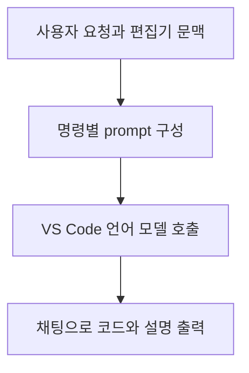

# SHACL Guru 도구 리뷰 — 자연어 작성 지원과 실행 검증의 경계

SHACL을 자연어로 만들고 선택한 코드를 설명받고 예시 데이터를 생성하는 도구는 이미 공개돼 있다. SHACL Guru는 이런 작업을 VS Code 채팅 안에 모은 확장이다. 이 글은 논문 평가가 아니라 2026년 10월 16일 확인한 공식 README와 공개 소스의 검토다. 설치 후 사용성을 측정한 리뷰와는 구분한다.

## 편집기 안의 작성 흐름

공식 README는 자연어에서 shape 생성, 기존 RDF에서 shape 추정, 제약 추가, 설명, 통과·위반 예시 생성을 소개한다. 선택한 코드나 현재 파일을 문맥으로 사용할 수 있다. 사용자가 매번 문서를 복사해 별도 채팅으로 옮기지 않아도 되는 구성이다. [공식 저장소](https://github.com/simonstey/vscode-shacl-guru)

공개 `extension.ts`의 주요 흐름은 문맥을 읽고 prompt를 구성해 모델 응답을 스트리밍하는 방식이다. 확인한 처리 경로에서 생성 RDF를 별도 SHACL 엔진으로 실행하는 단계는 찾지 못했다. 따라서 통과·위반 예시라는 이름을 실행으로 확인된 판정으로 받아들이면 안 된다. [검토한 소스](https://github.com/simonstey/vscode-shacl-guru/blob/main/src/extension.ts)

## 명령과 prompt의 연결

소스에는 확인해 볼 구현 지점도 있다. `generate-conforming`과 `generate-violating`이 같은 분기로 들어가며 생성 종류는 `request.prompt`에 `violate`가 포함됐는지로 정한다. 명령 이름 자체로 종류를 선택하지 않는다. 위반 생성 명령이라도 본문에 해당 문자열이 없으면 코드상 conforming이 선택될 수 있다. 이는 소스에서 읽은 가능성이며 VS Code에서 재현한 결과는 아니다. [해당 구현](https://github.com/simonstey/vscode-shacl-guru/blob/main/src/extension.ts)

작은 도구에서도 자연어 요청, 명령 분기, 모델 출력은 이처럼 서로 다른 검사 대상이다. 정확한 prompt 문장을 만드는 것만으로 인터페이스 전체의 의도를 보장하기는 어렵다.

## 승인 규칙 작성에 사용할 때

다음은 자체 적용 예시다. 사용자가 현재 버전에 대한 승인을 요구하는 shape를 생성한 뒤 이전 버전만 승인된 RDF를 만들어 달라고 요청한다고 하자. 코드와 설명이 그럴듯하더라도 다음 항목은 따로 확인해야 한다.

- 예시가 실제로 이전 버전만 참조하는지
- 해당 작업이 shape의 검사 대상으로 선택되는지
- 실행 결과가 의도한 제약 때문에 실패하는지

우리 연구의 도구는 이 단계들을 실행 결과와 연결해 보여줄 수 있다. 이미 있는 생성·설명 인터페이스 위에 검증된 사례를 붙이는 구성이다. 새 생성 챗봇을 만드는 것보다 경계가 명확하다.

## 기여 범위의 판단

SHACL Guru가 제공하는 작성 지원은 우리 아이디어와 직접 겹친다. ‘자연어 생성과 예시를 제공한다’는 기능만으로 차별성을 주장하기 어렵다. 반면 생성 예시를 실제로 실행하고 두 규칙 사이의 판정 차이와 검사 제외를 구분하는 기능은 추가로 검토할 가치가 있다. 이 기능이 기존 도구 전체에 없는지는 더 넓은 비교가 필요하다.

원문: [README와 라이선스](https://github.com/simonstey/vscode-shacl-guru) · [extension.ts](https://github.com/simonstey/vscode-shacl-guru/blob/main/src/extension.ts)
