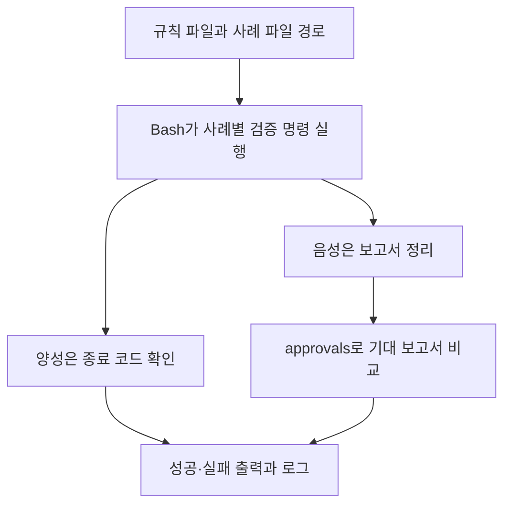

# shacl-test 도구 리뷰 — RDF 사례와 검증 보고서를 반복 검사하는 방법

SHACL 규칙을 수정한 뒤 어제 통과하던 데이터가 오늘도 통과하는지 확인하고 싶다고 하자. 매번 웹 화면에 규칙과 데이터를 붙여넣는 대신 정상 사례와 실패 사례를 파일로 보관하고 한 번에 실행할 수 있다. Zazuko의 shacl-test는 이 작업을 위한 명령행 도구다.

논문에서 실험 성능을 보고한 대상은 아니다. 도구의 목적은 SHACL과 RDF 사례를 테스트로 묶고 바뀐 결과를 검토하게 하는 것이다. 이 글은 공식 README와 고정 커밋의 소스를 바탕으로 설명한다. 실제 프로젝트에 설치해 속도나 호환성을 측정하지는 않았다.

## 검사 규칙과 데이터의 분리

SHACL에서는 검사할 데이터 그래프와 검사 규칙을 담은 shapes graph를 구분한다. Turtle 파일 두 개를 읽더라도 하나는 사람·상품 같은 대상의 기록이고 다른 하나는 그 기록이 갖춰야 할 조건이다. 검증 보고서는 그 실행에서 발견한 위반을 설명하는 또 다른 RDF 결과다. [W3C SHACL](https://www.w3.org/TR/shacl/)

shacl-test의 README는 양성 사례를 통과·실패로 검사하고 음성 사례의 검증 보고서를 기대 결과와 비교한다고 설명한다. 실패를 더 살펴볼 수 있도록 SHACL Playground 링크도 제공한다. [공식 문서](https://github.com/zazuko/shacl-test)

## 도구에 넣을 파일의 예시

다음은 사용 구조를 설명하기 위해 만든 최소 예시다. 이 리뷰에서는 이를 벤치마크 데이터로 실행하지 않았다.

```text
project/
  shapes.ttl
  cases/
    valid/person-with-name.ttl
    invalid/person-without-name.ttl
```

`shapes.ttl`에 Person은 이름을 하나 이상 가져야 한다는 조건을 둔다.

```turtle
@prefix ex: <https://example.org/> .
@prefix sh: <http://www.w3.org/ns/shacl#> .

ex:PersonShape a sh:NodeShape ;
    sh:targetClass ex:Person ;
    sh:property [ sh:path ex:name ; sh:minCount 1 ] .
```

정상 데이터는 `ex:alice a ex:Person ; ex:name "Alice" .`이고 실패시킬 데이터는 `ex:bob a ex:Person .`으로 생각할 수 있다. 각 데이터 파일에는 같은 `ex:` prefix 선언도 넣는다. 이름 없는 Bob이 정말 Person으로 선언돼 있어야 이 target 조건으로 검사된다.

여기서 사례의 정상·실패는 사람이 정한 기대 판정이다. 모든 실제 사람에게 이름이 있는지에 관한 사실 검증과는 다르다.

## 실행 인터페이스

```sh
npx shacl-test   --shapes=shapes.ttl   --valid-cases="cases/valid/*.ttl"   --invalid-cases="cases/invalid/*.ttl"
```

이는 README의 옵션 구조에 맞춘 사용 예시다. `--shapes`는 필수이고 적어도 하나의 사례 패턴을 제공해야 한다. 패턴을 따옴표로 감싸는 방식도 문서가 안내한다. [공식 옵션](https://github.com/zazuko/shacl-test)

## 언어와 라이브러리

| 구성 | 공개 구현 | 역할 |
|---|---|---|
| 진입점 | Bash `run.sh` | 옵션 읽기와 파일별 반복 실행 |
| 보조 처리 | Node.js JavaScript 모듈 | RDF 읽기와 출력 정리 |
| 기본 검증 명령 | `barnard59 shacl validate` | SHACL 검증 실행 |
| RDF 처리 | `barnard59-rdf`, `@zazuko/env-node` | RDF 입출력 환경 |
| 보고서 비교 | `approvals` | 기대 보고서와 새 결과 비교 |
| 그래프 import | `rdf-transform-graph-imports` | 참조된 그래프 처리 |

검토한 package.json은 버전 0.1.1이며 npm 실행 명령을 `run.sh`에 연결한다. Python의 pySHACL을 내부에서 직접 호출하는 구성은 아니다. [package.json](https://github.com/zazuko/shacl-test/blob/f09b688477090ca3cba6a70326797e64d911eb37/package.json) · [실행 스크립트](https://github.com/zazuko/shacl-test/blob/f09b688477090ca3cba6a70326797e64d911eb37/run.sh)

## 입력이 처리되는 과정



`run.sh`는 기본 검증 명령을 구성하고 데이터 파일을 표준입력으로 넘긴다. 양성 경로는 검증 명령의 종료 코드를 확인한다. 음성 경로는 출력 보고서를 정리한 뒤 approvals에 넘긴다. 처리는 외부 명령과 파일을 연결해 진행되며 단일 함수의 boolean 반환만으로 끝나지 않는다. [run.sh](https://github.com/zazuko/shacl-test/blob/f09b688477090ca3cba6a70326797e64d911eb37/run.sh)

이 차이는 실패 원인을 해석할 때 중요하다. 규칙 위반, 실행 명령 오류, 기대 보고서와의 차이를 같은 현상으로 읽지 않아야 한다. 특히 검토한 음성 분기는 별도의 종료 코드 검사보다 보고서 비교를 중심으로 동작한다.

## 저장 위치와 보고서 승인

입력 사례는 로컬 RDF 파일이다. 실행 스크립트는 사례 파일 옆에 `.log`를 쓴다. approvals의 출력 디렉터리도 해당 사례의 디렉터리로 지정한다. `load-graph.js`는 RDF를 스트림으로 읽고 import를 처리해 Turtle로 출력한다. 이 경로에 별도 RDF DB 서버를 설치하거나 적재하는 단계는 없다. [그래프 로더](https://github.com/zazuko/shacl-test/blob/f09b688477090ca3cba6a70326797e64d911eb37/load-graph.js) · [파일 처리](https://github.com/zazuko/shacl-test/blob/f09b688477090ca3cba6a70326797e64d911eb37/run.sh)

`--approve`는 새 검증 보고서를 기대 결과로 받아들이는 기능이다. 테스트 기준을 갱신하는 기능으로, 업무 승인과는 다르다. 예를 들어 Bob의 실패 원인이 이름 누락에서 전혀 다른 제약으로 바뀌었는데도 새 보고서를 그대로 승인하면 테스트는 이후 그 상태를 정상적인 기대값으로 기억할 수 있다. 따라서 보고서가 달라진 이유를 먼저 읽어야 한다. [옵션 설명](https://github.com/zazuko/shacl-test)

## 데이터셋과 평가 결과의 범위

이 도구는 고정된 학습 데이터셋으로 모델을 학습시키지 않는다. 사용할 사례는 프로젝트 담당자가 준비한다. JSON 파일을 테스트 데이터로 요구하는 구조도 아니며 위 예시처럼 RDF 사례와 SHACL 규칙을 검증 명령에 제공한다. RDF 직렬화 지원 범위는 실제 로더와 검증 명령의 설정을 확인해야 한다.

공식 문서에서 대규모 정확도·처리량 실험은 확인되지 않았다. 사례가 모두 성공했다는 결과는 등록한 사례와 기대 보고서가 일치한다는 뜻이다. 보지 못한 데이터에서도 규칙이 옳다는 증명은 아니다.

shacl-test의 쓸모는 한 번 검토한 사례를 다음 수정에서도 반복 확인하는 데 있다. 규칙이 바뀌면 데이터뿐 아니라 검증 보고서도 달라질 수 있다는 점을 테스트 대상으로 삼는다. 적용하려면 어떤 사례를 넣을지, 보고서 변경을 누가 어떤 기준으로 승인할지를 함께 정해야 한다.
