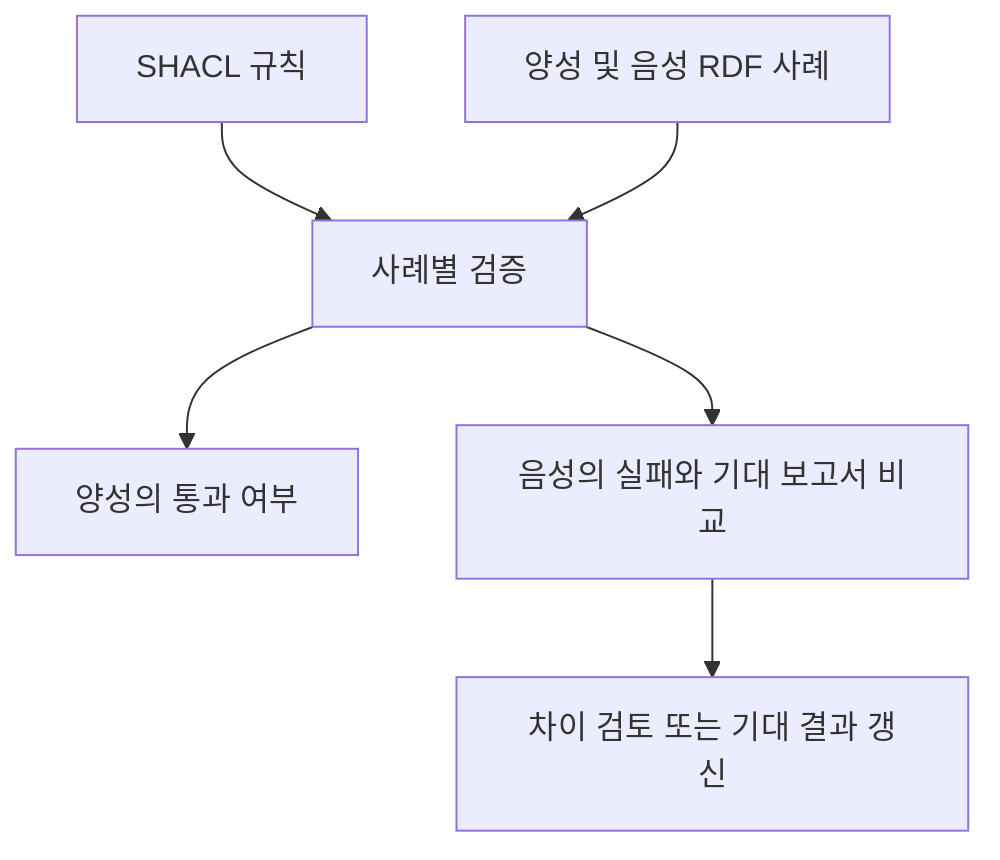

# shacl-test 도구 리뷰 — 검증 사례를 회귀 테스트로 남기는 방법

규칙을 한 번 제대로 작성해도 수정하면서 이전 의도를 잃을 수 있다. 정상 사례가 갑자기 실패하거나 막아야 할 사례가 통과하는 식이다. Zazuko의 shacl-test는 SHACL과 RDF 사례를 테스트로 묶는 공개 도구다. 이 글은 2026년 10월 16일 확인한 공식 문서를 바탕으로 한 도구 리뷰이며 성능 측정이나 설치 후 실행 보고서는 아니다.

## 양성 사례와 음성 사례

공식 README에 따르면 양성 사례는 통과 여부를 확인하고 음성 사례는 실패를 기대하면서 검증 보고서를 저장된 기대 결과와 비교한다. 실패를 조사할 때 SHACL Playground 링크도 제공한다. `--shapes`와 함께 `--valid-cases` 또는 `--invalid-cases` 중 적어도 하나를 지정해야 한다. [공식 사용법](https://github.com/zazuko/shacl-test)

예시 입력과 검증 결과를 남겨 다음 변경에서도 비교한다.

## 검증 보고서의 승인

`--approve`는 음성 사례의 검증 보고서를 승인된 기대 결과로 갱신하는 옵션이다. 여기서 approval은 업무 승인이나 데이터의 진실성 인증을 뜻하지 않는다. 테스트가 비교할 결과를 받아들이는 절차다. [README의 옵션 설명](https://raw.githubusercontent.com/zazuko/shacl-test/master/README.md)

규칙 변경 후 결과가 달라졌다고 매번 기대 결과부터 갱신하면 회귀 테스트가 오류를 놓칠 수 있다. 갱신 전에 그 변화가 요청한 동작인지 검토하는 과정이 필요하다.

## 승인 버전 변경의 테스트 예시

다음은 우리 도구에 적용하기 위해 만든 사례 구성이다.

| 사례 파일의 역할 | 담을 내용 | 기대 결과 |
|---|---|---|
| 현재 승인 | 현재 버전을 승인한 검토 | 통과 |
| 이전 승인 | 이전 버전만 승인한 검토 | 실패 |
| 승인 없음 | 검토 관계 없음 | 실패 |

이 세 사례를 보관하면 규칙 수정 후 이미 합의한 조건을 다시 확인할 수 있다. 다만 검토 관계가 없다는 것을 곧바로 업무상 거부로 처리할지는 별도 정책이다. SHACL 위반을 추가 자료 요청이나 판단 보류로 연결할 수도 있다. 테스트는 그 정책의 선택을 대신하지 않는다.

## 사례를 만드는 단계의 공백

회귀 테스트는 확보한 사례를 반복 확인하는 데 유용하다. 아직 생각하지 못한 사례를 자동으로 다 검토하는 기능과는 다르다. 현재 사례가 모두 통과해도 두 규칙이 모든 데이터에서 동등하다고 결론낼 수 없다.

판정이 달라질 만한 사례를 찾아 담당자에게 보여주고 확인한 사례를 이런 테스트 묶음으로 넘기는 작업이 우리에게 남아 있다. 생성 도구와 테스트 실행기를 별도 구성요소로 두면 기존 저장소에서도 필요한 기능만 채택하기 쉽다.

## 작은 도구의 완성 조건

새 도구의 결과물을 설명 화면에만 남기지 않고 RDF 사례, 규칙 버전, 기대 판정으로 내보낼 수 있어야 한다. 사용자가 확인한 해석을 다음 수정에서도 검사할 수 있기 때문이다. shacl-test의 사례 구조와 연결하는 어댑터는 가능한 구현 방향이다. 실제 호환성과 사용성은 구현 후 확인해야 한다.

원문: [공식 저장소](https://github.com/zazuko/shacl-test) · [사용법 원문](https://raw.githubusercontent.com/zazuko/shacl-test/master/README.md)
