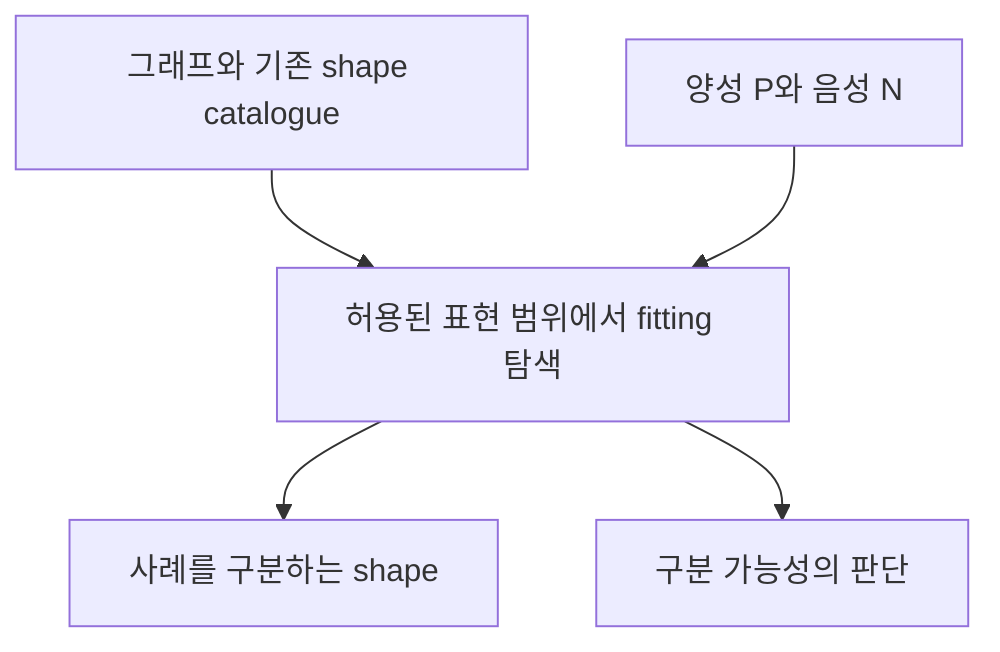

# Shapes from Examples 리뷰 — 사례로 SHACL을 학습하는 조건

온톨로지와 검증 규칙을 사람이 모두 작성해야 한다면 구축 비용은 쉽게 줄어들지 않는다. 정상 사례와 비정상 사례를 알려주고 규칙을 얻을 수 있다면 작업 방식이 달라진다. *Shapes from Examples: Foundations of Shape Learning in Recursive SHACL*은 이 접근이 어떤 조건에서 가능한지를 다룬다. ISWC 2026 채택 논문의 arXiv v2를 기준으로 읽었다.

## 양성과 음성을 구분하는 shape

입력은 그래프, 통과해야 할 노드 집합 P, 실패해야 할 노드 집합 N이다. 목표는 P의 모든 노드에서 만족하고 N의 모든 노드에서는 만족하지 않는 shape 표현 C를 찾는 것이다. 이를 fitting이라고 부른다. 이미 정의된 재귀 shape catalogue도 사용할 수 있다. [논문 §1–3](https://arxiv.org/html/2607.27934v2)

쉽게 말하면 예시를 분리하는 규칙을 찾되 사용할 수 있는 언어와 의미 해석을 먼저 고정하는 문제다.

## 표현 범위를 제한하는 이유

양성 사례의 식별자를 그대로 나열하는 규칙도 사례에만 맞추면 정답처럼 보일 수 있다. 논문은 이런 자명한 해법을 피하려고 ELI*에 대응하는 표현 범위를 택한다. 관계의 역방향과 도달 경로를 표현하면서 fitting 존재 여부와 가장 구체적인 fitting을 분석한다. 재귀 catalogue에는 well-founded, stable, supported semantics를 검토한다. 일반적인 지수시간 경계와 함께, 양성 사례 수가 제한되고 검증이 다항시간인 일부 조건에서는 다항시간 결과를 제시한다. 모든 SHACL에 대한 실용 속도 보장은 아니다. [논문 §3–6](https://arxiv.org/html/2607.27934v2)

## 승인 데이터에 대입한 예시

다음은 논문 방법의 적용을 생각하기 위한 자체 예시다.

| 사례 | 관측된 관계 | 담당자 판정 |
|---|---|---|
| 작업 A | 현재 버전 → 승인 검토 | 통과 |
| 작업 B | 이전 버전 → 승인 검토 | 실패 |
| 작업 C | 현재 버전 → 검토 없음 | 실패 |

이 사례들만 보고 ‘현재 버전에 승인 검토가 있어야 한다’는 후보를 생각할 수 있다. 하지만 A가 우연히 특정 부서의 작업이기도 하다면 부서 조건이 후보에 섞일 수 있다. 사례를 잘 분리하는 규칙이 업무 의도까지 알아낸 것은 아니다.

또한 이전 버전과 현재 버전이 그래프에서 구별되지 않는다면 원하는 규칙을 표현할 정보가 부족하다. 이때 생성 모델을 교체하기 전에 데이터에 어떤 구분이 있는지부터 확인해야 한다.

## 구축 도구로 이어지는 과제

이 논문의 주된 기여는 학습 문제의 형식화와 계산적 성질이다. 비전문가가 적은 시간에 올바른 규칙을 작성한다는 사용자 실험으로 읽으면 범위를 벗어난다.

우리에게는 ‘사례에서 규칙을 얻는다’는 목표를 더 세분화해 준다. 허용할 관계와 연산, 사례의 판정 근거, 구분할 수 없는 사례의 처리 방식을 먼저 정해야 한다. 도구가 후보를 만들지 못했을 때도 표현 범위가 좁은지 사례가 충돌하는지 추가 정보가 필요한지 알려준다면 쓸모가 있다. 이 설명 기능의 효용은 별도 평가가 필요하다.

원문: [arXiv v2와 출판 상태](https://arxiv.org/abs/2607.27934v2) · [본문](https://arxiv.org/html/2607.27934v2)
