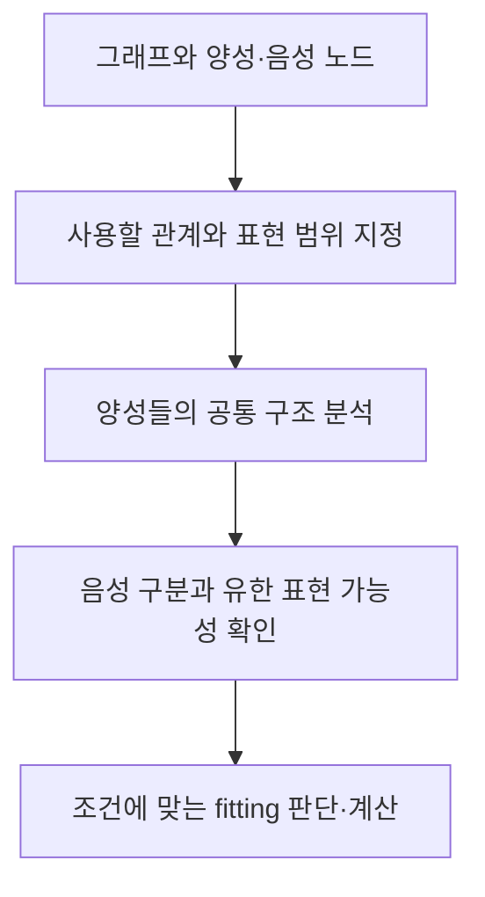

# Shapes from Examples 리뷰 — 그래프 사례에서 검증 규칙을 학습하는 이론

데이터에 맞는 규칙을 사람이 처음부터 작성하는 대신, 통과해야 하는 사례와 실패해야 하는 사례를 알려주면 규칙을 찾을 수 있을까. *Shapes from Examples: Foundations of Shape Learning in Recursive SHACL*은 이 질문을 수학적으로 다룬다. ISWC 2026 채택 논문의 arXiv v2를 기준으로 읽었다.

이 연구는 어떤 표현 범위에서 규칙을 찾을 수 있는지, 찾는 절차가 얼마나 어려운지를 정리와 알고리즘으로 제시한다. 서비스 화면이나 정확도 순위를 제시하는 연구와는 다르다. 이를 이해하려면 SHACL, 사례 학습, 그래프의 경로를 먼저 구분해야 한다.

## SHACL과 사례의 역할

RDF는 대상을 노드로, 관계를 연결로 표현하는 데이터 모델이다. SHACL의 shape는 그 그래프에서 특정 노드가 만족해야 할 조건을 표현한다. 예를 들어 도서에 제목이 적어도 하나 있어야 한다는 조건을 검사할 수 있다. 실제 데이터 그래프와 검사 규칙을 담은 shapes graph는 역할이 다르다. [W3C SHACL 개요](https://www.w3.org/TR/shacl/)

이 논문에서는 그래프 G와 양성 노드 집합 P, 음성 노드 집합 N을 입력으로 준다. P의 모든 노드는 만족하고 N의 모든 노드는 만족하지 않는 shape C를 찾는 문제가 fitting이다. 기존에 정의된 shape catalogue를 이용할 수 있고 그 안의 shape가 서로를 참조하는 재귀도 다룬다. [논문 §1–3](https://arxiv.org/html/2607.27934v2)

양성은 좋은 사람이나 참인 사실이라는 뜻이 아니다. 찾으려는 규칙을 만족해야 한다고 지정한 학습 예시다. 음성은 그 규칙의 만족 대상에서 제외하려는 예시다. 데이터 자체가 현실에서 거짓인지는 이 표시로 판단하지 않는다.

## 연구 질문

논문이 다루는 질문을 풀어쓰면 다음과 같다.

- 정해진 표현 언어 안에서 양성과 음성을 구분하는 shape가 존재하는가.
- 가능하다면 사례의 공통 조건을 가장 구체적으로 담는 fitting을 계산할 수 있는가.
- 경로와 재귀를 허용했을 때 계산 복잡도는 어떻게 달라지는가.

무제한으로 표현을 허용하면 양성 노드의 식별자를 그대로 나열하는 자명한 답도 가능하다. 논문은 의미 있는 구조를 학습하도록 ELI*에 대응하는 범위를 택한다. 관계의 역방향과 반복 경로를 표현할 수 있지만 전체 SHACL을 자유롭게 사용하는 문제와는 구별된다. [논문 §3–5](https://arxiv.org/html/2607.27934v2)

## 경로를 이용한 작은 예시

다음은 fitting을 설명하려고 만든 예시이며 논문의 데이터셋은 아니다. `r`은 처리 단계의 이동이고 `중단`은 어떤 상태에 붙은 표식이라고 하자.

```text
양성 A: 접수 A ─r→ 검토 A ─r→ 중단
양성 B: 접수 B ─r→ 중단
음성 C: 접수 C ─r→ 검토 C ─r→ 완료
```

찾을 만한 조건은 ‘r을 따라가면 중단 상태에 도달한다’이다. A와 B의 이동 횟수는 다르지만 공통적인 도달 관계가 있다. 단순히 ‘다음 노드가 중단이다’라고 하면 A를 놓친다. 경로의 반복을 표현할 수 있으면 여러 길이를 함께 다룰 수 있다.

여기서 예시의 ID만 외워 A 또는 B라고 답하는 규칙과, 중단으로 이어지는 관계를 찾는 규칙은 학습 결과의 성격이 다르다. 논문이 표현 언어를 제한하는 이유를 이 차이로 이해할 수 있다.

## 알고리즘의 직관

논문은 양성 예시들의 공통 구조를 그래프의 곱으로 표현하고 도달 관계를 반영한 star product를 구성한다. 이어 음성과 구분되는지, 그 구조를 유한한 shape로 표현할 수 있는지를 분석한다. fitting 존재 판단에는 오토마타를 이용한 방법도 제시한다. [논문 §4–5](https://arxiv.org/html/2607.27934v2)



이 그림은 접근을 이해하기 위한 요약이다. 증명의 세부 알고리즘을 그대로 구현한 의사코드와는 구별된다. 특히 사례를 구분하는 규칙이 존재하는 문제와, 그중 가장 구체적인 규칙을 얻는 문제를 섞어서는 안 된다.

## 데이터 형식과 구현 정보

| 항목 | 논문에서 다루는 내용 |
|---|---|
| 입력 그래프 | 노드·관계·라벨로 정의한 유한 그래프 |
| 학습 표시 | 양성 및 음성 노드 집합 |
| 기존 지식 | 참조 가능한 shape catalogue |
| 출력 | 허용된 논리 언어의 shape 또는 존재 여부 판단 |
| JSON·Turtle 파일 | 특정 직렬화 형식을 사용하는 실험 파이프라인은 제시되지 않음 |
| DB와 프로그래밍 언어 | 본문의 결과를 뒷받침하는 배포 구현·DB 성능 실험은 제시되지 않음 |

그래프를 다룬다는 사실만으로 Neo4j나 GraphDB를 썼다고 추정할 수 없다. 이 글에서 검토한 본문은 추상 그래프와 논리식을 정의하고 성질을 증명한다. 특정 라이브러리로 실행한 벤치마크의 정확도·처리시간을 보고한 연구로 읽으면 안 된다. [논문 본문](https://arxiv.org/html/2607.27934v2)

## 증명된 결과와 남는 한계

논문은 일반적인 경우의 지수시간 복잡도 결과를 제시한다. 양성 사례 수가 제한되며 검증을 다항시간에 할 수 있는 일부 설정도 다룬다. 이 설정에서는 존재 판단과 가장 구체적인 fitting의 표현 계산이 다항시간에 가능함을 보인다. 재귀 catalogue의 의미론도 결과의 조건에 포함된다. [논문 §5–6](https://arxiv.org/html/2607.27934v2)

이 결과는 모든 데이터에서 사람이 원하는 규칙을 자동으로 발견한다는 보장이 아니다. 예시의 판정이 부정확하거나 필요한 관계가 그래프에 없으면, 올바른 알고리즘도 사용자의 의도를 복원할 수 없다. 앞의 예시에서 중단 표식이 누락되면 도달 조건을 학습할 근거도 바뀐다.

이 논문은 사례 기반 SHACL 학습을 막연한 자동화 목표로 두지 않고 입력·표현 언어·의미론·계산 조건으로 나누어 분석했다. 구현을 시도하는 독자에게는 어느 범위의 규칙을 지원할지부터 결정해야 한다는 기준을 제공한다.
