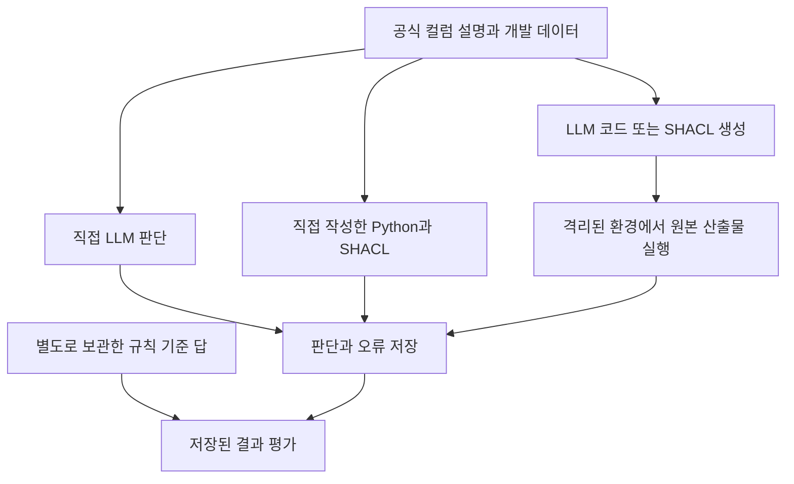

# 소매 데이터 검토 비교: 실행 결과와 연구의 한계

이번 비교에서는 LLM이 데이터를 직접 판단하는 방식과 코드를 만들어 실행하는 방식, Python·SHACL로 명시한 규칙을 적용하는 방식을 실제로 실행했다. 작은 실제 데이터 표본에서는 대부분 같은 답을 냈다. SHACL의 정확도 우위나 사람의 검토 시간 절감은 입증하지 못했다.

## 데이터와 판정 기준

UCI Online Retail의 기존 개발 데이터에서 24행을 골랐고 별도로 실제 사례 2행과 직접 만든 경계 사례 12행을 사용했다. 각 행에 고객 ID 존재 여부, 취소 송장과 수량 부호의 일치, 음수가 아닌 가격이라는 세 가지 연구용 규칙을 적용했다. 판정 수는 각각 72건, 6건, 36건이다. 실제 표본과 합성 사례를 합쳐 대표 정확도로 제시하지 않았다.

정답은 이 규칙에 따른 기준 답이다. 실제 소매업체가 해당 거래를 정상으로 인정하는지까지 확인한 것은 아니다. 별도로 보관한 610행은 이번 평가에 사용하지 않았다.

## 실행 경로

LLM에는 기준 답을 주지 않았다. 생성한 코드와 규칙은 수정하지 않고 실행했으며 실행 실패와 판단 오류도 보존했다. 도식의 기준 답은 결과를 평가할 때만 사용한다.

## 처음 실행한 일곱 조건

| 방식 | 실제 개발 표본 | 별도 선정 실제 사례 | 만든 경계 사례 |
|---|---:|---:|---:|
| 직접 작성 Python | 72/72 | 6/6 | 36/36 |
| 직접 작성 SHACL | 72/72 | 6/6 | 36/36 |
| 직접 LLM: 원본 입력 | 72/72 | 6/6 | 36/36 |
| 직접 LLM: 파싱 정보 추가 | 72/72 | 6/6 | 36/36 |
| LLM이 만든 배치 전용 Python | 72/72 | 6/6 | 36/36 |
| LLM이 만든 재사용 Python | 4/72 | 2/6 | 4/36 |
| LLM이 만든 SHACL | 72/72 | 6/6 | 36/36 |

숫자는 규칙 기준 답과 일치한 판정 수다. 모든 조건에 명시적인 규칙을 제공했다. 배치 전용 코드는 ‘규칙이 불명확한 LLM+코드’ 조건이 아니다.

재사용 Python은 값이 `row["data"]["Quantity"]`에 있는데 `row["Quantity"]`로 읽으려 했다. 프로그램은 실행됐지만 값을 누락으로 판단했다. 배치 전용 코드에는 실제 행을 보여 줬고 재사용 코드 생성 시에는 행 예시와 명확한 입력 구조 설명이 부족했다. 이후 SHACL에는 더 명확한 인터페이스와 지원 구문을 제공했다. 따라서 이 차이를 Python과 SHACL의 우열로 해석할 수 없다. SHACL의 판단 불가 3건도 생성 규칙 자체가 아니라 공통 사전 처리의 결과다.

## 규칙 설명의 구체성을 맞춘 후속 비교

이후에는 두 조건 모두에 같은 입력 구조와 공식 컬럼 설명을 제공했다. 한쪽에는 업무 목적만, 다른 쪽에는 명확한 운영 규칙까지 줬다. 각각 새 Python 코드 하나를 생성했고 기존 실패 코드를 고치거나 다시 실행하지 않았다.

| 입력 조건 | 실제 개발 표본 | 별도 선정 실제 사례 | 만든 경계 사례 |
|---|---:|---:|---:|
| 업무 목적과 공식 컬럼 설명 | 72/72 | 6/6 | 15/36 |
| 위 정보와 명확한 운영 규칙 | 72/72 | 6/6 | 36/36 |

차이는 만든 경계 사례에 집중됐다. 예를 들어 공식 설명은 고객 ID를 숫자 5자리로 설명하지만 연구 규칙은 비어 있지 않으면 통과하도록 정했다. 합성 사례의 `SYN-CUSTOMER`는 후자는 만족하지만 전자는 만족하지 않는다. 업무 목적만 받은 모델은 ID 형식까지 검사했다.

저장된 불일치 21건에는 고객 ID 형식 관련 11건과 송장 ID 형식 관련 10건이 있었다. 소수 수량 사례도 송장 형식 조건을 함께 어겼으므로 소수 허용 규칙의 효과를 따로 측정한 것은 아니다. 이 분류는 결과를 본 뒤 붙인 설명이며 독립적인 원인 실험은 아니다. 사례를 제외하거나 기존 점수를 다시 계산하지 않았다.

## 현재 주장할 수 있는 범위

이번 실험은 규칙을 어디까지 적용할지와 입력 구조를 어떻게 전달할지가 결과에 영향을 줄 수 있음을 보여 주는 개발 사례다. 규칙이 불명확할 때 모델이 다른 해석을 했다고 해서 업무적으로 틀렸다고 단정할 수는 없다. 조건별 생성은 한 번이므로 설명의 효과와 생성 편차도 분리하지 못했다.

규칙 구현 언어의 우위, 일반적인 데이터 오류 탐지 성능, 사람의 검토 시간 절감, 유지보수 비용은 아직 측정하지 않았다. 다음 평가에서는 실제 업무 규칙과 컬럼 정의가 함께 있는 자료를 고정하고 규칙 밖의 형식 조건이 섞이지 않는 사례를 별도로 설계해야 한다. 사람이 검토한 시간과 자동화 후 다시 확인한 시간을 실제로 기록해야 시간 절감도 계산할 수 있다. 이는 다음 연구 제안이며 완료된 실험이 아니다.

## 비용과 결과 기록

실험 모델은 OpenRouter의 `openai/gpt-6-luna`이며 reasoning 설정은 `medium`이었다. 이번 캠페인 누적 호출은 82회, API가 보고한 비용은 $0.026434950이다. 실패에 대비해 차감한 보수적 예약액은 $0.22332864이며 실제 청구액과 다르다. Codex 작업, 사람의 노동과 인프라 비용을 합산한 총비용은 아니다.

- [일곱 조건 통합 결과](../experiments/records/20261020-retail-round-summary.json)
- [규칙 구체성 후속 비교](../experiments/records/20261020-retail-policy-specificity.json)
- [사례별 형식 조건 분석](../experiments/records/20261020-retail-specificity-annotations.json)

<!-- HUMANIZE-SUMMARY -->
<!--
장르: report. 강도: light, 보수적 윤문.
적용 규칙: C-11. 연결어미 직후 쉼표 7곳을 제거했다.
사실·주장·수치·고유명사·제목·링크·기술 용어·서법·격식체를 보존했다.
자체검증: 내용 보존, 장르, register, 잔존 핵심 패턴, 인공 표현 주입 여부를 점검했다. 변경률 확정은 오케스트레이터의 별도 검증 대상으로 남겼다.
자가검증 미통과 항목: 0건.
-->
