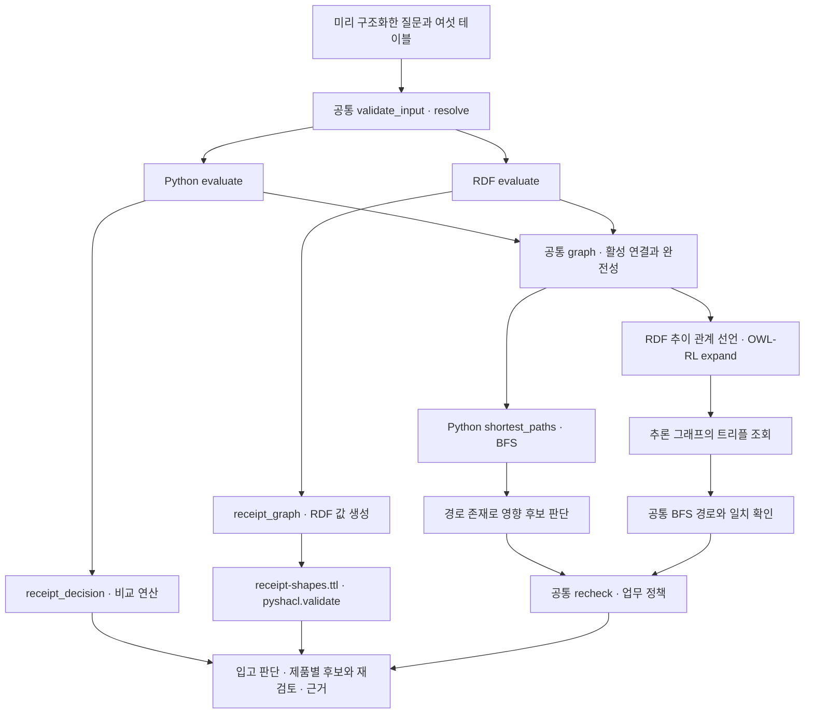

# 같은 업무 질문의 Python·RDF·OWL·SHACL 실행 구조

이 문서는 입고 인수와 인증 만료 영향 분석의 실제 코드를 따라간다. 같은 질문에 답하면서 무엇을 함수로 작성했고 무엇을 선언했으며 어떤 라이브러리가 실행하는지 비교한다. 실험 결과는 [구현 비교 보고서](2026-10-21-industrial-question-comparison.md)에 있다. 여기서는 기존 코드를 설명하며 새 실험이나 성능 측정을 수행하지 않았다.

현재 두 구현은 모두 Python 프로그램이다. 코드 비교군은 조건 비교와 그래프 탐색을 직접 작성했다. 표준 기반 비교군은 RDFLib로 그래프를 만들고 `owlrl`과 `pyshacl`을 호출한다. 입력 해석과 최종 업무 판단 중 일부는 같은 Python 함수를 쓴다. 따라서 아래 그림에서 공통 부분과 교체된 부분을 함께 읽어야 한다.

## 질문과 입력

첫 질문은 “이 입고를 입고 당시 인수할 수 있었는가?”이고 두 번째는 “이 부품의 인증이 만료된 현재 어떤 제품을 재검토해야 하는가?”다. 프로그램은 자연어를 해석하지 않는다. 실행 입력의 `question`에 입고 식별자, 대상 부품·개정, 인증 식별자, 판단일을 미리 넣는다.

기본 3단계 사례를 설명용 별칭으로 쓰면 다음과 같다. 별칭은 저장된 식별자를 바꾸지 않는다. 연구자가 작성한 사례이며 실제 기업 거래 기록은 아니다.

| 입력 | 설명용 값 |
|---|---|
| 입고·발주 | 입고 수량 5, 발주 잔량 10, 단위 `Nos` |
| 검사 | 해당 입고를 참조하고 상태는 `Accepted` |
| 인증 | 상태 `Active`, 유효기간 `2026-01-01 ≤ 날짜 < 2026-10-01` |
| 두 판단일 | 입고일 `2026-09-15`, 현재 판단일 `2026-10-21` |
| 구성품 관계 | 부품 → 중간 A → 중간 B → 제품 X |
| 제품 X | 인증과 시설 범위가 같고 현재 인증 요구가 있음 |

품목·개정·시설이 일치하는 이 사례에서 두 구현의 업무 답은 같다. 과거 입고는 `accept`, 제품 X는 영향 후보 `yes`이면서 재검토 `required`다. 입고 당시의 유효성과 현재의 만료를 서로 다른 날짜로 판단한다. 진단 정보는 다르다. 표준 기반 구현에는 SHACL 보고서와 트리플 수 등이 추가된다.

## 전체 호출 구조



텍스트로 읽으면 입고 판단은 Python 비교 연산과 SHACL 검증으로 갈라진다. 영향 후보 판단은 Python 탐색과 OWL-RL 추론으로 갈라진다. 입력 검사, 참조 연결, 연결 제외 기준, 근거 경로와 최종 재검토 정책은 공통 코드다. 두 갈래는 각각 실행되며 하나의 실행에서 두 비교군을 합쳐 답을 만드는 구조는 아니다.

실행기는 `scripts/run_industrial_questions.py`이고 각 비교군의 진입점은 `evaluate(packet)`이다. 실행 결과를 먼저 저장하고 `scripts/score_industrial_questions.py`가 별도 기대 결과와 비교한다. 실행 함수는 채점 자료를 읽지 않는다.

## 입고 인수의 조건 표현

### 공통 참조 연결

입고가 가리키는 발주·검사·인증 기록부터 찾는다. `scripts/industrial_question_python.py`의 실제 함수다.

```python
def resolve(rows, key):
    matches = [r for r in rows if text(key) and r.get('id') == key]
    return ('missing', None) if not matches else (('ambiguous', None) if len(matches) > 1 else ('resolved', matches[0]))
```

일치 기록이 없으면 `missing`, 여러 개면 `ambiguous`, 하나면 `resolved`다. 두 구현 모두 세 참조가 모두 해결된 뒤 입고 내용 조건을 평가한다. 해결되지 않으면 입고는 `unknown`이며 SHACL도 실행하지 않는다. 이 연결 작업은 OWL이나 SHACL 대신 공통 Python 코드가 맡는다.

### Python 비교 연산

`receipt_decision()`은 품목·개정·시설, 입고 참조, 수량, 검사 상태, 인증 상태, 날짜 조건을 목록에 담는다. 아래는 실제 함수의 일부다. 생략된 참조·범위 검사까지 포함한 전체 함수는 원본 파일에 있다.

```python
checks.append({'Accepted': True, 'Rejected': False}.get(str(inspection.get('status'))))
checks.append({'Active': True, 'Inactive': False}.get(str(cert.get('status'))))
span, received = interval(cert), day(receipt.get('received_at'))
checks.append(None if not span or not received else span[0] <= received < span[1])
return aggregate(checks)
```

수량은 같은 함수에서 `0 < q <= remaining`으로 비교한다. 숫자는 표준 라이브러리 `decimal.Decimal`, 날짜는 `datetime.date`로 해석한다. 알 수 없는 상태나 해석 불가능한 날짜는 `None`으로 남긴다. 집계 함수도 직접 작성했다.

```python
def aggregate(checks):
    return 'violation' if False in checks else ('unknown' if None in checks else 'accept')
```

어느 조건이든 명확한 위반이 있으면 `violation`, 위반은 없지만 알 수 없는 조건이 있으면 `unknown`, 모두 참이면 `accept`다. 현재 Python 출력에는 SHACL과 같은 개별 위반 보고서를 만드는 기능이 없다. 업무 답이 같다는 것과 진단 기능이 같다는 것은 구분해야 한다.

### RDF 값과 SHACL 선언

표준 기반 구현의 `receipt_graph()`는 비교할 값을 RDF로 바꾼다. 합격 여부를 먼저 계산해 SHACL에 넘기지 않는다. 아래 Turtle은 실제 변환 구조를 읽기 쉽게 표현한 예시이며 실행 파일의 원문 출력은 아니다.

```turtle
@prefix ex: <urn:industrial:> .
@prefix xsd: <http://www.w3.org/2001/XMLSchema#> .

<urn:industrial:check:quantity> a ex:QuantityCheck ;
    ex:quantity "5"^^xsd:decimal ;
    ex:remaining "10"^^xsd:decimal .
```

이 값에 적용할 조건은 `research/industrial-questions/receipt-shapes.ttl`에 있다. 다음은 실제 선언이다.

```turtle
ex:QuantityShape a sh:NodeShape ; sh:targetClass ex:QuantityCheck ;
  sh:property [ sh:path ex:quantity ; sh:minCount 1 ; sh:maxCount 1 ;
    sh:datatype xsd:decimal ; sh:minExclusive 0 ; sh:lessThanOrEquals ex:remaining ] .
```

`sh:targetClass`는 검사할 노드를 지정하고 `sh:path`는 수량 값을 고른다. 그 값이 하나의 decimal이고 0보다 크며 잔량 이하여야 한다는 조건이다. Python의 수량 비교를 SHACL 어휘로 표현한 부분이다.

| 정책 | Python 표현 | 이 구현의 SHACL 표현 |
|---|---|---|
| 품목·개정·시설 등 두 값의 일치 | `equality(a, b)` | `sh:equals ex:right` |
| 양수이며 발주 잔량 이내 | `0 < q <= remaining` | `sh:minExclusive`, `sh:lessThanOrEquals` |
| 검사 합격 | 상태를 `True`/`False`/`None`으로 변환 | `sh:hasValue "Accepted"` |
| 인증 활성 | 상태를 `True`/`False`/`None`으로 변환 | `sh:hasValue "Active"` |
| 시작일 포함·만료일 제외 | `span[0] <= received < span[1]` | 일수 정수에 `sh:lessThanOrEquals`, `sh:lessThan` |

이 표에는 공통 전처리가 전제돼 있다. 날짜 파싱, 유효한 기간인지 확인, 단위 `Nos` 확인, 알 수 없는 값의 분리는 Python 코드가 담당한다. 값이 없으면 해당 검사 노드를 만들지 않고 `unknown_checks`에 기록한다. 따라서 SHACL의 `sh:minCount`만으로는 원본의 모든 누락을 검출하지 못한다.

`scripts/industrial_question_rdf.py`의 `receipt_decision()`은 다음 호출로 선언을 실행한다.

```python
data, unknown = receipt_graph(receipt, order, inspection, cert)
shapes = Graph().parse(SHAPES, format='turtle')
conforms, report, _ = validate(data, shacl_graph=shapes, inference='none', advanced=False)
```

여기서 `Graph`는 RDFLib, `validate`는 pySHACL 함수다. RDF 그래프를 만드는 코드와 조건을 선언한 Turtle 파일이 분리돼 있다. 검증 후 업무 답으로 바꾸는 부분은 다시 Python이다.

```python
decision = 'violation' if not conforms else ('unknown' if unknown else 'accept')
```

SHACL이 통과해도 전처리에서 알 수 없다고 남긴 조건이 있으면 입고를 허용하지 않는다. 반환된 보고서에서는 `sh:focusNode`를 모아 위반한 검사 노드 식별자를 기록한다. 검증 자체의 실패는 업무 위반과 구분해 실행 오류로 남긴다.

## 인증 만료의 영향 경로

### Python의 직접 작성한 탐색

공통 `graph()`는 활성 연결을 `부품·개정 → 상위 품목·개정`의 인접 목록으로 만든다. 중복 식별자나 잘못된 연결은 제외하고 완전성 표시도 낮춘다. Python 비교군은 이 인접 목록을 다음 함수에 넘긴다.

```python
def shortest_paths(adjacency, target):
    paths, queue = {target: []}, deque([target])
    while queue:
        node = queue.popleft()
        for occurrence, other in adjacency.get(node, []):
            if other not in paths:
                paths[other] = paths[node] + [occurrence]
                queue.append(other)
    paths.pop(target, None)  # positive non-reflexive closure, including cycles
    return paths
```

표준 라이브러리 `collections.deque`를 사용한 너비 우선 탐색이다. 부품에서 A, B, 제품 X를 차례로 발견하면서 연결 기록의 식별자를 경로에 붙인다. 이미 방문한 노드는 다시 넣지 않으며 대상 자신은 결과에서 제외한다. 깊이가 늘어나도 질문마다 함수를 새로 작성하지 않는다. 같은 탐색 함수를 재사용한다.

### OWL 선언과 추론기 호출

표준 기반 비교군도 같은 `graph()`의 인접 목록을 받는다. 이어서 RDF 관계를 넣고 그 관계가 추이적이라고 선언한다. 다음은 실제 코드다.

```python
rdf = Graph()
rdf.add((EX.reaches, RDF.type, OWL.TransitiveProperty))
for a, edges in adjacency.items():
    for _, b in edges:
        rdf.add((entity(a), EX.reaches, entity(b)))
asserted_count = len(rdf)
DeductiveClosure(OWLRL_Semantics).expand(rdf)
```

`entity()`는 품목·개정의 조합을 IRI로 인코딩한다. `DeductiveClosure`와 `OWLRL_Semantics`는 `owlrl` 라이브러리에서 가져온다. 선언과 입력을 설명용 Turtle로 풀면 다음과 같다.

```turtle
@prefix ex: <urn:industrial:> .
@prefix owl: <http://www.w3.org/2002/07/owl#> .

ex:reaches a owl:TransitiveProperty .
ex:part ex:reaches ex:A .
ex:A ex:reaches ex:B .
ex:B ex:reaches ex:productX .
```

추론기는 연결을 결합해 `ex:part ex:reaches ex:productX`를 도출한다. 실제 구현의 IRI에는 개정도 들어가며 위 별칭은 설명에만 쓴다. 현재 실험은 이 추이 관계를 사용한다. 서브클래스 분류나 OWL 전체 기능을 구현했다고 볼 수는 없다.

### 결과 조회와 근거 경로

현재 코드는 SPARQL 문자열을 실행하지 않는다. 추론 후 RDFLib 그래프에 해당 트리플이 있는지 검사한다.

```python
member = key != target and (entity(target), EX.reaches, entity(key)) in rdf
witness = paths.get(key, [])
if member != bool(witness):
    raise RuntimeError('OWL membership / path witness disagreement')
candidate = 'yes' if member else ('no' if complete else 'unknown')
```

`paths`는 공통 Python `shortest_paths()`로 따로 계산한다. OWL 추론은 도달 여부를 맡고 Python은 사용한 연결 기록의 경로를 제공한다. 결과가 다르면 오류를 내며 경로를 근거로 OWL 결과를 고치지 않는다. 이 구현에서는 OWL 사용만으로 업무용 근거 경로까지 자동 제공되지 않는다.

관계가 없을 때 `no`로 답하는 것도 OWL이 도출한 부정이 아니다. 제공된 연결 자료가 완전하다는 공통 표시가 있을 때 응용 코드가 `no`를 선택하고 그렇지 않으면 `unknown`을 선택한다.

## 최종 재검토 정책의 공통 함수

영향 후보라고 모두 재검토가 필요한 것은 아니다. 현재 인증 요구, 부품·개정·시설 범위, 인증 기간과 상태를 확인한다. 양쪽 모두 `scripts/industrial_question_python.py`의 `recheck()`를 호출한다. 다음은 그 함수에서 기간·상태를 처리하는 실제 부분이다.

```python
span, now = interval(cert), day(question.get('as_of'))
status = cert.get('status')
if not span or not now or status not in ('Active', 'Inactive'):
    return 'unknown'
if now >= span[1]:
    return 'required'
return 'not_required' if span[0] <= now < span[1] and status == 'Active' else 'unknown'
```

이 코드 앞에서 후보 여부, 인증 기록 존재, 인증 요구와 범위 일치를 먼저 처리한다. 위 부분만 독립적으로 적용하는 정책은 아니다. 제품 X는 앞의 조건을 충족하고 현재 날짜가 만료일 이후이므로 `required`를 반환한다.

| 단계 | 코드 기반 구현 | 표준 기반 구현 |
|---|---|---|
| 질문 연결 | `evaluate → validate_input → resolve` | 같은 공통 함수 |
| 과거 입고 | `receipt_decision → aggregate` | `receipt_graph → Graph.parse → validate → 업무 답 집계` |
| 영향 후보 | `graph → shortest_paths → 경로 존재 확인` | `graph → RDF 변환 → TransitiveProperty → expand → 트리플 포함 확인` |
| 근거 경로 | 탐색 중 기록 | 같은 Python 탐색 후 OWL 결과와 대조 |
| 현재 재검토 | `recheck` | 같은 `recheck` |

즉, 현재 비교에서 교체한 부분은 입고 조건의 실행과 영향 후보의 도달 여부 계산이다. 표준 기반 비교군의 최종 재검토 정책까지 선언 언어로 옮겨 비교한 결과는 아직 없다.

## 변경 요청별 수정 위치

이 표는 현재 코드를 읽어 확인한 수정 위치다. 변경 작업의 시간이나 오류율을 측정한 결과는 아니다. 다음 기술 선택 실험에서는 이 수정 위치를 출발점으로 삼아 같은 변경 요청을 양쪽에 적용한다.

| 변경 요청 | 코드 기반에서 볼 곳 | 표준 기반에서 볼 곳 |
|---|---|---|
| 입고일이 만료일과 같아도 허용 | `receipt_decision`의 날짜 비교 | `DateShape`의 `sh:lessThan` 조건 |
| 수량 제약 변경 | `receipt_decision`의 수량 비교 | `QuantityShape` |
| 새 검사 상태 도입 | 상태 해석과 판단 분기 | Python의 허용 상태 처리와 SHACL 상태 조건 모두 |
| BOM에 기간별 활성 조건 추가 | 공통 `graph`와 입력 계약 | 같은 공통 `graph`와 입력 계약 |
| 재검토 면제 조건 추가 | 공통 `recheck` | 같은 공통 `recheck` |
| 개별 위반 사유 제공 | 결과 구조와 조건별 진단 구현 | SHACL 보고서를 업무 용어로 연결하는 코드 |

입고 날짜 정책을 바꿀 때에도 현재 인증 판단까지 자동으로 바뀌는 것은 아니다. 과거 입고와 현재 재검토는 별도 정책이므로 변경 요청이 어느 날짜 판단에 적용되는지 먼저 정해야 한다. 두 방식 모두 정책 문서, 기대 결과와 회귀 검사를 함께 관리해야 한다.

## 기술 선택 비교의 다음 측정

이번 설명을 바탕으로 두 업무 질문을 유지하고 다음 비교를 설계한다. 아래 항목은 계획이며 새로 측정한 결과가 아니다. “몇 홉부터 어떤 방식이 유리한가”는 분기 수·자료 크기·갱신·반복 조회 조건과 함께 답한다.

| 비교 축 | 동일하게 맞출 요구 | 얻을 선택 정보 |
|---|---|---|
| 실행 비용 | 같은 업무 답과 근거 수준 | 적재·준비·질의·갱신 시간과 최대 메모리의 교차 구간 |
| 구현 구성 | 입력 해석·질의·판단·설명·오류 처리 | 직접 작성한 부분과 라이브러리에 맡긴 부분 |
| 정책 변경 | 같은 변경 요청과 기존 기능 보존 | 수정 범위, 첫 제출 오류, 회귀 오류, 작업 시간 |
| 공통 정책 사용 | 여러 업무가 같은 정책을 사용 | 수정 전파 범위와 업무 사이 불일치 |

현재 `validate_input()`에는 사례당 입고 1건·제품 4개·기록 수 상한이 있다. 이 구현을 그대로 대규모 자료에 넣어 성능을 재면 범위 검사에서 실패한다. 규모 비교는 별도 입력 계약과 사전 검토를 거쳐야 한다. 현재 표준 기반 구현은 호출마다 shape를 읽고 그래프를 새로 만든다. 반복 서비스 비교에서는 재사용·캐시·갱신 방식을 양쪽에 명시하고 요청별 비용과 초기 준비 비용을 나누어 기록한다.

단순 조회의 선택 지침에는 SQL 비교군도 설계에 포함한다. 공통 규칙 설정을 읽는 Python 구현도 고려해 코드에 조건을 반복해서 적은 방식만 비교하지 않는다. 사람의 유지보수 작업을 측정할 때에는 경험·작업 순서·허용 도구를 기록하며 에이전트 작업 시간을 사람의 작업 시간으로 대체하지 않는다. 실험 범위에서 한 방식이 계속 유리하면 그 결과를 그대로 보고한다.

완료 산출물은 이 문서와 같은 질문별 구현 설명, 조건별 비용 표, 관찰된 선택 경계다. 새 도메인이나 범용 라이브러리 개발을 계속 추가하는 대신 이 세 산출물로 기술 선택에 답하는 것을 목표로 한다.

## 원본 위치

| 파일 | 읽을 함수·선언 |
|---|---|
| `scripts/industrial_question_python.py` | `resolve`, `receipt_decision`, `aggregate`, `graph`, `shortest_paths`, `recheck`, `evaluate` |
| `scripts/industrial_question_rdf.py` | `entity`, `receipt_graph`, `receipt_decision`, `evaluate` |
| `research/industrial-questions/receipt-shapes.ttl` | `EqualityShape`, `QuantityShape`, `InspectionShape`, `CertificateShape`, `DateShape` |
| `scripts/run_industrial_questions.py` | 실행·원본 출력·오류 보존 |
| `scripts/score_industrial_questions.py` | 실행 이후 별도 채점 |

코드 블록은 실제 발췌와 설명용 Turtle을 구분했다. 생략한 함수 전체와 실패·판단 불가 사례는 원본 코드 및 [기존 실행 기록](../experiments/records/20261021-industrial-question-execution.json)을 함께 확인한다.
