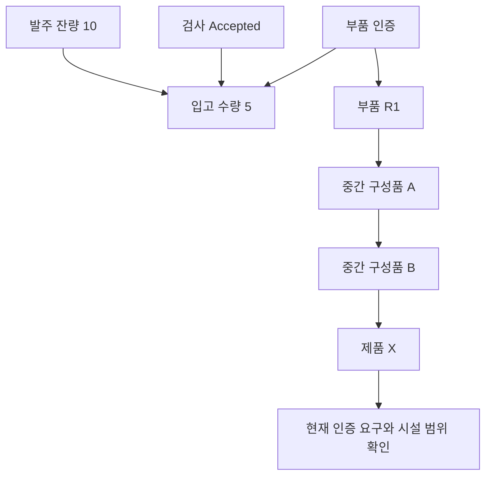

# 입고 인수와 인증 만료 영향 분석의 구현 비교

2026-10-21에 같은 자료로 두 질문을 평가했다. 하나는 입고 당시 인수할 수 있었는지, 다른 하나는 부품 인증이 만료된 현재 어떤 제품을 재검토해야 하는지다. 다단계 탐색을 구현한 Python과 RDF/OWL/SHACL은 연구자가 정한 정책의 기대 결과와 모두 일치했다. 직접 연결만 보는 조건은 3단계 사례에서 재검토가 필요한 7건을 놓쳤다.

이 결과는 여러 관계를 결합하는 기능이 필요한 사례를 확인한다. 그 기능은 Python으로도 구현했다. RDF의 우위나 실제 기업 업무의 정확도를 입증한 결과로 해석하지 않는다.

## 자료와 정책의 출처

ERPNext의 품목·발주 항목·입고 항목·검사·BOM·BOM 구성품 정의를 같은 커밋 `e864addb6c367688d2b264f284c2dd9b9360a97d`에서 확보했다. Schema.org의 인증 어휘와 ERPNext의 BOM 테스트 예제도 살폈다. 이 자료는 공개 스키마와 소프트웨어 테스트 예제다. 기업 운영 기록 중 실제 발주·입고·검사·인증서가 연결된 자료는 이번에 확보하지 못했다.

따라서 평가 자료 24개는 이 구조를 참고해 연구자가 작성했다. 12가지 상황에 연결 깊이 1단계와 3단계를 적용했다. 사례마다 입고 1건, 명시적 참조 3개, 제품 4개가 있다. 정상 자료 외에 검사 기록 누락, 발주 참조 중복, 인증 만료일 누락, BOM 연결 누락 등을 포함한다. 기대 결과는 실행 코드에서 계산하지 않고 정책에 따라 별도 작성한 뒤 독립 검토했다. 외부 업무 전문가의 정답 확인은 받지 않았다.

인증 유효기간은 `시작일 ≤ 판단일 < 만료일`로 정했다. 만료일 당일은 유효기간에서 제외한다. 재검토 대상은 현재 인증 요구가 있는 제품 중 부품·개정·시설 범위가 일치하는 제품으로 정했다. 이 역시 연구자가 정한 정책이며 공개 어휘를 법적 재검토 의무의 근거로 삼지 않았다.

## 과거 인수와 현재 재검토의 분리

아래 그림은 고정된 기본 3단계 사례다. 식별자에는 읽기 쉬운 별칭을 붙였다. 별칭은 설명용이며 실행 입력에는 불투명한 식별자를 사용했다.

그림의 제품 X는 네 제품 중 재검토가 필요한 제품 한 개만 표시한다. 텍스트로 읽으면 발주·검사·인증은 입고 판단의 근거이고 부품→중간 구성품 A→중간 구성품 B→제품 X는 영향 탐색 경로다.

입고일은 **2026-09-15**, 인증 유효기간은 **2026-01-01부터 2026-10-01 전까지**다. 입고 수량 5는 발주 잔량 10 이내이고 검사는 `Accepted`다. 품목·개정·시설 범위도 일치하므로 당시 입고는 인수 가능하다.

현재 판단일 **2026-10-21**에는 인증이 만료됐다. 부품에서 제품 X까지 활성 연결 세 개가 이어지고 X는 같은 시설에서 현재 인증을 요구한다. 따라서 X는 재검토가 필요하다. 현재의 만료가 과거 입고 판단을 소급해 바꾸지는 않는다.

나머지 제품은 영향 후보와 재검토 의무를 나누기 위해 넣었다. 연결은 있지만 현재 인증을 요구하지 않는 제품, 연결이 없는 제품, 연결은 있지만 시설 범위가 다른 제품이다. 재검토에는 연결 여부 외에 현재 인증 요구와 시설 범위도 적용한다.

## 비교 구현과 공통 코드

| 처리 내용 | Python 비교군 | RDF/OWL/SHACL 비교군 |
|---|---|---|
| 입력 구조·중복 식별자·명시적 참조 | 공통 Python 코드 | 같은 코드 사용 |
| 숫자·날짜 해석과 판단 불가 처리 | 공통 Python 코드 | 같은 코드 사용 |
| 입고 내용 조건 | Python 비교 연산 | SHACL의 동등성·수량·상태·날짜 제약 |
| 제품까지 다단계 연결 | 너비 우선 탐색 | OWL-RL의 추이 관계 추론 |
| 잘못된 연결 제외·그래프 완전성 | 공통 Python 코드 | 같은 코드 사용 |
| 근거 경로 추출 | Python 최단 경로 | 같은 경로 추출 후 OWL 결과와 대조 |
| 최종 재검토 정책 | 공통 Python 함수 | 같은 함수 사용 |

SHACL에는 미리 계산한 합격·불합격이 아니라 비교할 값을 전달한다. 날짜는 공통 파서가 검증한 뒤 순서를 보존하는 일수 정수로 변환한다. 값이 없거나 해석할 수 없으면 해당 검사를 판단 불가로 남긴다. 별도의 명확한 위반이 있으면 위반을 우선한다.

OWL-RL에는 활성 상태이고 식별자가 유효한 구성품 연결을 넣고 추이 관계를 선언했다. OWL의 도달 여부와 별도 경로 추출 결과가 다르면 실행 오류로 처리한다. 경로 결과로 OWL 답을 고치지 않는다. 이 실험의 OWL 범위는 제한된 추이 관계이며 클래스 계층이나 OWL 전체 기능을 비교하지 않았다.

직접 연결 조건은 같은 정책에서 다단계 탐색만 생략한 기능 제거 비교다. 연결 자료가 완전하다고 표시된 경우 직접 연결이 없으면 영향 대상이 아니라고 답한다. 이 때문에 간접 연결을 놓칠 수 있으므로 안전한 운영 방식으로 권하지 않는다. 여기서 그래프 완전성은 제공된 연결 자료의 범위에 관한 표시다. 이 표시만으로 알고리즘이 모든 경로를 계산했다고 볼 수는 없다.

## 판단 결과와 오류

24개 사례를 세 조건에서 한 번씩 실행해 총 72개 실행 결과를 저장했다. 처음 두 조건의 48개 실행은 다시 실행하지 않았고 직접 연결 조건 24개만 추가했다. 실행·출력 형식 오류는 세 조건 모두 0건이었다. LLM 호출은 하지 않았다.

| 평가 항목 | 비교군별 건수 | Python | RDF/OWL/SHACL | 직접 연결만 |
|---|---:|---:|---:|---:|
| 입고 판단의 기대 결과 일치 | 24 | 24 | 24 | 24 |
| 명시적 참조 판단의 일치 | 72 | 72 | 72 | 72 |
| 영향 후보 판단의 일치 | 96 | 96 | 96 | 62 |
| 재검토 판단의 일치 | 96 | 96 | 96 | 84 |
| 그래프 완전성 판단의 일치 | 24 | 24 | 24 | 24 |

판단 불가도 기대 결과의 일부로 포함했다. 처음 두 조건에서 입고는 인수 가능 10건·위반 8건·판단 불가 6건, 영향 후보는 해당 68건·비해당 20건·판단 불가 8건이었다. 재검토는 필요 14건·불필요 72건·판단 불가 10건이다. 명시적 참조는 해결 68건·누락 2건·모호 2건, 그래프는 완전 20건·부분 4건이었다.

직접 연결 조건은 1단계 사례의 제품 판단 48건에서 영향 후보와 재검토 모두 일치했다. 3단계 사례의 제품 판단 48건에서는 다음 차이가 생겼다. 단계는 **사례를 설계한 연결 깊이**이며 연결이 없는 제품을 포함한 모든 제품의 실제 경로 길이를 뜻하지 않는다.

| 3단계 사례의 기대 결과 → 직접 연결 답 | 건수 |
|---|---:|
| 영향 후보 해당 → 비해당 | 30 |
| 영향 후보 해당 → 판단 불가 | 4 |
| 재검토 필요 → 불필요 | 7 |
| 재검토 판단 불가 → 불필요 | 1 |
| 재검토 불필요 → 판단 불가 | 4 |

직접 연결 조건의 전체 재검토 혼동표는 다음과 같다. 행은 기대 결과, 열은 저장된 답이다.

| 기대 결과 | 필요 | 불필요 | 판단 불가 | 오류 |
|---|---:|---:|---:|---:|
| 필요 | 7 | 7 | 0 | 0 |
| 불필요 | 0 | 68 | 4 | 0 |
| 판단 불가 | 0 | 1 | 9 | 0 |

원본에서 연결을 삭제한 경우와 조회 입력에서만 연결을 뺀 경우는 별도 집단으로 보존했다. 입력에서 구별할 근거가 없으면 두 경우 모두 판단 불가가 맞다. 검증기가 원본의 숨은 누락을 발견했다고 해석하지 않는다. 검사 기록만 빠진 경우에는 입고 판단이 불가능해도 제품 연결 그래프 자체는 완전할 수 있다.

## 기술 선택과 연구 의의

이 사례에서는 다단계 관계를 계산하는 기능이 차이를 만들었다. Python 탐색과 OWL-RL 모두 그 기능을 구현했다. SHACL은 입고 제약의 표현과 검증 보고서에 기존 체계를 활용했고 Python은 비교 연산으로 같은 조건을 처리했다.

공통 전처리·경로 추출·재검토 함수가 있으므로 두 구현의 일치를 전체 기능에 대한 독립 검증으로 볼 수는 없다. 규칙 변경에 걸린 시간, 사람이 오류 원인을 찾는 시간, 처리 속도와 메모리 비교도 측정하지 않았다. 유지보수의 쉽고 어려움을 수치로 결론 내릴 근거는 없다.

다만 구현 책임은 구체적으로 나눌 수 있었다. 코드 방식은 탐색과 조건 평가를 직접 작성했고 표준 방식은 OWL-RL과 SHACL 구현체를 사용하면서 데이터 변환과 범위 설정을 별도로 작성했다. 정책 자체가 업무에 맞는지, 인증 근거가 신뢰할 만한지, 제공된 BOM이 충분한지는 어느 방식에서도 별도로 확인할 문제다. 코드와 평가 도구는 표준 기술을 도입하지 않는 환경에서도 검토할 출발점이 된다. 재사용을 위한 일반 라이브러리로 포장하지 않았고 현장 검증도 마치지 않았다.

## 기록과 후속 범위

- [공개 자료 확보 기록](../experiments/records/20261021-industrial-questions-sources.json)
- [작성 사례와 기대 결과 고정 기록](../experiments/records/20261021-industrial-questions-fixtures.json)
- [두 구현의 첫 실행 기록](../experiments/records/20261021-industrial-question-execution.json)
- [직접 연결 조건의 실행 기록](../experiments/records/20261021-industrial-question-direct.json)
- [코드 기반·표준 기반 비교의 연구 의의](2026-10-21-research-significance.md)

구현은 `scripts/industrial_question_python.py`, `scripts/industrial_question_rdf.py`, `scripts/industrial_question_direct.py`에 있다. SHACL 제약은 `research/industrial-questions/receipt-shapes.ttl`, 실행과 채점은 `scripts/run_industrial_questions.py`와 `scripts/score_industrial_questions.py`로 분리했다.

이번 비교로 작성 사례의 다단계 탐색과 조건 검증을 확인했다. 실제 연결된 운영 자료와 업무 전문가의 정책 확인은 확보하지 못했고 별도 평가 집합으로 일반화되는지도 아직 검증하지 않았다. 기존 소매 자료의 610개 보류 사례는 사용하지 않았다. 같은 사례를 반복 실행해 결과 수를 늘리지 않고 후속 비교는 이 세 가지 근거를 확보한 뒤 설계할 수 있다.
