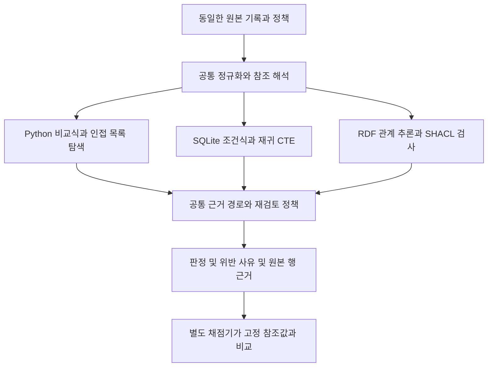
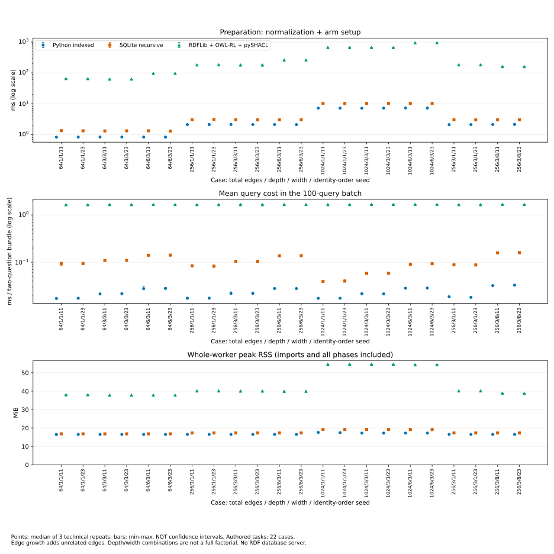
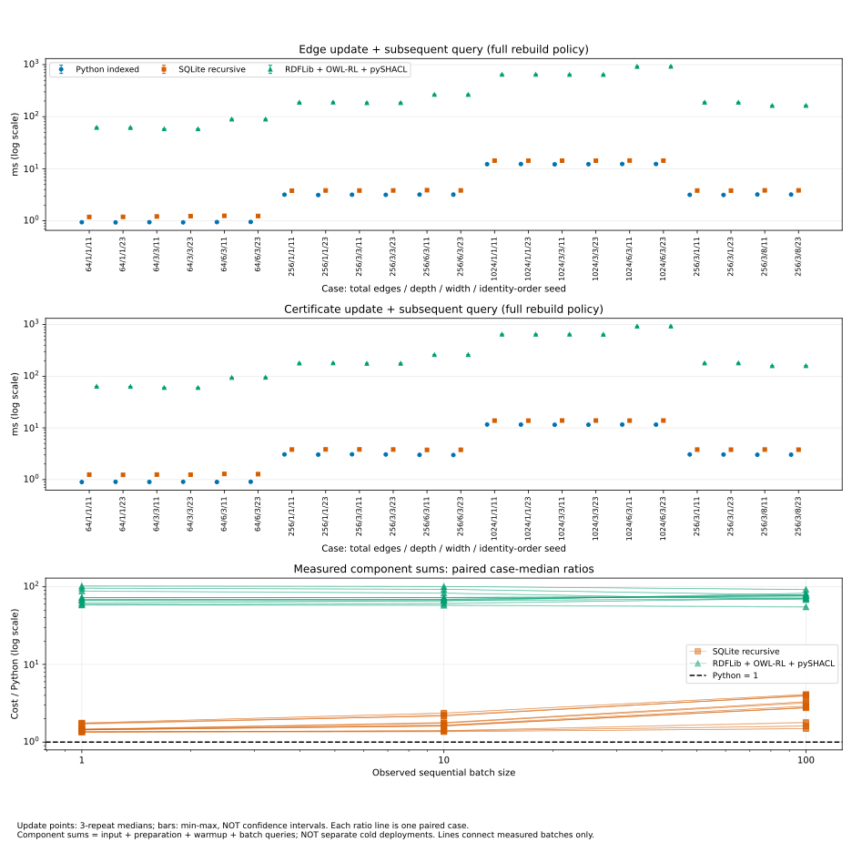

# 동일 정책의 Python SQL OWL SHACL 구현 비용과 변경 범위

## 초록

입고 인수와 부품 인증 만료의 제품 영향 분석을 대상으로 동일한 정책을 Python, SQLite, RDFLib·OWL-RL·SHACL로 구현하고 실행 비용과 정책 변경 범위를 비교했다. 직접 구성한 22개 사례에서 세 구현을 각각 세 번 실행했다. 198회 실행 모두 완료됐고 반복 조회와 갱신 후 조회를 포함한 22,572개 출력은 고정한 참조값과 일치했다. 사례별 중앙값을 비교하면 Python의 준비·반복 조회·갱신 비용과 프로세스 최대 메모리가 모두 가장 낮았다. 종료일 경계와 수량 한도를 바꾸는 과제에서는 Python의 코드와 설정을 함께 수정했고 SQL·SHACL은 규칙 파일을 수정했다. 다른 세 과제는 공통 처리부를 수정했으므로 방식별 유지보수 우열의 근거로 삼지 않았다. 이 결과는 제한된 업무를 직접 구현할 때의 실행 비용과 선언적 규칙을 변경할 때의 수정 위치를 함께 제시한다.

## 연구 질문과 비교 범위

규칙이 주어진 업무는 여러 표현 방식으로 구현할 수 있다. 기술을 선택하려면 구현 가능성에 더해 준비 비용, 반복 실행, 갱신, 근거 출력과 변경 범위를 살펴야 한다. 본 연구의 질문은 이렇다. 같은 판정과 근거를 반환할 때, 데이터 크기·관계 깊이·분기·조회 반복과 정책 변경에 따라 각 구현의 비용과 수정 위치가 어떻게 달라지는가?

첫 업무는 주문·입고·검사·인증 기록을 연결해 입고 인수 여부를 판단한다. 두 번째 업무는 인증이 만료된 부품에서 BOM 관계를 따라 제품을 찾고 재검토 대상인지 판단한다. 관계가 연결된 제품을 영향 후보로 보고 정책상 재검토가 필요한 제품과 구분한다. 연결 근거가 불완전하면 미확인을 반환한다.

기업 운영 기록 대신 연구자가 작성한 데이터와 정책을 사용했다. 질문은 이미 정해진 구조로 입력하며 자연어 해석이나 LLM 호출은 포함하지 않는다. 원천 기록의 진실성, 숨겨진 누락의 발견, 일반적인 GraphRAG 성능은 평가 대상에 넣지 않았다.

## 표준과 기존 벤치마크의 비교 범위

SHACL은 데이터 그래프를 shapes 그래프의 조건에 따라 검증하며 검증 결과를 표현하는 공통 어휘를 정의한다. OWL 2 RL은 규칙 기반 기술로 구현할 수 있도록 표현을 제한한 프로파일이다. 따라서 검증 조건을 선언하는 일과 관계에서 새 사실을 도출하는 일을 구분해야 한다. 이번 구현에서는 입고 조건 검사에 pySHACL을, 도달 관계 계산에 OWL-RL을 사용했다. 최단 근거 경로와 업무상 재검토 판정은 공통 Python 코드가 맡았다. [SHACL 권고안](https://www.w3.org/TR/shacl/#validation-report), [OWL 2 프로파일 권고안](https://www.w3.org/TR/owl2-profiles/#OWL_2_RL)

LUBM은 대학 도메인의 온톨로지, 반복 생성할 수 있는 합성 데이터, 질의와 성능 지표로 시맨틱 웹 저장소를 평가하도록 구성됐다. Bizer와 Schultz의 Berlin SPARQL Benchmark는 RDF 저장소와 SPARQL-to-SQL 변환 방식을 비교하며 관계형 데이터베이스도 평가에 포함했다. 이런 선행 작업이 있으므로 SQL과 RDF를 비교한다는 사실 자체를 본 연구의 독창성으로 주장할 수는 없다. [LUBM 프로젝트 설명](https://swat.cse.lehigh.edu/projects/lubm/), [Bizer와 Schultz, 2009](https://www.igi-global.com/article/berlin-sparql-benchmark/4112)

이번 연구의 비교 단위는 두 업무의 판정과 근거 출력을 만드는 전체 처리 과정이다. 저장소의 질의 속도 순위보다 업무 구현에 범위를 좁혔다. 같은 정책을 직접 코드·SQL·OWL 및 SHACL로 구성할 때 준비·조회·갱신 비용과 다섯 정책 변경의 수정 위치를 함께 기록했다. 기존 벤치마크를 재실행하지 않았으며 그 결과와 수치를 직접 비교하지 않는다. 이 선택은 업무 구현의 책임을 살피기 위한 설계다. 두 업무의 관측 결과만으로 다른 저장소, 질의 종류 또는 산업 도메인의 우열을 결정하지 않는다.

표준의 표현·결과 형식과 이번 구현의 비용은 서로 다른 근거로 판단한다. SHACL 결과 어휘가 있다는 사실은 표준 문서로 확인할 수 있지만 사람이 오류를 더 빨리 찾는다는 결론은 이번 측정에 없다. 반대로 Python이 이 실험에서 빨랐다는 결과는 표준 형식의 교환 요구를 없애지 않는다. 선택표는 측정한 실행 비용, 실제 변경 위치, 별도로 주어진 교환 요구를 구분해 사용하도록 구성했다. 위 자료는 비교 설계를 설명하기 위해 선택한 표준과 벤치마크이며 체계적 문헌조사나 최신 연구 전체를 포괄하는 목록은 아니다.

## 동일한 입력과 출력 서비스

세 구현은 문자열·날짜·정수 수량의 해석, 중복 참조 처리, 유효한 연결 선별, 근거 경로 추출과 재검토 정책을 공유한다. 수량은 Nos 단위의 정수로 제한했다. 공통 정규화는 비교할 값과 미확인 표시를 전달하고 입고 조건의 통과 여부는 각 구현이 계산한다.



그림의 공통 처리부는 세 방식에서 같은 기능을 수행한다. Python은 직접 비교와 탐색을 수행한다. SQLite는 네이티브 SQL 조건식과 재귀 `UNION`으로 도달 가능한 노드를 계산한다. RDF 구현은 OWL-RL의 추이 관계로 도달 가능성을 계산하고 실제 pySHACL 검사로 알려진 값의 위반 여부를 얻는다. 이 RDF 비교군에는 SPARQL 질의나 RDF 데이터베이스 서버를 사용하지 않았다.

모든 출력에는 입고 판정, 참조 해석 상태, 제품별 영향 후보와 재검토 여부, 최단 근거 경로, 위반·미확인 규칙과 원본 행 식별자가 들어간다. 도달 여부와 근거 경로가 어긋나면 오류로 남긴다. 채점기는 실행 결과를 수정하지 않는다. [실제 함수와 호출 흐름 설명](2026-10-21-industrial-code-walkthrough.md)은 앞선 구현의 출발점을 정리하며 이번 세 비교군의 정확한 경계는 이 절과 재현 기록에 따른다.

## 실험 조건과 측정 절차

| 항목 | 조건 |
|---|---|
| 업무 | 입고 인수와 인증 만료 영향 분석을 한 묶음으로 조회 |
| 총 연결 수 | 64, 256, 1024 |
| 깊이 | 1, 3, 6 |
| 중간층 너비 | 1, 3, 8의 지정 조합 |
| 사례 | 11개 구성 × 식별자·행 순서 변형 2개 = 22개 |
| 실행 | 3개 구현 × 사례별 기술 반복 3회 = 198회 |
| 반복 조회 | 준비 후 예열 1회, 이어서 1·10·100회 묶음 |
| 갱신 | 대상 제품으로 들어가는 연결 비활성화, 인증 종료일 연장 |
| 자원 제한 | 한 번에 작업자 1개, 작업자당 12초, 가상 주소 공간 1536MiB |

총 연결 수를 늘릴 때는 질문의 대상과 연결되지 않은 간선을 추가했다. 이 축은 관련 제품군 자체를 확장하지 않고 무관한 데이터가 늘어날 때의 부하를 측정한다. 깊이 1과 3의 비교에는 너비 차이도 포함된다. 고정된 너비에서 깊이를 비교하거나 같은 깊이에서 너비를 비교하는 셀을 구별해야 한다. 두 식별자·행 순서 변형은 민감도 확인용이며 서로 다른 산업 도메인을 뜻하지 않는다.

입력 읽기, 공통 정규화, 구현별 준비, 조회, 갱신과 초기 상태 복원을 따로 기록했다. 연결 갱신 후 원래 상태를 새로 구성한 다음 인증 갱신을 수행했다. 초기 상태 복원 비용은 갱신 비용과 구분했다. 세 구현 모두 각자 구현한 재구성 방식을 사용했다. RDF는 인증만 갱신해도 관계 폐쇄를 다시 계산했으며 증분 갱신 최적화는 적용하지 않았다.

조회 시간은 답을 만든 직후까지이며 직렬화와 로그 기록은 제외한다. 전체 작업자 시간에는 시작·가져오기·로그·모든 단계가 포함된다. 준비·예열·특정 조회 묶음의 시간을 더한 값은 측정 구성요소의 합이다. 별도로 실행한 초기 요청 지연시간은 아니다. 1·10·100회 묶음은 같은 프로세스에서 순차 실행했으므로 누적된 캐시 효과가 포함될 수 있다.

호스트는 논리 CPU 2개와 약 15.3GiB 메모리를 사용했다. 실행 당시 환경과 의존성 버전은 별도 기록했다. 메모리는 전체 작업자의 `ru_maxrss`이며 가져오기와 모든 단계를 포함한다. 가상 주소 공간 제한과 최대 RSS를 같은 지표로 해석하지 않는다. [실험 실행 기록](../experiments/records/20261021-technology-selection-campaign.json)에 입력·소스 고정과 결과 위치를 남겼다.

## 실행 비용과 관측된 선택 경계

198회 실행에서 실패·시간 초과·잘못된 출력은 없었다. 22,572개 출력에는 같은 사례의 반복 조회가 포함되므로 이를 독립적인 정확도 시험 횟수로 해석하지 않는다. 아래 수치는 각 사례에서 세 번 측정한 중앙값의 최솟값과 최댓값이다. 조회 열은 100회 묶음의 회당 평균을 사용했다.

| 구현 | 준비 시간 ms | 조회 1회 ms | 전체 작업자 최대 메모리 MiB |
|---|---:|---:|---:|
| Python | 0.826–7.296 | 0.017–0.033 | 16.5–17.6 |
| SQLite | 1.302–10.262 | 0.039–0.160 | 16.8–19.1 |
| RDFLib·OWL-RL·SHACL | 62.338–941.408 | 1.643–1.676 | 37.9–54.6 |

같은 사례끼리 비교한 조회 시간 비율은 SQLite/Python이 2.27–5.50, RDF/Python이 50.96–95.78이었다. Python은 준비 시간, 두 종류의 갱신과 갱신 후 조회의 합, 최대 메모리에서도 22개 사례 모두 중앙값이 가장 낮았다. 준비·예열과 1·10·100회 조회의 측정 구성요소를 합산해도 비용 순위는 바뀌지 않았다. 이 범위에서는 반복 횟수나 깊이가 늘어 RDF 구현의 비용이 더 낮아지는 전환점이 관측되지 않았다. [사례별 분석 기록](../experiments/records/20261021-technology-selection-analysis.json)은 66개 사례·구현 셀과 22개 대응 비교를 보존한다.

이번 규모에서 고정된 두 업무를 처리하고 실행 비용을 우선할 때는 이 결과를 근거로 Python을 선택할 수 있다. SQL이나 RDF 구현을 선택하려면 현재 시스템의 저장 형식, 정책을 읽고 바꾸는 방식과 같은 다른 요구를 함께 판단해야 한다. 이번 비교에서 사용한 범용 검사·추론 구현의 비용을 모든 RDF 저장소의 비용으로 확대할 수는 없다.




그림 1. 점은 사례별 기술 반복 3회의 중앙값, 오차 막대는 최솟값과 최댓값이다. 신뢰구간이 아니다. 가로축은 총 연결 수·깊이·너비·식별자 및 행 순서 변형을 차례로 표시한다. 시간 축은 로그 척도이며 메모리 축은 0에서 시작한다. [PNG 원본](../assets/technology-selection/cost-by-case.png)을 확대해 조건별 값을 비교할 수 있다.



그림 2. 위 두 패널은 전체 재구성 방식의 갱신과 직후 조회 비용이다. 아래 패널의 각 선은 같은 사례에서 Python 대비 SQL 또는 RDF 구현의 비용 비율을 나타낸다. 1·10·100회 조회에서 측정한 구성요소를 합산했으며 별도의 초기 요청을 실행한 값은 아니다. 선은 측정 지점을 연결할 뿐 그 사이의 비용이나 더 큰 규모의 전환점을 예측하지 않는다. [PNG 원본](../assets/technology-selection/updates-and-repetition.png)과 [그림 데이터 및 해시](../assets/technology-selection/figure-data.json)를 함께 제공한다.

## 정책 변경과 구현 책임

성능 측정에 사용한 원본을 고정한 뒤 다섯 변경 과제를 각각 별도 사본에 적용했다. 수정 전에 32개 입력과 참조 출력을 확정했다. 세 구현의 15개 최초 제출 모두 96개 출력을 일치시켰고 구현 재시도는 없었다.

| 변경 과제 | Python | SQLite | RDF·OWL·SHACL |
|---|---|---|---|
| 입고의 인증 종료일 포함 | 비교 코드와 JSON 설정 2개 파일 | SQL 규칙 1개 파일 | SHACL 규칙 1개 파일 |
| 서비스 부품의 재검토 예외 | 공통 재검토 함수 | 같은 공통 함수 | 같은 공통 함수 |
| BOM 연결 유효기간 | 공통 정규화 함수 | 같은 공통 함수 | 같은 공통 함수 |
| 세 호출자의 수량 한도 8 | 비교 코드와 JSON 설정 2개 파일 | SQL 규칙 1개 파일 | SHACL 규칙 1개 파일 |
| 모든 검사 항목의 근거·버전 | 공통 출력 조립 함수 | 같은 공통 함수 | 같은 공통 함수 |

종료일 변경에서 수정한 부분은 작다. Python은 종료일 비교를 `v[1] < v[2]`에서 `v[1] <= v[2]`로 바꾸고 해당 규칙 이름을 설정에서 바꿨다. SQL은 `b<c`를 `b<=c`로 바꿨다. SHACL은 같은 위치의 `sh:lessThan`을 `sh:lessThanOrEquals`로 바꿨다. 입고의 날짜 경계를 바꿔도 인증 종료일 당일의 재검토는 계속 필요하다는 별도 검사를 통과했다.

세 구현이 공유하는 함수의 변경은 고유한 과제·파일·내용 해시로 한 번만 집계했다. 전체 고유 변경은 11개였다. 수량 한도를 위한 세 호출자는 같은 정책 파일을 읽는 로컬 함수이며 독립적으로 배포된 서비스가 아니다. 이 과제에서는 Python과 SQL도 하나의 정책을 공유했다. 표준 형식에서만 규칙을 재사용할 수 있다는 주장은 이 결과와 맞지 않는다.

패치의 비어 있지 않은 추가·삭제 줄과 영향을 받은 함수·규칙을 별도로 기록했다. Python 수량 설정에는 JSON 들여쓰기 변경이 포함되므로 줄 수가 의미 변경량보다 커진다. 동일한 작성자가 고정된 순서로 수정했고 실제 사람의 이해 시간·수정 시간·협업 비용은 측정하지 않았다. 이 비교는 변경 위치와 회귀 검사 결과를 보여준다. [정책 변경 기록](../experiments/records/20261021-technology-selection-maintenance.json)에 최초 제출과 로그를 연결했다.

## 조건별 기술 선택

| 요구와 상황 | 이번 연구에서 확인한 근거 | 선택에 적용할 판단 |
|---|---|---|
| 고정된 두 업무와 작은 관계 집합에서 실행 비용 우선 | 모든 관측 조건에서 Python 비용이 가장 낮음 | 현재 Python 구현을 우선 후보로 삼는다 |
| 이미 SQL로 관리하는 값과 관계에 같은 조건을 적용 | SQL의 동일 출력과 재귀 도달 계산을 확인함 | SQL로 구현 가능하다. 기존 DB와 통합할 비용은 이번 실행 비용에 포함되지 않았다 |
| 종료일·수량 같은 조건을 규칙 파일에서 변경 | SQL·SHACL은 해당 파일 하나를 수정함 | 변경 위치를 분리하려는 요구에 사용할 수 있다. Python도 다른 규칙 해석기 설계로 달라질 수 있다 |
| 팀·시스템 간 RDF·SHACL 형식의 교환이 필요 | 이번 구현은 해당 형식을 사용함 | 교환 형식 요구를 채택 근거로 삼되, 그 경제적 효과를 이 실험의 측정값으로 제시하지 않는다 |
| 예외·시간 조건·사용자용 근거 출력이 핵심 | 세 구현 모두 공통 코드의 수정이 필요했음 | 표준 도입 여부와 함께 업무 코드의 책임을 설계한다 |
| 깊이가 특정 홉 수를 넘으면 그래프 방식이 유리한지 판단 | 시험한 조건에서 비용 순위 전환이 없었음 | 보편적인 홉 기준을 만들지 않고 이 범위의 관측 결과를 사용한다 |

## 결론과 재현 범위

동일한 정책과 근거 출력을 갖춘 작은 업무에서는 직접 작성한 Python이 낮은 실행 비용을 보였다. SQL과 SHACL은 시험한 두 조건 변경을 규칙 파일에서 처리했지만 예외·유효기간·사용자용 근거 보고는 공통 코드에 남았다. 기술 선택은 실행 비용, 규칙 표현, 공통 업무 코드가 맡는 책임을 함께 검토하는 문제다.

본 연구는 한 방식의 독점적인 구현 능력을 주장하지 않는다. 연구의 기여는 같은 질문을 처리하는 세 구현, 입력과 채점의 분리, 생애주기별 측정, 고정된 변경 과제와 보존된 실패다. 표준 기반 기술을 도입하지 않는 환경에서도 코드 기반 비교 구현과 평가 도구를 재사용할 출발점이 된다. 재사용 시에는 이 연구의 정책과 입력 범위를 먼저 확인해야 한다.

요약 생성기는 96개 정책 변경 출력을 저장한 뒤 경로 타입 오류로 종료됐다. 원래 종료 코드와 로그를 보존하고 새 검토를 거쳐 저장된 결과만으로 요약을 복구했다. 업무 구현의 실패와 보고 도구의 실패를 구분했으며 실행 결과나 참조값을 고치지 않았다. 실험 설계, 수행, 분석, 정책 변경의 JSON 기록과 원본 로그를 함께 보관한다. 이 문서는 두 업무에 대한 실험 논문 초안이며 새로운 산업 데이터나 사람의 유지보수 실험을 수행한 것으로 읽어서는 안 된다.

## 재현 자료와 실행 순서

그림 데이터에는 66개 사례·구현 셀의 중앙값과 범위, 44개 대응 비용 비율, 분석 입력과 생성 스크립트의 해시, Matplotlib 버전, SVG·PNG 파일 해시가 들어 있다. 이 자료로 그림의 값을 대조할 수 있다. 개별 실행의 원시 로그는 별도로 보존하며 집계 파일만으로 원시 로그 전체를 대신하지 않는다.

| 확인 대상 | 저장소 경로 | 역할 |
|---|---|---|
| 고정 정책과 실행 구성 | `research/technology-selection/protocol-v1.json`, `cases-v1.json`, `runs-v1.json` | 업무 의미, 22개 사례, 198회 실행 계획 |
| 비교 구현 | `scripts/technology_selection_python.py`, `technology_selection_sqlite.py`, `technology_selection_rdf.py` | 같은 입력에 적용한 세 실행 방식 |
| 공통 처리 | `scripts/technology_selection_common.py`, `industrial_question_python.py` | 정규화·근거·재검토 정책의 공유 범위 |
| 집계 코드 | `scripts/analyze_technology_selection.py` | 보존된 실행 결과에서 대응 비교 계산 |
| 그림 코드 | `scripts/plot_technology_selection.py` | 고정 분석 해시 확인 후 그림 생성 |
| 정책 변경 코드 | `scripts/prepare_technology_selection_patches.py`, `check_technology_selection_maintenance.py` | 고정 사본의 수정과 별도 채점 |

위 표에서 디렉터리 경로를 생략한 파일은 해당 행의 첫 경로와 같은 디렉터리에 있다. 로컬 작업 자료는 `_workspace/technology-selection/` 아래에 있다. `campaign-1/results/`는 원시 실행 기록, `analysis-1/output/`은 집계 JSON·CSV, `maintenance-1/`은 변경 전 사본·제출 패치·검사 결과다. 이 디렉터리는 Git에서 제외된다. 공개 문서만 내려받은 상태에서 전체 재현 입력을 이미 갖췄다고 볼 수 없다. 별도 전달 시에는 고정 입력, 원시 로그, 버전과 해시 기록을 함께 묶어야 한다.

보존된 분석 입력이 있는 환경에서는 아래 명령으로 그림을 생성한다.

```bash
uv run --locked --with matplotlib==3.9.2 python scripts/plot_technology_selection.py
```

출력은 `docs/assets/technology-selection/`에 저장한다. 현재 출력이 있으면 스크립트가 중단하므로 원본을 삭제하거나 덮어쓰지 않는다. 별도 재현 사본에서 출력 경로를 분리한 뒤 실행하고 변경한 스크립트도 기록한다. 그림 데이터의 재현과 SVG 바이트의 일치는 구분한다. SVG에는 생성 시각과 내부 식별자가 포함될 수 있다.

전체 측정을 새로 수행하려면 먼저 고정 입력과 실행 소스의 해시, 의존성, 호스트 조건을 확인하고 기존 기록과 분리된 실행 경로를 정해야 한다. 이번 집계와 그림 작업은 새 측정을 실행하지 않았다. 요약 복구도 저장된 96개 결과만 사용했다. 실패 이후에는 원시 결과 보존 여부를 먼저 확인하고 보고 단계만 복구할 수 있는지 판단해야 한다.

<!-- HUMANIZE-SUMMARY -->
<!-- 장르: report. 강도: light. A-15·A-18·C-8·D-3에 해당하는 추상 서술, 긴 수식, 반복 대조와 도입구를 최소 수정했다. 수치·날짜·고유명사·코드·링크와 주장 강도를 보존했다. 자가검증 미통과 항목 0건. 변경률 확정은 별도 검증 스크립트에 따른다. -->
