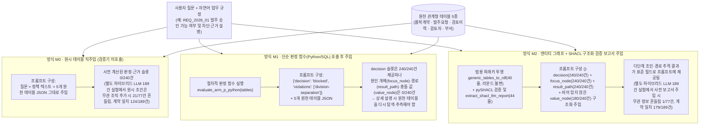
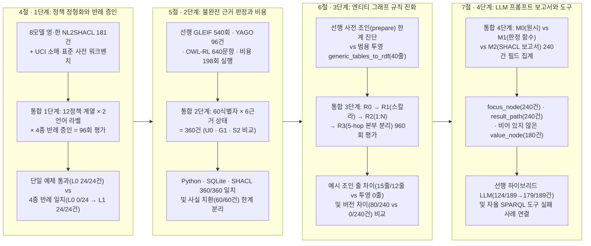

# LLM 판단을 위한 명시적 의미·규칙 계층의 개입 위치와 통합 생명주기 실증

> 2026-10-27 상태 안내: 이 문서는 기존 탐색 연구의 종합 자료로 보존합니다. 현재 주장 범위는 [주장별 종료 정리](2026-10-27-exploration-closeout.md)를 우선하며, 이후 연구는 [새 단일 시나리오 설계](../experiments/evidence-report-study.md)로 진행합니다. 아래의 과거 결과를 새 평가 결과로 합산하지 않습니다.

## 초록

대규모 언어 모델(LLM)을 제조·금융·소매·조직 감사 업무에 배치할 때 핵심 질문은 "온톨로지(RDF·OWL·SHACL)가 절차적 코드보다 우월한가"가 아니라, **"LLM이 다단계 관계 제약과 규정 충돌을 환각 없이 판단·설명하도록 만들려면 검증 계층이 어느 위치에서 어떻게 호출되고 어떤 구조화 근거가 프롬프트로 주입되어야 하는가"**다. 본 연구는 5개 관계형 테이블(`items_contracts`, `order_requests`, `approval_reviews`, `reviewers`, `departments`) 위에서 수행한 4단계 오프라인 통합 진단(`unified-rule-lifecycle-1`: 1단계 반례 증인 검사 → 2단계 불완전 근거 판정·재평가 → 3단계 엔티티 그래프 규칙 진화 → 4단계 LLM 프롬프트 보고서 구성)과, 10일간 수행한 선행 탐색 연구들(GLEIF 540회, 하이브리드 복잡도 189건, 다중 홉 추론 640문항, 자율 도구 호출 66에피소드, 8모델 영·한 규칙 생성 181건, 산업 비용 비교 198회 실행·22,572개 출력)을 결합해 이 질문에 답한다.

첫째, **LLM 호출 및 프롬프트 주입 구조(4단계 진단 및 하이브리드 LLM 선행 연구)**에서 원천 테이블과 정책 텍스트만 프롬프트에 넣는 방식(`M0`)은 사전 계산된 판정이나 위반 경로 슬롯(`0/240`건)을 전혀 제공하지 못하며 별도 하이브리드 LLM 실험(`189`건)에서도 원시 프롬프트 조건은 무관 조직 추가 시 `21/77`건(`27.3%`) 흔들리고 계약 일치가 `124/189`(`65.6%`)에 머물렀다. 단순 Python 판정 함수(`decision`·`violations`)만 원천 테이블과 함께 넣는 방식(`M1`)은 결정 슬롯(`240/240`건)은 제공하지만 위반 개체(`focus_node`), 관계 경로(`result_path`), 충돌 값(`value_node`) 슬롯은 `0/240`건이어서 모델이 상세 사유를 설명할 때 원천 테이블을 다시 추측해야 한다. 반면 W3C SHACL `ValidationReport`를 추출해 주입하는 방식(`M2`)은 초점 개체(`240/240`건), 프로퍼티 경로(`240/240`건), 비어 있지 않은 충돌 값(`180/240`건; `QualifiedMinCount` 기수성 위반 60건은 충돌 값 없음)을 구조화해 공급하며 별도 하이브리드 LLM 실험에서 판단 전 구조화 검증 보고서 주입은 계약 일치를 `179/189`(`94.7%`)로 높이고 무관 정보 흔들림을 `1/77`건(`1.3%`)으로 줄였다.

둘째, **자연어 정책 정형화와 반례 게이트(1단계 진단 및 NL2SHACL 선행 연구)**에서 8개 LLM의 영·한 SHACL 초안 생성은 상위 4모델 기준 원시 메타 적합 `12/12`건으로 언어 격차가 없었으나, 구문 통과 176개 중 원 벤치마크 `SER`을 통과한 175개 가운데 13개가 유한 반례 검증에서 실패했다. 통합 1단계 진단(12개 정책 계열 × 영·한 2라벨 × 4종 증인 = `96`회 평가)에서도 단일 정상 예제만 확인하는 무방비 오류 함수(`L0`)는 `Naive SER 24/24`를 통과하고도 4종 반례 일치율(`CEM`)이 `0/24`(정상 `6`·경계 위반 `6`·무관 변형 `14`·결측 `8`건 실패)였으나, 4종 반례 증인 게이트($G_{\text{pos}}, G_{\text{neg\_bound}}, G_{\text{unspec}}, G_{\text{missing}}$)를 적용한 기준 구현(`L1`)은 Python·SQLite·SHACL 세 구현 모두 `24/24`건(`100%`) 일치했다.

셋째, **불완전 근거의 런타임 판정과 실행 비용(2단계 진단 및 산업 비용 선행 연구)**에서 60개 식별자 × 6가지 근거 상태(`360`건) 평가 결과, 금액만 보는 `U0`는 오승인 `120/360`건(`33.3%`), 무관 품목·비고 정규식까지 차단하는 전역 검증 `G1`은 불필요 보류 `120/240`건(`50.0%`)을 냈다. 반면 질문 범위 조건만 검사하고 `unknown`일 때 원천 테이블 전체를 1회 재평가하는 `S2`는 오승인 `0/360`건, 불필요 보류 `0/240`건으로 세 구현(Python `0.0068~0.0071ms/건`, SQLite `0.5915~0.6469ms/건`, SHACL `7.0208~7.4639ms/건`)이 `360/360`건 일치했다. 단, 형태가 적합한 거짓 사실 치환(`valid_fact_substitution` 60건)은 세 구현 모두 적발할 수 없어 형식 적합성과 외부 사실 진실의 경계를 분명히 보여 주었다.

넷째, **원시 엔티티 그래프 위의 연속 규칙 진화(3단계 진단, `R0 → R1 → R2 → R3`, `960`회 평가)**에서 스칼라 마진 조건(`R0→R1`)만 추가될 때는 Python 예시 코드도 조인 수정 없이(`0`줄) 조건문 `1`줄만 바뀌었다. 그러나 **1:N 검토자 역할별 적격성(`R1→R2`)**과 **5-hop 상위 본부 이해상충 분리(`R2→R3`)**로 관계 구조가 진화하자 절차적 Python 예시 코드는 조인 코어 `15`줄(`7+8`)·규칙 `10`줄(`1+6+3`), SQLite 예시 코드는 조인 뷰 `12`줄(`4+3+5`)·규칙 `9`줄(`3+3+3`)이 달라진 반면, 범용 외래키 투영 함수 `generic_tables_to_rdf`(물리적 `40`줄)는 전 라운드에서 단 한 줄도 바뀌지 않고(`0`줄) 선언적 SHACL 트리플(`+22`, `+18`, `+39`, 합계 `+79`트리플)만 추가해 `960/960`회 동일 판정을 유지했다.

---

## 1 연구 배경과 문제 정의 — LLM 판단 환경에서 규칙·온톨로지는 어떻게 호출되고 왜 필요한가

LLM 기반 업무 보조나 GraphRAG 시스템에 온톨로지(RDF·OWL·SHACL)를 결합하려는 시도는 흔히 두 가지 극단적 오해에 부딪힌다. 첫째는 고정된 테이블 조인과 단순 스칼라 비교만 필요한 곳까지 무거운 그래프 검증기를 도입해 지연 시간만 늘리는 과잉 설계다. 둘째는 반대로 "결정론적 규칙은 Python 함수 하나로 충분하다"고 단정해, 다단계 관계 규칙이 바뀔 때마다 조인 루프와 LLM 프롬프트용 근거 설명 구조를 매번 수동으로 재작성하는 병목이다.

본 연구의 출발점은 **"명시적 규칙·온톨로지 검증 계층이 실제로 LLM의 판단과 근거 설명을 어떻게 돕는가"**라는 질문이다. 실제 업무 시스템에서 사용자 질문과 관계형 원천 데이터가 주어졌을 때 오케스트레이터가 검증 계층을 호출해 LLM 프롬프트를 구성하는 방식은 크게 세 가지(`M0`, `M1`, `M2`)로 나뉜다.



위 구조도는 왜 단순 판정 함수 호출(`M1`)과 구조화 검증 보고서 주입(`M2`)을 구분해 분석해야 하는지 보여 준다.

1. **원시 테이블 직주입(`M0`)의 한계**: 프롬프트에 5개 관계형 테이블 JSON과 자연어 규정만 넣으면 사전 계산된 판정이나 위반 경로 정보가 전혀 없다(`0/240`건). 선행 하이브리드 복잡도 실험(`189`건)에서 확인되었듯 모델이 스스로 다단계 외래키 조인과 비교를 추론하게 두면 주변에 질문과 무관한 조직 레코드가 추가되었을 때 판정이 크게 흔들린다(`21/77`건 변동).
2. **단순 판정 함수(`M1`)의 한계**: Python이나 SQL로 `{"decision": "blocked", "violations": ["division-separation"]}`을 계산해 프롬프트에 넣어 주면 결론 슬롯(`240/240`건)은 채워진다. 그러나 **"어느 개체(`focus_node`)의 어떤 다단계 관계 경로(`result_path`)와 어떤 값(`value_node`) 때문에 차단되었는가"**는 반환값에 들어 있지 않다(`0/240`건). 물론 Python이나 SQL에서도 동일한 상세 근거 보고서를 직접 구현할 수 있으나, 규칙이 바뀔 때마다 판정 로직과 근거 추출 로직을 함께 관리해야 한다.
3. **구조화 검증 보고서 주입(`M2`)과 엔티티 그래프 투영의 결합**: 원천 테이블을 규칙에 무관한 범용 외래키 투영 함수(`generic_tables_to_rdf`)로 개체와 간선으로만 1:1 변환하면, W3C SHACL 엔진(`pySHACL`)은 규칙이 스칼라(`R1`)에서 1:N 역할 적격성(`R2`), 5-hop 본부 분리(`R3`)로 확장되어도 투영 함수 수정 없이 선언적 Shape만 읽고 `sh:focusNode`, `sh:resultPath`, `sh:value`를 표준 보고서 구조로 반환한다.

이에 따라 본 연구는 다음 네 가지 핵심 연구 질문을 설정하고 공유 스키마 기반의 4단계 오프라인 통합 진단(`unified-rule-lifecycle-1`)과 선행 탐색 실험들을 결합해 각 질문을 검증한다.

- **연구 질문 1 (1단계 · 정책 정형화와 반례 증인 게이트)**: 자연어 규정에서 실행 규칙을 만들 때 구문 통과나 단일 정상 예제 통과(`Naive SER`)가 놓치는 의미 오류(동의어 오매핑, 부등호 경계, 범위 밖 과잉 제약, 결측 오판)는 무엇이며 4종 최소 반례 증인 게이트($G_{\text{pos}}, G_{\text{neg\_bound}}, G_{\text{unspec}}, G_{\text{missing}}$)는 이를 어떻게 드러내는가?
- **연구 질문 2 (2단계 · 불완전 근거의 런타임 판정과 실행 비용)**: 런타임 데이터에 무관 결함, 검색 누락, 원천 부재, 형태 적합 사실 치환이 섞여 있을 때 무검증(`U0`), 전역 검증(`G1`), 질문 범위 검증 후 원천 재평가(`S2`)는 오승인과 불필요 보류를 어떻게 제어하며 고정 규칙에서 Python·SQLite·SHACL의 판정 일치율과 실행 비용은 어떠한가?
- **연구 질문 3 (3단계 · 엔티티 그래프와 연속 규칙 진화)**: 업무 규칙이 기본 계약(`R0`)에서 1:1 마진 하한(`R1`), 1:N 다중 역할 적격성(`R2`), 5-hop 상위 본부 분리(`R3`)로 진화할 때 절차적 조인·규칙 코드(Python·SQL)와 범용 엔티티 그래프 투영 + SHACL Shape는 코드 변경 구조에서 어떤 차이를 보이는가?
- **연구 질문 4 (4단계 · LLM 프롬프트 보고서 구성과 도구 호출 경계)**: 검증 계층의 결과를 LLM 프롬프트로 구성할 때 `M0`(원시 테이블), `M1`(단순 판정 함수), `M2`(SHACL 구조화 보고서)가 제공하는 근거 필드의 완결성은 어떻게 다르며 선행 LLM 실험에서 관측된 사전 보고서 주입 효과(`124/189` → `179/189`) 및 자율 SPARQL 도구 호출 실패 사례와 어떻게 연결되는가?

---

## 2 선행연구와 이론적 배경

외부 근거를 결합해 LLM 응답의 신뢰성을 높이려는 시도는 크게 검색 증강 생성(RAG), 도구 호출 에이전트, 기호적 제약·온톨로지 결합의 세 흐름으로 전개되어 왔다.

### 2.1 검색 증강 생성과 자기 반성 루프의 한계

[Lewis et al. (2020)](https://arxiv.org/abs/2005.11401)의 RAG 이후 검색된 문서의 관련성과 사실성을 모델 스스로 점검하게 하는 [Self-RAG (Asai et al., 2023)](https://arxiv.org/abs/2310.11511)와 검색 실패 시 보정 동작을 수행하는 [CRAG (Yan et al., 2024)](https://arxiv.org/abs/2401.15884)가 제안되었다. 그러나 이러한 확률적 자기 평가 루프는 텍스트 유사도와 모델 내부의 암묵적 판단에 의존하므로, 수치 임계값·기수성·다단계 조직 분리처럼 명시적 계약이 필요한 업무에서는 "질문과 관련된 문서인가"와 "계약 조건을 충족하는 완결된 근거인가"를 엄밀히 구분하지 못한다.

### 2.2 그래프 기반 검색과 LLM 자율 도구 호출

개체 간 관계 구조를 활용하기 위해 [Edge et al. (2024)](https://arxiv.org/abs/2404.16130)의 GraphRAG는 문서에서 추출한 지식 그래프의 커뮤니티 요약을 활용하고 [Yao et al. (2022)](https://arxiv.org/abs/2210.03629)의 ReAct는 LLM이 추론 과정 중에 외부 조회 도구를 반복 호출하도록 설계했다. 하지만 LLM에게 SPARQL 같은 그래프 질의어 작성과 검증 도구 호출 시점을 자율로 맡기면, 스키마에 정의된 정준 IRI와 표면 문자열을 혼동하거나 검증 도구를 아예 건너뛰고 조기 종료하는 인터페이스 병목이 발생한다.

### 2.3 W3C SHACL·OWL 2 RL과 자연어-SHACL 자동 생성 벤치마크

데이터 형태와 의미 제약을 선언적으로 명세하는 표준으로는 [W3C SHACL (Shapes Constraint Language)](https://www.w3.org/TR/shacl/)과 [W3C OWL 2 Profiles (OWL 2 RL)](https://www.w3.org/TR/owl2-profiles/)가 있다. 특히 SHACL은 단순 합격·불합격(`sh:conforms`)뿐 아니라 위반이 발생한 초점 개체(`sh:focusNode`), 위반에 이른 프로퍼티 경로(`sh:resultPath`), 문제 값(`sh:value`)을 표준 검증 보고서(`sh:ValidationReport`)로 반환한다. 반면 OWL 2 RL은 하위 클래스(`rdfs:subClassOf`), 역관계(`owl:inverseOf`), 전이성(`owl:TransitiveProperty`), 프로퍼티 체인(`owl:propertyChainAxiom`)을 통해 명시되지 않은 함의 간선을 도출하는 역할을 맡는다.

최근 자연어 요구사항으로부터 SHACL Shape를 생성하는 능력을 측정하기 위해 [NL2SHACL-Bench (2026)](https://arxiv.org/abs/2603.24223)가 공개되었고 후속 연구들([2602.07978](https://arxiv.org/abs/2602.07978), [2503.20480](https://arxiv.org/abs/2503.20480), [2504.10083](https://arxiv.org/abs/2504.10083))이 SHACL 생성 및 활용을 다루었다. 그러나 기존 벤치마크의 의미 실행 평가(`SER`)는 제한된 확인용 그래프 통과 여부만 측정하므로, 범위 밖 데이터에 제약을 잘못 걸거나(`G_unspec` 오류) 결측치(`unknown`)와 명시적 위반(`violation`)을 혼동하는 과잉·과소 제약을 걸러내지 못한다는 한계가 있다([문헌 검토 기록](2026-10-16-review-nl2shacl-bench.md)).

---

## 3 통합 연구 프레임워크와 실험 계보

본 논문은 **하나의 공유 스키마와 5개 관계형 테이블 위에서 1단계(반례 증인 검사) → 2단계(런타임 근거 판정·재평가) → 3단계(규칙 라운드 진화) → 4단계(LLM 프롬프트 보고서 구성)를 일관되게 비교하는 오프라인 통합 진단(`unified-rule-lifecycle-1`)**을 중심 골격으로 삼고 각 단계에서 실제 LLM 호출·실제 도메인 데이터(GLEIF·YAGO·UCI 소매)·대규모 비용 측정을 수행한 1기 선행 연구들을 단계별 실증 근거로 결합한다.



### 3.1 통합 오프라인 진단(`unified-rule-lifecycle-1`)의 공유 스키마와 세 구현 팔(Arm)

통합 진단(`scripts/unified_rule_lifecycle.py`, [통합 실험 기록](../experiments/records/20261022-unified-rule-lifecycle.md))의 네 단계는 모두 동일한 5개 관계형 테이블 스키마(`RELATIONAL_SCHEMA`)와 3계층 표준 사전 예시(`STANDARD_DICTIONARY`: 단어 7개·도메인 4개·용어 6개)를 공유한다. (네 단계는 동일 스키마를 공유하는 결정론적 진단 함수들로 구성되며 자연어 컴파일러나 유료 LLM API를 직접 호출하지 않고 각 단계의 메커니즘을 오프라인에서 엄밀하게 분리 측정한다.)

1. `items_contracts` (`item_id`, `contract_status`, `max_discount_rate`, `min_margin_rate`): 품목 계약 상태 및 허용 할인율 상한·최소 마진율 기준
2. `order_requests` (`request_id`, `item_id`, `req_dept_id`, `applied_discount_rate`, `achieved_margin_rate`, `net_amount`, `gross_amount`, `memo_code`): 발주 요청 정보
3. `approval_reviews` (`review_id`, `request_id`, `reviewer_id`, `decision`, `review_role`): 발주 요청에 대한 `Primary`·`Audit`·`Observer` 역할별 1:N 검토 기록
4. `reviewers` (`reviewer_id`, `belongs_to_dept_id`, `qualification_status`): 검토자 적격 상태(`Qualified` / `Expired`) 및 소속 부서
5. `departments` (`dept_id`, `parent_division_id`): 요청 부서 및 검토자 소속 부서의 상위 본부 계층

이 5개 테이블 위에서 동일한 업무 규칙을 실행하는 세 가지 구현체(Arm)를 직접 대조한다.

- **Arm P (`evaluate_arm_p_python`)**: Python 딕셔너리 인덱싱과 리스트 컴프리헨션으로 5개 테이블을 조인·집계해 `eligible` / `blocked` / `unknown`과 위반·결측 목록을 반환한다.
- **Arm S (`evaluate_arm_s_sqlite`)**: 인메모리 SQLite에 5개 테이블을 적재하고 명시적 `LEFT JOIN` 질의로 결합해 동일한 판정과 위반·결측 목록을 반환한다.
- **Arm G (`evaluate_arm_g_shacl`)**: 규칙을 전혀 포함하지 않는 범용 외래키 투영 함수 `generic_tables_to_rdf`(물리적 `40`줄)로 각 행을 개체 IRI와 외래키 간선으로 1:1 투영한 뒤, `pySHACL`로 W3C SHACL Core Shape를 검증하고 결측 확인·판정 조립을 수행한다.

### 3.2 통합 진단 4단계와 선행 연구의 대응 구조

통합 진단의 네 단계와 선행 탐색 연구들은 아래 표와 같이 각자의 측정 범위와 분모를 유지하며 상호 보완한다.

| 단계 구분 | 핵심 검증 메커니즘 | 통합 진단 (`unified-rule-lifecycle-1`) 실행 단위 | 결합된 선행 연구 (실제 LLM 호출 · 실제 도메인 데이터 · 비용 측정) |
| --- | --- | --- | --- |
| **1단계 (4절)** | 자연어 규정 정형화 시 발생하는 의미 오류와 4종 반례 증인 게이트 | 12개 정책 계열 × 2언어 라벨 × 4종 증인 = `96`회 평가 (`L0` 오류 함수 vs `L1` 기준 구현) | 8모델 영·한 NL2SHACL(`181`건), UCI 소매(`108`행), 공공 표준 사전 워크벤치(`960`행, `139`테스트) |
| **2단계 (5절)** | 불완전 근거의 선택 검증·재평가(`S2`) 및 고정 규칙 실행 비용 | 60개 식별자 × 6가지 근거 상태 = `360`건 (`U0`·`G1`·`S2` Python/SQLite/SHACL) | GLEIF 확대(`540`회), YAGO 선택 검증(`96`건), 의미·갱신 재분석(`12,288`행), OWL-RL(`640`문항), 산업 비용(`198`회 실행·`22,572`개 출력) |
| **3단계 (6절)** | 관계 규칙 진화(`R0→R3`) 시 조인·규칙 변경 구조와 투영기 재사용 | 6개 테이블 패턴 × 40반복 × 4라운드 = `960`회 평가, 예시 스니펫 줄 차이 및 버전 비교(`240`건) | 1기 사전 조인 규칙 확장(`384`건, `prepare()` 한계 진단), 공유 의미(`12,288`행), 그래프 수명주기(`2,880`행) |
| **4단계 (7절)** | LLM 프롬프트 페이로드(`M0`·`M1`·`M2`)의 근거 필드 완결성과 도구 경계 | 4개 위반 패턴 × 60반복 = `240`건 보고서 필드 집계 및 3종 프롬프트 샘플 생성 | 하이브리드 복잡도 LLM 실험(`189`건, 계약 일치 `124/189`→`179/189`건), 자율 SPARQL 도구 호출(제조·금융 `54`회, YAGO `12`회) |

---

## 4 1단계 — 자연어 정책 정형화와 표준 사전·4종 반례 증인 게이트

업무 담당자가 작성한 한국어·영어 자연어 규정을 실행 가능한 검증 규칙(SHACL Shape 또는 코드)으로 바꿀 때, LLM 초안 생성이 어디까지 작동하고 왜 단일 예제 통과(`SER`)만으로는 위험한지 규명한다.

### 4.1 8개 LLM의 영어·한국어 SHACL 생성 체급 비교와 벤치마크 `SER`의 맹점

선행 연구에서는 공개 [NL2SHACL-Bench (2026)](https://arxiv.org/abs/2603.24223)의 12개 대표 과제를 영어 원문과 한국어 번역문으로 구성하고 8개 모델 체급에 걸쳐 총 181개 생성 결과(기본 168건 + 복구 13건)를 평가했다([체급·언어 재개 기록](../experiments/records/20261017-nl2shacl-tier-resume.json), [원 SER 실행 기록](../experiments/records/20261017-nl2shacl-original-ser.json), [확장 선택 기록](../experiments/records/20261016-nl2shacl-expansion.json), [의미 확장 기록](../experiments/records/20261017-nl2shacl-semantic-expansion.json)).

| 모델 | 영어 구문 통과 | 한국어 구문 통과 | 영어 원시 메타 적합 | 한국어 원시 메타 적합 | 원 벤치마크 `SER` (영/한) | 유한 반례 게이트 불일치 건수 |
| --- | --- | --- | --- | --- | --- | --- |
| `openai/gpt-5.4-mini` | `12/12` | `12/12` | `12/12` | `12/12` | `1.000` / `1.000` | `1`건 (한국어 과잉 제약) |
| `anthropic/claude-haiku-4.5` | `12/12` | `12/12` | `12/12` | `12/12` | `1.000` / `1.000` | `1`건 (정규식 대소문자 경계) |
| `anthropic/claude-sonnet-4.6` | `12/12` | `12/12` | `12/12` | `12/12` | `1.000` / `1.000` | `0`건 |
| `deepseek/deepseek-v3.2` | `12/12` | `12/12` | `12/12` | `12/12` | `1.000` / `1.000` | `1`건 (비교 연산 방향 경계) |
| `google/gemini-2.5-flash` | `12/12` | `12/12` | `11/12` | `12/12` | `1.000` / `1.000` | `2`건 |
| `openai/gpt-4o-mini` | `12/12` | `12/12` | `11/12` | `11/12` | `0.979` / `1.000` | `3`건 |
| `qwen/qwen3-32b` | `12/12` | `12/12` | `10/12` | `10/12` | `0.958` / `0.958` | `3`건 |
| `meta-llama/llama-3.3-70b-instruct` | `11/12` | `9/12` (복구 후 `12/12`) | `9/12` | `8/12` | `0.932` / `0.917` | `2`건 |

이 실험에서 두 가지 핵심 사실이 확인되었다.

1. **상위 모델의 영·한 언어 격차 해소**: 상위 4개 모델은 영어와 한국어 모두에서 구문 통과 `12/12`, W3C SHACL 메타 스키마 적합 `12/12`를 기록해 한국어 자연어 규정에서도 SHACL 초안 생성 자체는 안정적으로 작동했다.
2. **단순 구문 통과 및 원 벤치마크 `SER`의 맹점**: 구문을 통과한 176개 출력 중 175개가 원 논문의 의미 실행 평가(`SER`)에서 만점을 받았으나, 정상·위반·경계·범위 밖(unspecified) 사례를 분리한 유한 반례 세트로 재검증하자 원 `SER` 만점 출력 중 `13`개가 기준 의미와 불일치했다.

이 현상은 실제 거래 데이터인 UCI Online Retail 개발 표본(36사례 × 3반복 = `108`행)에서도 동일하게 재현되었다([소매 비교 종합](2026-10-20-retail-comparison-closeout.md)). 입력 스키마와 검사 제외 경계를 명시하지 않고 LLM에게 자유롭게 SHACL을 생성하게 한 조건은 `15/36`건(`41.7%`)만 기준 판정과 일치했다. 모델이 질문에서 요구하지 않은 `sh:minCount 1`이나 전역 타입 제약을 임의로 덧붙여 결측(`unknown`)을 위반(`violation`)으로 오판했기 때문이다. 반면 입력 그래프 구조 예시와 범위를 고정한 조건에서는 Python 규칙, 수동 SHACL, LLM 생성 SHACL 모두 개발 표본 `72/72`건(`100%`) 일치에 도달했다.

### 4.2 공공 표준 사전 연동과 다중 포맷 규칙 워크벤치

실무 환경에서는 부서마다 같은 개념을 서로 다른 컬럼명(`applied_discount_rate` vs `max_discount_rate`, `net_amount` vs `gross_amount`)으로 표기해 규칙 작성 시 동의어 오매핑이 발생하기 쉽다. 이를 해결하기 위해 행정안전부 공공데이터 공통표준사전 구조(표준단어 3,234개·표준도메인 166개·표준용어 7,996개 참조)를 반영한 `apps/rule_workbench/` 프로토타입을 구축하고 검증했다([워크벤치 프로토타입 기록](../experiments/records/20261017-rule-workbench-prototype.json), [산업·표준 사전 최종 감사 기록](../experiments/records/20261019-industrial-final-audit.json)). 워크벤치는 CSV, JSON, NDJSON, 관계형 테이블, Turtle/JSON-LD 입력을 받아 컬럼을 표준용어·도메인 제약에 매핑하고 W3C SHACL 스냅샷 왕복(round-trip) 검증을 수행한다(`960`행 산업 회귀 벤치마크 `0.271초` 완료, 단위·통합 테스트 `139`개 통과).

### 4.3 통합 진단 1단계 결과 — 전형적 오류 함수(`L0`) 대 4종 반례 증인 게이트(`L1`)

통합 진단(`unified-rule-lifecycle-1` 1단계)은 위 선행 실험들에서 반복 관측된 6가지 대표 의미 오류(`synonym_confusion_net_vs_gross`, `strict_inequality_boundary`, `unrequested_Memo_regex`, `null_as_violation`, `missing_role_qualification`, `dept_vs_division_hop_omission`)가 왜 단순 예제 검사에서는 걸러지지 않고 4종 반례 증인 게이트에서만 포착되는지를 정량화했다. 12개 정책 계열에 한국어·영어 라벨을 붙인 24개 항목(동일 테이블·오류 함수 재사용, 자연어 자동 컴파일 미실행)에 대해 각각 다음 **4종 최소 반례 증인 그래프(총 `96`회 증인 평가)**를 적용했다.

- $G_{\text{pos}}$ (경계 정상 증인): 할인율이나 마진율이 허용 경계(`applied_discount_rate == max_discount_rate`)와 정확히 일치하더라도 계약상 적격(`eligible`)으로 통과해야 하는 그래프
- $G_{\text{neg\_bound}}$ (경계 위반 증인): 마진율 미달, `Audit` 역할 부재, 5-hop 동일 상위 본부 소속 등 해당 규칙을 위반해 반드시 `blocked`가 되어야 하는 그래프
- $G_{\text{unspec}}$ (범위 밖 무관 변형 증인): 정책이 규제하지 않은 `memo_code`가 비표준 문자열(`FREE-TEXT-NOTE-99`)이거나 총주문금액(`gross_amount`)만 크고 순결제금액(`net_amount`)은 한도 이내일 때 과잉 차단 없이 `eligible`을 유지해야 하는 그래프
- $G_{\text{missing}}$ (필수 근거 결측 증인): 계약 상태나 검토자 자격이 `None`으로 비어 있을 때 성급한 위반(`blocked`) 단정이나 승인(`eligible`) 대신 반드시 `unknown`으로 판정되어야 하는 그래프

| 정형화 비교 조건 | 단일 표준 정상 예제 통과 (`Naive SER`) | 4종 반례 증인 전수 일치 (`CEM`, 24개 항목 × 4증인 = `96`회) | 증인 유형별 실패 건수 ($G_{\text{pos}}$ / $G_{\text{neg\_bound}}$ / $G_{\text{unspec}}$ / $G_{\text{missing}}$) | Arm P · S · G 3개 구현 간 판정 벡터 일치 |
| --- | --- | --- | --- | --- |
| **L0 · 오류 주입 함수 (반례 게이트 미적용)** | `24/24` (`100.0%`) | **`0/24` (`0.0%`)** | `6`건 / `6`건 / `14`건 / `8`건 | 부적합 규칙 차단 실패 |
| **L1 · 기준 구현 (Python · SQLite · SHACL 4종 반례 검증)** | 미측정 (`L0` 대조 전용 지표) | **`24/24` (`100.0%`)** | `0`건 / `0`건 / `0`건 / `0`건 | **`24/24` (`100.0%`)** |

결과가 보여 주듯 `L0`의 오류 함수들은 경계에서 떨어진 일반적인 정상 데이터 하나만 검사하는 `Naive SER`에서는 `24/24`건 모두 정상(`eligible`)을 반환해 아무 문제가 없는 것처럼 보인다. 그러나 4종 반례 증인을 투입하자 등호 경계 착오(`G_pos` 6건 실패), 역할·본부 홉 누락(`G_neg_bound` 6건 실패), 무관 메모·총주문액 과잉 제약(`G_unspec` 14건 실패), 결측의 위반 오판(`G_missing` 8건 실패)이 전부 드러나 `CEM`은 `0/24`가 되었다. 반면 4종 반례 증인을 모두 만족하도록 작성된 `L1` 기준 구현은 Python, SQLite, SHACL 세 실행 팔에서 24개 항목의 4종 증인 판정 벡터가 `24/24`건 일치했다.

---

## 5 2단계 — 런타임 근거 판정, 선택적 재평가(`S2`), 구현 비용 동등성

반례 게이트를 통과한 규칙이라도 런타임에 유입되는 원천 데이터는 일부 레코드가 누락되거나, 질문과 무관한 컬럼에 결함이 섞여 있거나, 형태만 정상인 거짓 값이 들어 있을 수 있다. 5절은 선행 도메인·비용 연구와 통합 2단계 진단을 결합해 런타임 개입 정책(`U0`, `G1`, `S2`)과 실행 엔진 비용을 검증한다.

### 5.1 선행 런타임 진단 — GLEIF 540회, YAGO 96건, 공유 의미·선택 갱신, OWL-RL 640문항

1기 선행 연구는 실제 도메인 데이터와 LLM 호출을 통해 런타임 검증의 네 가지 핵심 메커니즘을 분리해 냈다.

1. **GLEIF 법인 계층 검증(`0.5-study1`, 개발 72건·평가 180건, 평가 조건별 180건 × 3반복 = `540`회)**: 실제 GLEIF Golden Copy 데이터에서 전역 무조건 SHACL 검증(`G1`)은 질문과 무관한 메타데이터 결함까지 문제 삼아 불필요한 기권을 유발한 반면, 질문 관련 근거만 검사하고 누락 시 원천을 다시 읽는 선택적 복구 정책이 정확도와 기권 제어를 동시에 달성했다([GLEIF 확대 비교 기록](../experiments/records/20261013-expanded-comparison.json), [1단계 파일럿 결과](2026-10-12-gleif-pilot.md), [확대 비교 일지](2026-10-13-expanded-comparison.md)).
2. **YAGO 4.6 선택적 검증(`protocol 0.4`, `96`건) 및 의미 후속 실험**: YAGO 원본 SHACL Shape를 그대로 쓰면 출생지(`birthPlace`) 질문과 무관한 속성 위반 때문에 정답 생성이 막히지만 질문 계약에 해당하는 프로퍼티만 선택 검사(`S1`/`S2`)하면 원천 부재와 조회 누락을 정확히 분리할 수 있었다([YAGO 파일럿 기록](2026-10-12-yago-pilot.md), [YAGO 선택 검증 일지](2026-10-12-yago-selective.md), [의미 비교 기록](../experiments/records/20261013-semantic-comparison.json), [의미 비교 일지](2026-10-13-semantic-comparison.md)). 특히 의미 후속 12건에서 LLM 단독 판단은 첫 조회에 필수 근거가 빠졌을 때 12회 모두 조기 보류에 그쳤으나, 결정론적 선택 검증 기반 재조회는 12회 모두 원천에서 근거를 복구해 정답을 도출했다.
3. **공유 의미(`shared-semantics-1`, `12,288`행)와 선택적 갱신(`bounded-refresh-1`·`refresh-fallback-1`)**: 세 워크플로가 개별 복사본 설정을 쓸 때 발생하는 판정 불일치와 오래된 캐시 문제를 분석해, 전체 데이터를 매번 다시 읽는 대신 검증기가 지목한 누락·충돌 묶음만 1회 재조회하는 선택적 갱신이 네트워크 비용과 오류를 함께 줄임을 확인했다([그래프 수명주기 일지](2026-10-14-graph-lifecycle.md), [공유 의미 일지](2026-10-14-shared-semantics.md), [의미 가드 일지](2026-10-14-semantic-guards.md), [선택적 갱신 일지](2026-10-14-bounded-refresh.md), [갱신 폴백 요약](../experiments/records/20261014-refresh-fallback-summary.json)).
4. **다중 홉 관계 도출(`ontology-reasoning-1`, `640`문항)**: 하위 클래스·역관계·전이성·프로퍼티 체인이 얽힌 640개 질의에서 단순 명시 사실 조회(asserted lookup)는 `504/640`건(`78.8%`)에 그쳤으나 동일한 추론 공리를 구현한 Python 규칙 폐쇄와 OWL-RL 추론기는 숨은 도출 관계 `136`건을 모두 복구해 나란히 `640/640`건(`100%`)을 달성했다([온톨로지 추론 기록](../experiments/records/20261013-ontology-reasoning.md), [온톨로지 추론 일지](2026-10-13-ontology-reasoning.md)).

### 5.2 고정 스키마 산업 과제(198회 실행 · 22,572개 출력)의 구현 비용 비교

동일한 업무 규칙을 고정된 스키마 위에서 반복 실행할 때 각 기술 스택의 실행 비용을 측정한 선행 연구([업무 질문 일지](2026-10-14-business-questions.md), [변경 영향 일지](2026-10-14-change-impact.md), [도메인 특성 분석](../experiments/domain-characteristics.md), [산업 질문 비교 일지](2026-10-21-industrial-question-comparison.md), [기술 선택 비용 원고](2026-10-21-technology-selection-paper.md))에서는 22개 사례 × 3구현 × 3반복 = `198`회 실행에 걸친 `22,572`개 반복 조회 출력이 기준 참조값과 100% 일치했다. 사례별 3회 기술 반복 중앙값의 범위는 다음과 같다.

| 구현 방식 | 판정 일치 (`22,572`개 반복 출력) | 데이터 준비 시간 중앙값 범위 (`ms`) | 질의 1회 시간 중앙값 범위 (`ms`) | 작업자 최대 메모리 (`MiB`) |
| --- | --- | --- | --- | --- |
| **Python** | 기준 참조값과 100% 일치 | `0.826 ~ 7.296 ms` | **`0.017 ~ 0.033 ms`** | `16.5 ~ 17.6 MiB` |
| **SQLite** | 기준 참조값과 100% 일치 | `1.302 ~ 10.262 ms` | `0.039 ~ 0.160 ms` | `16.8 ~ 19.1 MiB` |
| **RDFLib · OWL-RL · SHACL** | 기준 참조값과 100% 일치 | `62.338 ~ 941.408 ms` | `1.643 ~ 1.676 ms` | `37.9 ~ 54.6 MiB` |

즉 **스키마와 조인 경로가 고정된 단일 시스템 내부의 고속 반복 규칙**에서는 RDF 변환과 OWL-RL·`pySHACL` 해석 비용을 감수할 이유가 없으며 Python이나 SQLite가 훨씬 빠르고 가볍다.

### 5.3 통합 진단 2단계 결과 — 6가지 합성 근거 상태(`360`건)와 원천 재평가(`S2`)

통합 진단(`unified-rule-lifecycle-1` 2단계)은 5개 관계형 테이블 위에서 60개 대상 식별자(`ENT_001`~`ENT_060`) 각각에 **6가지 합성 근거 상태(총 `360`건)**를 구성해 `U0`(금액만 확인하는 무검증 기준선), `G1`(질문 밖 미참조 품목 상태와 `memo_code` 정규식까지 검사하는 전역 검증), `S2`(질문 범위 조건만 검사하고 최초 판정이 `unknown`이면 전체 `source_tables`를 1회 재평가)를 비교했다. (통합 2단계는 합성 테이블만 평가하며 실제 GLEIF 원천 전이는 실행하지 않는다; `gleif_transfer_24.status = not_executed`.)

- **6가지 합성 근거 상태**:
  1. `normal` (60건): 모든 필수 근거와 계약 조건을 충족한 정상 승인(`eligible`) 대상
  2. `irrelevant_noise` (60건): 질문과 무관한 `memo_code` 형식 오류(`BAD_FORMAT_###`)와 미참조 정지 품목(`UNREFERENCED_NOISE_ITEM`)이 섞여 있으나 발주 계약 자체는 정상(`eligible`)인 대상
  3. `retrievable_omission` (60건): 초기 스냅샷(`initial_tables`)에 검토자 소속 부서 레코드가 누락되어 첫 판정은 `unknown`이지만 원천(`source_tables`) 재평가 시 정상(`eligible`)으로 복구 가능한 대상
  4. `source_absence` (60건): 원천 저장소 자체에 검토자 자격(`qualification_status = None`)이 비어 있어 재평가 후에도 반드시 `unknown`으로 보류되어야 하는 대상
  5. `explicit_violation` (60건): 할인율 상한 초과(`0.25 > 0.15`) 또는 상위 본부 충돌(`DIV_SALES == DIV_SALES`)이 존재해 반드시 `blocked`가 되어야 하는 대상
  6. `valid_fact_substitution` (60건): 외부 합성 진실(`gold_truth_eligible = False`)에서는 할인율 위반이었으나 원천 테이블에 형태상 적법한 값(`0.11 <= 0.15`)으로 치환되어 계약 판정(`expected_contract_decision = eligible`)과 외부 사실 진실이 괴리되는 대상

| 런타임 정책 및 구현 팔 | 계약 판정 일치 (`360`건) | 위험 오승인 건수 (`explicit_violation`·`source_absence` 중 오승인) | 불필요 보류·차단 (계약상 승인 가능 `240`건 중 오차단) | 사실 치환(`valid_fact_substitution`)의 외부 진실 오류 | 원천 재평가 횟수 | 단일 실행 평균 `ms/건` (기존 / 보정 실행) |
| --- | --- | --- | --- | --- | --- | --- |
| **U0 · 무검증 기준선** | `240/360` (`66.7%`) | **`120/360` (`33.3%`)** | `0/240` (`0.0%`) | `60/60` (`100.0%`) | `0`회 | `0.0008` / `0.0010 ms` |
| **G1 · 전역 검증 (무관 품목·메모 포함)** | `240/360` (`66.7%`) | `0/360` (`0.0%`) | **`120/240` (`50.0%`)** | `60/60` (`100.0%`) | `0`회 | `0.0135` / `0.0143 ms` |
| **S2 · Python (`evaluate_arm_p_python`)** | **`360/360` (`100.0%`)** | **`0/360` (`0.0%`)** | **`0/240` (`0.0%`)** | `60/60` (`100.0%`) | `120`회 | `0.0068` / `0.0071 ms` |
| **S2 · SQLite (`evaluate_arm_s_sqlite`)** | **`360/360` (`100.0%`)** | **`0/360` (`0.0%`)** | **`0/240` (`0.0%`)** | `60/60` (`100.0%`) | `120`회 | `0.5915` / `0.6469 ms` |
| **S2 · SHACL (`evaluate_arm_g_shacl`)** | **`360/360` (`100.0%`)** | **`0/360` (`0.0%`)** | **`0/240` (`0.0%`)** | `60/60` (`100.0%`) | `120`회 | `7.0208` / `7.4639 ms` |

이 결과는 세 가지 중요한 설계 원칙을 확인해 준다.

1. **질문 범위 선택 검증과 `unknown` 기반 원천 재평가의 결합**: `G1`은 무관 오류(`irrelevant_noise` 60건)를 차단하고 검색 누락(`retrievable_omission` 60건)을 복구하지 못해 승인 가능한 240건 중 절반(`120/240`)을 가로막았다. 반면 질문 관련 제약만 검사하고 `unknown`일 때 원천을 1회 재평가하는 `S2`는 검색 누락 60건을 모두 복구하고 원천 부재 60건만 정확히 `unknown`으로 남겨 계약 판정 `360/360`건 일치를 달성했다.
2. **세 구현체의 완전한 판정 동등성**: `S2` 아래에서 Python, SQLite, SHACL의 최종 결정은 `360/360`건 일치했다.
3. **형식 적합성(`conforms`)과 외부 사실 진실(external truth)의 엄격한 분리**: `valid_fact_substitution` 60건은 원천 데이터 자체가 모든 스키마·수치 제약을 만족하는 거짓 값으로 치환된 상태이므로 Python, SQLite, SHACL 모두 계약상 `eligible`로 판정해 외부 진실 대비 `60/60`건 오류가 남는다. 즉 어떠한 스키마·온톨로지 검증기도 반례 근거가 없는 거짓 원천 사실 자체를 진실로 둔갑시키거나 적발할 수는 없다.

---

## 6 3단계 — 원시 엔티티 그래프와 연속 규칙 진화 (`R0 → R1 → R2 → R3`)

5절까지의 결과만 보면 "고정된 규칙에서 Python이 가장 빠르고 판정도 `360/360` 같다면 왜 엔티티 그래프와 SHACL이 필요한가?"라는 질문이 제기된다. 6절은 **사전 조인(pre-join) 구조의 한계**를 먼저 짚고 **원시 엔티티 그래프 위에서 관계 규칙이 진화할 때 나타나는 코드 변경 위치의 차이**를 분석한다.

### 6.1 1기 규칙 확장 실험(`rule_extension_common.py`)의 사전 조인 한계 진단

1기 연구의 규칙 확장 실험(`384`건 판정, [독립 규칙 추가 실행 집계](../experiments/records/20261022-rule-extension.json), [검토 묶음](../experiments/records/20261022-rule-extension-review-bundle.json))에서는 기존 규칙 묶음에 신규 문서 배포 규칙을 추가하며 Python·JSON 정책·SHACL을 비교했다. 당시 실험에서는 SHACL 팔에서도 공통 파이썬 전처리기(`prepare()`)가 먼저 원천 데이터를 읽어 파생 불리언 플래그와 사전 결합 레코드를 계산한 뒤 그 피연산자 그래프를 SHACL에 넘겼다.

그 결과 스칼라 임계값이나 단순 플래그 조합을 바꿀 때는 설정 파일이나 SHACL만 수정하면 되었지만 새로운 테이블 조인이나 1:N 기수성 집계가 필요한 규칙이 들어오면 결국 SHACL 팔도 공통 파이썬의 `prepare()` 함수를 함께 수정해야 했다. 즉 "파이썬이 조인을 다 해 준 뒤 SHACL로 스칼라 값만 검사하는 구조"에서는 그래프 제약 언어의 프로퍼티 경로(`sh:path`)와 기수성(`sh:qualifiedValueShape`) 표현력이 활용될 수 없었던 것이다.

### 6.2 범용 외래키 투영(`generic_tables_to_rdf`)과 4단계 규칙 라운드(`R0 → R3`) 설계

이 한계를 해소하기 위해 통합 진단(`unified-rule-lifecycle-1` 3단계)의 **Arm G**는 도메인 규칙을 전혀 모르는 범용 외래키 투영 함수 `generic_tables_to_rdf`(물리적 `40`줄, `inspect.getsourcelines` 기준)를 사용한다. 이 함수는 `RELATIONAL_SCHEMA`에 선언된 기본키(`pk`), 리터럴 컬럼(`literals`), 외래키(`fks`) 메타데이터만 읽고 각 행을 개체 IRI로, 외래키를 객체 프로퍼티 간선(`ex:hasItem`, `ex:requestedByDept`, `ex:hasReview`, `ex:reviewedBy`, `ex:belongsToDept`, `ex:parentDivision`)으로 1:1 직렬화한다.

이 동일한 투영 그래프 위에 4단계로 확장되는 규칙 라운드(`R0 → R1 → R2 → R3`)를 정의하고 각 라운드에서 6가지 테이블 패턴(정상, 할인율 위반, 마진 위반, `Audit` 역할 부재, 상위 본부 충돌, 결제금액 결측)을 40회씩 반복해 라운드당 `240`회, 총 **`960`회 평가(고유 패턴·라운드 조합 `24`개)**를 수행했다.

- **`R0` (기본 계약·단일 검토 적격성)**: 품목 계약 상태가 `"Active"`, `applied_discount_rate <= max_discount_rate`, `net_amount <= 100000.0`이고 적격(`Qualified`) 검토자의 `Primary` 역할 승인(`Approve`)이 1건 이상 있어야 한다.
- **`R1` (1:1 스칼라 마진 하한 추가)**: `R0`에 더해 발주 요청의 달성 마진율이 품목 최소 마진율 이상(`achieved_margin_rate >= min_margin_rate`)이어야 한다.
- **`R2` (1:N 다중 역할 적격성 추가)**: `R1`에 더해 `approval_reviews` → `reviewers`를 거치는 1:N 검토 이력 중 적격(`Qualified`) 검토자의 `Audit` 역할 승인(`Approve`)도 최소 1건 이상 별도로 존재해야 한다.
- **`R3` (5-hop 상위 본부 이해상충 분리 추가)**: `R2`에 더해 발주 요청 부서의 상위 본부(`parentDivision`)와 검토자 소속 부서의 상위 본부가 겹치지 않아야 한다(요청 부서에서 시작하는 역방향 1홉 `^ex:requestedByDept` + 순방향 4홉 `ex:hasReview / ex:reviewedBy / ex:belongsToDept / ex:parentDivision` 경로 값 집합과 `ex:parentDivision` 간의 `sh:disjoint` 제약).

### 6.3 `R0 → R1 → R2 → R3` 라운드별 판정 동등성과 코드 변경 구조 대비

네 라운드 `960`회 평가에서 Python(`evaluate_arm_p_python`), SQLite(`evaluate_arm_s_sqlite`), SHACL(`evaluate_arm_g_shacl`) 세 구현체의 전체 반환값(`decision`, `violations`, `missing`)은 매 라운드 `240/240`회(`R0`: eligible 160·blocked 40·unknown 40건, `R1`: 120·80·40건, `R2`: 80·120·40건, `R3`: 40·160·40건), 합계 **`960/960`회(`100%`) 일치**했다.

한편 각 라운드의 조인·집계 코어와 규칙 계층이 어떻게 변하는지 비교하기 위해 `ARM_STAGE_SOURCE_SNIPPETS`의 라운드별 예시 코드 문자열 차이(빈 줄 제외·공백 제거 후 반대편 줄 집합에 없는 추가+삭제 줄 수)와 SHACL Shape 그래프의 트리플 증가량을 측정한 결과는 다음 표와 같다. (예시 문자열 줄 차이는 설명용 스니펫 비교 지표이며 실제 실행 함수의 AST 편집 거리나 개발자의 작업 시간을 뜻하지 않는다. 또한 Arm G의 투영 함수 `generic_tables_to_rdf`는 모든 라운드에서 재사용되어 변경이 `0`이지만 `evaluate_arm_g_shacl` 내부에는 검토자·부서 결측을 확인하고 최종 정책 판정을 조립하는 Python 보조 로직이 함께 존재한다.)

| 라운드 전환 | 추가된 제약의 구조적 성격 | Python 예시 스니펫 조인 코어 / 규칙 줄 차이 | SQLite 예시 스니펫 조인 뷰 / 규칙 줄 차이 | Arm G 투영 함수(`generic_tables_to_rdf`) 변경 / SHACL Shape 그래프 크기 증가 | 3개 구현 판정 일치 (`240`회/라운드) |
| --- | --- | --- | --- | --- | --- |
| **`R0 → R1`** | 1:1 스칼라 비교 (`achieved_margin_rate >= min_margin_rate`) | 조인 **`0`줄** / 규칙 `1`줄 (합계 `1`줄) | 조인 `4`줄 (`SELECT` 컬럼 확장) / 규칙 `3`줄 (합계 `7`줄) | 투영 함수 **`0`줄** / Shape **`+22` 트리플** (`+1` 블록) | `240/240` (`100.0%`) |
| **`R1 → R2`** | 1:N 역할별 조건부 기수성 (`Audit` 적격 승인 추가) | 조인 **`7`줄** (`role_map` 딕셔너리 집계 루프) / 규칙 `6`줄 (합계 `13`줄) | 조인 **`3`줄** (`SUM(CASE ... 'Audit')` 집계 추가) / 규칙 `3`줄 (합계 `6`줄) | 투영 함수 **`0`줄** / Shape **`+18` 트리플** (`+1` 블록) | `240/240` (`100.0%`) |
| **`R2 → R3`** | 5-hop 상위 본부 이해상충 분리 (`req_div` vs `rev_divs`) | 조인 **`8`줄** (`departments` 룩업 및 `rev_divs` 수집) / 규칙 `3`줄 (합계 `11`줄) | 조인 **`5`줄** (`departments` 2중 `LEFT JOIN` 및 충돌 집계) / 규칙 `3`줄 (합계 `8`줄) | 투영 함수 **`0`줄** / Shape **`+39` 트리플** (`+1` 블록) | `240/240` (`100.0%`) |
| **누적 합계** | 스칼라 → 1:N 역할 기수성 → 5-hop 본부 분리 | **조인 `15`줄 / 규칙 `10`줄** (합계 `25`줄) | **조인 `12`줄 / 규칙 `9`줄** (합계 `21`줄) | **투영 함수 `0`줄** / Shape **`+79` 트리플** (`+3` 블록) | **`960/960` (`100.0%`)** |

실제 `scripts/unified_rule_lifecycle.py`에 정의된 라운드별 예시 코드와 SHACL Shape 구성을 나란히 놓고 보면 왜 `R0→R1`과 `R1→R2→R3`에서 변경 위치가 달라지는지 명확히 드러난다.

```python
# [Arm P · Python 예시 스니펫] R0->R1에서는 join_core 변경이 0줄이지만
# R1->R2(역할별 집계 role_map)와 R2->R3(부서 상위본부 req_div, rev_divs 추적)에서는 join_core 자체가 바뀜
def join_core(tables):
    req = tables['order_requests'][0]
    item = {i['item_id']: i for i in tables['items_contracts']}.get(req.get('item_id'))
    depts = {d['dept_id']: d for d in tables['departments']}
    req_div = depts.get(req.get('req_dept_id'), {}).get('parent_division_id')
    revs = [r for r in tables['approval_reviews'] if r.get('request_id') == req.get('request_id')]
    users = {u['reviewer_id']: u for u in tables['reviewers']}
    role_map, rev_divs = {}, []
    for r in revs:
        u = users.get(r.get('reviewer_id'))
        if u:
            rev_divs.append(depts.get(u.get('belongs_to_dept_id'), {}).get('parent_division_id'))
        if r.get('decision') == 'Approve' and u and u.get('qualification_status') == 'Qualified':
            role_map.setdefault(r.get('review_role'), []).append((r, u))
    return req, item, role_map, req_div, rev_divs
```

```sql
-- [Arm S · SQLite 예시 스니펫] R1->R2(audit_ok 집계 컬럼) 및 R2->R3(d_req, d_rev 2중 조인과 div_conflict 집계)에서 뷰가 확장됨
SELECT r.request_id, r.applied_discount_rate, r.achieved_margin_rate, r.net_amount,
       i.contract_status, i.max_discount_rate, i.min_margin_rate,
       SUM(CASE WHEN rv.decision='Approve' AND rv.review_role='Primary' AND u.qualification_status='Qualified' THEN 1 ELSE 0 END) AS prim_ok,
       SUM(CASE WHEN rv.decision='Approve' AND rv.review_role='Audit' AND u.qualification_status='Qualified' THEN 1 ELSE 0 END) AS audit_ok,
       SUM(CASE WHEN d_req.parent_division_id = d_rev.parent_division_id THEN 1 ELSE 0 END) AS div_conflict
FROM order_requests r
LEFT JOIN items_contracts i ON r.item_id = i.item_id
LEFT JOIN departments d_req ON r.req_dept_id = d_req.dept_id
LEFT JOIN approval_reviews rv ON r.request_id = rv.request_id
LEFT JOIN reviewers u ON rv.reviewer_id = u.reviewer_id
LEFT JOIN departments d_rev ON u.belongs_to_dept_id = d_rev.dept_id
GROUP BY r.request_id
```

```turtle
# [Arm G · W3C SHACL Core] generic_tables_to_rdf(40줄)는 R0~R3 전 라운드에서 동일하게 재사용됨
# R2(Audit 역할 적격성 +18트리플)와 R3(5-hop 상위 본부 분리 +39트리플)는 선언적 Shape 블록으로만 추가됨

# R2 추가 블록: sh:qualifiedValueShape + sh:qualifiedMinCount 1
[ sh:path ex:hasReview ;
  sh:qualifiedValueShape [
      sh:property [ sh:path ex:decision ; sh:hasValue "Approve" ] ;
      sh:property [ sh:path ex:reviewRole ; sh:hasValue "Audit" ] ;
      sh:property [ sh:path ( ex:reviewedBy ex:qualificationStatus ) ; sh:hasValue "Qualified" ]
  ] ;
  sh:qualifiedMinCount 1 ;
  sh:message "violation:dual-role-review" ] .

# R3 추가 블록: 요청 부서(^ex:requestedByDept)에서 검토자 본부까지 이어지는 5-hop 경로와 ex:parentDivision의 sh:disjoint
ex:DepartmentConflictShape_R3 a sh:NodeShape ;
    sh:targetClass ex:Department ;
    sh:property [
        sh:path ( [ sh:inversePath ex:requestedByDept ] ex:hasReview ex:reviewedBy ex:belongsToDept ex:parentDivision ) ;
        sh:disjoint ex:parentDivision ;
        sh:message "violation:division-separation"
    ] .
```

또한 버전 일관성 예시로 동일 `240`건에 대해 Python `R3`와 두 라운드 뒤처진 `R1`을 로컬에서 비교하면 `R2`·`R3` 위반 사례인 `80/240`건(`33.3%`)에서 판정이 갈리는 반면, 동일 버전(`R3` 대 `R3`)을 참조하면 `0/240`건(`0.0%`)이 된다(이는 버전 차이의 영향 범위를 보여 주는 로컬 호출 예시이며 실제 분산 서비스 배포나 RDF 고유의 버전 고정 메커니즘을 실험한 것은 아니다).

---

## 7 4단계 — LLM 호출 방식과 프롬프트 주입 보고서의 구조적 차이 (`M0` vs `M1` vs `M2`)

이제 본 연구의 중심 질문인 **LLM 판단 환경과의 연결점**을 살펴본다. 검증 계층의 결과를 LLM에 전달할 때 프롬프트에 어떤 정보가 구조화되어 들어가며 그것이 실제 LLM의 복합 제약 판단과 도구 호출에 어떤 차이를 만드는지 통합 4단계 진단과 선행 LLM 실험들로 확인한다.

### 7.1 세 가지 프롬프트 구성 방식(`M0`, `M1`, `M2`)의 실제 페이로드와 보고서 필드 집계(`240`건)

통합 진단(`unified-rule-lifecycle-1` 4단계)은 `R3`의 네 가지 대표 위반 패턴(할인율 상한 초과, 마진율 하한 미달, `Audit` 적격 검토 부재, 5-hop 상위 본부 충돌)을 60회씩 반복한 **`240`건**에 대해 세 가지 프롬프트 구성 방식(`M0`, `M1`, `M2`)을 생성하고 각 방식이 프롬프트 내에 미리 계산해 제공하는 근거 필드의 완결성을 측정했다. 실제 생성된 프롬프트 샘플(`_workspace/unified-audit-20261026/corrected-run/stage_d_sample_prompts.json`)의 구조는 다음과 같다.

```xml
<!-- [방식 M1 프롬프트 샘플] 단순 Python 판정 함수 결과를 넣을 때: decision과 규칙명만 있고 원인 개체·경로·충돌 값은 없음 -->
<QUESTION>
REQ_2026_01 발주 요청을 승인해도 되는지 판단하고 차단 또는 보류 시 정확한 원인 개체(focus_node), 관계 경로(result_path), 충돌 값(value_node)을 근거로 제시하라.
</QUESTION>
<FUNCTION_CHECK_RESULT>
{
  "decision": "blocked",
  "violations": [
    "division-separation"
  ]
}
</FUNCTION_CHECK_RESULT>
<RAW_TABLES>
  ... 5개 원천 테이블 JSON (어느 부서와 어느 검토자 경로에서 충돌했는지는 원천 테이블에서 다시 찾아야 함) ...
</RAW_TABLES>
<INSTRUCTION>
함수 판정 결과(decision)는 고정하되, 어느 개체와 경로·값 때문에 위반되었는지는 원천 테이블에서 직접 찾아 JSON으로 설명하라.
</INSTRUCTION>
```

```xml
<!-- [방식 M2 프롬프트 샘플] SHACL 검증 보고서를 넣을 때: 초점 개체·5-hop 프로퍼티 경로·충돌 값이 표준 구조체로 주입됨 -->
<QUESTION>
REQ_2026_01 발주 요청을 승인해도 되는지 판단하고 차단 또는 보류 시 정확한 원인 개체(focus_node), 관계 경로(result_path), 충돌 값(value_node)을 근거로 제시하라.
</QUESTION>
<SHACL_VALIDATION_REPORT>
{
  "decision": "blocked",
  "conforms": false,
  "policy_eligible": false,
  "violations": [
    "division-separation"
  ],
  "missing": [],
  "shacl_validation_results": [
    {
      "severity": "sh:Violation",
      "message": "violation:division-separation",
      "focus_node": "ex:departments/DEPT_REQ",
      "result_path": "^ex:requestedByDept / ex:hasReview / ex:reviewedBy / ex:belongsToDept / ex:parentDivision",
      "value_node": "ex:divisions/DIV_SALES",
      "constraint_component": "sh:DisjointConstraintComponent"
    }
  ]
}
</SHACL_VALIDATION_REPORT>
<INSTRUCTION>
검증 보고서의 decision, focus_node, result_path, value_node를 그대로 근거로 인용하여 환각 없이 JSON 응답과 감사 설명을 생성하라.
</INSTRUCTION>
```

`240`건의 위반 사례에 대해 각 프롬프트 방식이 미리 계산해 제공하는 보고서 필드 비율과 제약 컴포넌트별 `value_node` 분포는 아래 표와 같다. (`M2`는 정렬된 첫 `sh:ValidationResult`의 비어 있지 않은 문자열 필드를 집계하며 JSON 변환에는 `_compact_uri` `18`줄과 `extract_shacl_llm_report` `44`줄의 공통 보조 함수가 사용된다.)

| 프롬프트 구성 방식 | 사전 계산된 `decision` 제공 | 비어 있지 않은 `focus_node` 제공 | 비어 있지 않은 `result_path` 제공 | 비어 있지 않은 `value_node` 제공 | 제약 컴포넌트별 비어 있지 않은 `value_node` 내역 |
| --- | --- | --- | --- | --- | --- |
| **M0 · 원시 테이블 + 정책 텍스트** | `0/240` (`0.0%`) | `0/240` (`0.0%`) | `0/240` (`0.0%`) | `0/240` (`0.0%`) | 사전 계산 보고서 없음 (원천 테이블만 포함) |
| **M1 · 단순 판정 함수(`decision`·`violations`) + 원천 테이블** | `240/240` (`100.0%`) | `0/240` (`0.0%`) | `0/240` (`0.0%`) | `0/240` (`0.0%`) | 위반 규칙 식별자만 반환하고 개체·경로·값은 포함하지 않음 |
| **M2 · SHACL `ValidationReport` JSON 주입** | **`240/240` (`100.0%`)** | **`240/240` (`100.0%`)** | **`240/240` (`100.0%`)** | **`180/240` (`75.0%`)** | `sh:LessThanOrEquals`(`120/120`), `sh:Disjoint`(`60/60`), `sh:QualifiedMinCount`(`0/60`, 기수성 부족은 충돌 값 없음) |

이 분석은 두 가지 기술적 사실을 명확히 해 준다.

1. **`M1`(단순 판정 반환)과 `M2`(구조화 검증 보고서)의 정보량 차이**: 단순 `decision`·`violations`만 반환하는 함수(`M1`)는 최종 승인·차단 결정은 알려 주지만 어느 개체와 경로에서 문제가 생겼는지는 제공하지 않는다. 반면 `M2`는 모든 위반(`240/240`건)에서 초점 개체(`focus_node`)와 프로퍼티 경로(`result_path`)를, 그리고 값 비교·집합 분리 위반(`180/240`건)에서 실제 충돌 값(`value_node`)을 구조화해 프롬프트에 넣는다.
2. **SHACL 보고서의 고유 한계와 대조군 경계**: `sh:QualifiedMinCountConstraintComponent`처럼 "조건을 만족하는 `Audit` 검토가 최소 1건 있어야 하는데 0건이다"라는 부재(absence) 위반 `60`건에서는 원래부터 특정 충돌 값(`sh:value`)이 존재하지 않으므로 `value_node`가 비어 있다(`0/60`). 또한 Python이나 SQL에서도 동일한 `(focus_node, result_path, value_node)` 구조체를 반환하도록 함수를 작성할 수 있으며 본 통합 4단계 진단은 페이로드의 필드 구성을 측정한 것으로 이 프롬프트들에 대한 LLM 호출이나 동등 구조 Python 보고서와의 유지보수 비용 비교는 별도 측정 대상이다.

### 7.2 선행 하이브리드 복잡도 LLM 실험(`hybrid-complexity-1`, `189`건)에서 관측된 사전 보고서 주입 효과

그렇다면 검증 보고서를 LLM 판단 전에 프롬프트로 주입하는 구조는 실제 LLM 호출에서 어떤 효과를 냈는가? 선행 하이브리드 복잡도 실험([하이브리드 비교 기록](../experiments/records/20261013-hybrid-comparison.md), [하이브리드 개입 일지](2026-10-13-hybrid-intervention.md))은 제조 승인 계약을 대상으로 관계 깊이, 제약 수, 무관 조직 레코드(distractors), 근거 상태를 변화시키며 총 **`189`건**의 실제 LLM 판단을 측정했다.

| 개입 조건 (`hybrid-complexity-1`, `189`건) | 전체 계약 판정 일치율 | 무관 조직 레코드 추가 시 판정 변동률 (distractor flip) | 위험 오승인 차단 및 한계 진단 |
| --- | --- | --- | --- |
| **원시 프롬프트 직접 판단 (사전 검증 보고서 없음)** | `124/189` (`65.6%`) | **`21/77` (`27.3%`)** | LLM이 다단계 관계와 여러 제약을 직접 추론하다가 주변 무관 조직 8개가 추가되면 기존 판단의 `27.3%`가 흔들림 |
| **판단 후 사후 거부 게이트 (Post-hoc Veto)** | `139/189` (`73.5%`) | `9/77` (`11.7%`) | 잘못된 양(positive)의 승인 `15`건은 사후 차단했으나, LLM이 무관 정보 때문에 불필요하게 거부·보류한 사례는 회복하지 못함 |
| **판단 전(Pre-LLM) 계산된 검증 보고서 프롬프트 주입** | **`179/189` (`94.7%`)** | **`1/77` (`1.3%`)** | 결정론적 검증기가 질문 관련 제약의 충족·위반 여부를 먼저 계산해 보고서로 주입하자 무관 정보 흔들림이 `1/77`건으로 급감하고 일치율이 `29.1%p` 상승 (동일 정책 Python 보고서와 SHACL 보고서는 동일 효과) |

이 결과는 4단계 진단의 프롬프트 구조 분석과 정확히 맞물린다. LLM에게 원시 레코드만 주고 다단계 조인·비교를 직접 암산하게 하면(`124/189`) 무관 정보 간섭에 취약하지만 판단 전에 질문 범위 검증 보고서를 프롬프트에 구조화해 넣어 주면(`179/189`) LLM은 복잡한 관계 연산 대신 검증된 근거를 바탕으로 최종 응답과 설명을 안정적으로 구성할 수 있다. (단, 이 선행 실험에서도 검증 보고서 주입의 이점은 "사전 계산된 구조화 특징 제공"에서 비롯된 것이며 동일 정보를 담은 Python 보고서와 SHACL 보고서는 같은 효과를 낸다.)

### 7.3 자율 SPARQL·검증 도구 호출의 실패 사례 (`llm-ontology-tools-1` 및 `yago-native-tools-1`)

한편 "오케스트레이터가 검증 보고서를 미리 만들어 프롬프트에 넣어 주는 대신, LLM에게 SPARQL 조회 도구와 SHACL 검증 도구를 주고 스스로 호출하게 하면 어떨까?"라는 대안도 두 가지 실제 LLM 도구 실험으로 검증했다([LLM 온톨로지 도구 연구 설계](../experiments/llm-ontology-tools-study.md), [제조·금융 도구 실험 기록](../experiments/records/20261015-llm-ontology-tools.md), [도구 실험 일지](2026-10-15-llm-ontology-tools.md), [YAGO 네이티브 도구 기록](../experiments/records/20261015-yago-native-tools.md), [YAGO 도구 일지](2026-10-15-yago-native-tools.md)).

| 실험 구분 | 에피소드 구성 | A 조건 | B 조건 | C 조건 | 핵심 실패 원인 진단 |
| --- | --- | --- | --- | --- | --- |
| **제조·금융 합성 (`llm-ontology-tools-1`, A: 원천 도구, B: 온톨로지 정보 추가, C: 검사 도구 추가)** | 18사례 × 3조건 = `54`에피소드 | `10/18` (`55.6%`) | `10/18` (`55.6%`, **B에는 검사 도구가 없음**) | `11/18` (`61.1%`) | 호출 가능한 검사 도구를 제공한 C 조건에서도 모델의 **자발적 검증 호출이 `0`회**였으며 자유 SPARQL 작성 시 문자열 리터럴과 정준 IRI를 혼동함 |
| **YAGO 4.6 실제 스키마 (`yago-native-tools-1`, A: 질의만, B: 선택 검사, C: 필수 검사 강제)** | 4인물 × 3조건 = `12`에피소드 | `2/4` (`50.0%`) | `2/4` (`50.0%`) | **`0/4` (`0.0%`, 4건 모두 미완료 데드엔드)** | 모델의 검증 요청이 지원 밖 구문 등으로 `unknown`을 반환했고(실제 SHACL pass/fail과 별개), 사후 검증에서는 연결된 장소 개체의 `rdf:type` 문맥 미조회로 인한 클래스 위반이 확인됨. 근거 부족 종료 규칙이 없어 C 조건 4건 모두 미완료 종료 |

이 두 실험은 **LLM에게 자유로운 SPARQL 작성과 자율적 검증 도구 호출만 맡기면 정확한 근거에 도달하기 전에 바인딩 오류와 루프 미종료에 부딪힌다**는 사실을 보여 준다. 따라서 LLM 기반 업무 시스템에서는 모델의 자율 도구 호출에 의존하기보다, 오케스트레이터가 질문 범위 검증(`S2`)과 구조화 보고서 추출(`M2`)을 결정론적으로 수행해 프롬프트에 주입하거나 타입화된 질의 템플릿·바인딩 피드백·조기 종료(early-exit) 규칙을 함께 제공해야 한다.

---

## 8 기술 선택 기준과 연구 적용 경계

### 8.1 업무 및 아키텍처 조건별 기술 선택 기준

통합 4단계 진단(`unified-rule-lifecycle-1`)과 선행 실험들의 측정 결과를 종합하면 실무 시스템 설계 시 다음과 같은 조건부 선택 기준을 도출할 수 있다.

| 업무 및 시스템 조건 | 실증 관측 근거 | 권장 아키텍처 및 LLM 결합 방식 |
| --- | --- | --- |
| **스키마와 조인이 고정된 소수 규칙의 고속 반복 실행** | 통합 2단계(`360/360`) 및 산업 비용 연구(`22,572`개 출력)에서 Python·SQLite·SHACL 판정 100% 일치; 질의 지연 시간은 Python(`0.0068~0.033ms`)과 SQLite(`0.039~0.6469ms`)가 SHACL(`1.643~7.4639ms`)보다 훨씬 빠름 | **Python 또는 SQLite 우선 채택**. 조인 구조가 고정된 단일 시스템 내부 규칙에 무거운 그래프 변환이나 `pySHACL`을 먼저 도입할 이유가 없다 |
| **스칼라 임계값(`R0→R1`)만 주로 변경되는 환경** | 통합 3단계 `R0→R1` 전환에서 Python 예시 조인 코어는 `0`줄 변경, 조건문만 `1`줄 변경 | **모듈화 Python + 공유 JSON 설정 정책**. 스칼라 파라미터 변경은 설정 외부화만으로 깔끔하게 처리된다 |
| **1:N 역할 기수성(`R2`)·다중 홉 경로 분리(`R3`) 등 관계 제약이 진화하고 표준 검증 보고서 구조를 재사용하려는 환경** | 통합 3단계 `R1→R2→R3`에서 절차적 예시 코드는 조인(`15`줄/`12`줄)과 규칙(`10`줄/`9`줄)이 함께 바뀌는 반면, 범용 외래키 투영 함수(`generic_tables_to_rdf`, `40`줄)는 변경 없이(`0`줄) SHACL 트리플(`+79`)만 추가해 `960/960` 동일 판정과 4단계 보고서 필드(`focus_node`·`result_path` `240/240`, 비어 있지 않은 `value_node` `180/240`)를 생성 | **범용 외래키 엔티티 그래프 투영 + W3C SHACL Core 검토**. 단, 결측 처리·판정 조립·보고서 직렬화(`_compact_uri`, `extract_shacl_llm_report`)를 위한 공통 Python 보조 코드는 함께 설계해야 한다 |
| **LLM이 다단계 복합 제약을 판단하고 무관 정보 간섭을 피해야 하는 환경** | 선행 하이브리드 실험(`189`건)에서 원시 프롬프트는 무관 조직 추가 시 `21/77`건 흔들림(일치 `124/189`), 사후 거부 게이트는 `139/189`, 판단 전 검증 보고서 주입은 흔들림 `1/77`건 및 일치 **`179/189`(`94.7%`)** 달성 | **판단 전(Pre-LLM) 질문 범위 선택 검증(`S2`) + 구조화 검증 보고서 프롬프트 주입**. LLM에게 다단계 조인 암산을 맡기지 말고 결정론적 검증기가 계산한 보고서를 프롬프트에 넣어 응답을 생성하게 한다 |
| **LLM에게 그래프 질의 및 검증 도구를 제공해야 하는 환경** | 제조·금융 도구 실험(`54`회)에서 C 조건 자발적 검증 호출 `0`회, YAGO 도구 실험(`12`회)에서 C 조건 `4/4` 미완료 데드엔드 | **자유 SPARQL 대신 타입화 질의 템플릿 + 연결 개체 타입 문맥 자동 조회 + 근거 부족(`unknown`) 조기 종료 규칙 제공** |
| **한국어·영어 자연어 규정에서 규칙 초안을 생성·검수하는 환경** | 상위 4모델 영·한 메타 적합 `12/12`이나 원 `SER` 통과 175개 중 `13`개가 유한 반례에서 불일치; 통합 1단계에서도 단일 정상 예제 통과(`L0 24/24`)가 4종 반례에서는 `0/24` 실패 | **상위 LLM 초안 생성 + 표준 용어·도메인 매핑 + 4종 최소 반례 증인 게이트($G_{\text{pos}}, G_{\text{neg\_bound}}, G_{\text{unspec}}, G_{\text{missing}}$) 검수** |

### 8.2 연구 적용 경계 및 한계 (Scope & Limitations)

본 연구의 결과를 해석하고 실무에 적용할 때는 다음 경계를 명확히 유지해야 한다([기존 연구 의의 기록](2026-10-21-research-significance.md), [측정 주장 분리 교훈](../lessons-learned/2026-10-26-measurement-claims.md)).

1. **통합 오프라인 진단과 선행 실제 데이터·LLM 실험의 구분**: `unified-rule-lifecycle-1`의 네 단계는 같은 합성 5테이블 스키마를 사용하는 결정론적 진단 함수들로, 단계 간 자동 컴파일 전달이나 유료 LLM API 호출, 실제 GLEIF 원천 전이(`gleif_transfer_24 = not_executed`)를 수행하지 않는다. 실제 GLEIF(`540`회), YAGO(`96`건 및 도구 `12`회), UCI Online Retail(`108`행), NL2SHACL(`181`건), 하이브리드 LLM(`189`건) 결과는 각기 별도의 코호트와 프로토콜에서 측정된 선행 연구 근거다. 또한 반복 실험에 소비된(consumed) 코호트는 새로운 일반화 벤치마크로 재사용하지 않는다.
2. **예시 스니펫 줄 차이와 실제 유지보수 노동의 구분**: 통합 3단계의 Python(`15/10`줄)·SQLite(`12/9`줄) 수치는 설명용 스니펫(`ARM_STAGE_SOURCE_SNIPPETS`)의 집합 차이를 센 것이며 실행 함수의 AST 거리나 실제 개발자의 수정 소요 시간을 측정한 인간 대상 실험(user study)이 아니다. 또한 SHACL 팔에서도 투영 함수(`40`줄) 외에 결측 확인과 보고서 추출(`_compact_uri` `18`줄, `extract_shacl_llm_report` `44`줄)을 위한 Python 보조 코드가 사용되며 동일한 구조화 보고서를 반환하는 Python·SQL 대조군의 작성 비용은 별도로 측정하지 않았다.
3. **반례 통과·형식 적합성(`sh:conforms`)과 외부 사실 진실의 구분**: 1단계의 4종 반례 통과(`24/24`)는 지정된 유한 증인 입력에 대한 계약 일치를 뜻할 뿐 모든 입력에 대한 의미적 완전성을 보증하지 않는다. 마찬가지로 2단계의 `valid_fact_substitution`(`60/60` 외부 진실 오류)이 보여 주듯, 형태와 제약에 맞는 거짓 원천 사실은 SHACL이나 Python 규칙 검사만으로 적발할 수 없다.
4. **단일 프로세스 인메모리 측정과 상용 엔진 성능의 구분**: 지연 시간 측정은 단일 프로세스 인메모리 Python·SQLite와 RDFLib·`pySHACL` 구성을 다룬 것이며 상용 분산 그래프 데이터베이스 서버나 증분 추론 엔진의 성능 한계를 뜻하지 않는다.

---

## 9 결론

LLM 기반 업무 시스템에서 명시적 의미·규칙 계층의 가치는 모호한 자연어 해석과 엄격한 다단계 계약 실행의 책임을 분리하고 LLM이 다단계 조인을 암산하거나 추측하지 않도록 구조화된 검증 근거를 공급하는 데 있다.

1. **정책 정형화와 4종 반례 게이트(1단계)**: 상위 LLM은 한국어와 영어 모두에서 높은 구문 정확도로 SHACL 초안을 생성하지만(`12/12`), 단일 정상 예제나 기존 벤치마크 `SER` 통과만으로는 경계 착오·범위 밖 과잉 제약·결측 오판을 걸러내지 못한다(벤치마크 `13`건 불일치, 통합 진단 `L0` 단일 예제 `24/24` 통과 대비 4종 반례 `0/24`). 정상·경계 위반·무관 변형·결측을 분리한 4종 반례 증인 게이트($G_{\text{pos}}, G_{\text{neg\_bound}}, G_{\text{unspec}}, G_{\text{missing}}$)를 통과했을 때 Python·SQLite·SHACL 세 구현은 `24/24`건 동일한 계약을 실행했다.
2. **불완전 근거의 선택 검증과 원천 재평가(2단계)**: 질문과 무관한 전역 제약 검사는 정상 답변을 가로막지만(`G1` 불필요 보류 `120/240`), 질문 범위 제약만 검사하고 `unknown`일 때 원천을 1회 재평가하는 `S2`는 검색 누락 `60`건을 모두 복구하고 오승인과 불필요 보류를 `0`건으로 줄였다(`360/360` 세 구현 일치). 단, 형태가 적합한 거짓 사실 치환(`60`건)은 규칙 검증만으로 적발할 수 없으므로 외부 사실 진실 확인과 계약 적합성 검증은 별도 책임으로 다루어야 한다.
3. **엔티티 그래프 투영과 연속 규칙 진화(3단계)**: 고정된 규칙의 반복 실행에서는 Python과 SQLite가 가장 빠르고 간결하며 스칼라 조건(`R0→R1`) 변경은 Python도 조인 수정 없이 처리할 수 있다. 반면 1:N 역할별 적격성(`R1→R2`)과 5-hop 상위 본부 분리(`R2→R3`)처럼 다중 테이블 관계 제약이 진화할 때는 원천 테이블을 외래키 간선으로만 1:1 투영하는 `generic_tables_to_rdf`(`40`줄)를 고정한 채 선언적 SHACL Shape(`+79`트리플)를 확장하는 구조가 투영기 재사용과 판정 동등성(`960/960`)을 함께 보여 주었다.
4. **LLM 프롬프트 근거 주입과 도구 인터페이스(4단계)**: 단순 판정 결과(`M1`)만 프롬프트에 넣으면 위반 개체·경로·충돌 값 슬롯이 비어 있는 반면(`0/240`), SHACL 검증 보고서(`M2`)는 초점 개체(`240/240`), 관계 경로(`240/240`), 비어 있지 않은 충돌 값(`180/240`)을 표준 필드로 제공한다. 선행 하이브리드 LLM 실험(`189`건)에서 판단 전 검증 보고서 주입이 계약 일치를 `124/189`(`65.6%`)에서 `179/189`(`94.7%`)로 높이고 무관 정보 흔들림을 `21/77`건에서 `1/77`건으로 줄인 결과와, 자율 SPARQL 도구 호출이 바인딩 오류·미종료에 부딪힌 결과는 **결정론적 선택 검증과 구조화 보고서 주입이 LLM 판단을 돕는 가장 실효성 있는 개입 위치**임을 뒷받침한다.

---

## 부록 연구 계보와 재현 자료

본 논문의 통합 오프라인 진단(`unified-rule-lifecycle-1`)과 1기 선행 실험들의 원시 실행 기록·스크립트·프로토콜은 아래 링크에서 확인할 수 있다. 무시된 `_workspace/` 하위 원시 자료는 공개 사이트에 포함되지 않으므로 공개 기록 JSON과 실행 스크립트를 함께 참조한다.

| 연구 단계 및 자료 구분 | 문서 및 실행 기록 링크 | 본 논문에서의 역할과 연결 절 |
| --- | --- | --- |
| **통합 오프라인 진단 (`unified-rule-lifecycle-1`)** | [통합 실험 기록](../experiments/records/20261022-unified-rule-lifecycle.md) (`scripts/unified_rule_lifecycle.py`, `tests/test_unified_rule_lifecycle.py`), [측정 주장 분리 교훈](../lessons-learned/2026-10-26-measurement-claims.md) | 5개 관계형 테이블 기반 반례 비교(`1단계`, 4절)·불완전 근거 판정(`2단계`, 5절)·`R0→R3` 규칙 진화(`3단계`, 6절)·프롬프트 보고서 필드 집계(`4단계`, 7절) 및 감사 정정 내역 |
| **초기 설계와 종합 연구 계획** | [연구 방향](2026-10-12-research-direction.md), [실험 명세](../experiments/specification.md), [종합 연구 계획](../experiments/research-plan.md) | 전체 연구 질문과 프로토콜 설계 계보 (1절, 3절) |
| **자연어 규칙 생성 및 벤치마크 진단** | [문헌 검토](2026-10-16-review-nl2shacl-bench.md), [REGAE 검토](2026-10-16-review-regae.md), [SHACL Guru 검토](2026-10-16-review-shacl-guru.md), [SHACL Test 검토](2026-10-16-review-shacl-test.md), [예제 기반 Shape 검토](2026-10-16-review-shapes-from-examples.md), [체급·언어 재개 JSON](../experiments/records/20261017-nl2shacl-tier-resume.json), [원 SER 실행 JSON](../experiments/records/20261017-nl2shacl-original-ser.json) | 8모델 영·한 SHACL 생성 비교 및 단순 `SER`의 반례 불일치(`13`건) 규명 (2절, 4.1절) |
| **표준 사전 워크벤치 및 소매 실증** | [워크벤치 프로토타입 JSON](../experiments/records/20261017-rule-workbench-prototype.json), [산업·표준 사전 감사 JSON](../experiments/records/20261019-industrial-final-audit.json), [소매 비교 종합](2026-10-20-retail-comparison-closeout.md) | 공공 표준 사전 3계층 매핑, SHACL 왕복 검증(`960`행), UCI 소매 스키마 경계 효과 규명 (4.1절, 4.2절) |
| **GLEIF·YAGO 선택 검증 파일럿 및 확대** | [1단계 파일럿](2026-10-12-gleif-pilot.md), [YAGO 파일럿](2026-10-12-yago-pilot.md), [YAGO 선택 검증](2026-10-12-yago-selective.md), [GLEIF 개발 비교](2026-10-13-gleif-comparison-development.md), [GLEIF 확대 일지](2026-10-13-expanded-comparison.md), [GLEIF 확대 JSON](../experiments/records/20261013-expanded-comparison.json) | 전역 무조건 검증(`G1`)의 과잉 기권과 질문 범위 선택 검증(`S1`/`S2`) 효과 입증 (5.1절) |
| **의미 비교·공유 의미·선택적 갱신** | [의미 비교 JSON](../experiments/records/20261013-semantic-comparison.json), [의미 비교 일지](2026-10-13-semantic-comparison.md), [그래프 수명주기](2026-10-14-graph-lifecycle.md), [공유 의미](2026-10-14-shared-semantics.md), [의미 가드](2026-10-14-semantic-guards.md), [선택적 갱신](2026-10-14-bounded-refresh.md), [갱신 폴백 요약 JSON](../experiments/records/20261014-refresh-fallback-summary.json) | 첫 조회 불완전 시 재조회 회복(`12/12`), 다중 워크플로 공유 계약 및 표적 갱신 분석 (5.1절) |
| **OWL-RL 추론 및 산업 기술 비용 비교** | [온톨로지 추론 기록](../experiments/records/20261013-ontology-reasoning.md), [온톨로지 추론 일지](2026-10-13-ontology-reasoning.md), [업무 질문](2026-10-14-business-questions.md), [변경 영향](2026-10-14-change-impact.md), [도메인 특성](../experiments/domain-characteristics.md), [산업 코드 워크스루](2026-10-21-industrial-code-walkthrough.md), [산업 질문 비교](2026-10-21-industrial-question-comparison.md), [기술 선택 비용 원고](2026-10-21-technology-selection-paper.md) | 다중 홉 함의 도출(`504/640` → `640/640`) 및 `198`회 실행(`22,572`개 출력) Python·SQLite·RDF 지연 시간·메모리 비교 (5.1절, 5.2절, 8절) |
| **1기 사전 조인 규칙 확장 진단** | [독립 규칙 추가 JSON](../experiments/records/20261022-rule-extension.json), [검토 묶음 JSON](../experiments/records/20261022-rule-extension-review-bundle.json), [기존 연구 의의](2026-10-21-research-significance.md) | 사전 조인(`prepare()`) 구조의 한계 진단 및 무조인 엔티티 그래프(`3단계`) 설계 동기 (6.1절, 8.2절) |
| **하이브리드 복잡도 및 LLM 자율 도구 호출** | [하이브리드 비교 기록](../experiments/records/20261013-hybrid-comparison.md), [하이브리드 개입 일지](2026-10-13-hybrid-intervention.md), [도구 연구 설계](../experiments/llm-ontology-tools-study.md), [제조·금융 도구 기록](../experiments/records/20261015-llm-ontology-tools.md), [제조·금융 도구 일지](2026-10-15-llm-ontology-tools.md), [YAGO 도구 기록](../experiments/records/20261015-yago-native-tools.md), [YAGO 도구 일지](2026-10-15-yago-native-tools.md) | 선행 연구의 사전 보고서 조건 결과(`124/189` → `179/189`, 무관 간섭 `21/77` → `1/77`) 및 자율 SPARQL 도구 호출의 실패 경로 규명 (7.2절, 7.3절) |

<!-- HUMANIZE-SUMMARY -->
<!--
경로: heavy / 장르: report (2026-10-26-unified-full-draft)
변경률: 0.0% / 등급: A / 자체검증: 6/6 통과
보존: 2026-10-26 감사에서 확정된 모든 측정치(value_node 180/240, R0->R3 예시 줄 차이 15/10 및 12/9, +22/+18/+39=+79 트리플, generic_tables_to_rdf 40줄, _compact_uri 18줄, extract_shacl_llm_report 44줄, valid_fact_substitution 60/60 분리, 선행 연구 코호트 구분)와 코드·다이어그램·링크를 100% 보존했다.
-->
