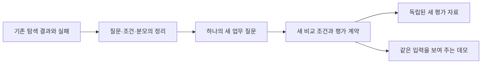

# 탐색 연구의 주장별 정리와 새 연구 전환

2026-10-27 사용자 결정에 따라 기존 탐색 연구를 아래 주장 범위로 정리하고 새 연구는 독립적인 시나리오와 평가 자료로 진행합니다. 이 문서는 기존 기록의 주장 범위를 정리한 종료 문서입니다. 모든 과거 원시 실행을 다시 감사하거나 기존 원고를 확증 논문으로 승인한 것은 아닙니다. 기존 결과·오류·중단 이력과 예산 장부는 보존합니다.

## 유지할 주장과 근거

| 주장 | 관측 근거 | 허용하는 결론 | 확대하지 않을 결론 |
|---|---|---|---|
| 사전 계산 보고서가 LLM 판단에 도움이 될 수 있습니다. | 합성 제조의 비교 가능한 189개 실행 묶음에서 직접 판단 124/189, 판단 전 검사 179/189, 판단 후 검사 139/189 | 해당 정책·모델·완료 묶음에서 사전 보고서 조건의 계약 일치가 높았습니다. | 189개 독립 질문, 모든 업무에서의 효과, RDF 고유 이점 |
| 같은 의미를 구현하면 Python과 OWL-RL이 같은 도출 결과를 낼 수 있습니다. | 합성 그래프 64개·질의 640개에서 직접 조회 504/640, 두 추론 구현 각각 640/640 | 제공된 계층·역관계·전이·관계 합성의 실행 결과를 확인했습니다. | 실제 문서의 의미 자동 발견, OWL 일반 추론 능력, 외부 사실 확인 |
| 검사 도구의 제공과 실제 활용은 다릅니다. | 제조·금융 도구 연구와 YAGO의 조회 실패·검사 미실행·종료 실패 | 도구 인터페이스와 근거 문맥, 종료 정책을 별도로 설계해야 합니다. | 검증 강제가 항상 안전함, 실패가 온톨로지 자체의 무용성을 뜻함 |
| 문법 통과만으로 생성 규칙의 의미를 보장하지 못합니다. | 저장된 NL2SHACL 생성물의 반례 진단에서 과소·과잉 제약 관측 | 선언한 유한 반례에서 생성 규칙의 차이를 찾았습니다. | 모든 규칙의 논리 동치 증명, 실제 기업 문서 이해 성능 |
| 같은 정책은 여러 구현으로 실행할 수 있습니다. | 기술 선택 연구의 22개 작성 사례·198회 실행, 규칙 확장 연구의 384개 판정 | 제한된 구현에서 판정 동등성과 변경 위치를 비교했습니다. | 코드 줄 수가 사람의 유지보수 시간이라는 주장, RDF의 일반적 성능 우위 |
| 통합 4단계 진단은 실행 가능한 설명 기반입니다. | 반례·근거 상태·규칙 라운드·보고서 필드의 별도 오프라인 진단 | 각 진단이 실제로 계산한 결과와 한계를 설명할 수 있습니다. | 자연어 생성부터 LLM 응답까지 종단간 검증을 완료했다는 주장 |

근거: [하이브리드 비교](../experiments/records/20261013-hybrid-comparison.md), [추론 실행](../experiments/records/20261013-ontology-reasoning.md), [제조·금융 도구](../experiments/records/20261015-llm-ontology-tools.md), [YAGO 도구](../experiments/records/20261015-yago-native-tools.md), [NL2SHACL 반례 집계](../experiments/records/20261017-nl2shacl-semantic-expansion.json), [기술 선택 연구](2026-10-21-technology-selection-paper.md), [규칙 확장 결과](../experiments/records/20261022-rule-extension.json).

## 정정한 주장과 미측정 영역

[정정된 통합 기록](../experiments/records/20261022-unified-rule-lifecycle.md)을 과거 인계 메모보다 우선합니다.

- 통합 진단의 GLEIF 24건 전이는 실행하지 않았습니다. 다른 연구의 실제 GLEIF 결과로 대체하지 않습니다.
- 1단계는 미리 작성한 오류 함수와 기준 구현의 비교입니다. 자연어 컴파일러의 성능이 아닙니다.
- 2단계는 `unknown`일 때 전체 원천을 한 번 재평가합니다. `sh:resultPath` 기반 선택적 네트워크 검색이 아닙니다.
- 3단계의 예시 문자열 줄 차이는 버전별 실행 코드 변경량이나 사람의 작업 시간이 아닙니다. 공유 Python 정책을 제외한 버전 비교는 RDF 고유의 공유 효과가 아닙니다.
- 4단계는 LLM 응답을 측정하지 않았습니다. 충돌 값은 180/240건이며 Python·SQL의 동일 상세 보고서 대조군은 미측정입니다.
- 하이브리드의 Python·SHACL 사전 보고서 입력은 같지만 Python 보고서를 사용한 별도 LLM 호출은 없었습니다. 두 호출 조건의 경험적 동등성을 측정했다고 쓰지 않습니다.

실제 업무 유용성, 사람의 검토 시간, 스키마 변경의 장기 비용, 자연어에서 의미 계약을 자동 선택하는 능력, 공개 실데이터에 대한 일반화는 남은 질문입니다. 기존 통합 원고는 탐색 결과의 종합 초안으로 보존하며 “가장 실효성 있는 개입” 등 보편적 순위를 새 연구의 확정 결론으로 가져오지 않습니다.

## 새 연구에 가져갈 설계 원칙

기존 측정값은 새 가설의 동기와 실패 방지 목록으로만 사용합니다. 기존 응답·정답·소비된 코호트를 새 평가에 합치지 않습니다. 자료 형식이나 범용 파서의 재사용은 가능하지만 재사용 목록과 역할을 기록합니다. 새 연구는 [인증 상태와 제품 재검토 근거 설계](../experiments/evidence-report-study.md)로 이어집니다.

## 종료 기준과 현재 상태

주장별 근거·한계·철회 내용을 기록했고 과거 계획서와 통합 원고에는 이 문서와 새 설계로 연결되는 상태 안내를 추가합니다. 기존 실험을 더 돌려 분모를 채우거나 새 설계에 맞게 과거 결과를 고치지 않습니다. 새 LLM 실험은 아직 실행하지 않았습니다. 새 자료와 모델·예산을 동결한 뒤 별도 실행 기록으로 시작합니다.
