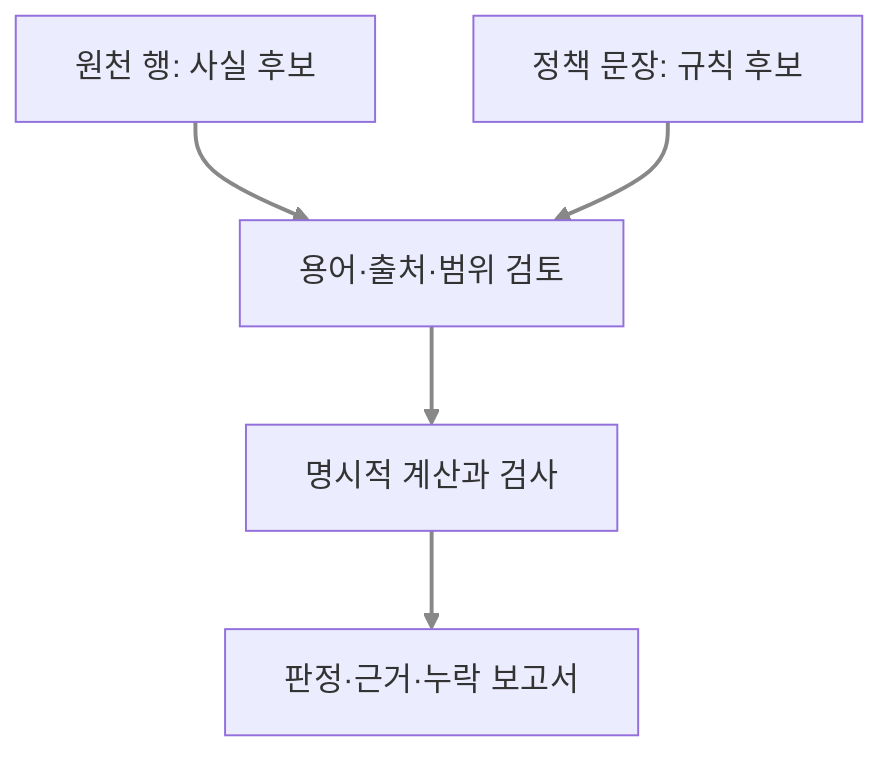

# 원천 구축과 규칙 적용의 병목 분리

10월 28일에는 새 연구 설계에 원천 데이터 처리와 기술 선택 기준을 보완했습니다. 질문은 네 가지입니다. 원천에서 관계와 규칙을 어떻게 만드는지, 처리 경로마다 무엇을 넣고 받는지, 규칙 구축과 적용 중 어디서 실패하는지, 그래프를 사용할 조건은 무엇인지입니다.

## 사실과 정책의 두 입력

테이블의 만료일은 사실 후보이고 만료일을 반드시 기록해야 한다는 문장은 정책입니다. 데이터에 값이 자주 등장한다는 이유로 필수 규칙을 만들지 않습니다. 원천 행과 정책 문장을 각각 추적하면서 식별자·관계 방향·날짜·예외를 명세합니다.

## 단계별 진단 기준

| 관측한 실패 | 먼저 확인할 단계 |
|---|---|
| 정책에 필수 조건이 정의되지 않음 | 규칙 정의 |
| 요구사항은 있지만 shape에서 minCount가 빠짐 | 규칙 변환 |
| shape은 맞지만 대상 타입이 없어 검사 대상이 0개임 | 실행 범위 |
| 필요한 관계 행이 조회 입력에서 빠짐 | 근거 확보 |
| 계산은 맞지만 LLM이 다른 판정이나 근거를 제시함 | 보고서 활용 |

LLM·Python·온톨로지는 서로 배타적인 기술 분류가 아닙니다. 같은 사실과 정책을 받는 처리 경로로 비교해야 합니다. 그래프의 관계·경로 재사용과 RDF·OWL·SHACL의 기능도 나누어 설명합니다. 유지보수 비용이나 RDF의 우위는 이번 문서만으로 입증하지 않습니다.

## 현재 설계의 범위

[보완 설계안](../experiments/source-to-rule-guide.md)에 전처리 표, 프롬프트, 중간 규칙 JSON, SHACL 예제, NL2SHACL 선행연구와 개발용 교체 진단을 정리했습니다. 아직 검증할 권고안이며 자동 추출 실험 결과는 아닙니다.

주실험은 동일한 계산 판정에 상세 근거를 추가하는 C−B 비교를 유지합니다. 자연어 규칙 생성과 그래프 유지보수는 별도 검증 과제입니다. 기존 프로토콜과 공개 데모 데이터는 이 보완으로 변경하지 않았습니다.
