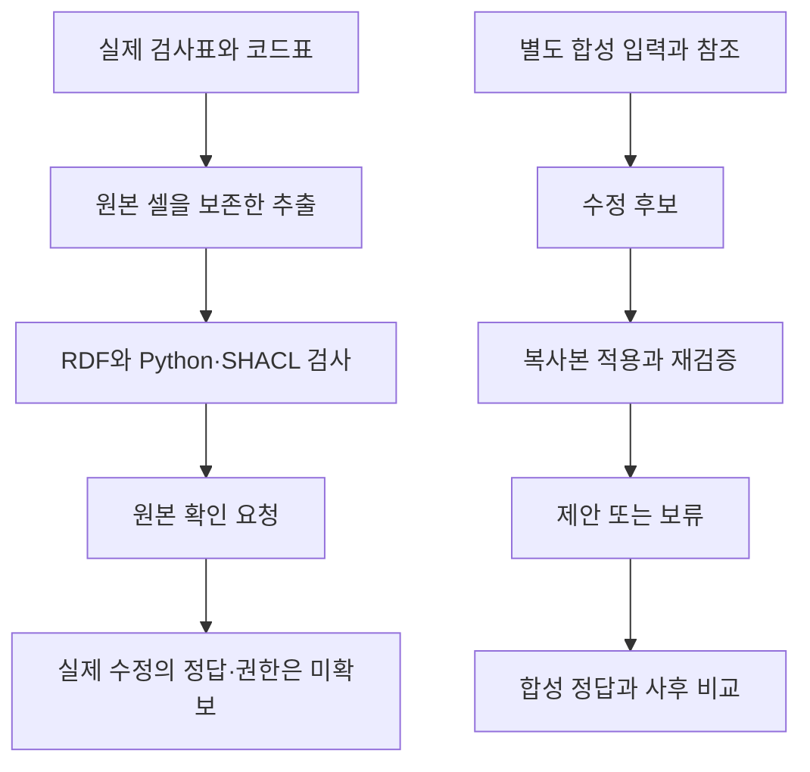

# 근거 기반 조치 연구의 현재 결과와 다음 사례

## 완료한 범위

이번 작업에서는 실제 제조 자료의 전처리와 검증을 구현하고, 별도의 합성 사례에서 수정 후보와 재검증을 실행했습니다. 실제 공정의 개선 효과나 그래프의 우월성을 입증한 단계는 아닙니다. 두 종류의 결과를 연결하되 같은 실험으로 합치지 않습니다.

## 주장별 근거

| 주장 | 확인한 근거 | 현재 결론 |
|---|---|---|
| 실제 표에서 출처가 있는 관계 데이터를 만들 수 있다 | Excel 5개 파일의 243행, 코드표, 수식·저장값 27쌍을 직접 추출하고 기존 전사본과 대조 | 알려진 열 구조를 사람이 매핑한 전처리는 재현했습니다. 자연어 관계 추출 성능은 측정하지 않았습니다. |
| 명시한 조건을 두 구현으로 검사할 수 있다 | 실제 243행에 Python과 SHACL Core 적용, 행별 위반 집합 모두 일치 | 구현 간 일치입니다. 두 구현이 공유하는 의미 매핑과 원본 사실의 정확성을 증명하지 않습니다. |
| 근거를 따라 수정 후보를 만들고 적용 전 검사할 수 있다 | 별도 합성 개발 사례 32개, 3개 후보 방식과 2개 검사 반영 조건으로 192개 비교 결과 저장 | 선언한 정책 아래의 동작을 확인했습니다. 실제 제조 기록의 수정 정답을 얻은 것은 아닙니다. |
| 재검증이 잘못된 제안을 일부 보류할 수 있다 | 관계 조회를 구현한 Python과 SHACL-AF 각각에서 의존 조건을 위반한 제안이 4건에서 0건으로 감소 | 검사하도록 선언한 조건에 한정한 효과입니다. 불필요한 보류와 사실 오류도 따로 봐야 합니다. |
| 검증 통과가 사실 확인을 대신한다 | 같은 합성 조건에서 형식에 맞는 거짓 근거로 사실 오류 4건이 나왔고 재검증 후에도 남음 | 이 주장은 지지하지 않습니다. 외부 근거 또는 전문가 확인이 필요합니다. |
| 그래프가 일반 코드보다 유리하다 | 같은 정책의 Python과 SHACL-AF 결과가 일치, 실제 자료는 주로 행 검사와 코드표 참조 | 아직 입증하지 않았습니다. 유지보수 시간이나 SQL·그래프 엔진 성능도 측정하지 않았습니다. |

192개 결과는 서로 독립적인 192개 현장 사례가 아닙니다. 같은 32개 합성 입력을 여러 조건에서 실행했습니다. 이전 144개 합성 개발 사례도 별도로 보존했으며 새 평가 자료로 다시 세지 않았습니다.

## 현재 가능한 조치

실제 PP5 25행의 177→160 mm와 73717→66637 샘플 구간에는 원본 확인 요청을 만들었습니다. 어느 값이 맞는지는 알 수 없으므로 자동 수정하지 않습니다. 별도로 확인한 PP7 10행의 설정 코드와 설계 문서 간 차이도 적용 범위와 출처 확인이 먼저입니다. 명목 전류를 실제 측정값이나 변경 처방으로 사용하지 않습니다.

합성 사례에서는 참조 기록과 적용 조건이 주어졌을 때 수정 후보를 만들고 복사본에서 검사했습니다. 실제 자료에는 아직 이 참조가 정답이라는 근거와 수정 권한이 없습니다. 따라서 지금 실제 자료에 적용할 수 있는 결과는 확인할 기록·셀·조건을 제시하는 단계입니다.

## 규칙 작성과 적용의 병목

| 작업 | 이번에 확보한 것 | 남은 문제 |
|---|---|---|
| 표의 의미 해석 | 고정된 열 이름과 코드표의 범위를 사람이 지정 | 문서·열 구조가 바뀔 때 누가 매핑을 수정하고 승인하는지 |
| 규칙 작성 | 값·타입·코드 참조·구간 순서의 조건을 명시 | 업무 담당자가 실제로 요구하는 조건인지와 예외의 적용 범위 |
| 규칙 적용 | Python과 SHACL 실행, 보고서와 원본 셀 연결 | 검색에서 필요한 자료가 빠졌을 때의 별도 처리 |
| 조치 결정 | 근거 요청과 확인 요청, 합성 수정 후보 | 수정 정답의 출처, 적용 시점, 승인 권한과 책임 |

현재 자료에서는 규칙 실행보다 적용 범위와 확인 책임을 정하는 데 더 큰 병목이 있습니다. 어떤 문서의 정의를 어느 기록에 적용할지, 불일치를 발견한 뒤 누가 무엇을 확인해야 하는지가 충분히 정의되지 않았습니다. 이 판단은 이번에 살펴본 자료와 구현 범위에 한정합니다.

## 다음 시나리오의 선택 기준

다음 시나리오 후보는 **“기록이나 코드표의 해석이 바뀌면 어떤 검토 결과의 근거를 다시 확인해야 하는가”**입니다. 공정 조건을 자동 조정하는 문제보다, 원천 기록·의미 정의·검토 결과의 연결을 추적하는 문제에 초점을 맞춥니다.

이 시나리오를 실제 자료 실험으로 진행하려면 다음 연결의 근거가 필요합니다.

| 필요한 연결 | 자료 채택 기준 |
|---|---|
| 원천 기록 → 시험편·비드·검사 구간 | 식별자와 좌표의 의미가 문서에 명시되어 있음 |
| 검사 결과 → 사용한 코드표·절차 버전 | 적용한 버전이나 시점을 확인할 수 있음 |
| 검토 결과 → 사용한 기록·규칙 | 결과를 만들 때 사용한 근거를 추적할 수 있음 |
| 변경 사항 → 재확인이 필요한 범위 | 실제 변경 이력 또는 명시적으로 작성한 가상 변경임을 구분할 수 있음 |

PENELOPE에서 앞의 일부 연결은 확보했지만, 절차 버전과 실제 검토·변경 이력까지 확보한 것은 아닙니다. 없는 부분을 합성으로 보완한다면 실제 용접 자료 위에 연구자가 만든 업무 이력을 얹은 실험으로 표시해야 합니다. 이를 실제 공장 운영 이력이라고 부르지 않습니다.

이 연결이 확보되지 않으면 PENELOPE는 전처리·검증 실습 자료로 유지하고, 그래프의 장점을 검증할 주 실험 자료는 별도로 고르는 편이 타당합니다. 관계 수를 인위적으로 늘리는 것만으로 자료의 한계를 해결했다고 보지는 않습니다.

## 비교 조건과 가설

직접 식별자가 있는 질문, 여러 기록을 연결해야 하는 질문, 의미 정의나 버전이 바뀐 뒤 재확인 대상을 묻는 질문을 나눕니다. 검색 결과를 평가할 때도 답만 맞는지와 필요한 근거 경로를 확보했는지를 분리합니다.

- 키워드·벡터 검색은 같은 원천 자료와 반환 예산을 사용합니다. 검색 결과를 답으로 바꾸는 방법도 명시해야 합니다.
- SQL·Python과 그래프에는 같은 식별자 매핑, 의미 정의, 적용 정책을 제공합니다. 그래프에만 추가 정보를 주고 효과로 해석하지 않습니다.
- 비교 지표는 대상 누락·과잉 포함, 근거 경로의 완전성, 오래된 정의 사용, 불필요한 보류로 나눕니다. 변경에 필요한 사람의 작업량을 주장하려면 별도의 시간·수정 기록이 필요합니다.

검증할 가설은 “직접 조회에서는 검색으로 충분할 수 있지만, 여러 기록과 정의를 결합하는 질문에서는 명시적 관계 계산이 근거 경로 확보에 도움이 되는가”입니다. 같은 의미를 구현한 SQL·Python과 그래프의 차이는 별도로 평가합니다. 지금 결과만으로 이 가설을 검증했다고 말하지 않습니다.

## 실행 자료

- [Meyers 외 논문 리뷰](2026-10-29-review-meyers-manufacturing.md): 논문 자체의 아키텍처와 제조 사례를 다룬 독립 리뷰입니다.
- [실제 검사표에서 SHACL 보고서까지](2026-10-29-source-to-shacl.md): 실제 입력·shape·보고서와 재현 명령입니다.
- [합성 조치 실험](../experiments/actionable-evidence-study.md): 수정 후보, 재검증, 사실 오류와 보류의 구분입니다.
- [근거 확인 데모](../experiments/actionable-evidence-demo/index.html): 실제 확인 요청과 저장된 합성 실행을 구분한 화면입니다.
- [실제 자료 SHACL 실습 노트북](../experiments/seminar/notebooks/penelope-source-validation.ipynb): 실제 주석 두 행을 포함하며 저장 출력은 Python 커널에서 실행한 결과입니다. Excel 추출과 전체 243행 실험을 노트북 안에서 다시 수행하지 않습니다.

현재 단계에서 확인하지 못한 항목은 자연어→관계·shape 생성 성능, 실제 제조 수정의 정답, 그래프의 고유한 성능·유지보수 이점입니다. 후속 실험은 이 빈칸 중 하나를 선택해 설계하는 것이 좋습니다.
