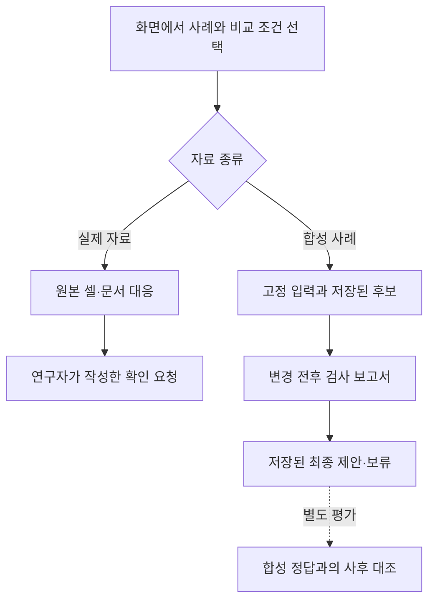

# 제조 기록의 확인 요청과 수정안 재생

[오프라인 데모](../experiments/actionable-evidence-demo/index.html)는 실제 용접 자료의 확인 요청과 합성 사례의 수정안을 구분해서 보여줍니다. 실제 자료 두 건에는 연구자가 작성한 확인 항목을 붙였습니다. 합성 사례 네 건은 앞서 실행한 `run-001`의 결과를 불러옵니다. 브라우저에서 새로 추론하거나 원본을 수정하지 않습니다.

## 화면의 자료 구분

| 구분 | 사례 | 화면에서 확인할 내용 |
|---|---|---|
| 실제 자료 점검 | PP5 25행 | 177→160 mm와 73717→66637 샘플 구간의 방향 확인 |
| 실제 자료 점검 | PP7 10행 | 주석의 설정 1과 설계에 대응하는 설정 2의 적용 근거 확인 |
| 합성 실행 재생 | `c008` | 두 단계 참조로 누락된 추출 필드의 복원 후보 제시 |
| 합성 실행 재생 | `c015` | 복원값은 참조와 같지만 의존 조건 위반으로 제안 보류 |
| 합성 실행 재생 | `c014` | 선언 조건은 통과하지만 합성 정답과 다른 제안 |
| 합성 실행 재생 | `c009` | 근거 부족으로 자료 요청; `c010`과 보이는 입력이 같음 |

PP7의 설정 코드가 가리키는 450 A와 550 A는 문서의 명목 설정입니다. 실제 측정 전류나 전류 변경 권고가 아닙니다. PP5의 역순 구간도 두 값을 바꾸면 맞는다고 확정할 수 없습니다. 두 실제 사례에는 실행하지 않은 SHACL 판정이나 수정 정답을 붙이지 않았습니다.

## 입력과 평가의 분리

합성 사례에서는 한 단계 참조, 관계 조회 Python, SHACL-AF를 선택할 수 있습니다. 수정 후 검사 결과를 보류에 반영할지도 바꿔 볼 수 있습니다. 선택에 따라 저장된 여섯 조건의 출력 중 하나를 표시합니다.

사후 평가 영역은 실행기가 받은 입력과 분리했습니다. `c014`에서는 검사 통과와 사실 오류를 함께 볼 수 있습니다. 정답을 화면에 표시한다고 해서 실행기가 그 정답을 알고 판단한 것은 아닙니다. `c009`와 `c010`의 원인 라벨도 평가에만 있으며 보이는 입력만으로 원천 누락과 검색 누락을 구분하지 않습니다.

## 재생과 출처 확인

재생 버튼은 입력, 관계, 후보, 검사, 최종 처리의 순서를 강조합니다. 내용은 처음부터 표시하며 버튼이 새 실행을 요청하지는 않습니다. 원본 셀 위치, 파일 해시, 합성 입력, 저장된 출력 JSON을 함께 확인할 수 있습니다. 실제 자료와 합성 데이터를 새 실험으로 합쳐 집계하지 않습니다.

데모 생성기는 전체 192행의 사례·비교 조건 조합과 입력 해시를 검사한 뒤 선택한 24개 합성 출력을 그대로 복사합니다. 기존 실행 결과는 덮어쓰지 않습니다. 원본 추출과 실행 파일의 해시는 별도 생성 기록에 남깁니다. 이는 저장된 자료와 화면의 대응을 확인하는 절차이며 제조 현장의 정확도를 새로 측정하는 실험이 아닙니다.

전체 비교 설계와 수치는 [제조 기록의 확인 요청과 근거 기반 수정안](../experiments/actionable-evidence-study.md)에 정리했습니다. 실제 자료의 출처는 Tapia Suárez 외의 [Submerged Arc Welding Open Repository](https://doi.org/10.5281/zenodo.15083865), CC BY 4.0입니다. 데모의 자료 선택과 한국어 해설은 연구자가 작성했습니다.
