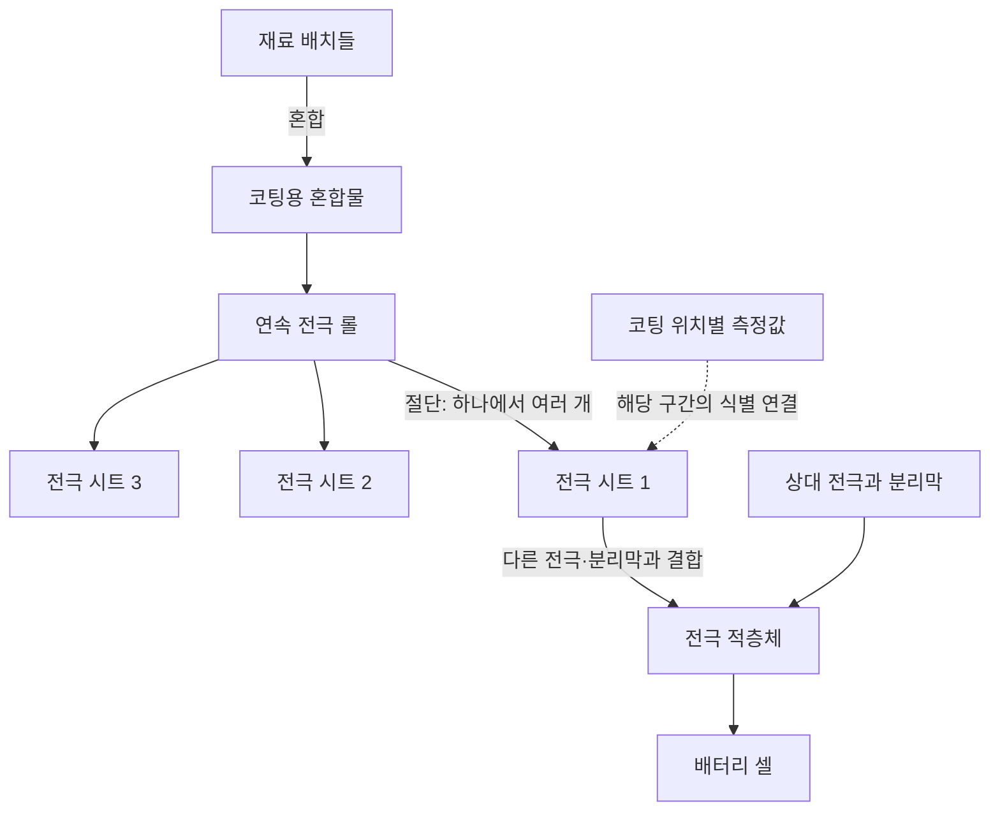
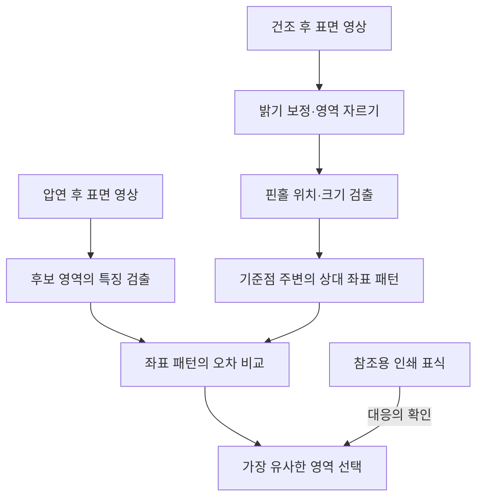

# Wessel 외 논문 리뷰 — 배터리 전극의 식별과 생산 이력 추적

배터리 공장에서 측정값을 많이 수집하는 것과 그 값이 어느 전극 조각의 특성인지 알아내는 것은 서로 다른 문제입니다. 긴 전극 롤을 자르고 여러 장을 쌓으면 물체의 단위가 달라집니다. 코팅 공정에서 이상을 발견했더라도 그 구간이 어느 셀에 들어갔는지 모르면 선별이나 원인 조사에 쓰기 어렵습니다.

Wessel 외의 *Traceability in Battery Cell Production*은 이 연결 문제를 다룹니다. 추적 체계의 설계, 전극 표면을 이용한 식별 실험, 전극별 측정값 배분, 재료비와 폐기량의 계산을 함께 제시합니다. 각각의 검증 수준은 다릅니다. 물리적 식별의 시연과 질량 측정 비교, 비용 모형을 구분해서 읽어야 합니다.

## 서지 정보와 읽기 범위

| 항목 | 내용 |
|---|---|
| 저자 | Jacob Wessel, Alexander Schoo, Arno Kwade, Christoph Herrmann |
| 학술지 | *Energy Technology* 11(5), 2200911, 2023 |
| 온라인 최초 공개 | 2022년 11월 16일 |
| 실험 기관 | 독일 TU Braunschweig의 Battery LabFactory Braunschweig, BLB |
| 원문 | [Wiley 공식 본문](https://onlinelibrary.wiley.com/doi/full/10.1002/ente.202200911) · [DOI](https://doi.org/10.1002/ente.202200911) |
| 공개 조건 | 논문 CC BY-NC 4.0. 연구 데이터는 공유하지 않는다고 명시합니다. |

이 글은 원문 전체의 본문·수식·표 2개·그림 11개의 캡션과 관련 설명을 검토했습니다. 출판사와 저장소의 이미지 접근 제한으로 그림 자체를 확대 대조하지는 못했습니다. 아래 도식은 본문을 바탕으로 새로 그린 설명용 그림이며 원문 그림을 복제한 것이 아닙니다.

## 1. 전극 롤에서 배터리 셀까지의 식별 문제

일반적인 생산 흐름은 전극 제조, 셀 조립, 셀 컨디셔닝으로 나뉩니다. 전극 제조에서는 재료를 혼합하고 집전체에 코팅하고 건조·압연한 뒤 필요한 크기로 자릅니다. 조립에서는 여러 전극과 분리막이 하나의 구조물로 합쳐집니다. 논문의 관심은 이 과정에서 물체와 데이터의 대응을 유지하는 데 있습니다. [§1–2.1]



텍스트로 읽으면 `재료 배치 → 전극 롤 → 잘린 시트 → 적층체 → 셀`입니다. 분할과 결합이 일어날 때 입력과 출력의 연결을 남겨야 앞 공정의 측정값을 뒤 공정의 물체에 대응시킬 수 있습니다.

### 추적 단위와 정보 손실 지점

**TRU, Traceable Resource Unit**은 정보를 붙여 관리할 추적 단위입니다. 완성 셀일 수도 있고 전극 롤이나 잘린 시트일 수도 있습니다. 이름표의 형식보다 어떤 범위의 물질을 같은 단위로 취급하는지가 중요합니다.

**CTP, Critical Traceability Point**는 추적 정보가 체계적으로 끊길 수 있는 지점입니다. 불량이 많이 발생하는 설비와 반드시 같지는 않습니다. 절단 과정에서 롤 번호만 남고 각 시트의 원래 위치를 잃는다면, 절단은 추적 관점에서 중요한 지점입니다. [§2.1.1–2.1.2, 그림 2]

논문은 기록할 기본 요소를 누가, 무엇을, 어디서, 언제, 왜 처리했는지로 설명합니다. 여기에 목적에 맞는 품질 측정값을 붙입니다. 모든 데이터를 무조건 저장하는 방식보다 추적 목적과 물체의 변환을 먼저 정하는 접근입니다.

### Tracking과 tracing

Tracking은 생산 흐름을 따라 물체와 정보를 기록하는 활동입니다. Tracing은 기록을 이용해 기원과 처리 이력을 되짚는 활동입니다. 기록 단계에서 대응 관계를 잃으면 나중에 조회 기능을 정교하게 만들어도 복구할 근거가 부족해집니다. [§2.1, §3]

## 2. 추적 체계의 구성

논문의 프레임워크는 물리적 생산, 데이터 수집, 디지털 표현, 해석과 의사결정을 연결합니다. [§3, 그림 4–5]

| 설계 단계 | 결정할 내용 | 잘못 정했을 때의 문제 |
|---|---|---|
| 상황 분석 | 목적, 이해관계자, 공장 내 범위 | 필요한 판단과 무관한 데이터 수집 |
| 추적 단위·식별 | 어떤 물체를 어떤 단위로 구별할지 | 롤 수준 기록으로 시트 수준 판단 시도 |
| 데이터 취득 | 센서·공정·제품 특성 | 필요한 특성 자체가 측정되지 않음 |
| 맥락 부여 | 식별자, 시각, 공정과 측정값의 대응 | 값은 있지만 어느 물체의 값인지 모름 |
| 관계 구조화·접근 | 입력·출력과 처리 이력의 연결 | 분할·결합 이후 이력 단절 |
| 해석·품질 판단 | 기록 조회, 이상 분석, 품질 게이트 | 측정과 실제 조치의 분리 |

온톨로지와 그래프 기반 표현도 논의하지만 이 논문이 서로 다른 데이터베이스의 성능을 비교한 것은 아닙니다. 선행연구 비교표인 표 1도 전문가 판단으로 접근법의 적용 범위를 정리한 표이며 동일 데이터에서 측정한 정확도 순위가 아닙니다.

## 3. Data Matrix 코드와 표면 특징의 두 식별 경로

### 반복 인쇄한 코드와 공정 데이터 연결

BLB의 구현에서는 코팅 장치에 잉크젯을 설치해 전극에 50 mm 간격으로 Data Matrix 코드를 인쇄했습니다. 나중에 잘린 시트에도 코드가 적어도 하나 남도록 하려는 설계입니다. 공정에서는 코드를 읽고 OPC-UA를 통해 관련 데이터를 연결합니다. [§4.1, 그림 7]

이 방식은 측정값을 기록할 때 그 구간의 물리적 식별자도 함께 확보합니다. 뒤에서 설명하는 두 응용 시나리오는 이 코드 기반 경로를 사용했습니다. 질량 비교 결과를 표면 특징 식별의 정확도로 읽으면 안 됩니다.

### 표면의 핀홀을 이용한 식별

별도 실험에서는 전극 표면의 특징을 지문처럼 활용합니다. 80 m × 200 mm 음극을 제작하면서 공기 방울을 넣어 구별 가능한 표면 특징을 늘렸습니다. 건조 중 생기는 약 100–200 μm 크기의 핀홀을 건조 후와 압연 후 영상에서 대응시키는 방식입니다. 압연 후 전극 밀도는 1.4 g/cm³입니다. [§4.2, 그림 8]



Python/OpenCV와 ImageJ를 사용하고 Hough transform과 blob detection으로 특징을 찾습니다. 매칭에서는 대응 특징점의 좌표 차이를 제곱한 값을 평균합니다. 작은 값일수록 두 패턴의 위치 구성이 가깝습니다. 핀홀 지름 차이도 분석하지만 영상의 밝기 영향을 크게 받기 때문에 직접적인 매칭 결정과 구분합니다.

그림 8의 예에서는 한 패턴이 압연 후의 특정 영역과 대응하고 인쇄 표식으로 이를 확인합니다. 그러나 전체 시도 중 몇 개를 맞혔는지, 잘못 연결한 비율, 누락률, 생산 속도에서 처리하는 데 걸린 시간은 보고하지 않습니다. 의도적으로 특징을 늘린 시편이므로 결함이 거의 없는 표면에서도 같은 성능을 낸다고 단정할 수 없습니다. 핀홀이 셀 성능에 미치는 영향도 후속 과제입니다.

## 4. 양극·음극 용량 균형과 안전 여유

배터리는 양극과 음극의 용량 균형이 중요합니다. 음극 용량이 부족하면 리튬 도금 위험이 생길 수 있고 과도하게 크게 잡으면 재료가 늘고 비에너지가 낮아집니다. 논문은 공정 변동과 안전 여유를 함께 계산합니다. [§4.3.1, 그림 9]

양극 목표 면적당 용량을 `C_C,T`, 음극 목표를 `C_A,T`, 각각의 공정 표준편차를 `σ_P,C`, `σ_P,A`, 선택한 배수를 `σ_U`라고 하면 다음 관계를 사용합니다.

```text
양극 상한 = C_C,T + σ_U × σ_P,C
음극 하한 = C_A,T − σ_U × σ_P,A

두 경계가 맞닿도록 설정하면
C_A,T = C_C,T + σ_U × (σ_P,C + σ_P,A)

음극 안전 여유 s[%] = 100 × C_A,T / C_C,T − 100
```

여기서 안전 여유는 목표 용량을 얼마나 더 크게 잡는지를 나타내는 비율입니다. 실제 안전사고 확률을 측정한 값은 아닙니다. 공정 표준편차를 줄이는 것과 허용 배수를 낮추는 것도 다릅니다. 전자는 공정을 안정화하는 것이고 후자는 더 많은 부적합 구간을 제외하는 대신 재료 여유를 줄이는 선택입니다.

논문의 Six Sigma 계산에는 1.5σ 평균 이동 관례가 포함됩니다. 3.4 DPMO를 평균이 고정된 정규분포의 단순한 ±6σ 확률로 설명해서는 안 됩니다.

## 5. 폐기 비용과 추가 재료 비용의 조건부 계산

표 2는 길이 500 m, 폭 200 mm인 단면 음극을 가정합니다. 면적은 100 m²이고, 면적당 질량 10.20 mg/cm²와 표준편차 0.08 mg/cm²를 사용합니다. 활성 물질 가격 €45/kg, 구리박 €10.40/m² 등의 조건으로 폐기 비용과 안전 여유에 필요한 추가 재료 비용을 계산합니다. [§4.3.2, 표 2]

| 선택 배수 | 모형의 수율 | 폐기 비용 | 안전 여유 재료비 | 합계 |
|---|---:|---:|---:|---:|
| 3.0σ | 93.31890% | €98.40 | €21.08 | €119.5 |
| 4.0σ | 99.37900% | €9.10 | €28.08 | €37.2 |
| 4.5σ | 99.86500% | €2.00 | €31.58 | €33.6 |
| 5.0σ | 99.97670% | €0.30 | €35.08 | €35.4 |
| 6.0σ | 99.99970% | €0.01 | €42.08 | €42.1 |

제시된 조건에서는 4.5σ의 합계가 가장 작습니다. 6.0σ보다 폐기량은 늘지만 여유 재료비가 더 크게 줄어듭니다. 이 표를 수율 향상을 실증한 결과라고 설명하면 방향이 뒤집힙니다.

계산에는 중요한 전제가 있습니다. 부적합 구간이 모여 있고 그 구간을 식별해 제외할 수 있어야 합니다. 아주 작은 불량이 여러 시트에 흩어져 시트 전체를 버려야 한다면 면적 기반 계산과 실제 폐기량이 달라질 수 있습니다. 추적 장비의 설치·운영비와 전체 제조비도 이 합계에는 포함되지 않습니다. 특정 가격과 공정 조건을 둔 비용 비교이지, 실제 공장의 절감액이나 보편적 최적 설정은 아닙니다.

## 6. 15개 양극 시트의 질량 비교

실제 측정 비교에서는 105 × 145 mm 크기의 양면 양극 시트 15개를 사용했습니다. 시트의 식별자와 시각으로 코팅 측정 기록을 배분하고 각 구간의 면적당 질량을 합산해 시트의 코팅 질량을 계산했습니다. 이를 분석용 저울의 측정값과 비교했을 때 논문은 ±0.8% 범위의 편차를 보고합니다. [§4.3.2, 그림 10]

이 수치는 **15개 시트의 계산 질량과 저울 측정 질량 사이의 일치 정도**입니다. 식별 성공률, 완성 셀의 용량 예측 정확도, 안전 보증 수준을 뜻하지 않습니다.

센서의 실제 측정 폭은 5 mm이고 간격은 20 mm로 설명됩니다. 가로 방향 전체를 직접 측정하는 구성이 아니며 시트 질량 계산에서는 20 × 1 mm의 대표 영역을 사용합니다. 물리적으로 감지한 폭과 값이 대표하는 면적을 구분해야 합니다. 본문 일부의 폭 표현도 일관되지 않아 장비를 그대로 재현하려면 추가 확인이 필요합니다. [§2.2, §4.3]

### 총질량과 국소적인 코팅 부족

그림 11을 설명하는 본문은 시트 ID 13을 예로 듭니다. 시트 전체 질량은 허용 범위에 있지만 가로 방향의 일부 구간은 양극의 하한보다 코팅이 부족합니다. 총합만 보면 이 국소적인 차이를 놓칩니다.

아래는 이를 이해하기 위한 가상의 예이며 논문의 실측값이 아닙니다.

| 시트 | 왼쪽 구역 | 중앙 구역 | 오른쪽 구역 | 총합 |
|---|---:|---:|---:|---:|
| A | 10 | 10 | 10 | 30 |
| B | 13 | 4 | 13 | 30 |

총합이 같아도 분포는 다릅니다. 이 논문에서 공간별 측정값을 시트에 연결하는 이유가 여기에 있습니다. 다만 이런 정보를 이용해 전극을 최적으로 짝짓는 지능형 적층과 수명 개선까지 실제로 검증한 것은 아닙니다.

## 7. 기여와 미검증 범위

논문의 강점은 추적을 식별자 저장만으로 설명하지 않는 데 있습니다. 물체가 바뀌는 지점, 측정 해상도, 데이터의 귀속 단위, 품질 판단의 단위를 함께 다룹니다. 코드 기반 구현, 표면 패턴 시연, 작은 규모의 질량 비교를 통해 각 연결을 구체화합니다.

반면 표면 특징 식별의 종합 오류율, 공장 처리량, 장기적인 셀 성능, 추적 시스템의 총투자수익은 제시하지 않습니다. 표면 특징을 늘리는 처리의 전기화학적 영향도 남아 있습니다. 데이터가 공개되지 않아 외부에서 같은 측정 비교를 다시 수행하기도 어렵습니다. [§4.4–5, Data Availability]

전극의 품질값이 어느 물리적 구간에 해당하는지 유지해야 합니다. 추적 체계는 그 연결을 가능하게 하지만 측정의 정확성이나 최종 셀의 안전성을 대신 검증하지는 않습니다.

## 원문 확인 위치

- 정의와 선행연구: §2.1–2.3, 그림 1–3, 표 1.
- 체계와 구현: §3–4.1, 그림 4–7.
- 표면 특징 식별: §4.2, 그림 8, 인쇄 쪽수 p.10.
- 용량 균형과 비용: §4.3.1–4.3.2, 그림 9·표 2, pp.11–12.
- 질량 및 공간 분포: 그림 10–11, pp.12–13.
- 토의·결론·공개 범위: §4.4–5 및 Data Availability Statement.

출처: Wessel et al., [*Traceability in Battery Cell Production*](https://doi.org/10.1002/ente.202200911). 도식과 가상 표는 이 글의 설명을 위해 작성했습니다.
