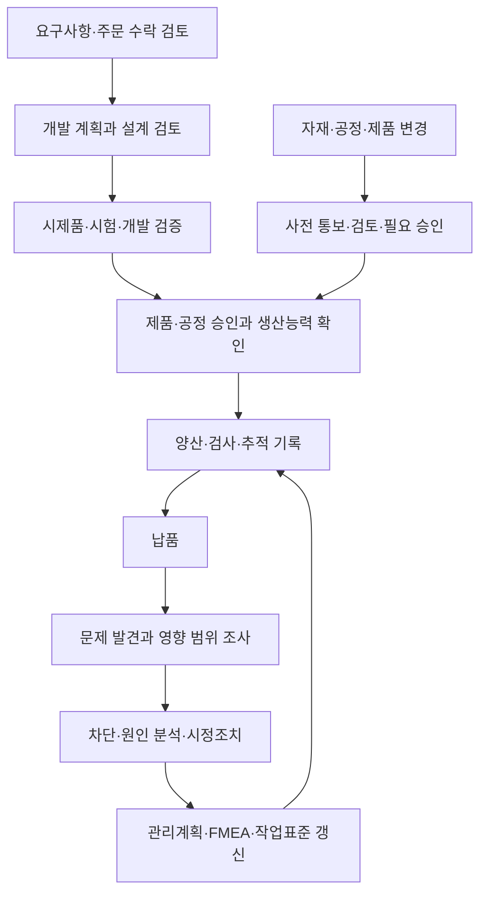
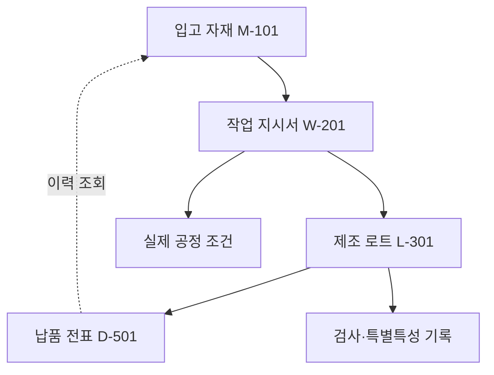

# LG마그나 협력사 요구사항 리뷰 — 추적성·변경 승인·품질 기록의 연결

납품한 부품에서 문제가 발견됐을 때는 검사 합격 여부만으로 부족합니다. 어느 자재가 들어갔고 어떤 작업을 거쳤으며 같은 조건으로 만든 제품이 어디로 납품됐는지 확인해야 합니다. 재작업이나 공정 변경이 있었다면 그 이력과 승인도 함께 따라가야 합니다.

LG마그나의 협력사 품질·환경 요구사항은 이런 기록을 개발부터 양산과 불만 대응까지 연결합니다. 이 글은 추적성 조항을 중심으로 전체 문서의 흐름과 각 기록의 역할을 설명합니다. 특정 시스템의 효과를 검증한 논문이 아니라 협력사에 요구하는 업무 기준이라는 점이 출발점입니다.

## 문서 정보와 적용 범위

| 항목 | 내용 |
|---|---|
| 문서 | *Global quality, environmental management requirements of the LG MAGNA to be met by suppliers* |
| 문서 번호 | VR 004 |
| 검토 버전 | v1.6, 2025년 12월 23일, 한국어판 18쪽 |
| 공식 원문 | [LG마그나 한국어 PDF](https://lgmagna.com/cn/wp-content/uploads/sites/3/2026/03/LG-Magna_VR004_Global-Quality-Environmental-Management-Requirements_v1.6_KOR.pdf) |
| 대상 | 시제품, 양산·서비스 부품과 자재, 가공 서비스, 해당되는 개발 업무 등 |

URL의 업로드 경로는 2026년 3월이지만 문서 내부의 버전 날짜는 2025년 12월 23일입니다. 이 글은 해당 버전 18쪽 전체를 검토한 해설입니다. 실제 적용 여부와 예외는 원문 및 개별 합의를 확인해야 하며 이 글은 공식 요구사항을 대체하지 않습니다.

문서는 ISO 9001, IATF 16949, ISO 14001, VDA, APQP, PPAP, MSA, SPC, 관련 CQI와 Quality SOR 등을 참조합니다. 이 참조를 모두 일반 법적 의무로 바꿔 읽으면 안 됩니다. LG마그나와 협력사의 관계에서 제시한 요구와 각 표준의 역할을 구분해야 합니다. [pp.1–3]

## 1. 개발에서 불만 대응까지의 전체 흐름

텍스트로 읽으면 `요구 확인 → 개발·시험 → 승인 → 양산·납품 → 문제 대응 → 문서와 공정 갱신`입니다. 변경은 기존 기록을 덮어쓰는 일이 아니라 적용 시점과 영향, 승인 조건을 관리하는 별도 경로입니다.

| 원문 장 | 중심 내용 |
|---|---|
| §1–2 | 적용 범위, 품질 체계, 특별특성, 추적성, 승인·환경 요구 |
| §3–4 | 프로젝트 계획과 주문 수락 전 실행 가능성 검토 |
| §5–6 | 개발 책임, 설계 검토, 변경, FMEA와 제조·측정 가능성 |
| §7–8 | 시제품, 시험 계획, 결과 분석, 내구성과 개발 검증 |
| §9 | 하위 공급업체에 대한 요구 전달과 변경 관리 |
| §10 | 공정 관리, 능력, 측정, 유지보수, 변경·일탈 관리 |
| §11–13 | 물류, 불만 대응, 특별 관리와 위험 수준 |
| §14 | 개정 이력 |

## 2. 추적성의 핵심 요구

§2.4, p.5는 입고 자재에서 제조·조립 배치와 로트를 거쳐 납품까지 추적할 것을 요구합니다. 실제 생산 조건과 특별특성 값도 남겨 원인 조사를 지원해야 합니다. 또한 납품 전표 번호를 작업 지시서와 입고 상품 번호에 연결할 수 있어야 한다고 설명합니다.

다음은 이 요구를 이해하기 위한 가상 데이터입니다. 실제 LG마그나 거래 기록이나 공식 데이터 스키마가 아닙니다.

| 기록 종류 | 식별자 | 연결할 대상 | 기록의 내용 예시 |
|---|---|---|---|
| 입고 자재 | M-101 | 공급사 자재 배치 | 언제 어떤 자재를 받았는지 |
| 작업 지시서 | W-201 | M-101 | 어떤 자재를 어느 작업에 투입했는지 |
| 제조 로트 | L-301 | W-201 | 어느 생산 결과에 해당하는지 |
| 공정·검사 기록 | Q-401 | W-201, L-301 | 적용 조건과 특별특성 측정값 |
| 납품 전표 | D-501 | L-301, W-201, M-101 | 어떤 이력의 물품을 납품했는지 |

이 연결로 조사할 수 있는 질문은 “M-101이 투입된 납품은 무엇인가”, “D-501과 관련된 작업 조건은 무엇인가”와 같습니다. 단, 기록의 연결이 곧 인과관계의 증명은 아닙니다. 같은 자재가 사용됐다는 사실은 조사 대상을 좁히는 근거이며 실제 원인은 공정·검사 결과를 함께 분석해야 합니다.

문서는 추적의 세분화 수준과 표시·기록 방식을 공정 지식에 따라 정하고 LG마그나와 조율하도록 합니다. 모든 부품에 동일한 식별 방식을 일괄 지정한 문서는 아닙니다. 데이터베이스 제품이나 특정 그래프 표현도 정하지 않습니다. [§2.4]

## 3. 특별특성과 기록의 우선순위

특별특성은 안전, 기능, 후속 가공과 조립 등에 중요한 제품·공정 특성입니다. 문서는 이 특성을 식별하고 관련 요구를 하위 공급업체까지 전달하며 FMEA, 관리계획, 검사 기록에 반영하도록 합니다. [§2.3]

이를 이해하려면 세 기록의 역할을 나누는 편이 좋습니다. FMEA는 어떤 고장이 생기고 어떤 영향을 줄 수 있는지 분석합니다. 관리계획은 무엇을 어떤 방법과 주기로 관리할지 정합니다. 검사·공정 기록은 실제로 무엇을 측정하고 수행했는지 남깁니다. 세 문서는 같은 대상을 다루지만 서로 대신할 수 없습니다.

검사값 하나가 있어도 그 값이 어느 특성에 해당하는지, 당시 어떤 기준이 적용됐는지, 어느 로트에서 측정했는지를 알아야 해석할 수 있습니다. 이는 문서의 여러 요구를 연결해 읽은 해설이며 별도의 공식 데이터 모델을 제시한 것은 아닙니다.

## 4. 주문 수락과 개발 단계의 예방 활동

프로젝트 계획에는 일정뿐 아니라 품질 조치, 책임, 기한을 반영합니다. 주문 수락 전에는 제공된 사양과 문서가 충분한지, 기술·품질·물류·인력·비용 측면에서 수행 가능한지 검토하고 결과를 문서화합니다. 요구사항이 부족하면 보완을 요청해야 합니다. [§3–4, p.8]

개발 업무를 수행하는 협력사는 역할과 책임, 설계·시험 기준, 기술 문서 형식, 인터페이스를 정합니다. 정기 설계 검토에서는 결과가 요구사항을 충족하는지 확인합니다. 문서는 DFMA, DOE, FMEA, CAD, 신뢰성 분석과 시뮬레이션 등 관련 방법의 활용 역량도 언급합니다. [§5, pp.9–10]

소프트웨어가 포함된 개발에는 별도의 프로세스 요구가 있습니다. 이 버전은 ISO 15504(SPICE), HIS 프로세스, SPICE 수준 2 또는 CMMI 수준 2 등을 언급합니다. 이는 문서의 해당 버전 내용을 설명한 것으로, 현재의 모든 소프트웨어 표준 체계를 정리한 목록은 아닙니다. [§5.8]

설계·제품 FMEA는 제품 사용과 수명 중 발생 가능한 문제를 다룹니다. 제조·조립·측정 가능성 검토는 설계가 생산 현장에서 구현되고 검사될 수 있는지를 확인합니다. 좋은 설계 의도와 실제 생산 가능성을 별도로 확인하는 구성입니다. [§6, pp.10–11]

## 5. 시제품·시험·양산 승인의 구분

시제품 단계에서는 부품 특성, 시험 방법과 기준, 재작업과 수리 이력을 합의한 범위로 남깁니다. 시험에서는 하중, 반복 수, 수량, 신뢰성 조건과 결과 보고 방식을 정합니다. 개발 검증은 DVP&R 같은 계획·보고서로 문서화하고 승인을 받도록 합니다. [§7–8, pp.11–12]

PPAP/PPA는 제품과 공정이 정해진 조건을 충족하는지를 확인하는 승인 절차입니다. Run at Rate는 실제 생산 조건에서 요구 생산능력을 확보하는지 확인하는 활동입니다. 각각 다른 질문에 답합니다. [§2.5–2.6]

| 확인 활동 | 핵심 질문 |
|---|---|
| 개발 검증 | 개발 결과가 정해진 요구를 충족하는가 |
| 제품·공정 승인 | 양산에 사용할 제품과 공정 조건이 승인됐는가 |
| Run at Rate | 실제 생산 조건에서 필요한 양을 생산할 수 있는가 |
| 양산 관리 | 승인 이후에도 조건과 품질을 유지하는가 |

문서는 PPAP의 기본 제출 수준, 재검증과 초기 샘플 승인, 실제 교대·생산 조건에서 능력을 확인하는 일도 다룹니다. 승인 기록은 영구적인 무조건 합격 표식이 아닙니다. 이후 자재와 공정이 바뀌면 변경 관리 요구와 함께 읽어야 합니다.

## 6. 하위 공급업체와 변경의 범위

직접 협력사만 이력을 잘 남겨도 하위 공급업체의 자재 변경을 알 수 없다면 추적이 끊깁니다. §9는 납품 문서, 특별특성, 표시와 추적성, 샘플링, 공급업체 선정·감시와 관련 요구를 하위 단계로 전달하도록 합니다. 하위 공급업체 변경에는 사전 서면 동의와 필요한 제품·공정 승인이 연결됩니다. [pp.12–13]

개발 단계의 제품·공정 변경은 §5.7, 양산 공정 변경은 §10.9, 제품 사양 변경은 §10.11에서 다룹니다. 적용 위치와 상세 요구는 다르지만 먼저 변경을 알리고 영향을 검토하며 필요한 승인을 받은 뒤 기록에 반영한다는 흐름을 읽을 수 있습니다.

예를 들어 같은 품번이라도 도면이나 BOM, 공정 조건의 적용 버전이 달라질 수 있습니다. 이때 품번만으로 과거 납품과 현재 생산을 같은 조건으로 취급하면 문제가 생길 수 있습니다. 이 설명은 문서의 변경 요구를 이해하기 위한 예이며 실제 변경 사례를 보고한 것은 아닙니다.

## 7. 양산 공정과 측정의 신뢰성

§10은 입고부터 납품까지의 공정 흐름도, 주요 공정과 관리 항목, 공정 FMEA, 관리계획, 공정 능력, 측정 시스템, 예방보전 등을 다룹니다. 흐름도와 관련 문서는 변경 이력을 반영해야 합니다. 검사 결과만 쌓는 대신 공정 자체를 안정적으로 유지하려는 구성입니다. [pp.13–16]

공정 능력 지표는 규격 폭에 비해 공정 변동과 중심 위치가 어느 정도인지 보는 도구입니다. 문서는 초기 평가의 Pp/Ppk와 장기 평가의 Cp/Cpk를 구분하고 특성 종류별 기준을 제시합니다. 개별 제품의 합격 판정과 공정 능력 평가는 같지 않습니다. [§10.4]

측정 시스템 분석은 측정값을 믿을 수 있는지 다룹니다. 문서의 측정 불확실성 목표는 허용공차의 최대 10%이며 장비와 측정 방법을 함께 고려합니다. 예방보전과 설비 고장 대응도 납품 계획에 영향을 주므로 품질 관리와 분리되지 않습니다. [§10.7–10.8]

통계적 공정 관리나 최종 검사도 목적에 맞게 사용해야 합니다. 최종 검사 한 번으로 모든 공정 문제를 보완할 수 있다는 전제는 문서의 예방 중심 구성과 맞지 않습니다. 반대로 이를 최종 검사가 불필요하다는 뜻으로 읽어도 안 됩니다.

## 8. 재작업과 한시적 일탈 승인

재작업품은 일반품과 구분하고 관련 설명이 있는 납품 기록을 사용하도록 요구합니다. 필요한 변경·일탈 승인을 거쳐야 한다는 조건도 붙습니다. [§2.4]

일탈 승인은 서면 허용이며 정해진 수량과 기간에 한정됩니다. §10.12는 사유, 영향 범위, 측정값, 차단 조치 등 판단에 필요한 정보를 요구합니다. 문서는 안전·기능·내구·제조·조립 영향 조건도 다루며 승인 사실을 포장과 납품 기록에서 식별할 수 있도록 합니다. [p.16]

이를 설명하는 가상 예시는 다음과 같습니다.

| 생산 기록 | 상태 | 승인 범위 | 읽는 방법 |
|---|---|---|---|
| 로트 L-A | 정상 조건 | 해당 승인 조건 | 적용 조건과 검사 결과 확인 |
| 로트 L-B | 재작업 | 재작업·출하 관련 승인 | 일반품과 구분된 이력 확인 |
| 로트 L-C | 한시적 일탈 | 특정 수량·기간 | 그 범위 밖 출하까지 허용된 것은 아님 |

세 행 모두에 `approved`라는 문자열만 넣으면 중요한 차이가 사라집니다. 무엇을, 어떤 조건으로, 어느 범위까지 허용했는지가 승인 기록의 내용입니다. 이 표는 문서의 원칙을 풀어 쓴 설명용 예시입니다.

## 9. 불만 대응과 품질 문서의 갱신

§2.2는 불량 발생 뒤의 대응 일정을 구체적으로 제시합니다. 별도 연장 합의가 없다면 24시간 내 차단 보고, 7일 내 원인 분석, 14일 내 조치, 34일 내 효과 검증, 35일 내 PFMEA·관리계획·작업 지침 갱신, 40일 내 교훈의 정착으로 이어지는 흐름입니다. 실제 적용은 해당 조항과 합의 조건을 함께 확인해야 합니다.

이 일정은 제품을 선별하는 데서 끝나지 않습니다. 원인을 확인한 뒤 재발을 막기 위한 관리 문서와 작업 방식까지 바꿉니다. 8D, 5 Why, 특성요인도 같은 방법도 그 과정에 사용됩니다. [§2.2, §2.9–2.11]

§12의 불만 대응은 협력사 내부뿐 아니라 LG마그나, 고객, 외부 창고 등에 있는 물량의 차단과 연결됩니다. CS1은 협력사의 추가적인 검사, CS2는 승인된 제3자 검사와 관련됩니다. 해제 조건과 재승인 여부도 별도로 다룹니다. [p.17]

§13은 정상적인 대응부터 조치의 비효과, 문제 해결의 어려움, 협력 의지나 자원 부족에 이르는 위험 수준을 구분합니다. 이는 사례별 위험 관리 절차이지, 공개 데이터로 산출한 공급업체 성능 순위가 아닙니다. [pp.17–18]

## 10. 환경 요구와 개정 이력

환경 요구에는 재료 정보 등록, 재활용, 유해 물질과 폐기, 자재 표시, 보조 자재의 재처리 등이 포함됩니다. IMDS/CAMDS 등록은 제품·공정 승인과 연결되고 하위 공급업체 변경에 따른 갱신도 고려합니다. [§2.12–2.13]

개정 이력은 문서를 고정된 체크리스트로만 읽지 않게 해줍니다. v1.6은 2025년 12월 23일자이며 Quality SOR, CQI와 용어 관련 변경 등이 기록되어 있습니다. 과거 생산이나 승인 사례를 검토할 때에는 당시 적용 문서와 현재 버전을 구분할 필요가 있습니다. 이는 개정 관리의 의미를 설명한 것이며 이 문서만으로 개별 계약의 소급 적용을 판단할 수는 없습니다. [§14]

## 11. 문서의 가치와 해석 범위

이 문서는 추적성, 특별특성, 승인, 변경, 재작업, 불만 대응을 서로 구체적으로 연결합니다. 무엇이 납품됐는지뿐 아니라 어떤 조건과 기록 아래 생산됐는지를 알아야 한다는 요구가 반복됩니다. 품질 기록의 목적을 이해하는 데 좋은 자료입니다.

다만 실제 생산 데이터, 기록 스키마, 구현 소프트웨어, 자동 검증 규칙은 제공하지 않습니다. 이 요구를 어떤 데이터 모델이나 프로그램으로 구현할지는 별도 설계입니다. 문서에서 읽어낸 관계를 도식으로 표현했다고 해서 그 도식이 LG마그나의 공식 모델이 되는 것도 아닙니다.

또한 요구사항이 존재한다는 사실은 모든 현장에서 그 요구가 충족된다는 증거가 아닙니다. 이 자료는 실제 운영 성과를 보고한 실험이나 감사 결과가 아니라 운영에서 갖춰야 할 조건을 명시한 기준으로 읽는 것이 적절합니다.

## 원문 확인 위치

- 품질 체계와 대응 일정: §2.1–2.2, pp.3–4.
- 특별특성·추적성: §2.3–2.4, pp.4–5.
- 승인·생산능력·환경: §2.5–2.13, pp.5–8.
- 계획·개발·시험: §3–8, pp.8–12.
- 하위 공급업체·양산·변경: §9–10, pp.12–16.
- 납품·불만·위험 수준: §11–13, pp.16–18.
- 개정 이력: §14, p.18.

출처: LG마그나, [VR004 v1.6 한국어판](https://lgmagna.com/cn/wp-content/uploads/sites/3/2026/03/LG-Magna_VR004_Global-Quality-Environmental-Management-Requirements_v1.6_KOR.pdf). 도식과 가상 데이터 표는 독자의 이해를 위해 작성한 해설입니다.
