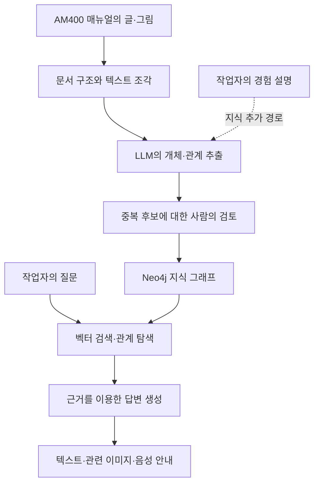

# MetalMind 논문 리뷰 — 금속 적층제조 매뉴얼에서 작업자 지원까지

설비 매뉴얼에서 밸브 이름을 찾는 일과 그 밸브를 어느 순서로 다루고 어떤 부품을 함께 확인해야 하는지 설명하는 일은 다릅니다. 작업 중에는 글뿐 아니라 부품 사진과 현재 작업에 맞는 안내도 필요합니다. Fan 외의 MetalMind는 매뉴얼, 지식 그래프, LLM, 사람의 검토, 혼합현실 인터페이스를 연결해 이 문제를 다룹니다.

이 논문의 중심은 금속 적층제조 장비를 위한 지식 지원 시스템입니다. 검색 방식 비교도 포함하지만 한 장비의 매뉴얼과 100개 질문에서 얻은 결과입니다. 그래프를 쓰면 모든 질문의 정확도가 좋아진다는 결론으로 확대해서 읽을 수는 없습니다.

## 서지 정보와 자료 범위

| 항목 | 내용 |
|---|---|
| 저자 | Haolin Fan, Zhen Fan, Chenshu Liu, Jianhao Zhu, Tom Gibbs, Jerry Ying Hsi Fuh, Wen Feng Lu, Bingbing Li |
| 제목 | *MetalMind: A knowledge graph-driven human-centric knowledge system for metal additive manufacturing* |
| 게재 | *npj Advanced Manufacturing* 2, 25, 2025년 6월 16일 |
| 원문 | [공식 논문](https://www.nature.com/articles/s44334-025-00038-9) · [DOI](https://doi.org/10.1038/s44334-025-00038-9) |
| 보충자료 | [프롬프트·질문 예시·사용자 설문 PDF](https://media.springernature.com/original/springer-static/esm/art%3A10.1038%2Fs44334-025-00038-9/MediaObjects/44334_2025_38_MOESM1_ESM.pdf) |
| 공개 저장소 | [OliverFanHL/MetalMind](https://github.com/OliverFanHL/MetalMind) |

본문 9쪽과 보충자료 6쪽, 본문 그림 5개·표 3개·알고리즘, 보충 그림 2개를 검토했습니다. 보충 동영상은 연결 주소와 설명만 확인했으며 재생 검토하지 않았습니다. 논문은 CC BY 4.0으로 공개되어 있습니다. 아래 도식은 이해를 돕기 위해 새로 작성했습니다.

## 1. 매뉴얼의 명시적 지식과 작업자의 경험

논문은 두 종류의 지식에 주목합니다. 매뉴얼에는 부품과 절차가 글과 그림으로 정리되어 있습니다. 작업자는 실제 작업에서 얻은 요령과 상황별 판단을 알고 있지만 그 지식은 문서에 모두 기록되지 않을 수 있습니다. MetalMind는 먼저 매뉴얼을 연결 가능한 지식으로 만들고 작업자의 설명도 추가할 수 있는 구조를 제안합니다. [서론, pp.1–2]

예를 들어 작업자가 특정 필터의 밸브 위치를 물으면 시스템은 관련 문장뿐 아니라 연결된 플랜지와 씰, 정비 절차, 그림까지 함께 제시하려고 합니다. 이때 지식 그래프는 부품과 작업의 연결을 저장하고 LLM은 문서에서 관계를 추출하거나 검색 결과를 답변으로 구성합니다. 혼합현실은 그 답을 작업 현장에서 보여주는 인터페이스입니다.



흐름을 글로 읽으면 `매뉴얼 → 관계 추출 → 검토 → 그래프 → 검색 → 답변·이미지`입니다. 작업자의 경험을 추가하는 경로도 있지만 장기적인 자동 개선 효과를 측정한 실험은 아닙니다.

## 2. 매뉴얼에서 그래프를 만드는 과정

### 문서 구조와 이미지 보존

대상은 Renishaw AM400 사용자 매뉴얼입니다. PDF를 Markdown으로 바꾸고 기계 개요·작동·유지보수 같은 문서 구조를 유지합니다. 텍스트는 600토큰 단위로 나누고 100토큰을 겹치게 합니다. 문서나 절을 중심 노드로 두고 조각을 연결합니다. 이미지는 고유 URL로 접근할 수 있게 분리합니다. [Methods, p.6]

이 설계에서는 글의 의미뿐 아니라 출처 위치도 중요합니다. 관계를 추출한 뒤에도 어느 문서 조각과 그림에서 나온 정보인지 연결할 수 있도록 구성합니다.

### 두 단계의 LLM 추출

Algorithm 1은 처음부터 완성된 분류표를 고정하지 않습니다. 먼저 조각들에서 개체를 추출하고 이를 묶어 범주를 만듭니다. 그다음 범주를 이용해 다시 개체와 관계를 추출합니다. 예시 범주는 Component, Operation, Maintenance입니다. 추출에는 GPT-4o를 사용합니다. [p.6, Algorithm 1]

보충자료의 프롬프트는 다음 사항을 강조합니다.

- 문서에 명시된 정보를 추출합니다.
- 밸브처럼 세부 대상이 달라도 일관된 상위 라벨을 사용합니다.
- 순서가 있는 목록을 작업 단계로 읽습니다.
- 같은 대상을 가리키는 표현을 가능한 한 통일합니다.
- 이미지에는 캡션과 외부 URL을 연결합니다.

여기서 스키마는 개체 범주와 추출 형식을 뜻합니다. 구현은 Neo4j의 속성 그래프이며 OWL 공리나 SHACL 검사, 논리 추론기의 효과를 평가한 논문은 아닙니다.

### 중복 후보와 사람의 판단

서로 비슷한 도구명이 별도 노드가 되면 연결이 흩어집니다. 논문의 화면 예에는 `5 Mm Hex Key`와 `5 Mm Hexagon Key`가 등장합니다. 시스템이 유사한 개체를 후보로 제시하면 사람이 병합 여부를 판단합니다. 여러 사용자의 판단을 종합하는 방식도 설명합니다. [pp.6–7, 그림 4]

그러나 유사도 임계값, 검토자 수, 의견이 갈릴 때의 처리, 소요 노동, 검토 전후 오류율은 구체적으로 보고하지 않습니다. 사람이 검토하는 경로가 있다는 사실과 그래프 정확도가 얼마나 개선됐는지는 별개의 주장입니다. 연결이 없는 노드를 제거하는 처리도 사실 확인과 같지는 않습니다.

최종 그래프는 노드 3,102개와 관계 8,366개입니다. 임베딩에는 all-MiniLM-L6-v2의 384차원 표현을 사용합니다. 이미지도 주로 설명과 캡션의 텍스트 표현을 이용하므로 이미지 픽셀 자체를 이해하는 모델의 성능 평가로 읽어서는 안 됩니다. [p.2, 그림 1]

## 3. 세 가지 검색 방식과 이미지 선택

| 방식 | 논문의 설명 | 기대하는 역할 |
|---|---|---|
| Vector | 질문과 문서 노드의 임베딩 유사도로 검색 | 표현이 비슷한 근거 탐색 |
| Graph | 키워드 또는 벡터로 시작점을 찾고 관계 탐색 | 연결된 부품·작업 정보 확보 |
| Hybrid | 벡터 검색 후 주변 개체·관계로 확장 | 의미 유사성과 연결 구조 결합 |

Graph와 Hybrid의 설명에는 겹치는 부분이 있습니다. 정확한 시작점 수, 탐색 깊이, 간선 선택, 가지치기, 최종 근거 길이가 충분히 공개되지 않았습니다. 독자가 이름만 보고 세 구현을 정확히 재현하기는 어렵습니다. Microsoft GraphRAG의 커뮤니티 요약 방식을 그대로 구현했다고 설명하는 것도 부정확합니다. [pp.7–8]

이미지는 검색된 개체의 Figure 연결을 확인하고 생성 답변의 핵심 내용과 이미지 캡션·설명의 유사도를 비교해 선택합니다. 논문은 0.85보다 큰 유사도를 사용한다고 설명합니다. 이미지 연결의 정량 정확도는 별도로 제시하지 않습니다. [p.8]

## 4. 100개 질문의 평가 설계

질문은 세부 질문 70개와 전체적인 질문 30개로 구성됩니다. 세부 질문은 특정 압력이나 부품 취급처럼 좁은 정보를 묻고 전체 질문은 빌드 준비나 가스 회로와 산소 감시처럼 여러 정보를 함께 설명하도록 요구합니다. 정답은 사람이 작성했습니다. [p.2, 보충자료 p.2]

평가에는 아래 지표를 사용합니다.

| 지표 | 확인하려는 내용 | 해석상의 주의 |
|---|---|---|
| Faithfulness | 답변과 제공 근거의 일치 | 현실의 사실을 독립 검증한 값은 아닙니다. |
| Answer relevancy | 질문에 맞는 답변 | 불필요하거나 빠진 내용의 영향을 받습니다. |
| Context precision | 검색 근거의 관련성 | 많이 가져오는 것만으로 좋아지지 않습니다. |
| Context recall | 필요한 근거의 확보 | 정답 근거를 얼마나 찾았는지 봅니다. |
| Domain rubric | 전문가의 1–5점 평가 | 평가 기준과 평가자 일치도를 함께 알아야 재현하기 쉽습니다. |

논문은 RAGAs를 참고했다고 설명하지만 모든 계산식과 평가 모델 버전, 전문가 평가표, 평가자 간 일치도, 품질 점수의 신뢰구간을 제공하지는 않습니다.

## 5. 지표별 결과와 성능 차이

아래 수치는 본문 그림 2의 레이더 차트와 라벨을 직접 대조한 값입니다.

### 전체적인 질문 30개

| 지표 | Vector | Graph | Hybrid |
|---|---:|---:|---:|
| Faithfulness | 0.823 | 0.835 | 0.868 |
| Answer relevancy | 0.792 | 0.802 | 0.811 |
| Context precision | 0.846 | 0.872 | 0.919 |
| Context recall | 0.515 | 0.570 | 0.598 |
| Domain rubric | 2.915 | 3.167 | 3.348 |

이 질문 묶음에서는 Hybrid가 다섯 지표 모두 가장 높습니다. 예를 들어 context recall은 Vector 0.515에서 Hybrid 0.598로, 절대 차이는 0.083입니다. 여러 절의 정보를 함께 찾는 질문에서 관계 확장이 도움이 될 가능성과 부합하는 결과입니다. 다만 어떤 관계가 개선에 기여했는지 분리한 절제 실험은 없습니다.

### 세부 질문 70개

| 지표 | Vector | Graph | Hybrid |
|---|---:|---:|---:|
| Faithfulness | 0.952 | 0.950 | 0.921 |
| Answer relevancy | 0.720 | 0.705 | 0.744 |
| Context precision | 0.933 | 0.913 | 0.927 |
| Context recall | 0.551 | 0.563 | 0.579 |
| Domain rubric | 2.930 | 3.000 | 3.200 |

세부 질문에서는 양상이 다릅니다. Hybrid의 rubric과 recall은 높지만 faithfulness는 Vector보다 0.031 낮고 context precision도 0.006 낮습니다. 본문의 전반적으로 긍정적인 설명과 별개로, 그림은 지표 사이의 손익을 보여줍니다. 모든 지표에서 Hybrid가 우세하다고 요약하면 이 차이가 사라집니다.

## 6. 336.61% 개선 수치의 의미

논문에서 강조하는 336.61%는 종합점수의 상대적 개선이며 위의 원시 지표를 가리키지는 않습니다. 저자들은 품질과 토큰 소비를 정규화하고 품질 70%와 효율 30%의 가중치 및 sigmoid 변환으로 1–5 범위의 점수를 만든다고 설명합니다. 세부 집계식과 변환 매개변수는 완전히 제시하지 않습니다. [p.2, 표 1]

| 질문 | Vector 토큰 / 종합점수 | Graph 토큰 / 종합점수 | Hybrid 토큰 / 종합점수 |
|---|---|---|---|
| 세부 | 5.96±1.38천 / 2.79 | 5.70±1.33천 / 1.83 | 5.93±1.33천 / 4.30 |
| 전체 | 6.35±1.29천 / 1.12 | 6.05±1.19천 / 2.91 | 6.16±1.19천 / 4.89 |

```text
(4.89 − 1.12) / 1.12 × 100 = 약 336.61%
```

이 계산은 표의 종합점수를 비교한 것입니다. 답변 정확도가 336.61% 높아졌거나 실제 업무 이해 능력이 그만큼 증가했다는 뜻은 아닙니다. 비선형 변환을 거친 척도의 상대 증가율은 원래 품질 차이보다 크게 보일 수 있습니다.

또한 전체 질문에서 Hybrid는 Vector보다 토큰을 적게 쓰지만 Graph보다는 더 씁니다. 이 표의 표준편차는 토큰 소비에 붙은 값이며 품질 효과의 통계적 불확실성을 나타내지 않습니다. 시스템 구축비, 사람의 검토 비용, 응답 지연을 포함한 총비용 비교도 아닙니다.

## 7. 이미지 안내와 작업자의 암묵지

표 2는 필터의 밸브 관련 질문에 부품과 정비 설명, 여러 이미지를 연결한 사례입니다. 표 3은 작업자가 설명한 세척 지식을 구조화한 예입니다. 논문에는 와이퍼·리코터와 일반 표면에 서로 다른 알코올 농도를 언급한 사례가 나오지만 농도별 세척 효과를 비교한 실험은 아닙니다. 이를 장비 전반에 적용되는 검증된 작업 지침으로 받아들여서는 안 됩니다. [p.4, 표 2–3]

혼합현실 인터페이스는 텍스트·이미지·음성을 제공합니다. 현재 작업을 파악하는 행동 인식 모델은 실험실의 디지털 트윈에서 만든 합성 데이터로 학습했다고 설명합니다. 그림 5에서는 리코터와 빌드 플레이트 사이의 간격을 종이나 게이지로 확인하는 작업을 보여줍니다. 모델 구조·학습량·실측 인식 정확도는 제시하지 않습니다. [p.8, 그림 5]

## 8. 10명 사용자 설문의 범위

보충자료의 설문은 학생과 엔지니어 10명을 대상으로 하며 다수는 초급 또는 중급 경험자입니다. 그래프 명료성, 이미지 도움, 인터페이스 직관성의 평균은 각각 4.2점입니다. 작업 흐름에서 사용할 의향은 80%가 Yes, 20%가 Not sure로 응답했습니다. [보충자료 pp.3–6]

행동 인식에 대한 60% Accurate와 40% Neutral은 사용자가 선택한 주관적 평가 범주입니다. 정답 라벨과 예측을 비교해 얻은 분류 정확도 60%가 아닙니다. 응답 속도에 대한 의견도 있지만 실제 지연 시간을 측정한 표는 없습니다.

이 설문은 초기 사용성을 파악하는 데 도움이 됩니다. 실제 작업 오류 감소, 교육 효과, 장기적인 생산성 향상은 별도 측정이 필요하며 이 설문만으로 확인되지 않습니다.

## 9. 재현성과 후속 과제

2026년 10월 29일 확인한 공개 저장소의 main에는 100개 질문·정답을 담은 `evaluation_ground_truth.json`이 있었습니다. 논문 링크의 기존 소유자 경로는 현재 저장소로 연결됩니다. 실행 코드, 그래프 전체, 평가 스크립트, 개별 모델 출력은 확인하지 못했습니다. 보충 프롬프트도 전체 시스템 설정을 모두 복원할 수준은 아닙니다.

저자들은 AM400 매뉴얼 중심의 범위, 추가 유지보수 기록과 작업자 피드백의 필요성, 검색 개선, 더 발전된 멀티모달 처리와 디지털 트윈 연계를 후속 과제로 제시합니다. 평가도 한 장비의 100개 질문과 10명의 초기 설문에 한정됩니다. [Discussion, pp.4–5; Data Availability, p.8]

리뷰 관점에서 가장 유용한 기여는 문서 추출, 관계 탐색, 이미지, 사람의 검토, 작업 현장 인터페이스를 하나의 흐름으로 구체화한 점입니다. 정량 결과는 전체적인 질문에서 Hybrid의 장점을 보여주지만 세부 질문에는 손해를 본 지표도 있습니다. 시스템의 여러 요소를 동시에 도입했으므로 개선을 그래프 하나나 특정 의미 기술의 효과로 분리할 수는 없습니다.

## 원문 확인 위치

- 그래프 규모와 검색 결과: 본문 pp.2–4, 그림 1–2, 표 1.
- 이미지와 작업 지식 사례: 표 2–3.
- 전체 구조·중복 검토·현장 안내: 그림 3–5, Methods pp.5–8.
- 추출 절차: Algorithm 1, p.6; 보충자료 p.1.
- 질문 구분과 설문: 보충자료 pp.2–6.
- 코드·데이터 공개 범위: 본문 p.8 및 [공개 저장소](https://github.com/OliverFanHL/MetalMind).

출처: Fan et al., [*MetalMind*](https://doi.org/10.1038/s44334-025-00038-9). 수치는 본문의 표와 그림, 설문은 보충자료를 기준으로 설명했습니다.
