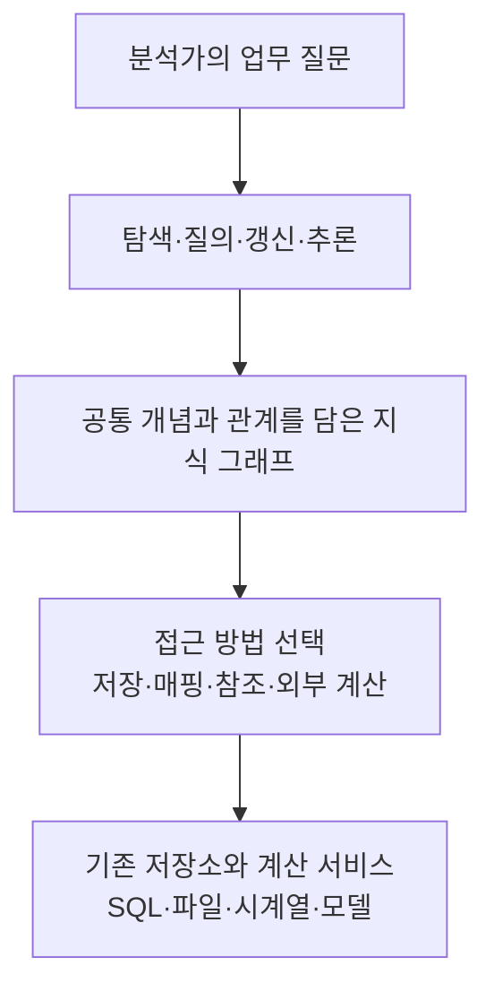
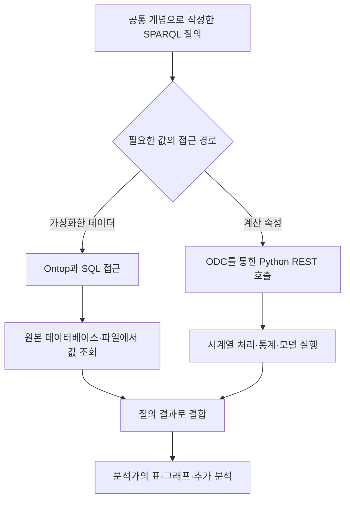

# Meyers 외 논문 리뷰: 제조 데이터를 연결하는 지식 그래프와 외부 계산

공장의 품질 문제를 분석하려면 한 제품의 가공 기록, 센서 값, 검사 결과를 함께 봐야 합니다. 그런데 가공 기록은 MES 데이터베이스에 있고 센서 값은 시계열 저장소에 있으며 검사 결과는 PDF에 있을 수 있습니다. 파일을 모아도 어느 측정이 어느 제품과 공정에 해당하는지 연결하는 작업이 남습니다. 공정 담당자가 알고 있는 영향 관계도 데이터만으로 바로 드러나지는 않습니다.

Meyers 외의 *Towards a knowledge graph framework for ad hoc analysis in manufacturing*은 이런 분석을 반복해서 수행할 수 있는 구조를 제안합니다. 지식 그래프에 업무 개념과 관계를 정의하고 기존 데이터와 계산 기능을 연결합니다. 모든 원본을 RDF로 복제하는 방식에 한정하지 않는다는 점이 이 논문의 중요한 설계 선택입니다.

## 서지 정보와 읽기 범위

| 항목 | 내용 |
|---|---|
| 저자 | Bart Meyers, Hans Vangheluwe, Pieter Lietaert, Geert Vanderhulst, Johan Van Noten, Michel Schaffers, Davy Maes, Klaas Gadeyne |
| 학술지 | *Journal of Intelligent Manufacturing* 35, 3731–3752, 2024 |
| 온라인 공개 | 2024년 2월 29일 |
| 소속 | Flanders Make 및 University of Antwerp의 관련 연구 조직 |
| 원문 | [출판사 본문](https://link.springer.com/article/10.1007/s10845-023-02319-6) · [PDF](https://link.springer.com/content/pdf/10.1007/s10845-023-02319-6.pdf) |
| DOI | [10.1007/s10845-023-02319-6](https://doi.org/10.1007/s10845-023-02319-6) |
| 공개 조건 | [CC BY 4.0](https://creativecommons.org/licenses/by/4.0/) |

이 글은 22쪽 PDF의 본문과 표를 검토했으며 참조 아키텍처, 데이터 접근 방식 비교표, 구현 구조, 베이지안 네트워크 그림을 이미지로 대조했습니다. 아래 도식은 설명을 위해 다시 구성했습니다. 대괄호의 쪽수는 PDF 파일의 순서가 아닌 학술지 인쇄 쪽수입니다.

## 1. 반복적인 제조 분석과 세 가지 장벽

논문의 *ad hoc analysis*는 특정 질문을 탐색하면서 필요한 데이터와 가설을 확인하고 분석 방법을 바꾸는 과정입니다. 예를 들어 검사 횟수를 줄이고 싶다면 먼저 어떤 공정 조건이 품질과 관련되는지 가설을 세우고 실제 기록을 찾아 비교해야 합니다. 분석 결과가 유용하면 대시보드나 업무 애플리케이션으로 발전시킵니다. [pp.3731–3734]

저자들은 이 과정의 장벽을 데이터 이질성, 지식의 형식화 부족, 다양한 추론·분석 기능의 부족으로 설명합니다. 데이터 이질성에는 파일 형식뿐 아니라 같은 대상을 서로 다른 구조와 이름으로 기록하는 문제도 포함됩니다. 지식의 형식화는 전문가가 알고 있는 공정 관계를 다른 분석에서도 사용할 수 있게 표현하는 일입니다. 추론·분석에는 논리적 관계 도출뿐 아니라 통계, 머신러닝, 시뮬레이션도 포함됩니다.

논문은 압축기 부품, 섬유 기계, 접착·분리 공정 등을 포함한 여덟 산업 사례에서 요구사항을 도출합니다. 그 결과를 다섯 범주의 24개 요구사항으로 정리하고 세 사례에 프레임워크를 적용합니다. 여덟 사례 전체가 동일한 실험을 수행한 평가 데이터셋은 아닙니다. [표 1–2]

| 요구사항 범주 | 해결하려는 문제 |
|---|---|
| 메타데이터 | 개념의 의미, 출처, 구조를 파악하고 설명하기 |
| 데이터 관리 | 서로 다른 저장소와 변경되는 데이터를 연결하기 |
| 데이터 활용 | 필요한 대상을 탐색하고 질의하기 |
| 작업 흐름 지원 | 지식을 점진적으로 추가하고 계산·추론을 재사용하기 |
| 프레임워크 도구 | 협업, 성능, 확장, 상호운용, 배포를 지원하기 |

## 2. 공통 접근 계층과 원본 저장소

참조 아키텍처의 중심에는 지식 그래프가 있습니다. 분석가는 이 계층을 통해 대상을 탐색하고 질의하며 지식을 갱신하거나 계산합니다. 원본 데이터 수집은 기존 제조 시스템에서 계속 수행합니다. 논문은 센서 수집이나 MES 입력 자체를 새로 해결하는 연구로 범위를 잡지 않습니다. [그림 3, pp.3736–3737]

여기서 단일 접근점은 데이터가 물리적으로 한곳에 저장된다는 뜻이 아닙니다. 사용자는 공통 개념으로 질문하지만 실제 데이터 접근은 원본 저장소나 계산 서비스로 나뉠 수 있습니다. 그 연결을 가능하게 하는 매핑과 인터페이스는 별도로 만들어야 합니다.

## 3. 업무 사례부터 시작하는 지식 공학

지식 엔지니어는 업무 담당자와 분석 목적을 정한 뒤 전문가에게 공정의 의미를 확인합니다. 다음으로 개념을 모델링하고 관련 데이터의 존재와 품질을 확인하며 개념과 데이터를 매핑합니다. 마지막에는 해당 업무 질문에 필요한 정보가 실제로 연결됐는지 검토합니다. 이 과정은 한 번에 끝나지 않고 반복됩니다. [그림 4]

데이터가 부족하면 정제, 추가 수집, 실험, 센서 도입 같은 작업이 필요할 수 있습니다. 온톨로지를 작성한다고 없던 측정값이 생기는 것은 아닙니다. 저자들도 지식 공학이 초기 비용을 추가한다고 인정합니다. 같은 지식과 매핑을 여러 분석에서 재사용할 때 이 비용을 회수할 수 있다는 논리이며 실제 인건비나 투자 회수 기간을 계량한 결과는 제시하지 않습니다. [p.3736]

분석가는 이와 별도로 분석 목표를 정하고 전문가와 가설을 세우며 데이터를 조회하고 통계·모델 분석을 수행합니다. 필요한 개념이나 자료가 없으면 지식 엔지니어에게 돌아갑니다. 새로 얻은 관계나 계산 방법은 이후 분석에 재사용하도록 기록할 수 있습니다. [그림 6, pp.3742–3743]

## 4. 네 계층으로 나눈 의미 모델

논문의 모델은 공통 표현, 재사용 가능한 도메인 개념, 기업별 개념, 실제 개체를 구분합니다. 접착 공정을 설명한 그림 5가 이 구분의 예입니다. [pp.3738–3739]

| 계층 | 역할 | 논문의 표현 예 |
|---|---|---|
| 상위 메타모델 | 클래스·속성·타입을 기술하는 공통 방식 | RDF·RDFS·OWL과 `mm` 모델링 관례 |
| 도메인 온톨로지 | 여러 사례에서 공유할 공정·영향 개념 | `dt`, `tacit` |
| 기업별 도메인 모델 | 특정 업무의 접착 단계·품질 항목 등 | `jml` |
| 개체 | 실제 작업, 대상, 측정과 연결 | 개별 공정 실행과 관련 데이터 |

`dt:ProcessStepExecution`은 특정 공정 단계의 실행을 나타냅니다. 실행 시간, 투입·생산 대상, 관련 자산을 연결하면 센서 열 이름보다 업무에 가까운 단위로 데이터를 조회할 수 있습니다. `tacit:influence`는 어떤 특성이 다른 특성에 영향을 준다는 지식을 표현합니다. 이 관계를 그래프에 기록했다는 사실만으로 인과관계가 실험적으로 입증되는 것은 아닙니다.

저자들은 온톨로지 표현에 명시적 타입과 속성 소유 같은 메타모델링 관례도 더합니다. 예를 들어 `mm:ownedProperty`를 사용합니다. 이는 개방적인 온톨로지 표현을 도구가 탐색하기 좋은 구조로 제한하려는 선택입니다. OWL의 domain·range 선언을 일반적인 입력 오류 검사와 동일하게 해석하면 이 설계를 오해하기 쉽습니다. 이 논문이 SHACL 기반 검증 파이프라인을 구현했다고 설명해서도 안 됩니다.

## 5. 네 가지 데이터 접근 방식

논문의 표 3은 데이터 성격에 따라 어떤 접근 방식을 선택할지 제안합니다. 표의 적합성 표시는 저자의 설계 지침이며 실행 시간이나 정확도를 측정한 순위표는 아닙니다. [pp.3739–3741, 표 3]

| 방식 | 실제 동작 | 적합한 용도와 부담 |
|---|---|---|
| Materialization | 원본이나 전문가 지식을 RDF 트리플로 저장 | 개념·관계·암묵지 저장에 유용하지만 복제와 갱신 관리가 필요합니다. |
| Virtualization / OBDA | 그래프 질의를 매핑에 따라 SQL 등으로 변환 | 원본 데이터베이스를 유지할 수 있으나 의미와 열의 매핑이 필요합니다. |
| Referencing | 파일 위치와 접근 정보를 그래프에 기록 | CAD·대용량 파일 등을 참조하며 실제 내용의 취득은 별도 단계입니다. |
| On-demand calculation | 질의 중 필요한 외부 계산을 호출 | 통계·모델·시계열 계산을 재사용하지만 실행 비용과 의존성을 관리해야 합니다. |

Materialization은 RDF용 ETL에 가깝습니다. 저자들은 특히 대량 시계열을 그대로 트리플로 저장하는 선택에 부정적입니다. 이 판단을 모든 RDF 저장소에 대한 성능 실험 결과로 읽기보다는 이 프레임워크의 설계 권고로 이해하는 편이 정확합니다.

가상화에서는 Ontop 같은 도구가 개념과 데이터베이스를 연결합니다. 원본을 복제하지 않아도 되지만 SQL 열의 의미를 저절로 알아내지는 않습니다. 파일 참조 역시 파일을 찾을 단서를 제공하는 방식입니다. 파일 내부의 정보 추출까지 자동으로 끝내는 기능은 아닙니다.

## 6. 질의 안에서 실행하는 외부 계산

On-demand calculation, ODC는 계산 결과를 그래프의 속성처럼 질의하게 합니다. 특정 속성에 연결된 REST 계산 기능이 입력을 받아 실행하고 결과를 질의에 돌려줍니다. 분석가는 같은 질의 인터페이스를 사용하면서 저장된 값과 계산된 값을 함께 다룰 수 있습니다. [pp.3741–3744]

기술 구현 그림 8에서는 파일·SQL 접근에 Dremio와 Ontop을 사용하고 시계열 저장소 InfluxDB에 대한 계산은 Python REST 서버로 연결합니다. ODC 엔드포인트가 이러한 경로를 연결합니다. 데이터베이스 질의, 외부 Python 계산, OWL의 논리적 추론은 각각 다른 실행 경로입니다.

논문은 Theia 기반 탐색 도구도 제시합니다. 그림 7에는 개념 간 연결, SPARQL 편집기, 표와 그래프가 한 화면에 배치되어 있습니다. 이는 분석가가 관계를 따라가며 데이터를 탐색하는 인터페이스입니다. 자연어 질문을 LLM이 자동으로 해석하는 시스템은 이 논문의 구현 범위에 포함되지 않습니다.

## 7. 압축기 부품의 검사 전략

첫 사례는 Atlas Copco의 압축기 핵심 부품인 air end입니다. CNC 가공 기록, 센서 시계열, MES 정보, CAQ 품질 데이터, CMM 측정 PDF를 연결합니다. 목표는 품질에 대한 신뢰를 유지하면서 검사 횟수를 줄이는 적응형 측정 전략을 분석하는 것입니다. [pp.3744–3746, 그림 9–10]

가공 중의 조건과 가공 후 형상 측정이 같은 제품에 해당하는지 연결해야 이런 분석이 가능합니다. 그래프는 제품·작업·측정의 대응을 유지하는 역할을 합니다. 센서나 검사 데이터 자체의 계산은 해당 도구에서 수행합니다.

이 사례는 실제 생산과 분리된 실험 환경에서 구현했으며 실제 데이터 형식과 스트리밍 구조를 모사합니다. 그림 10의 대시보드에는 합성 데이터를 사용했다고 명시합니다. 따라서 실제 공장에서 검사 비용을 얼마나 줄였는지 입증한 결과로 소개하면 안 됩니다. 논문 작성 시점에도 가설과 자료를 추가하고 있었습니다.

## 8. 섬유 기계의 공통 계산과 고객별 데이터

두 번째 사례는 이름을 공개하지 않은 섬유 기계 제조사입니다. 고객별 기계 구성과 데이터가 다르고 여러 대시보드에서 재료 소비 등을 계산해야 합니다. InfluxDB, Parquet, MS SQL 자료를 공통 기능 모델에 연결하고 계산을 재사용하려고 합니다. [pp.3745–3747, 그림 11]

같은 업무 개념을 여러 기계 데이터에 대응시켜 두면 대시보드마다 의미와 계산을 처음부터 구현하는 부담을 줄일 여지가 있습니다. 다만 원본별 매핑은 여전히 필요합니다. 논문에서 고객에게 배포하는 대시보드는 정제된 데이터에 직접 접근할 수 있으며 고객 환경에 반드시 지식 그래프가 있어야 하는 것은 아닙니다.

저자들은 GraphQL도 검토했지만 필요한 유연성이 부족했다고 설명합니다. 이를 GraphQL과 지식 그래프의 일반적인 성능 우열을 측정한 비교 실험으로 확대할 수는 없습니다.

## 9. 접착 품질의 베이지안 추론

세 번째 사례는 두 기판의 접착·분리 실험입니다. 센서 데이터는 Parquet, MES 기록은 JSON, 수작업 품질 측정은 Excel에 있습니다. 관심 결과는 최대 파단 응력과 육안으로 확인한 손상 등입니다. [pp.3746–3749, 그림 12]

전문가 지식, 문헌, 매뉴얼, 데이터를 이용해 변수 사이의 영향 관계를 선택합니다. 연속값을 범주로 나누고 조건부 확률을 정한 뒤 베이지안 네트워크를 구성합니다. 데이터가 충분하지 않은 부분에는 문헌이나 전문가 추정이 들어갈 수 있습니다. 논문은 PR-OWL로 확률 지식을 표현하고 `pgmpy`로 네트워크를 만들어 ODC를 통해 계산하는 구조를 설명합니다.

예를 들어 접착 품질을 설명하는 기준에 8 MPa가 등장합니다. 이는 해당 사례의 품질 조건이며 제조업 전체나 용접 공정에 그대로 적용할 보편 기준은 아닙니다. 그래프의 영향 관계를 이용해 계산 구조를 만들더라도 확률의 신뢰도는 데이터, 전문가 가정, 범주화 방식에 달려 있습니다.

이 사례는 논리적 추론과 수치 모델을 함께 사용하는 방법을 보여줍니다. OWL 규칙만으로 접착 강도를 계산하거나 인과관계를 자동 발견한 결과로 해석하면 안 됩니다. 논문이 말하는 추론의 범위에는 외부 모델 실행도 포함됩니다.

## 10. 사례 검증의 성과와 한계

세 사례는 서로 다른 저장소와 분석 기능을 하나의 의미 모델에 연결하는 방법을 보여줍니다. 재사용 가능한 개념, 네 가지 접근 방식, 지식 엔지니어와 분석가의 작업 흐름을 실제 도구 구성과 함께 제시했다는 점에서 아키텍처 참고 자료로 유용합니다.

반면 같은 업무 의미를 구현한 SQL/Python 시스템과의 통제 비교, 정량적인 작업 시간 절감, 검색 정확도 비교는 제시하지 않습니다. 이 논문의 사례 적용은 범용 벤치마크나 운영 효과의 인과적 검증과 구분해서 읽어야 합니다.

저자들이 직접 남긴 과제도 구체적입니다. 지식 엔지니어에게 필요한 업무·모델링·데이터 지식이 한 사람에게 모여 있지 않아 협업이 필요합니다. 도구의 성숙도와 노트북 환경 연계도 과제입니다. 데이터 접근 구성을 잘못 사용하면 질의 성능이 예상보다 나빠질 수 있으며 성능 개선은 아직 사례별 조정에 의존합니다. [pp.3748–3749]

보안과 데이터 거버넌스, 지식 그래프의 검증·확인은 충분히 다루지 않았다고 밝힙니다. 모델의 변경을 기록해 특정 시점의 상태를 질의하고 what-if 분석을 지원하는 문제도 후속 과제로 제시합니다. 결론에서는 설계·제조·운영·재사용을 포함한 제품 생애주기로 범위를 넓히려는 방향을 설명합니다. [pp.3749–3750]

이 논문에서는 공통 개념을 어디에 두고 원본 조회와 외부 계산을 어떻게 연결할지에 대한 선택지를 가장 구체적으로 참고할 수 있습니다. 지식 그래프의 장점을 평가할 때도 연결 구조의 유용성, 매핑 비용, 계산 성능, 실제 업무 효과를 나눠 살펴볼 필요가 있습니다.

## 원문 안내

Meyers, B., et al. (2024). *Towards a knowledge graph framework for ad hoc analysis in manufacturing*. Journal of Intelligent Manufacturing, 35, 3731–3752. [https://doi.org/10.1007/s10845-023-02319-6](https://doi.org/10.1007/s10845-023-02319-6).

참조 아키텍처는 그림 3, 지식 공학 절차는 그림 4, 계층 모델은 그림 5, 데이터 접근 선택은 표 3, 구현 구조는 그림 8, 베이지안 추론 사례는 그림 12에 정리되어 있습니다. 본문 설명과 도식은 원문을 요약·재구성한 것이며 저자의 공식 한국어 번역은 아닙니다.
