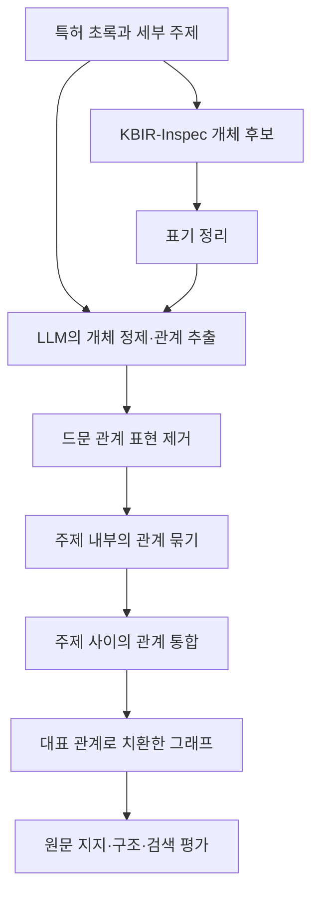

# 이수연 외 논문 리뷰 — 반도체 특허에서 개체와 관계를 추출하는 방법

특허 초록에는 재료, 장치, 공정, 효과가 문장으로 섞여 있습니다. 이를 지식 그래프로 바꾸려면 명사를 찾는 것만으로는 부족합니다. 어떤 대상끼리 어떤 관계를 맺는지 추출하고 문장마다 다르게 표현된 관계를 정리해야 합니다.

이수연 외의 논문은 도메인 개체 후보와 LLM을 결합하고 관계 표현을 단계적으로 통합하는 방법을 제안합니다. 대상은 기술 텍스트이며 사람이 별도의 정답 트리플을 대량으로 주석하지 않았습니다. 결과는 원문에 의한 뒷받침, 그래프 구조, 특허 검색이라는 서로 다른 기준으로 평가합니다.

## 서지 정보와 읽기 범위

| 항목 | 내용 |
|---|---|
| 저자 | 이수연·박소형·김현종·조성준 |
| 제목 | 대규모 언어 모델을 활용한 비주석 기술 텍스트 기반 도메인 특화 지식 그래프 구축 |
| 학술지 | 대한산업공학회지 52(2), 176–192, 2026 |
| 게재 승인 / 발행 | 2026년 2월 9일 / 2026년 4월 15일 |
| 원문 | [학회 공식 본문](https://www.jkiie.org/_common/do.php?a=current&aidx=49215&b=22&bidx=4418) · [공식 PDF](https://jkiie.org/xml/49215/49215.pdf) |
| DOI | [10.7232/JKIIE.2026.52.2.176](https://doi.org/10.7232/JKIIE.2026.52.2.176) |

본문 §1–6, 결과 표, 알고리즘과 부록 A의 프롬프트를 검토했습니다. 부록의 프롬프트 그림도 PDF에서 확인했습니다. 아래 도식과 짧은 예시는 설명을 위해 재구성한 것이며 원문의 그림이나 프롬프트 전문을 옮긴 것이 아닙니다.

## 1. 비주석 텍스트와 세 가지 난점

이 논문에서 비주석은 개체와 관계의 정답이 붙어 있지 않다는 뜻입니다. 입력 문서에 구조가 전혀 없다는 뜻은 아닙니다. 특허에는 CPC 분류 정보가 있으며, 실험에서도 이를 사용합니다. [§1–2, §4.1]

첫째, 일반적인 개체 인식기는 공정의 의미 단위를 놓칠 수 있습니다. `polishing system`을 하나의 시스템으로 다뤄야 하는데 일부 표현만 잡거나 wafer와 etching chamber 같은 개체를 빠뜨리는 문제가 소개됩니다. [그림 2]

둘째, LLM에 자유롭게 트리플을 만들도록 하면 표현이 흔들리고 원문에 없는 연결을 만들 수 있습니다. 셋째, 관계명이 계속 늘어나면 같은 종류의 연결도 다른 간선으로 흩어집니다. `formed by`, `form`, `used to form`을 어떻게 정리할지와 같은 문제가 생깁니다.

논문은 개체 후보 제공과 관계 표현 통합을 함께 사용합니다. 다만 표현을 합쳐도 의미의 정확성이 자동으로 보장되지는 않습니다. 뒤에서 결과와 함께 살펴보겠습니다.

## 2. 특허 초록과 전체 처리 흐름

입력은 2020–2023년 USPTO 영어 특허 초록입니다. 반도체 제조의 웨이퍼 제조, 산화, 포토리소그래피, 식각, 이온 주입, 증착, CMP, 패키징에 해당하는 여덟 세부 주제를 다룹니다. 실제 공장의 센서 기록이나 생산 로트 이력을 사용한 연구는 아닙니다. [§4.1]



흐름은 `후보 추출 → 문맥을 이용한 관계 생성 → 관계 어휘 통합 → 평가`입니다. LLM을 한 번 호출해 모든 작업을 끝내기보다 중간 결과를 정리하며 좁혀갑니다. [§3, 그림 1, 그림 3–6]

### 개체 후보 추출과 표기 정리

KBIR-Inspec으로 핵심 구를 추출합니다. 이 모델은 과학 초록의 핵심 구 추출에 학습된 모델이며 이 실험을 위해 반도체 개체 인식기로 새롭게 지도학습한 모델로 설명해서는 안 됩니다. 소문자화, 단복수와 관사 처리, 특수문자 정리 등도 수행합니다. [§3.1–3.2]

이 단계의 목적은 LLM이 기술적으로 중요한 명사구를 놓치지 않게 돕는 것입니다. 표기 정리 자체가 서로 다른 개체의 동일성을 완전히 해결하는 것은 아닙니다.

### 후보 목록과 원문을 함께 제공하는 추출

LLM에는 원문과 개체 후보를 제공합니다. 후보를 문맥에 맞게 정리하고 필요한 관계를 추출하도록 합니다. 부록 그림 10은 개체를 더 명확하게 고치거나 제한적으로 새 개체를 넣을 여지도 둡니다. 후보 목록을 절대 벗어나지 않는 폐쇄형 추출과는 다릅니다. [§3.3, 부록 A]

추출 모델은 `gpt-4.1-2025-04-14`입니다. 출력은 주어·관계·목적어의 트리플입니다. 다음은 방법을 이해하기 위한 가상 예시입니다.

```text
입력 문장: The chamber contains a wafer.
개체 후보: chamber, wafer
출력 예시: (chamber, contain, wafer)
```

이 예시는 논문의 실제 평가 데이터가 아닙니다. 역할을 나눠 보면 개체 후보는 대상의 범위를 잡고 원문은 둘 사이에 어떤 관계를 말할 수 있는지 정합니다.

## 3. 관계 표현의 단계적 통합

트리플을 모두 모으면 같은 의미가 여러 표현으로 나타납니다. 논문은 낮은 빈도의 관계 표현을 먼저 제거하고 같은 세부 주제 안에서 LLM으로 관계를 묶고 대표 관계를 정합니다. 이후 주제별 결과를 다시 합쳐 전체 관계 어휘가 안정될 때까지 통합합니다. [§3.4–3.6]

부록 그림 11은 관계 목록을 의미와 문맥에 따라 묶고 대표 관계에서 원래 표현 목록으로 이어지는 사전 형태를 요청합니다. 그림 12는 서로 다른 주제 사이의 유사 관계를 다시 정리합니다. 결과를 적용하면 원래 트리플의 관계를 대표 관계로 치환할 수 있습니다.

본문은 주제 내부의 관계 수 상한으로 K=30을 설명합니다. 다만 표 3에는 통합 후 33개인 행도 있어 단계·반복 종료 조건을 재현할 때 확인이 필요합니다. 최종 그래프는 표 4에서 트리플 4,551개, 고유 개체 2,899개, 관계 30개로 보고합니다.

### 표현 통합과 의미 보존의 차이

표 9의 예에서는 `form` 아래에 `formed by`, `used to form`, `fill` 등이, `chemical` 아래에 `dissolve`, `react`, `polished by`, `heated by` 등이 묶입니다. 이는 어휘 수를 줄이는 데는 효과적입니다. 그러나 방향과 행위의 차이까지 보존되는지는 별도 문제입니다.

가령 A가 B를 형성한다는 관계와 A가 B에 의해 형성된다는 관계는 주어·목적어의 방향을 함께 다루어야 합니다. 용해와 가열도 넓은 범주에서 관련되지만 서로 바꿔 써도 되는 관계는 아닙니다. 이는 표의 묶음에 대한 리뷰 관점의 주의점이며 실제 모든 치환이 잘못되었다는 판정은 아닙니다. 논문은 의미 손실을 직접 측정하는 별도 평가를 제시하지 않습니다.

드문 표현의 제거도 같은 관점에서 읽을 수 있습니다. 잡음이 줄 수 있지만 드물게 등장하는 중요한 관계가 보존되는지는 원문 지지율만으로 확인하기 어렵습니다.

## 4. 세 비교 방법과 평가 질문

| 방법 | 개체·관계 생성 방식 |
|---|---|
| Domain-only | KBIR 개체 후보와 의존 구문·SVO 및 규칙 기반 관계 추출 |
| LLM-only | 개체와 관계를 LLM 프롬프트로 직접 추출 |
| Hybrid | 개체 후보 제공, LLM 추출, 단계적 관계 통합 |

Hybrid에는 여러 변화가 함께 들어갑니다. 결과 차이를 개체 후보 제공 하나 또는 관계 정규화 하나의 효과로 분리할 수는 없습니다. [§4.2]

평가에서는 원문이 추출한 트리플을 뒷받침하는지, 그래프의 연결과 중복이 어떤지, 그래프 표현으로 비슷한 특허를 검색할 수 있는지를 확인합니다. 개체·관계의 완전한 정답 목록과 비교하는 전통적인 추출 재현율 실험은 아닙니다.

## 5. 원문에 의한 지지와 LLM 판정

`gpt-5-mini`는 원문과 트리플을 보고 SUPPORTED, NOT SUPPORTED, UNCLEAR 중 하나로 판정합니다. 부록 그림 14의 질문은 해당 트리플이 문장에 명시적으로 뒷받침되는지를 묻습니다. 실험은 temperature 1.0을 보고합니다. 이 설정이 평가의 반복 일치도를 보장하지는 않습니다. [§4.3, 부록 A]

| 방법 | 지지됨 | 지지되지 않음 | 불명확 |
|---|---:|---:|---:|
| Domain-only | 60.23% | 35.78% | 3.98% |
| LLM-only | 89.47% | 8.42% | 2.11% |
| Hybrid | 97.35% | 2.21% | 0.44% |

표 5에서 Hybrid의 지지 비율이 가장 높습니다. 97.35%는 특허 초록이 그 관계를 말하고 있다고 평가 모델이 판단한 비율입니다. 이 비율이 전체 사실 정확도나 실제 제조 현장의 정답률을 뜻하지는 않습니다. 특허의 주장이 현실에서 참인지와는 구분됩니다.

또한 생성하지 않은 정답 관계는 이 평가에 들어오지 않습니다. 어려운 관계를 많이 버리면 남은 트리플의 지지율은 높아질 수 있습니다. 높은 지지율과 누락이 적다는 주장을 함께 하려면 추가 근거가 필요합니다.

## 6. 구조 지표의 정확한 의미

| 지표 | Domain-only | LLM-only | Hybrid |
|---|---:|---:|---:|
| Entity completeness | 0.8813 | 0.9408 | 0.8875 |
| Redundancy | 0.0022 | 0.0019 | 0.0003 |
| Structural inconsistency | 0.0027 | 0.0047 | 0.0009 |

표 6의 entity completeness는 추출된 개체 가운데 트리플에 참여한 개체의 비율입니다. 원문에 있는 모든 정답 개체를 얼마나 찾았는지를 뜻하지 않습니다. LLM-only가 이 지표에서 가장 높습니다.

Redundancy는 전체 트리플에서 중복이 차지하는 정도를 나타냅니다. Structural inconsistency는 주어와 목적어가 같은 자기 연결을 셉니다. 이름만 보고 전체 그래프의 논리적 무모순성이 검증됐다고 읽으면 안 됩니다. 자기 연결도 관계의 뜻에 따라 유효할 수 있으므로 이 값은 논문이 선택한 구조적 대리 지표로 이해하는 편이 정확합니다. [§4.3, §5.1]

## 7. CPC를 이용한 특허 검색 평가

각 그래프에서 node2vec으로 개체를 벡터화하고 문서별 개체 벡터를 평균해 특허 표현을 만듭니다. 코사인 유사도로 다른 특허를 검색하고 같은 CPC subclass에 속한 문서를 관련 문서로 봅니다. [§4.3, §5.1, 표 7]

| 방법 | Recall@10 | Recall@20 | MAP@10 | MAP@20 | nDCG@10 | nDCG@20 |
|---|---:|---:|---:|---:|---:|---:|
| Domain-only | 0.0262 | 0.0515 | 0.9258 | 0.9226 | 0.9515 | 0.9511 |
| LLM-only | 0.0276 | 0.0538 | 0.9427 | 0.9333 | 0.9603 | 0.9562 |
| Hybrid | 0.0284 | 0.0546 | 0.9632 | 0.9568 | 0.9728 | 0.9686 |

표 7에서는 Hybrid가 여섯 값 모두 가장 높습니다. MAP와 nDCG는 상위 결과의 순서와 관련성에 초점을 두고 Recall은 관련 문서 전체 중 찾은 비율을 봅니다. 관련 문서가 많고 반환 수가 10개나 20개로 제한되면 높은 상위 순위 품질과 낮은 Recall이 함께 나타날 수 있습니다. 정확한 분모와 집계 구현은 재현 시 확인이 필요합니다.

이 실험은 세 그래프 구축 방법의 표현을 비교합니다. BM25, 일반 문서 임베딩 검색, 전체 RAG 시스템과의 비교는 아닙니다. CPC는 구축 단계의 주제 구분에도 쓰이므로 평가가 완전히 독립된 의미 정답이라고 단정하기도 어렵습니다. 그렇다고 그 사실만으로 데이터 누출이 입증되는 것은 아닙니다.

## 8. 그래프 규모와 관계 어휘의 축소

| 방법 | 트리플 | 관계 표현 |
|---|---:|---:|
| Domain-only | 7,070 | 3,471 |
| LLM-only | 7,818 | 1,597 |
| Hybrid | 4,551 | 30 |

표 8은 Hybrid의 관계 어휘가 크게 줄어든 결과를 보여줍니다. 트리플도 함께 줄었습니다. 이것을 모두 불필요한 관계의 제거로 해석할 수는 없습니다. 제거·통합 뒤 남은 관계가 정확한지와, 필요한 관계가 빠지지 않았는지는 다른 평가입니다.

표 8에는 관계 분포 점수도 제시하지만 그 산식을 충분히 확인하기 어려워 여기서는 특정 엔트로피 지표라고 부르지 않습니다. 표 3의 주제별 트리플 수 합계와 표 4의 최종 수치도 같지 않으므로 동일한 처리 시점의 숫자로 합쳐 쓰지 않았습니다.

## 9. 사례 그림과 프롬프트 부록

그림 7은 특허 US10847349에서 방법별 관계 경로를 비교합니다. 그림 8은 US11417511의 웨이퍼 건조 과정, 그림 9는 US10535801의 AlGaN 관련 공정과 발광 관계를 시각화합니다. 이런 예시는 그래프를 사람이 따라가며 공정과 효과를 읽을 수 있음을 보여줍니다. 선택된 사례 그림이 전체 데이터의 다단계 추론 정확도를 측정한 것은 아닙니다. [§5.2–5.3]

부록 A의 다섯 프롬프트는 처리 단계를 이해하는 데 유용합니다.

| 그림 | 프롬프트 역할 |
|---|---|
| 10 | 원문과 개체 후보를 이용한 개체 정제·관계 추출 |
| 11 | 같은 주제 안에서 유사 관계를 묶고 대표 표현 선택 |
| 12 | 주제 사이의 관계 표현 통합 |
| 13 | LLM-only 비교군의 직접 추출 |
| 14 | 트리플이 원문에 의해 지지되는지 평가 |

비교군 프롬프트도 출력 형식과 원문 근거를 요구합니다. Hybrid의 결과를 아무 지시도 받지 않은 LLM과 비교한 것으로 설명하면 안 됩니다.

## 10. 기여와 남은 검증

논문의 기여는 정답 주석이 부족한 기술 문서에서 개체 후보와 LLM을 조합하고 관계 어휘를 관리 가능한 규모로 정리한 절차입니다. 원문 지지율, 구조 지표, 특허 검색을 함께 제시해 한 종류의 평가에만 의존하지 않으려 했습니다.

다만 원문에 없는 관계를 줄이는 것과 필요한 모든 관계를 보존하는 것 사이의 균형은 충분히 측정되지 않았습니다. 관계를 통합할 때의 방향과 의미 손실, 평가 LLM의 오판, 다른 기술 분야로 전이하는 문제, 문서가 추가될 때의 갱신도 남아 있습니다. 저자들도 CPC 기반 검색만으로 구조 의존적 질의응답이나 경로 추론 능력을 확인할 수 없다는 한계를 인정합니다. [§6]

이 논문을 읽을 때 가장 유용한 구분은 후보 추출, 관계 생성, 어휘 통합, 결과 평가입니다. 각 단계는 서로 다른 오류를 줄이려 합니다. 최종 그래프가 작고 정돈되어 있다는 사실만으로 모든 의미가 보존되었다고 보기는 어렵지만 그 정리 과정을 명시적인 절차로 제안했다는 점에서 읽을 가치가 있습니다.

## 원문 확인 위치

- 문제와 선행연구: §1–2, 그림 2.
- 구축 절차: §3.1–3.6, 그림 1·3–6.
- 데이터·비교군·지표: §4.1–4.3.
- 규모와 결과: §5, 표 3–10.
- 사례: 그림 7–9.
- 한계와 확장: §6.
- 프롬프트: 부록 A, p.191, 그림 10–14.

출처: 이수연 외, [「대규모 언어 모델을 활용한 비주석 기술 텍스트 기반 도메인 특화 지식 그래프 구축」](https://doi.org/10.7232/JKIIE.2026.52.2.176). 수치와 방법은 원문을 따르고 의미 통합과 평가 범위에 대한 판단은 리뷰의 해석으로 구분했습니다.
