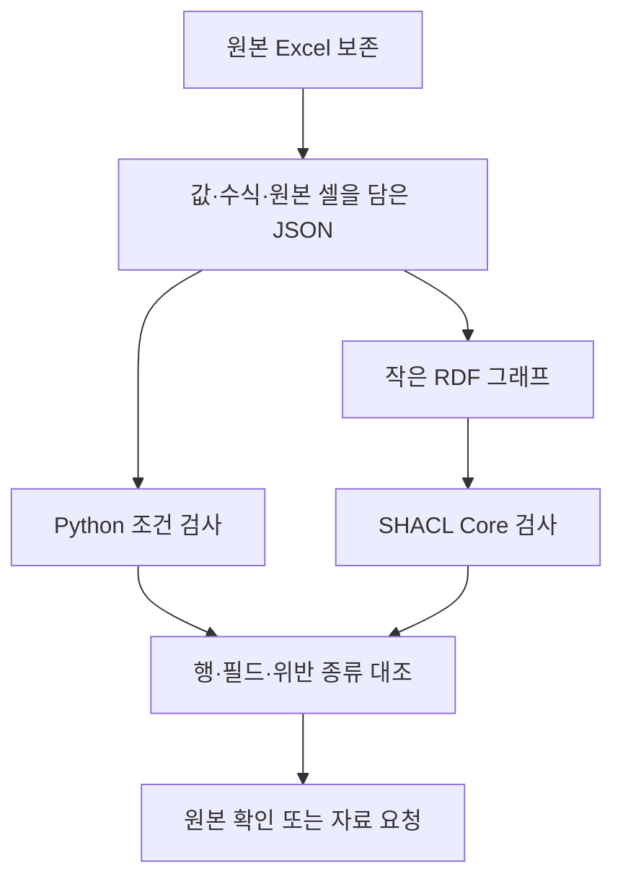

# 실제 검사표에서 SHACL 보고서까지

## 이번 단계의 질문

Excel에서 관계를 뽑는 과정과 SHACL로 검사하는 과정을 실제 용접 자료로 연결했습니다. 질문은 “이 용접부를 승인해도 되는가”가 아니라 “검사 기록의 코드 참조와 위치 구간이 우리가 명시한 조건에 맞는가”입니다.

PENELOPE의 PP3–PP7 Excel에서 추출한 243행을 사용합니다. 앞선 합성 실험의 32개 사례와는 다른 자료입니다. 원본에서 이미 확인했던 역순 구간을 다시 검사하므로 새로운 이상 발견 실험이나 탐지 정확도 평가로 해석하지 않습니다.

## 원본 열과 관계 선언

검사표의 `defect=2`를 읽는 것만으로는 의미가 정해지지 않습니다. PP3 파일의 `defect_code` 시트에서 코드 2를 찾아야 `Lack of fusion`이라는 이름이 붙습니다. 전처리는 코드가 속한 시험편과 시트를 포함해 참조를 만듭니다. 같은 숫자가 다른 코드표에서 다른 뜻을 가질 수 있기 때문입니다.

| PP3 원본 셀 | 기록값 | 선언한 해석 |
|---|---:|---|
| A2 | 2 | PP3 결함 코드표의 코드 2 참조 |
| B2 | 1 | PP3 설정 코드표의 코드 1 참조 |
| C2 | 1 | PP3 안의 비드 번호 |
| D2 | 80 | 시작 위치, mm |
| E2 | 314.41 | 끝 위치, mm |

명목 설정과 실제 측정값은 구분합니다. 설정 코드 1의 450 A는 코드표에 적힌 명목 전류이며 HDF5 측정 신호를 읽은 값이 아닙니다. 이번 변환은 검사표와 코드표의 관계만 다룹니다.

## 원본 보존과 검증 흐름



Excel은 그대로 둡니다. JSON에는 빈 값과 수식, 저장된 계산값, 원본 셀 주소가 남습니다. RDF에는 이번 검사에 필요한 기록과 코드표 참조를 옮깁니다. 모든 파일을 온톨로지로 바꾸거나 실제 측정 신호까지 그래프에 넣지는 않습니다.

## 검사 조건과 해석 범위

| 검사 | 명시한 조건 | 위반 시 확인할 내용 |
|---|---|---|
| 코드 참조 | 해당 시험편의 결함·설정 코드표에 연결 | 코드표 범위나 참조 대상 |
| 값과 타입 | 비드·샘플 위치는 정수, mm 위치는 숫자 | 누락값 또는 잘못 읽힌 타입 |
| mm 구간 | 시작 위치 ≤ 끝 위치 | 구간 방향이나 전사 내용 |
| 샘플 구간 | 시작 샘플 ≤ 끝 샘플 | 구간 방향이나 전사 내용 |

두 위치가 같으면 이 조건을 통과합니다. 끝점이 없거나 타입이 맞지 않으면 먼저 그 문제를 보고하며 구간 순서를 판단할 근거로 삼지 않습니다. mm와 샘플 사이의 대응 관계, 다른 검사 방식의 결함 동일성, 공정 조건의 적정성은 검사하지 않습니다.

이 조건은 연구자가 작성한 데이터 확인 규칙입니다. 원천 기관이 제공한 용접 합격 기준이나 승인된 SHACL shape은 아닙니다. SHACL Core를 실행하며 OWL 추론이나 SHACL Rules는 사용하지 않습니다. 앞선 합성 수정 후보 실험에서 사용한 SHACL-AF와 구분합니다.

## 확인 요청의 근거

PP5의 25행에는 177→160 mm와 73717→66637 샘플이 기록되어 있습니다. 오름차순 구간 조건과 맞지 않지만 어느 값이 잘못됐는지는 이 검사만으로 알 수 없습니다. 결과에는 원본 셀과 값을 붙여 확인을 요청합니다. 두 값을 바꾸거나 용접 전류를 조정하는 처방은 만들지 않습니다.

`conforms=false`는 이 데이터 그래프가 지정한 shape의 조건을 모두 충족하지 못했다는 뜻입니다. 용접부가 실제로 불량이라는 뜻은 아닙니다. 반대로 `conforms=true`도 사실 확인이나 출하 승인을 대신하지 않습니다.

## 실행한 데이터와 shape 예시

아래는 저장된 RDF에서 PP5의 25행에 해당하는 위치값만 발췌한 예시입니다. 원본 파일 해시와 셀 주소도 전체 그래프에 남깁니다.

```turtle
@prefix p: <https://example.org/penelope/validation/> .

<https://example.org/penelope/source/PP5/PP5/25>
    a p:Annotation ;
    p:annotationId "PP5:25" ;
    p:x_init_mm 177 ;
    p:x_end_mm 160 ;
    p:sample_init 73717 ;
    p:sample_end 66637 .
```

shape의 속성 조건 하나를 보면 다음과 같습니다. `minCount`와 `maxCount`는 값의 개수, `datatype`은 데이터 타입을 정합니다.

```turtle
p:beadShape a sh:PropertyShape ;
    sh:path p:bead ;          # 검사할 속성
    sh:minCount 1 ;          # 값이 하나 이상 필요
    sh:maxCount 1 ;          # 여러 값은 허용하지 않음
    sh:datatype xsd:integer . # 정수로 기록
```

이 발췌에서는 `sh:`와 `xsd:` 접두사 선언을 생략했습니다. 전체 shape의 구간 조건은 `sh:lessThanOrEquals`를 사용합니다. 끝점의 존재와 타입을 먼저 확인하도록 `sh:or`와 `sh:not` 조건을 함께 두었습니다. 참조 검사에는 원본 코드와 시험편으로 만든 예상 참조를 사용하며 평가 정답을 넣지 않습니다.

## 저장된 검사 결과

| 항목 | 실제 실행 결과 |
|---|---:|
| 검사한 주석 행 | 243 |
| 이번 조건을 통과한 행 | 242 |
| 위반이 있는 행 | 1 |
| 원시 SHACL 보고서의 위반 결과 | 2 |
| Python·SHACL의 행별 위반 집합 일치 | 243/243 |

두 위반은 같은 PP5 25행의 mm 구간과 샘플 구간에 해당합니다. 서로 다른 물리적 결함 두 개로 세지 않습니다. 보고서를 행·필드·위반 종류로 정리하면 다음과 같습니다.

```json
[
  {"annotation_id": "PP5:25", "field": "sample_init", "kind": "order"},
  {"annotation_id": "PP5:25", "field": "x_init_mm", "kind": "order"}
]
```

확인 요청에는 `D25=177`, `E25=160`처럼 해당 셀과 원본값을 넣습니다. 요청의 종류는 `request_source_confirmation`이며 값 교환이나 공정 변경은 실행하지 않습니다. 실행 전후 입력 JSON의 바이트도 같았습니다.

## 재현 명령과 산출물

저장소 루트에서 새 출력 디렉터리를 지정합니다. 기존 실행 폴더가 있으면 덮어쓰지 않고 중단합니다.

```bash
uv run --locked --offline python scripts/validate_penelope_source.py \
  --input research/actionable-evidence-1/source/workbook-extraction-v1.json \
  --output-dir _workspace/new-source-validation
```

`research/actionable-evidence-1/source-validation/run-001/`에는 `data.ttl`, `report.ttl`, `report.txt`, 두 구현의 위반 목록, 행별 결과와 확인 요청을 저장했습니다. 입력·코드·shape·계약·잠금 파일의 복사본과 해시도 남겼습니다. 같은 끝점, 누락된 끝점, 잘못된 타입과 코드 참조 등은 별도의 복사본 단위 테스트로 확인했으며 실제 자료의 관측 건수에 더하지 않습니다.

## 그래프의 역할과 남은 연구 질문

이번 사례는 Python만으로도 검사할 수 있습니다. RDF와 SHACL은 기록의 관계와 검사 조건을 명시적으로 표현하는 구현입니다. 두 구현의 결과가 같다는 사실은 그래프의 우월성을 입증하지 않습니다.

다음 비교에서는 여러 문서와 시스템의 식별자를 연결해야 하는 질문, 스키마가 바뀔 때 수정해야 하는 지점, 근거 경로를 다시 확인하는 작업을 분리해야 합니다. 이번 결과는 그 비교를 위한 원천 데이터 처리 경로를 실행 가능하게 만든 단계입니다. LLM의 자연어 해석이나 관계 추출 능력은 아직 평가하지 않았습니다.

원천 자료는 [PENELOPE 공개 저장소](https://zenodo.org/records/15083865)의 CC BY 4.0 자료입니다. 저자·라이선스와 개별 파일 해시를 추출물에 남겼습니다. 전체 압축파일의 해시는 확인하지 않았습니다. 실제 자료와 합성 실행을 구분한 화면은 [이전 데모](../experiments/actionable-evidence-demo/index.html)에서 볼 수 있으며 그 화면은 이번 SHACL 실행 이전에 저장한 버전입니다.
