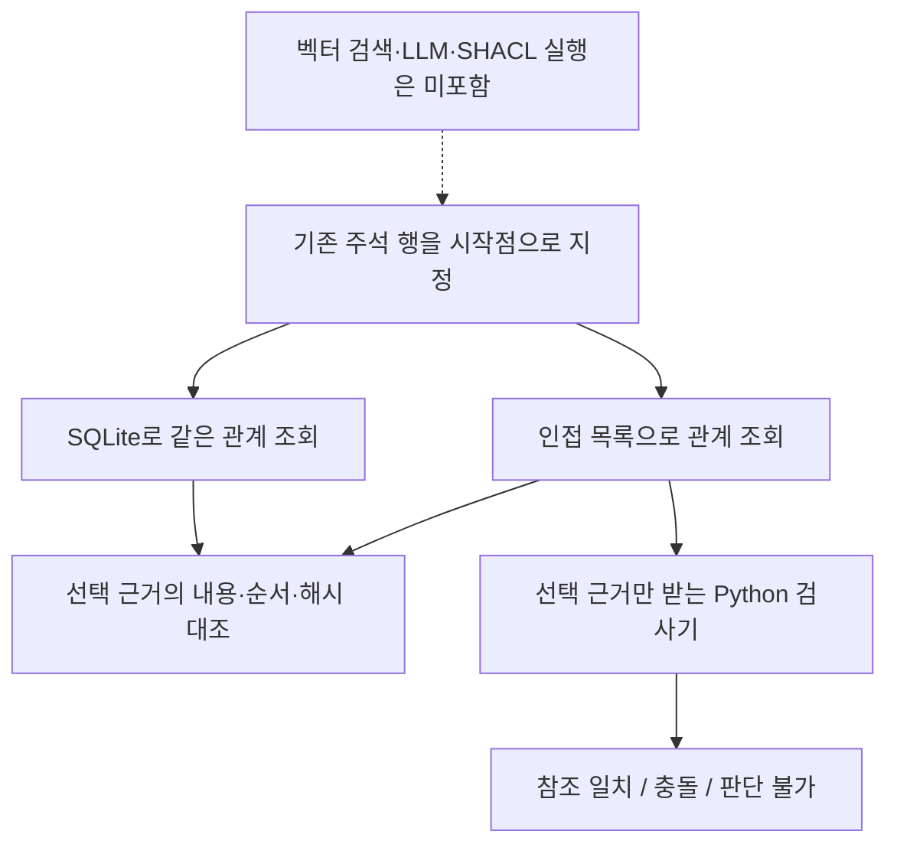

# 관계 조회의 동일성과 선택 근거의 검사 경계

기존 PENELOPE 주석 243개를 각각 시작점으로 지정하고 인접 목록과 SQLite가 같은 근거를 선택하는지 대조했습니다. 243쌍 모두 선택된 근거의 내용·순서·해시가 일치했습니다. 이는 두 구현의 소프트웨어 점검 결과입니다. 벡터 검색, 질문 해석, LLM 답변이나 GraphRAG의 성능을 평가한 결과는 아닙니다.

## 동일한 관계의 두 구현

인접 목록은 주체별 관계를 찾아 순회합니다. SQLite 구현은 별도의 frontier·visited 테이블과 SQL 조회로 순회를 수행합니다. 두 구현은 같은 원천과 입력 점검·결과 포장 코드를 공유하므로 완전히 독립적인 시스템은 아닙니다.

이번 점검은 바깥으로 나가는 관계를 한 단계만 따라갑니다. 관계를 역방향으로 만들거나 이름이 비슷한 노드를 연결하지 않습니다. 후보 상한은 32개, 근거 상한은 UTF-8 64,000바이트로 정했습니다. 상한을 넘으면 일부만 정상 결과처럼 반환하지 않고 오류를 남깁니다. 이 바이트 상한은 이후 RAG 비교에 필요한 토큰 예산을 대신하지 않습니다.

## 검사기가 읽는 정보

검사기는 저장된 선택 근거 묶음 하나만 받습니다. 전체 원천, 정답 파일, 다른 검색 결과를 인자로 받지 않으며 파일·네트워크를 읽는 함수도 두지 않았습니다. 소프트웨어 테스트에서는 검사 호출 중 파일·네트워크 접근을 막아도 동작하는지 확인했습니다. 운영체제 수준의 격리나 아직 만들지 않은 전체 파이프라인의 접근 통제까지 검증한 것은 아닙니다.

| 선택된 근거 | 검사 결과 |
|---|---|
| 작업표 행과 같은 파일의 코드북 행이 있고 코드·파일 정보가 일치 | 참조 일치 |
| 필요한 코드북 행이 선택되지 않음 | 판단 불가 |
| 필요한 파일 대신 값이 같은 다른 파일의 코드북만 선택됨 | 원래 대상이 없으므로 판단 불가 |
| 선택된 참조의 코드나 파일 정보가 서로 충돌 | 위반 |
| 공정 검토 버전의 적용 여부 | 현재 검사 규칙으로 판단 불가 |

작업표 노드 안의 명시적 참조와 대응 코드북 노드가 있으면 연결 근거로 인정하도록 정했습니다. 별도 관계 청크까지 중복으로 요구하지 않습니다. 관계 청크가 있다면 그 내용도 검사하지만 같은 연결을 두 번 표현했다고 독립적인 근거가 늘어난 것으로 세지 않습니다. 이 기준은 향후 모든 비교 조건의 채점에 동일하게 적용해야 합니다.

## 실행 결과와 해석 범위

| 점검 항목 | 관측 결과 |
|---|---:|
| 시도한 시작점별 조회 쌍 | 243 |
| 선택 근거 내용·순서·해시 일치 | 243 |
| 조회 실패·불일치 | 0 |
| 검사 실행 오류·입력 근거 변경 | 0 |
| 참조·관계 메타데이터 일치 결과 | 972 |
| 검토 버전 판단 불가 결과 | 243 |

972건은 같은 참조를 노드와 관계 표현에서 각각 검사한 결과를 포함합니다. 독립 사례 수나 정답 수가 아닙니다. 모든 행의 검토 버전이 판단 불가인 것도 현재 자료와 검사 규칙의 범위를 나타냅니다. 다른 곳에 버전 기록이 없다는 주장은 아닙니다.

이 검사기는 Python으로 작성한 참조 구현입니다. SHACL 검증이나 Open Ontologies 실행 결과로 표시하지 않습니다. LLM에 보고서를 제공하는 D 조건의 앞단을 준비한 것이며 자동 거부·수정·추가 검색은 하지 않습니다. 검사 실행 성공도 전체 데이터의 통과나 현실의 사실 확인을 뜻하지 않습니다.

## 보존한 산출물과 다음 단계

실행 입력, 코드, 계약, 의존성 잠금 파일의 해시와 사본을 저장했습니다. 시작점별 두 출력과 검사 보고서도 남겼으며 입력 파일이 실행 중 바뀌지 않았는지 확인했습니다. 생성기·관계 조회·검사기의 소프트웨어 테스트 28개가 통과했습니다. 이 가운데 이번에 추가한 조회·검사 테스트는 20개입니다.

다음 단계는 실제 임베딩 검색의 실행 가능성을 확인하고 검색·재순위화·토큰 포장 조건을 고정하는 것입니다. 현재 시작점은 사람이 만든 정답 파일에서 찾은 것이 아니라 전체 주석 노드를 차례로 열거한 것입니다. 질문에서 시작점을 찾는 능력은 아직 측정하지 않았습니다. 이전의 [개발 질문 24개](2026-11-01-graphrag-source-contract.md)도 수정하지 않았으며 값의 다양성이 낮다는 한계를 유지합니다.
