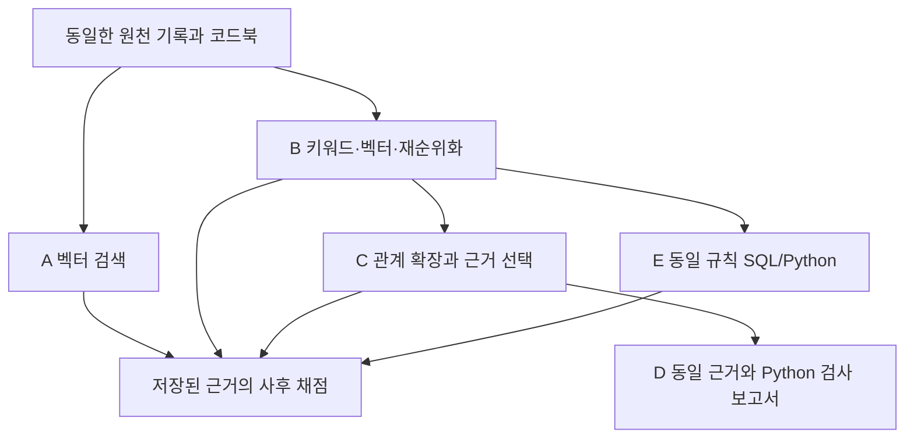

# 벡터 검색과 관계 확장의 근거 확보 비교

이번 연구일지는 실제 실행에서 저장한 검색 결과를 정리합니다. 비교 대상은 용접 기록의 설정 번호와 코드북 설명을 연결하는 개발용 질문 24개입니다. 답변 생성은 아직 실행하지 않았습니다.

## 원천 기록과 질문

PP4 작업표 2행의 설정 번호를 코드북에서 찾으면 명목 Idc를 확인할 수 있습니다. 작업표의 번호만으로는 값의 의미를 설명하기 어렵습니다. 여기서 명목 Idc는 코드북에 적힌 설정값이며 실제 측정값과는 다릅니다. 데모와 노트북에서 질문과 근거의 파일·시트·행 정보를 확인할 수 있습니다.

## 비교 조건과 실행 범위

A는 벡터 검색, B는 키워드·벡터 검색과 재순위화, C는 B의 선택 근거에서 관계를 따라 확장한 결과입니다. E는 C와 같은 규칙을 SQL/Python으로 구현했습니다. D는 C의 근거를 그대로 두고 검사 보고서만 덧붙입니다. 이 실험에서는 RDF·OWL 추론이나 SHACL 엔진을 실행하지 않았습니다.

## 질문별 근거 충족

원천에 필요한 정보가 있는 18건에서 A는 0건, B는 1건, C와 E는 각각 7건의 근거를 모두 확보했습니다. 원천 묶음에 정보가 없는 6건은 별도로 표시합니다. 이 수치는 답변 정확도가 아니라 사전에 정한 근거 묶음을 확보했는지를 나타냅니다. 평가용 정답 정보는 검색에 전달하지 않고 사후 채점에만 사용했습니다.

## 관계 확장 전후

dev-006은 B에서 작업표 기록을 찾았지만 필요한 코드북 기록이 빠진 사례입니다. C에서는 연결된 코드북 기록도 선택됐습니다. 데모는 저장된 결과를 그대로 보여줍니다. C의 후보 선택 순서도 B와 다르므로 이 차이를 그래프 표현만의 효과로 해석할 수는 없습니다. 같은 규칙의 E도 같은 결과를 냈습니다.

## 제한 초과와 근거 부재

dev-017은 확장 후보가 33개로 늘어 사전에 정한 32개 제한을 넘었습니다. 실패를 없애려고 제한을 바꾸거나 재실행하지 않았습니다. 이 실패도 18건의 평가에 포함했습니다. dev-004는 원천 묶음에 필요한 버전 정보가 없는 경우입니다. 검색 실패와 원천 정보 부재는 서로 다르게 기록합니다.

## 검사 보고서와 입력 길이

D의 24건은 C의 근거와 일치합니다. 검사는 23건에서 실행됐고 기존 검색 실패 1건에는 오류 기록이 붙었습니다. 개별 검사 결과는 pass 46개, unknown 98개입니다. 이는 독립적인 질문 144개가 아닙니다. pass도 현실의 사실이나 답변의 정답을 보증하지 않습니다. 보고서를 합친 입력은 21건에서 4,096 E5 토큰을 넘었습니다. 답변 생성 비교에는 공통 총 입력 예산이 필요합니다.

## 현재 결과의 해석

관계 확장과 근거 선택 방식을 함께 바꿨을 때 개발용 질문 6건에서 필요한 근거를 추가로 확보했습니다. SQL/Python도 같은 결과를 냈습니다. 이 자료만으로 그래프의 우위나 LLM 답변 개선을 주장할 수는 없습니다. 사례와 규칙을 정하는 데 이미 사용한 데이터이므로 새로운 검증용 데이터도 아닙니다.

## 후속 실험의 조건

현재 질문은 선택한 기록 6개에서 만든 4개 유형이며 설정 번호와 명목 Idc의 값도 같습니다. 실제 제조 로트의 투입·생산 이력을 연결한 실험은 아닙니다. 관계도 LLM이 문서에서 추출한 것이 아니라 작업표와 코드북의 식별자를 연결했습니다.

다음 실험에서는 값과 관계가 더 다양한 실제 자료를 먼저 확보하고 개발에 쓰지 않은 질문을 별도로 정해야 합니다. 관계 확장과 후보 정렬의 효과를 나누는 비교도 필요합니다. 답변 생성 단계에서는 검사 보고서를 포함한 총 입력 예산을 모든 조건에 동일하게 적용하고 답변 오류와 불필요한 판단 유보를 함께 평가해야 합니다. 이는 후속 설계안이며 아직 실행하지 않았습니다.

이번 실행의 D는 Python 검사입니다. SHACL의 효과나 OWL 추론의 효용을 평가한 결과로 사용하지 않습니다. 보고서가 붙은 입력 길이는 생성기 프롬프트와 일부 메타데이터를 제외하고 계산했으므로 실제 전체 입력 길이와도 구분해야 합니다.

## 근거 흐름과 결과 파일

A와 B는 동일한 원천 정보를 검색합니다. C와 E는 B에서 선택한 근거를 출발점으로 같은 관계를 조회합니다. D는 C의 근거를 그대로 보존합니다. 사후 채점용 정보는 검색이나 검사 입력에 전달하지 않습니다.

| 조건 | 원천 정보가 있는 18건 중 근거 충족 |
| --- | ---: |
| A 벡터 검색 | 0/18 |
| B 혼합 검색과 재순위화 | 1/18 |
| C 관계 확장 | 7/18 |
| E 동일 규칙 SQL/Python | 7/18 |

로컬 저장소의 `research/graphrag-evidence-1/` 아래에서 `demo-001/index.html`, `seminar-001/walkthrough.ipynb`, `graphrag-evidence-demo.zip`을 확인할 수 있습니다. 노트북 코드 셀 8개는 실행 완료했으며 HTML은 저장된 결과를 재생합니다. 원천 자료의 출처·라이선스와 파일별 해시는 함께 보존했습니다.

원천은 PENELOPE Submerged Arc Welding Open Repository의 PP3–PP7 작업표와 코드북입니다. DOI는 `10.5281/zenodo.15083865`이며 CC BY 4.0 자료입니다. 세부 저자 표기와 파일 출처는 배포 묶음에 포함했습니다.

[기존 실험 설계](../experiments/graphrag-evidence-study.md)와 [실행 요약 JSON](../experiments/records/2026-11-01-graphrag-retrieval-closeout.json)을 함께 보관합니다. 이 기록은 로컬 작성본이며 원격 게시 여부와 구분합니다.
