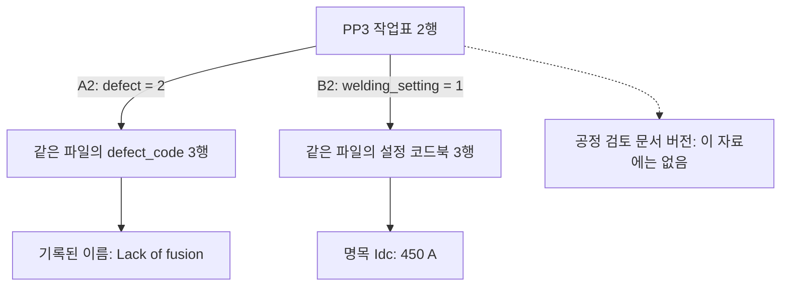

# GraphRAG 비교를 위한 원천 관계와 질문 범위

벡터 검색과 관계 확장을 비교하기 전에 검색 대상과 출처 연결을 정리했습니다. 이번 작업은 기존 PENELOPE 추출 자료로 검색용 입력을 만드는 단계입니다. A–E 검색·답변 실험은 아직 실행하지 않았습니다.

## 작업표와 코드북의 연결

기존 243개 주석 행과 코드북 85개 행을 328개 노드로 표현했습니다. 주석 행마다 결함 코드와 설정 코드의 연결을 하나씩 만들어 총 486개 관계를 기록했습니다. 각 관계는 같은 엑셀 파일의 코드북에서 코드가 일치하는 행을 찾습니다. 연구자가 정한 변환 방식이며 원천이 제공한 범용 식별자나 LLM이 발견한 관계는 아닙니다.

그림의 이름과 전류는 실제 추출 값입니다. 450 A는 코드북의 명목 설정이며 측정 전류나 공정 변경 권고가 아닙니다. 값과 함께 원본 파일 해시, 시트, 행, 셀 위치와 헤더를 보존했습니다. 결측값은 0으로 바꾸지 않았습니다.

노드와 관계를 각각 텍스트 청크로도 저장해 총 814개 청크를 만들었습니다. 벡터·키워드 검색에도 관계 정보를 같은 내용으로 제공합니다. 그래프 조건만 추가 사실을 받지 않도록 하기 위한 구성입니다. 이는 구현 점검용 직렬화이며 최종 검색 성능을 위한 청크 크기·표현은 아직 고정하지 않았습니다.

## 같은 값과 다른 출처

다섯 작업표의 코드북 내용은 같습니다. 다른 작업표의 코드북을 잘못 가져와도 숫자나 이름이 맞을 수 있습니다. 따라서 값이 맞는지와 질문에서 지정한 파일의 근거를 인용했는지를 따로 평가합니다. 같은 내용의 반복을 다섯 개의 독립적인 의미 체계로 세지 않습니다.

## 개발 질문 24개

이미 사용한 여섯 행에 네 유형의 질문을 붙였습니다. 기존 자료로 인터페이스를 점검하기 위한 질문이며 새로 확보한 평가 집합이 아닙니다.

| 질문 유형 | 예시 | 자료의 지원 범위 |
|---|---|---|
| 직접 조회 | 해당 행의 설정 번호 | 작업표 한 행 |
| 설정 해석 | 설정 번호에 대응하는 명목 Idc | 작업표와 같은 파일의 설정 코드북 |
| 결함 이름 해석 | 결함 번호에 대응하는 이름 | 작업표와 같은 파일의 결함 코드북 |
| 기록 부족 | 해당 행에 적용된 공정 검토 문서 버전 | 제공한 자료에서는 확인 불가 |

18개 질문에는 답의 근거가 있고 6개 질문은 제공한 자료에 필요한 기록이 없습니다. 이 수치는 작성한 질문의 구성입니다. 모델의 정답 수가 아닙니다. 검토 버전을 모른다는 판정도 이 자료 묶음에 한정하며 공장이나 전체 원천에 그 기록이 없다고 단정하지 않습니다.

질문 파일에는 ID와 자연어 질문을 넣었습니다. 정답·필수 근거·질문 유형은 별도 채점 파일에 보관했습니다. 검색기와 생성 모델, 검사기는 채점 파일을 읽지 않도록 구현해야 합니다. 현재는 파일을 나눴으며 실행 중 접근 차단 검사는 다음 단계입니다.

## 검증 조건과 실패 집계

D 조건은 C가 선택한 근거를 그대로 사용합니다. 검사기는 그 근거와 공통 규칙만 읽고 전체 자료나 숨은 사례 정보를 추가 조회하지 않습니다. 필요한 버전 정보가 없으면 통과가 아니라 판단 불가로 기록합니다. 검사 결과를 LLM에 제공하며 자동 거부나 추가 검색의 효과와 구분합니다.

검색 실패, 모델 미제공, 응답 형식 오류, 예산 초과, C/E 근거 불일치를 모두 시도한 질문 목록에 남기도록 계약을 작성했습니다. 정답 사례만 남기는 집계와 자동 재시도는 허용하지 않습니다. 같은 내용을 SQL/Python으로 조회하는 E는 C와 근거 내용·순서까지 대조합니다.

## 완료 범위와 다음 단계

원천 전용 생성기와 입력 자료, 개발 질문, 채점 참조, 입출력 계약을 작성했습니다. 생성기의 소프트웨어 검사는 잘못된 파일 범위, 없는 코드, 중복 코드, 원시 셀과 추출 값의 불일치, 결측값 보존과 덮어쓰기 방지를 확인합니다. 검색 효과나 실제 업무 정확도를 측정하는 검사는 아닙니다.

현재 관계는 대부분 작업표에서 코드북으로 가는 한 단계 연결입니다. 장거리 관계 추론이나 제조 변경 영향의 장점을 입증하기에는 부족합니다. 설계 PDF의 수동 대응 관계와 미완료 취득 건은 이번 입력에서 제외했습니다. 다음 단계에서는 이 작은 입력으로 조회·검사 인터페이스를 점검하고 별도로 더 복잡한 실제 관계를 뒷받침할 자료를 확인합니다.

실행 전 [A–E 비교 설계](../experiments/graphrag-evidence-study.md)의 모델, 검색 후보 수, 관계 탐색, 토큰 예산과 채점 기준을 고정해야 합니다. 현재 벡터 RAG 성능은 미측정이며 TF-IDF 결과를 임베딩 검색 결과로 대신 표시하지 않습니다.

원천은 [PENELOPE Submerged Arc Welding Open Repository](https://doi.org/10.5281/zenodo.15083865)의 기존 추출본입니다. CC BY 4.0 출처·저자·파일 해시는 파생 입력에도 보존했습니다.
