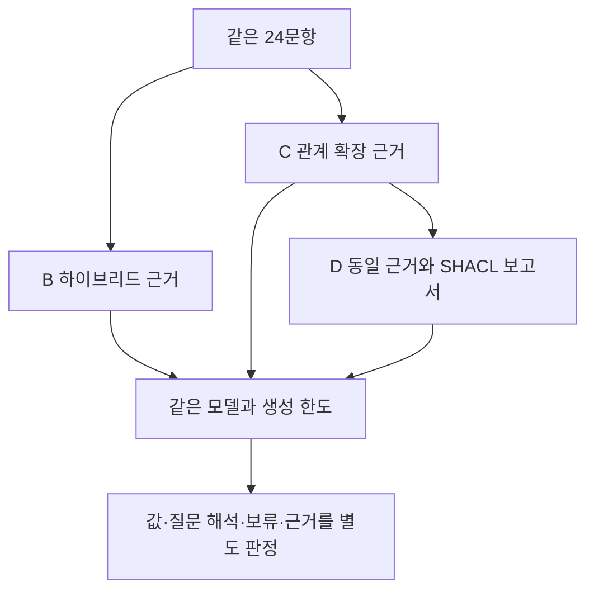

# 관계 확장과 SHACL 보고서의 최종 답변 비교

2026-11-03 · `answer-evidence-1` · 개발용 24문항, 72회 호출

이번에는 LLM의 최종 답변까지 실행했다. 핵심 값이 맞은 답변은 B 9건, C 10건, D 10건이었다. SHACL 보고서를 추가한 D에서 정답 수가 늘지는 않았다. C의 오답 1건이 D에서 근거 부족을 인정하는 답변으로 바뀌었지만 다른 1건은 응답 형식 실패로 남았다. 이 두 변화를 모두 개선으로 세면 안 된다.

## 비교 조건과 실행 범위

B는 기존 하이브리드 검색, C는 같은 기반에 관계 확장을 더한 조건이다. D에는 C와 정확히 같은 근거와 선택된 근거의 SHACL 검토 보고서를 제공했다. D가 원문을 더 조회하거나 답변을 강제로 거부하도록 만들지 않았다. A1 벡터 검색은 이전 검색 진단에 포함됐지만 이번 72회 최종 답변 비교에는 포함하지 않았다.

그림의 비교 단위는 각 질문의 B·C·D 답변이다. 검색 단계의 원문 접근과 예산을 맞췄으며 생성 단계에는 공통 입력 상한 16,384토큰과 출력 상한 2,048토큰을 적용했다. 보고서가 추가되는 D의 실제 입력 길이는 C보다 길다. 보고서 내용의 효과와 길이 효과를 분리한 실험은 아니다.

`openai/gpt-4o-mini`를 OpenAI 제공자로 고정하고 temperature 0, seed 20261103을 사용했다. 제공자 전환과 자동 재시도를 막았다. 실제 모델 토크나이저 `o200k_base`로 계산한 입력 추정치는 1,240~2,078토큰이었다. 사전 계산은 채팅 프레임을 포함한 추정값이며 제공자가 보고한 사용량과 구분했다.

72회 모두 호출했고 71건은 요구한 응답 구조를 충족했다. D의 `dev-011` 한 건은 `claims[].value`에 허용되지 않은 배열을 반환했다. 원문을 보존했으며 수정하거나 재호출하지 않았다. 실제 비용 보고액은 $0.02170545, 실패를 포함해 반환하지 않는 예약액은 $0.72였다. 승인 한도는 최대 72회·$1이었고 남은 금액으로 추가 실험을 실행하지 않았다.

## 핵심 값과 질문 해석

| 판정 | B | C | D |
|---|---:|---:|---:|
| 핵심 값 일치 | 9 | 10 | 10 |
| 오답 또는 질문 오해 | 3 | 8 | 6 |
| 핵심 값 보류 | 12 | 6 | 7 |
| 응답 형식 실패 | 0 | 0 | 1 |
| 전체 계획 건수 | 24 | 24 | 24 |

‘핵심 값 일치’는 요청한 설정 번호나 코드북 이름을 맞혔다는 뜻이다. 답변 전체의 인용 위치와 모든 부가 설명이 맞았다는 뜻은 아니다. 질문을 잘못 해석해 다른 필드를 답한 경우도 오답에 포함했다. 응답의 `answered`·`partial` 표시는 모델의 자기 선언이므로 그대로 정답 판정으로 쓰지 않았다.

각 조건의 24문항 중 18문항은 원본 묶음에 요청한 값이 있고 6문항은 공정 검토 문서 버전이 없는 질문이었다. 원본에 값이 있는 18문항에서 핵심 값 일치는 B 9/18, C 10/18, D 10/18이다. 원본에 없는 6문항은 세 조건 모두 자료 범위 안에서 알 수 없다고 답했다.

선택된 근거만으로 핵심 값을 답할 수 있다고 사전에 판정한 문항은 B 9건, C 10건, D 10건이었다. 이 문항에서 불필요한 보류는 각각 0/9, 0/10, 0/10이었다. 나머지 보류를 모두 불필요한 보류로 세지 않았다. 원본에는 값이 있어도 검색 결과에 필요한 코드북이 빠진 경우가 있기 때문이다.

## 같은 질문에서 달라진 답변

`dev-023`의 B는 결함 코드 1을 코드 6의 Cracks와 잘못 연결했다. C와 D는 Porosity를 답했다. 관계 확장이 이 질문의 필요한 연결을 확보한 사례다. 한 사례를 그래프 전반의 우수성으로 일반화할 수는 없다.

명목 전류 Idc를 묻는 여섯 질문에서는 필요한 설정 코드북이 최종 근거에 포함되지 않았다. B는 여섯 건 모두 보류했다. C는 설정 식별자, 결함 이름, 위치 좌표 등을 명목 전류 해석 대신 제시했다. 더 많은 관계 정보가 들어가도 질문에 필요한 관계를 골라 해석하는 문제가 남았다.

C와 D의 핵심 판정이 달라진 질문은 두 개였다.

- `dev-014`: C는 설정 참조와 좌표를 답했다. D는 결함·설정의 알려진 사실을 설명하면서 명목 Idc는 근거에 없다고 밝혔다. 오답에서 핵심 값 보류로 바뀐 사례다.
- `dev-011`: C는 내부 참조 식별자를 코드북 이름처럼 답했다. D는 응답 형식을 위반했다. 실패를 안전한 보류나 정답 개선으로 바꾸어 집계하지 않았다.

또한 `dev-019`의 D는 Porosity라는 이름은 맞혔지만 코드북의 행을 2행이 아닌 1행으로 제시했다. 핵심 값 정답 수만 보면 이런 근거 위치 오류를 놓친다.

## SHACL 보고서의 범위와 한계

이번 보고서는 선택된 레코드에 선언된 사전 참조를 검사한다. 질문에 그 참조가 필요한지, 답변이 질문을 올바르게 해석했는지, 최종 답변의 주장이 사실인지까지 검사하지 않는다. `dev-014` 보고서에서는 결함 참조가 `pass`, 용접 설정 참조가 대상 근거 누락으로 `unknown`이었다. D의 보류와 함께 관찰됐지만 이 한 쌍만으로 보고서가 보류를 유발했다고 확정하지 않는다.

정상 형식 응답 71건의 `review_requests`는 모두 비어 있었다. 이번 실행에서는 사람이 검토할 항목을 구체적으로 추천하는 효용을 관찰하지 못했다. 선택된 청크 ID에 속한 인용은 B 20/20, C 40/40, D 39/39였지만 이는 ID 존재 여부다. 해당 위치가 정확하거나 인용이 주장을 뒷받침한다는 결과가 아니다.

SHACL을 검토 안내와 근거 설명에 사용하는 방향은 여전히 연구할 가치가 있다. 다만 이번 결과가 그 효용을 입증한 것은 아니다. 질문과 관계의 적합성, 내부 식별자와 실제 이름의 구분, 답변의 인용 위치를 별도로 다루어야 한다.

## 판정의 신뢰 범위와 다음 실험

24문항은 이미 검색 설계에 사용한 개발 자료다. 답변당 한 번 생성했고 모델과 제공자는 하나뿐이다. 의미 판정은 결과를 본 조정 AI가 수행했으며 독립 전문가의 판정이나 평가자 간 일치도는 측정하지 않았다. 애매한 근거 위치는 미판정으로 남겼다. 주장 배열의 항목 수는 중복을 제거한 독립 명제 수가 아니다. 독립 검토 두 종류는 실행기와 집계 방식의 검토이며, 의미 판정의 독립 검증과 구분한다.

다음 비교는 이번 24문항을 더 조정하는 대신 새 문항에서 진행해야 한다. 질문에 필요한 설정 관계를 제공하는 조건, 동일한 정보의 Python 검토 보고서, SHACL 보고서, 길이를 맞춘 보고서 대조군을 구분하는 설계가 필요하다. 질문 해석과 최종 답변 검토를 추가하면 이번 선택 근거 검증과는 별도 개입으로 기록한다.

실제 Neptune 실행, 자연어에서 관계·스키마·SHACL을 만드는 진단, 사람의 검토 효용은 아직 측정하지 않았다. AWS 계정·리전·사용 시간·비용 상한이 정해지지 않아 Neptune 자원을 생성하지 않았다. SWRL·SHACL Rules를 이용한 물리적 조치 추천도 이번 범위에 넣지 않았다.

## 결과 파일

- 실행 결과와 실패 원문: `research/answer-evidence-1/final-answers-001/outcomes.jsonl`
- 문항별 판정과 이유: `research/answer-evidence-1/final-answers-001/adjudications.json`
- 전체 분모·비용·짝 비교: `research/answer-evidence-1/final-answers-001/summary.json`
- 프로토콜·해시·점검 기록: 같은 디렉터리의 `protocol.json`, `freeze.json`, `manifest.json`, `prelaunch-audit.json`, `postrun-audit.json`

원본 PENELOPE/Zenodo 자료의 CC BY 4.0 표시와 원본 해시는 기존 소스 목록에 유지했다. 이 문서는 로컬 결과 정리이며 GitHub Pages에 새로 발행하지 않았다.

<!-- HUMANIZE-SUMMARY -->
<!--
route: light
genre: report
적용: C-11 연결어미 뒤 쉼표 정리, A-18 중첩 수식 완화, J-1 본문 강조 축소.
보존: 사실·수치·날짜·경로·기술 용어·Mermaid·불확실성·판정 범위.
자체검증: 6항 점검 완료. 변경률 확정은 오케스트레이터의 verify_change_rate.py 판정에 따름.
자가검증 미통과 항목: 0건.
-->
