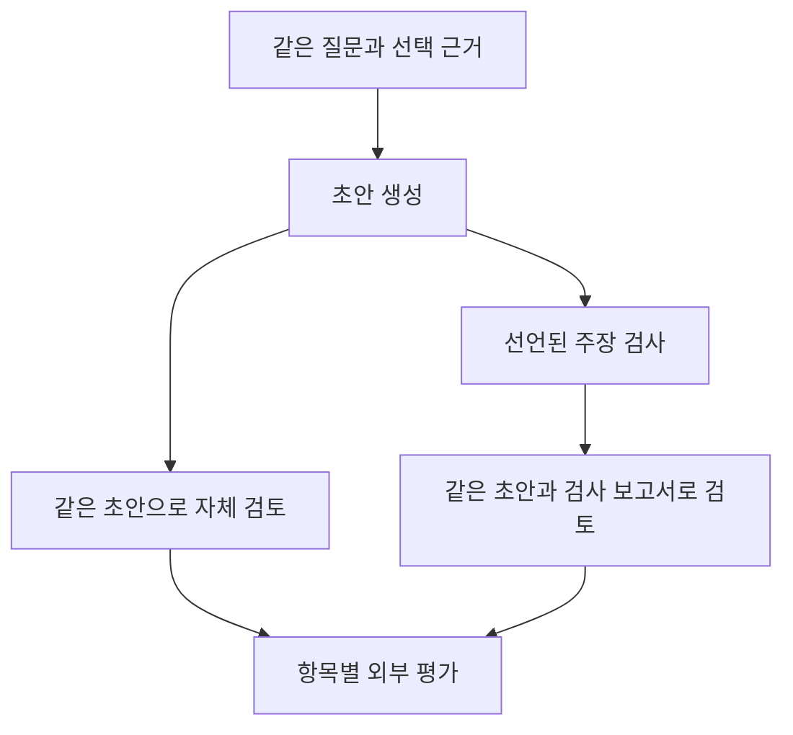

# 복합 질문과 답변 검토 입력 확장

9개 질문 유형을 실제 LLM 답변 비교로 연결하기 위한 오프라인 준비를 진행했다. 이번 실행에는 새 LLM 호출이 없으며 Neptune은 사용자의 요청에 따라 다음 날 설정하기로 했다. 검사 기능의 동작과 답변 개선 효과는 구분한다.

## 복합 질문의 채점 단위

하나의 답변을 한 개의 정답 여부로만 평가하면 일부만 맞은 답변을 구분하기 어렵다. 두 설정값과 차이를 묻는 질문은 설정 번호, 두 값, 단위, 차이의 방향, 출처를 각각 평가하도록 확장했다. 답변 실행 횟수와 세부 평가 항목 수는 별도로 집계한다. 세부 항목이 많아도 독립적인 LLM 실행이 늘어난 것은 아니다.

새 테스트 6개와 기존 테스트 7개가 통과했다. 작성한 예시에는 답변 흐름 1개, 세부 항목 3개, 초안·자체 검토·보고서 검토의 3단계가 있다. 차이 계산의 오답이 보류로 바뀐 결과는 정답으로 수정된 결과와 구분한다. 평가자가 아직 판정하지 않은 항목은 미채점으로 남긴다. 모든 목표 값이 일치해도 단위와 근거가 틀릴 수 있으므로 전체 답변의 정확성으로 해석하지 않는다.

## 근거 표현의 압축 시험

반복되는 작업표 경로·해시·머리글을 묶고 셀의 속성을 표로 표현했다. 원본 328개 기록과 질문 후보 9개의 근거를 다시 복원해 JSON 내용이 같은지 확인했다. 수식, 저장된 값, 명시적 null, 누락된 키를 구분하며 보존했다. 단위 테스트 4개도 통과했다.

전체 기록의 압축 JSON은 583,169바이트에서 287,997바이트로 줄었다. 그러나 개별 질문 9개 중 5개는 오히려 커졌다. 짧은 입력에서는 표현 형식 자체가 부담이 되므로 일괄 적용하지 않는다. 이 수치는 UTF-8 바이트이며 토큰 수나 비용 절감, 모델의 이해도를 측정한 결과가 아니다. 질문별 표현을 선택하더라도 그 질문의 모든 모델과 검토 조건에는 같은 표현을 제공한다.

## 선언된 주장과 검사기의 연결

모델이 선언하는 값·출처·조건을 검사기에 전달하되 검사 근거는 고정된 자료에서만 가져오도록 연결했다. 모델이 선언 안에 근거를 추가하면 입력 오류로 남긴다. 직접 값, 코드북 연결, 차이 계산, 조건별 항목·개수, 값의 역할, 시점별 적용성을 다룬다. 지원하지 않는 해석은 검사 범위 밖으로 표시한다.

첫 독립 검토에서 원본 기록과 기존 검사기의 입력 포장 형식이 맞지 않는 오류를 발견했다. 정상 사례의 결과가 비어 있어도 통과할 수 있던 테스트도 강화했다. 이전 코드와 검토를 보존한 뒤 새 검토를 거쳐 테스트 7개를 통과했다. 작성한 7개 주장 예시는 두 구현에서 각각 46개 검사를 완료했다. 각 구현의 결과는 pass 41개, unknown 4개, not_applicable 1개로 일치했다. 이는 작성한 예시의 소프트웨어 검사 결과이며 실제 모델의 정확도가 아니다.

계산 결과가 맞아도 피연산자의 출처가 질문에 맞지 않을 수 있다. 두 판단을 합치지 않는다. 모델이 잘못 선언한 범위나 시점, 자연어 문장과 구조화된 주장 사이의 불일치는 별도 평가가 필요하다. 기존 native lookup은 주장에 적힌 단위를 검사하지 않으며 차이 계산은 최종 결과의 단위만 검사한다.

## 같은 초안의 두 검토 조건

그림의 LLM 생성·검토는 다음 실험의 계획이다. 이번에는 작성한 초안으로 입력만 점검했다. 자체 검토와 보고서 검토가 같은 원래 초안, 근거, 시스템 지시, 응답 형식을 받도록 했다. 보고서 검토에는 주장별 검사 항목과 상태만 추가한다. 원시 RDF와 전체 SHACL 진단은 실행 기록에 보관하고 모델 입력에는 넣지 않는다. 따라서 이번 비교에서 말하는 보고서는 전체 SHACL 진단 문서가 아니라 간결한 상태 보고서다.

새 테스트 5개와 질문 9개에 대한 27개 입력 준비를 완료했다. 두 검토 조건의 입력 일치 9쌍과 Python·pySHACL 보고서 입력 일치 9건을 확인했다. 검사기 실패 때문에 자체 검토까지 제외되지 않도록 경로를 분리했다. 보고서가 답변을 강제로 거부하거나 수정하지는 않는다.

## 비용과 미측정 범위

실험 후보는 질문 유형별 1개씩 9문항, 6개 모델, 초안·자체 검토·보고서 검토로 최대 162회다. 이전 모델별 1회 시험 비용을 그대로 환산하면 약 $4.69지만 이번 질문과 수정 단계에 대한 확정 견적은 아니다. 현재 공급자 가격으로 모든 호출의 입력을 3,000토큰, 출력·추론 한도를 2,048토큰으로 가정하고 캐시 쓰기 비용을 보수적으로 더하면 약 $9.05다. 입력을 4,000토큰으로 가정하면 약 $10.37이다. 가정한 토큰 수는 측정된 상한이 아니다.

작성한 초안으로 만든 전체 메시지는 4,260~12,994바이트였다. 보조 환경의 tiktoken 0.12.0/o200k_base 추정은 874~3,131토큰이지만 선택한 6개 모델의 정확한 토큰 수나 비용 상한으로 사용할 수 없다. 실제 모델이 만든 초안과 보고서의 길이는 아직 측정하지 않았다. $10 한도에서 모든 162회를 완료할 수 있는지도 확정되지 않았다.

새 유료 호출은 시작하지 않았다. 실제 답변의 정확성, 불필요한 보류, 근거 없는 확신, 검토 지점의 유효성, SHACL 보고서의 수정 효과는 여전히 미측정이다. 기존 자료는 개발에 사용한 자료이며 새로운 독립 평가 집합으로 취급하지 않는다.

## 실행 기록

- 복합 채점: `research/post-answer-review-1/compound-accounting-001/`
- 근거 표현: `research/post-answer-review-1/source-pack-001/`
- 주장 연결: `research/post-answer-review-1/declarations-001/`
- 입력 준비: `research/post-answer-review-1/message-candidates-v3-001/`

실제 자료의 출처는 Tapia Suárez 외, *Submerged Arc Welding Open Repository*, [DOI 10.5281/zenodo.15083865](https://doi.org/10.5281/zenodo.15083865), CC BY 4.0이다. 시점별 버전 이력은 별도로 작성한 합성 자료다.
