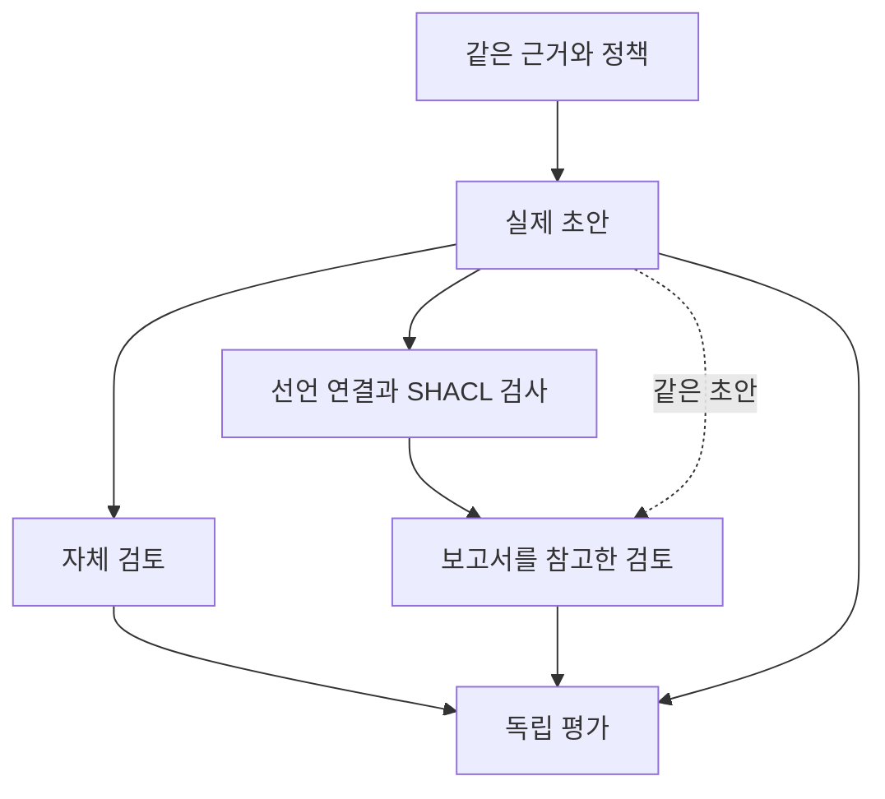

# 최종 답변의 자체 검토와 SHACL 보고서 검토

이번 실험은 LLM이 만든 초안을 마지막 단계에서 다시 검토할 때, 명시적인 검증 보고서가 도움이 되는지 살폈다. 같은 초안에서 자체 검토와 SHACL 보고서 검토를 분기했다. 보고서는 참고 자료이며 위반이 있다는 이유로 답을 강제로 막거나 정답으로 교체하지 않았다.

## 비교 구조

세 조건 모두 원문, 스키마와 수작업으로 정의한 역할·적용 정책을 받았다. 따라서 온톨로지 정보를 전혀 주지 않은 LLM과의 비교는 아니다. 자체 검토와 보고서 검토는 같은 원본 초안을 받았고 자체 검토 결과를 보고서 조건에 전달하지 않았다. 보고서 조건도 원문을 추가 검색하지 않았다.

모델에 전달한 것은 전체 SHACL 진단 원문이 아닌 주장별 간략 상태 보고서다. 모델이 선언한 값·출처·범위를 검사하며 질문 해석과 자연어 전체의 충실성까지 보증하지 않는다. 선언하지 않은 주장은 검사에서 빠질 수 있고 잘못 선언한 범위 안에서는 검사가 통과할 수도 있다.

## 실제 실행 결과

계획은 9개 유형 × 6개 모델 × 3개 조건, 총 162개 결과였다. 실제 API 호출은 154회였으며 145개 답변이 정상 완료됐다. 출력 실패는 9건이고 초안 실패 때문에 실행하지 않은 후속 검토는 8건이다. 재시도는 하지 않았다.

OpenRouter가 보고한 실제 비용 합계는 **$5.584621875**다. 실패한 호출의 사전 예약액을 돌려놓지 않는 보수적 원장에서 사용한 예산은 **$7.972082270**이며 승인 상한 $10 이내다. 두 숫자는 각각 보고된 비용과 실패 예약을 포함한 운영 한도 사용량이다. 성공 호출의 예약은 확인된 실제 비용으로 정산했다. 원장에 남은 누적 예약 이력은 지출 합계가 아니다.

비교 모델은 `google/gemini-3.8-flash`, `google/gemini-4-argon`, `openai/gpt-6-luna`, `openai/gpt-6-astra`, `anthropic/claude-sonnet-5.5`, `anthropic/claude-fable-5.1`이다. 실행 전에 고정한 OpenRouter 제공업체 경로를 사용했고 자동 대체 경로는 허용하지 않았다.

8번 유형에서 출력 길이 제한 실패가 6건 발생했고 그중 초안 실패로 후속 검토 6건도 실행하지 못했다. 9번 유형에서는 Fable의 두 검토 답변이 길이 제한으로 실패했다. 나머지 1건은 2번 유형 Sonnet 초안의 JSON 필수 키가 손상된 경우다. 그 초안에 의존한 후속 검토 2건도 실행하지 않았다. 잘린 답변을 정답·오답·보류에 섞지 않았다.

최종 실행 기록 대조에서 입력·실행기 해시, 모델별 요청 설정, 비용 및 마감 시각 준수, 같은 초안의 전달을 확인했다. 실제 전송된 보고서 검토 50건 모두에서 같은 정책의 Python 구현이 만든 요약 메시지와 SHACL 메시지가 같았다. 이는 검사 구현의 대조이며 Python 보고서를 받은 LLM을 별도로 실행한 결과는 아니다.

## 완료 범위와 짝지은 비교

| 조건 | 예정 결과 | 정상 완료 | 요청 세부 항목 모두 일치 |
|---|---:|---:|---:|
| 초안 | 54 | 50 | 48 |
| 자체 검토 | 54 | 48 | 46 |
| 보고서 검토 | 54 | 47 | 47 |

이 표의 마지막 열은 두 독립 검토자가 일치한 결과다. 조건마다 완료된 사례가 달라 이 비율을 바로 비교하지 않는다. 초안과 두 검토가 모두 완료된 **47개 묶음**으로 한정하면 초안 46개, 자체 검토 46개, 보고서 검토 47개에서 요청 항목이 모두 일치했다. 보고서 조건에서 나아진 사례는 Q3의 Luna 한 건이며 이 기준에서 새로 나빠진 사례는 없었다. 질문과 모델을 묶은 종속 결과이므로 47개의 독립적인 질문을 평가한 것은 아니다.

모델별 표의 각 칸은 **요청 항목 모두 일치 / 정상 완료**다. 각 모델·조건의 예정 결과는 9개이며 표 밖으로 빠진 실패·미실행도 함께 고려해야 한다. 유형별 사례가 하나뿐이고 출력 실패가 특정 유형에 집중돼 모델 순위로 사용하지 않는다.

| 모델 | 초안 | 자체 검토 | 보고서 검토 |
|---|---:|---:|---:|
| anthropic/claude-fable-5.1 | 8 / 8 | 7 / 7 | 7 / 7 |
| anthropic/claude-sonnet-5.5 | 7 / 8 | 7 / 8 | 7 / 7 |
| google/gemini-3.8-flash | 8 / 8 | 8 / 8 | 8 / 8 |
| google/gemini-4-argon | 9 / 9 | 9 / 9 | 9 / 9 |
| openai/gpt-6-astra | 9 / 9 | 8 / 8 | 8 / 8 |
| openai/gpt-6-luna | 7 / 8 | 7 / 8 | 8 / 8 |

완료된 답변에서 두 검토자 모두 불필요한 보류를 표시하지 않았다. 이는 이 작은 표본에서 관찰한 결과다. 근거 부족 질문의 적절한 판단 유보를 불필요한 보류로 세지 않았으며 출력 실패도 보류로 바꾸어 세지 않았다.

## 답변과 검증용 선언의 차이

145개 답변 중 34개에서는 하나 이상의 평가 항목에 두 검토자의 판단 차이가 있었다. 요청한 핵심 항목의 전체 일치 여부는 같았지만 선언 누락과 인용·부가 설명의 평가가 주로 달랐다. 예를 들어 Q8의 일부 답변은 필요한 측정 기록과 버전 이력을 요청하면서 문서의 적용 범위를 빠뜨렸다. 이를 틀린 값이나 부적절한 보류와 구분했다.

| 선언 평가 | 초안 | 자체 검토 | 보고서 검토 |
|---|---:|---:|---:|
| 누락으로 판정한 답변 수, 검토자 1 / 2 | 9 / 16 | 8 / 17 | 8 / 15 |
| 잘못된 연결로 판정, 두 검토자 공통 | 3 | 2 | 2 |

보고서 조건의 47개 완료 답변이 요청 항목을 모두 맞혔어도 선언 누락과 잘못된 연결이 사라진 것은 아니다. 모델이 잘못 만든 선언을 검사하는 문제와 자연어 답변을 정확히 이해하는 문제를 구분해야 한다.

보고서 조건 18개는 보고서 내용이나 검토 과정에 대한 부가 서술을 가린 평가 묶음만으로 확인할 수 없어 두 검토자가 답변 전체의 근거를 불명확으로 남겼다. 이를 18개의 환각으로 세지 않는다. 별도 사후 확인에서는 `unknown`을 언급하면서 동시에 “모두 pass”라고 요약한 문장도 발견했다. 보고서를 제공한 뒤 그 보고서를 모델이 어떻게 설명하는지도 추가 점검 대상이다.

## 원문 열을 잘못 읽은 답변의 수정

3번 유형의 Luna 초안은 코드북의 다른 열에 있는 1.6과 1.8을 명목 전류로 읽었다. 자체 검토도 이 값을 유지했다. 보고서 검토에서는 원문 열을 다시 확인해 450 A와 500 A로 수정했다.

| 조건 | 두 명목 전류 | 12행 − 2행 |
|---|---|---|
| 실제 초안 | 1.6 A / 1.8 A | +0.2 A |
| 자체 검토 | 1.6 A / 1.8 A | +0.2 A |
| SHACL 보고서 검토 | 450 A / 500 A | +50 A |

보고서는 두 조회 값과 차이 계산에 불일치 표시를 전달했다. 정답 값을 대신 넣어 주지 않았으며 모델은 모든 조건에 동일하게 주어진 원문에서 값을 다시 읽었다. 두 독립 검토자도 이 수정에 동의했다. 다만 한 질문·한 번의 생성에서 관찰한 사례이므로 일반적인 개선율이나 SHACL 고유의 효과로 확대하지 않는다.

## 질문 범위

| 유형 | 확인하려는 내용 | 이번 질문의 예 |
|---|---|---|
| Q1 직접 조회 | 값·단위·위치 | PP6 2행의 시작 위치 |
| Q2 사전 연결 | 코드와 같은 출처의 의미 연결 | 결함 코드 4의 이름 |
| Q3 관계를 거친 계산 | 설정 연결·피연산자·차이 방향 | 12행과 2행의 명목 전류 차이 |
| Q4 조건 선택·집계 | 모집단·범위·집계 | 지정된 두 행 중 조건에 맞는 행과 개수 |
| Q5 역할 구분 | 위치와 표본 번호, 명목값과 측정값 | 450 A가 실제 측정 전류인지 |
| Q6 출처 적용성 | 같은 이름과 같은 적용 범위의 차이 | PP7의 같은 결함명을 PP6에 대신 써도 되는지 |
| Q7 시점 적용성 | 최신 버전과 사건 시점의 유효 버전 | 사건일에 적용되는 규칙 버전 |
| Q8 근거 부족과 검토 요청 | 아는 값과 모르는 값의 분리 | 실제 측정 전류·적용 버전을 확인할 추가 자료 |
| Q9 잘못된 설명의 검토 | 수정·한정·보류를 함께 수행 | 결함명과 명목 전류를 잘못 서술한 문장 검토 |

질문 유형마다 사례는 하나다. 기존 개발 자료를 재사용했으며 새 평가용 표본이 아니다. 실제 자료는 Tapia Suárez 등의 *Submerged Arc Welding Open Repository*에서 가져왔다(DOI [10.5281/zenodo.15083865](https://doi.org/10.5281/zenodo.15083865), CC BY 4.0). Q7의 버전 이력은 합성 자료다. Q9의 잘못된 문장은 작성자가 넣은 과제 입력이며 그 문장을 검토한 모델의 실제 답변이 비교의 초안이다. 물리 공정의 조치나 안전성을 평가한 실험이 아니다.

## 출력 길이와 공통 실행 조건

모든 모델에 JSON 답변과 최대 2,048 출력 토큰을 요청했다. 이 한도에는 제공업체가 계산하는 추론 토큰도 포함된다. 실제 추론량과 입력 길이, 비용은 모델과 조건마다 달랐으므로 동일한 추론 작업량을 보장한 비교는 아니다. 입력은 보수적인 UTF-8 바이트 기반 여유분으로 사전 점검했으며 모델별 정확한 토크나이저 계산으로 제시하지 않는다.

실행 중에는 토큰 한도를 변경하거나 잘린 답변을 이어 붙이지 않았다. 길이 제한과 JSON 형식 실패는 오답이나 보류로 채점하지 않고 실행 실패로 분리했다. 초안이 실패하면 두 검토 조건을 실행하지 않았다.

## 평가와 해석 범위

모델명과 조건명을 가린 동일 답변 묶음을 두 native 검토 에이전트가 각각 원문과 대조했다. 문체로 조건을 짐작할 가능성은 남아 있다. 두 검토자는 도메인 전문가가 아니며 서로 다른 판단은 합의 결과로 바꾸지 않았다.

요청한 세부 항목의 일치, 답변 전체의 근거, 근거 없는 확신, 불필요한 보류, 인용의 뒷받침, 검증용 선언의 충실성, 사람에게 제시한 검토 지점을 따로 기록했다. 값이 맞더라도 선언이 빠져 있거나 잘못 연결될 수 있다. 세부 항목이 모두 맞았다는 결과를 답변 전체가 참이라는 의미로 사용하지 않는다.

## 남은 검증

이번 결과만으로 모델 순위나 SHACL의 일반적 우월성을 결론 내릴 수 없다. 질문 유형별 사례와 반복이 부족하고 같은 정책을 구현한 Python과의 차별적 효용도 별도 생성 실험으로 측정하지 않았다. 원문·정책·스키마는 사람이 준비했으므로 자연어에서 이들을 자동으로 생성하는 능력도 검증 대상이 아니다.

다음 단계는 개발 중 보지 않은 사례를 유형별로 확보하고 원문과 정책을 고정한 뒤 반복 실험하는 것이다. 검증용 선언이 답변을 얼마나 빠짐없이 담는지, 잘못된 선언을 검사기가 놓치는 경우가 얼마나 되는지도 별도로 확인해야 한다. Neptune 실험은 이번 범위에서 제외했다.

## 실행 자료

원문을 복원할 수 있는 선택 입력, 모델의 실제 답변과 실패한 원문, 두 독립 검토자의 개별 판단, 비용 원장과 해시를 `research/post-answer-review-1/paired-six-model-001/`에 보존했다. `outputs.json`의 답변은 수정하지 않았다. 실행기는 `scripts/run_paired_review.py`이며 실행 전 단위 테스트 13개와 별도의 독립 검토를 거쳤다. 소프트웨어 검사는 답변 정확도의 근거로 사용하지 않는다.

현재 확인한 성과는 **마지막 검토 단계의 구체적인 오류 수정 사례와 실패·선언 누락의 측정**이다. 새로운 질문에 대한 일반화, 도메인 전문가 검증, 자연어에서 관계·스키마·SHACL 자동 생성, 실제 Neptune 비교는 아직 남아 있다.
