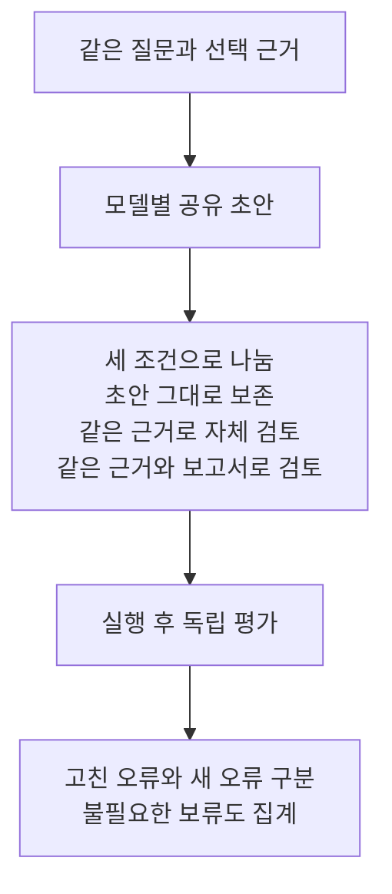

# 사후 검토 보고서의 비교 설계

현재 질문은 **같은 초안과 같은 근거를 다시 검토할 때, 외부 검사 보고서가 자체 검토보다 무엇을 더해 주는가**이다. SHACL을 답변 생성의 필수 통과 조건으로 두지 않는다. 선언한 규칙으로 확인할 수 있는 값과 연결을 점검하고 사람이 살펴볼 위치를 남기는 도구로 다룬다. 보고서를 받았다는 사실만으로 답변 개선을 가정하지 않는다.

## 관련 연구의 적용 범위

아래 자료는 비교 조건을 정하기 위해 고른 1차 논문 네 편과 표준 문서 한 건이다. 성능 수치를 합치거나 최신 모델의 효과를 예측하는 문헌 종합은 아니다.

| 자료 | 확인한 방법 | 이번 설계에 가져올 부분 | 직접 옮길 수 없는 부분 |
|---|---|---|---|
| [Self-Refine, NeurIPS 2023](https://proceedings.neurips.cc/paper_files/paper/2023/hash/91edff07232fb1b55a505a9e9f6c0ff3-Abstract-Conference.html) | 같은 모델이 초안, 피드백, 수정을 수행한다. 방법 절은 피드백의 구체성과 수정 가능성을 강조한다. | 보고서 없이 재검토하는 대조군을 둔다. | 여러 과제의 반복 수정 결과를 현재 모델이나 SHACL의 효과로 볼 수 없다. |
| [RARR, ACL 2023](https://aclanthology.org/2023.acl-long.910/) | 생성된 글의 근거를 검색하고 내용을 수정한다. 출처에 의한 뒷받침과 원문 보존을 함께 평가한다. | 근거 없는 주장 감소와 정당한 내용의 보존을 따로 센다. | RARR는 추가 검색을 한다. 이번 비교에서는 초안 이후 새 출처를 조회하지 않는다. |
| [CRITIC, ICLR 2024](https://proceedings.iclr.cc/paper_files/paper/2024/hash/fef126561bbf9d4467dbb8d27334b8fe-Abstract-Conference.html) | 외부 도구와 상호작용해 피드백을 얻고 수정한다. 수학 프로그램 과제에서는 실행기 피드백을 제거하는 비교도 수행한다. | 추가 생성 기회와 검사 정보의 효과를 구분한다. | 검색·실행기 등의 결과가 SHACL 보고서의 효용을 입증하지는 않는다. |
| [Large Language Models Cannot Self-Correct Reasoning Yet, ICLR 2024](https://proceedings.iclr.cc/paper_files/paper/2024/hash/8b4add8b0aa8749d80a34ca5d941c355-Abstract-Conference.html) | 외부 피드백 없는 추론 수정과 정답 여부를 알려 주는 조건을 구분한다. 정답 여부로 수정 중단을 결정하면 실제 사용 조건과 달라짐을 지적한다. | 정답을 이용한 수정·중단을 금지하고 새로 생긴 오류도 센다. | 당시 추론 과제의 결과가 현재 여섯 모델의 수정 능력을 결정하지 않는다. |
| [SHACL, W3C Recommendation 2017](https://www.w3.org/TR/2017/REC-shacl-20170720/) | §3.5–3.6은 주어진 데이터·shape의 적합성과 검증 결과를 정의한다. | 검증 범위와 결과 위치를 보고서에 명시한다. | 적합성이 원본 사실의 진위나 질문 해석의 정확성을 뜻하지 않는다. |

원문의 확인 범위는 Self-Refine 방법 절, RARR §2–3, CRITIC 방법과 수학 프로그램의 도구 제거 비교, 자기 수정 논문의 §3, SHACL §3.5–3.6이다. 논문의 모든 부록을 검토했다고 주장하지 않는다. 위 표의 ‘이번 설계에 가져올 부분’은 해당 연구를 참고한 우리의 설계 판단이다.

## 초안 공유와 검토 조건

같은 모델 안에서 초안을 공유하고 검토 조건만 바꾼다. 모델 간에는 각 모델이 만든 초안을 사용하므로 시작 답변의 차이와 보고서 효과를 함께 해석해야 한다. 초안 자체가 다른 모델끼리 단순 수정률만 비교하지 않는다.

자체 검토와 보고서 검토의 지시문·질문·초안·선택 근거·출력 형식을 같게 하고 보고서만 다르게 한다. 보고서 토큰도 공통 총예산에 포함한다. 이 비교는 공통 예산 아래 보고서 접근의 효과를 보는 것이며 정보 내용과 추가 길이의 효과를 완전히 분리하는 실험은 아니다. 보고서가 길다는 이유로 한 조건에서만 근거를 잘라내지 않는다. 실제 제공자의 토큰 계산, 출력·추론 여유분, 캐시 비용은 호출 전에 고정해야 한다. 현재는 그 제공자별 실행 준비가 끝난 상태가 아니다.

동일한 보고서를 Python과 SHACL이 만들면 후속 메시지도 같아질 수 있다. 이 경우 모델 처리는 하나로 두고 검사 엔진을 별도 구현 비교로 남긴다. 같은 입력을 두 번 호출한 뒤 엔진별 독립 효과로 해석하지 않는다.

## 현재 검사기의 역할

혼합 입력 v2에 연결된 구현은 공통 코드가 선언된 주장과 선택 근거에서 비교 대상을 뽑는다. Python은 이를 직접 대조하고 SHACL은 관측값을 RDF에 담아 기대값에 대한 shape로 검사한다. 코드북 연결도 공통 코드가 해석한다. 실제 pySHACL을 실행하지만 도메인 전체를 RDF로 모델링하여 복잡한 경로 제약을 검증한 실험은 아니다.

보고서의 `unknown`과 `not_applicable`은 애플리케이션이 정한 상태다. SHACL 자체의 세 가지 진리값으로 설명하지 않는다. 자연어 주장을 빠짐없이 구조화했는지, `recorded`·`lookup`·`derived`를 제대로 선택했는지, 질문에 맞는 행을 골랐는지는 별도 평가가 필요하다. 잘못된 주장을 `derived`로 선언하면 현재 검사 범위 밖으로 빠질 수 있다.

혼합 입력 v2는 이 세 유형을 명시하고 결함 이름과 명목 Idc라는 두 코드북 조회만 지원한다. 최초 7개 단위 테스트 메서드가 통과했고 이후 자체 검토와 검사기 실패를 분리한 버전은 9개 메서드가 통과했다. 이는 입력 처리와 보고서 동작의 점검이며 모델이 올바르게 유형을 선언하거나 답변을 개선한다는 증거가 아니다. 이전 v1 계약도 보존했다. 현재 v2의 자체 검토 준비는 검사기를 실행하지 않는다. 보고서 생성 실패와 그로 인해 실행하지 못한 후속 호출을 기록하는 전체 실행기는 아직 준비 단계다.

## 평가 단위와 실패 분모

질문별 요청 사실은 답변을 보기 전에 정한다. 답변의 주장 개수와 요청 사실 개수를 같은 분모로 쓰지 않는다. 한 문장에 여러 사실이 있거나 주장 목록이 비어 있어도 자연어 답변의 평가를 생략하지 않는다.

1. **요청 사실**: 맞음, 틀림·대상 이탈, 보류, 판정 불가를 구분한다. 기준은 명시한 원자료 범위이며 물리적 사실 전체의 진위가 아니다.
2. **주장과 인용**: 내용 값인지 위치·메타데이터 설명인지 먼저 나눈다. 셀 내용과 문자열이 다르다는 이유만으로 오답 처리하지 않는다.
3. **수정 전후**: 오류를 고친 수와 맞던 내용을 틀리게 만든 수를 별도로 센다. 정당한 내용 삭제와 불필요한 보류도 남긴다.
4. **검토 지점**: 질문과 관련 있는 경고, 무관한 경고, 해석할 수 없는 경고를 나눈다. 사람이 읽기 쉽다는 판단이나 시간 절감은 별도 사람 실험 전에는 미측정이다.
5. **실행 실패**: 초안 실패, 그로 인해 시도하지 못한 두 검토, 각각의 검토 실패를 전체 계획 수에 남긴다. 성공한 쌍만의 분석은 별도 조건부 분석으로 표시한다.

`revision_log`는 모델의 자기 보고다. 실제 초안·수정본과 대조해야 하며 현재 형식 검사는 변경 이유의 진실성을 검증하지 않는다. 독립 평가자에게는 조건명과 검사 엔진을 숨긴 사본을 주되 원본·해시·대응표는 보존한다. 보고서를 읽는 효용 평가에서는 조건이 드러나므로 완전한 눈가림을 주장하지 않는다. 평가자 간 불일치는 원래 판정과 합의 판정을 모두 남긴다. 이 사람 평가 절차는 아직 실행하지 않았다.

질문 후보 12개는 두 작업표 행에서 만든 6개 기본 질문의 근거 충분·누락 조건이다. 첫 버전의 모호한 x_init 질문은 보존하고 두 번째 버전에서는 x_init [mm] 열을 명시했다. 서로 독립인 12개 모집단 표본이 아니다. 이미 사용한 자료이므로 개발 진단으로 보고 이 크기에서 유의성이나 일반화된 모델 순위를 주장하지 않는다.

## 확인 기록과 남은 범위

2026-11-04에 논문 제목 중심 웹 검색 후 공식 학회 자료와 W3C 문서를 확인했다. 검색어는 Self-Refine, RARR, CRITIC, Large Language Models Cannot Self-Correct Reasoning Yet에 학회·연도를 붙였다. 관련 비교 방법을 찾기 위한 목적 표집이며 체계적 검색, 최신 연구의 완전한 목록, 메타분석이 아니다. 뉴스·요약 페이지는 근거로 사용하지 않았다.

5개 원문을 각각 8 MiB 이하로 읽기 전용 확보했고 모두 HTTP 200이었다. 원문 해시와 실패한 PDF 텍스트 추출 시도도 비공개 작업 기록에 남겼다. `pdftotext`가 없어 설치된 `pypdf`로 추출했다. 논문의 재배포 라이선스는 별도 검증하지 않았으므로 PDF를 공개 사이트에 싣지 않는다. 이 문서는 원문 링크와 짧은 요약만 제공한다.

Codex가 자료 검색·절 확인·설계 초안을 작성했다. 독립 검토와 한국어 윤문 기록은 작업 로그에 남긴다. 새 LLM 답변 생성, 답변 수정 효과, 전문가의 검토 시간, 실제 Neptune 비교는 이번 문헌 점검으로 측정되지 않았다.

[선택 근거의 관계 경로를 검사하는 별도 진단](2026-11-04-post-answer-native-paths.md)은 이 비교값 컴파일 방식과 구분해 기록했다.

## 실행 상태와 평가 집계

`scripts/postreview_evaluation.py`는 외부에서 작성한 평가 라벨을 집계한다. 답변의 의미를 자동 채점하지 않는다. 계획한 초안·자가검토·보고서 검토의 실행 상태를 모두 받고 성공한 출력에만 해시로 연결된 라벨을 허용한다. 빠진 평가는 미채점으로 남기며 평가자 간 불일치를 합의로 덮어쓰지 않는다.

작성한 소프트웨어 시험 7개와 두 작업 흐름의 예시에서 집계를 확인했다. 오답→보류는 오답→값 일치와 구분하고 값이 맞아도 선택된 근거가 없으면 근거 없는 주장으로 따로 센다. 실행 실패는 답변 보류에 포함하지 않는다. 대상은 질문의 주된 요구 값이며 모든 문장·인용의 품질을 포괄하지 않는다. 실제 모델 답변을 새로 채점하거나 전문가 평가를 수행한 결과는 없다. 독립 검토에서 지적한 두 분기의 직접 시험 부족도 기록했다. 보고서 분기만 실패한 경우의 자가검토 독립성과, 실패 출력의 평가 거절을 단독으로 확인하는 시험은 현재 7개에 포함되지 않는다.

입력과 집계 예시는 `research/post-answer-review-1/accounting-example-001/`에 보존했다. 해시는 내용의 연결을 확인할 뿐 평가자의 신원이나 판단의 타당성을 인증하지 않는다.

## 여섯 모델의 다음 실행 조건

2026-11-04 03:14 UTC에 OpenRouter의 공개 엔드포인트 목록을 다시 읽었다. Gemini 3.8 Flash·4 Argon, GPT-6 Luna·6 Astra, Claude Sonnet 5.5·Fable 5.1의 기존 제공자 경로 여섯 개가 조회됐고 `response_format`, `max_tokens`, `reasoning` 지원이 목록에 표시됐다. 이 조회는 새 생성 호출이 아니며 새 스키마와 프롬프트가 실제로 실행된다는 보장은 아니다. 원문 해시와 조회 시각은 `research/post-answer-review-1/provider-readiness-002/`에 기록했다.

현재 후보 전체를 실행하면 6모델 × 12개 문맥 × 3회로 최대 216회가 필요하다. 모델별로 초안 12회, 같은 초안의 자가검토 12회, 보고서 검토 12회다. 수정하지 않은 초안은 추가 호출 없이 비교한다. Python과 SHACL의 정규화 보고서가 같으면 별도의 모델 처치로 두 번 호출하지 않는다. 이는 실행 계획의 산술이며 새 예산 승인이나 실행 결과가 아니다.

추론 토큰은 출력 비용과 한도에 영향을 주고 출력에서 추론을 숨기는 옵션이 그 비용을 없애지는 않는다. 따라서 답변 텍스트만으로 출력 여유를 계산하지 않는다. [OpenRouter 추론 토큰 안내](https://openrouter.ai/docs/guides/best-practices/reasoning-tokens)

캐시 쓰기 비용도 별도로 고려해야 한다. 현재 안내와 이전 시험의 사용량 기록을 함께 보존하고 목록의 캐시 지원 플래그만으로 비용을 0으로 처리하지 않는다. 제공자별 단가 제한은 전체 실험의 총액 제한을 대신하지 않는다. [캐시 비용 안내](https://openrouter.ai/docs/guides/best-practices/prompt-caching), [제공자 선택과 가격 제한](https://openrouter.ai/docs/guides/routing/provider-selection)

여섯 모델의 정확한 토크나이저·메시지 형식별 토큰 계산, 동적으로 늘어나는 초안과 보고서의 공통 입력 한도, 추론을 포함한 출력 여유, 캐시 비용을 반영한 실패 포함 예약 원장은 아직 확정하지 않았다. 예전 한 질문씩의 6회 시험 비용을 새 실험의 확정 견적으로 재사용하지 않는다. 이번 작업에서 새 유료 생성 호출은 0회다.

<!--
장르 report, 보수적 light 윤문. C-11 연결어미 뒤 쉼표 다섯 곳만 제거했다. 관형절 관련 정량 지표는 실제 결함 수로 단정하지 않았으며 검사 범위와 비용 항목을 구체적으로 구분하는 수식은 보존했다.
자체검증 6항 점검: 사실·수치·날짜·모델명·경로·링크·내용 앵커, 한다체, 장르와 주장 강도를 보존했다. 잔존 S1과 인공 표현 주입 없음 확인. 변경률 확정 판정은 verify_change_rate.py에 맡긴다. 자가검증 미통과 항목 0건.
-->
