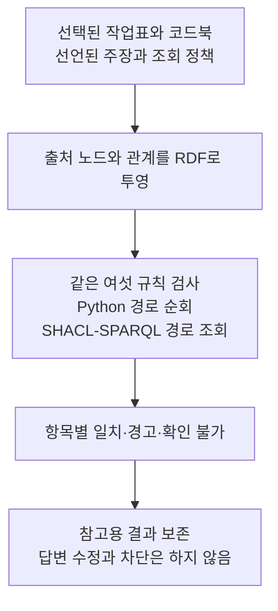

# 선택 근거의 관계 경로를 검사하는 SHACL 진단

앞선 코드북 검사는 공통 코드가 관측값과 기대값을 만든 뒤 두 엔진에 비교를 맡겼다. 이번에는 선택한 작업표와 코드북을 RDF 노드로 옮기고 그 관계 경로를 SHACL-SPARQL이 직접 따라가도록 별도 구현을 만들었다. Python 대조 구현도 같은 RDF 그래프를 읽는다. **검사 위치의 차이를 확인하는 소프트웨어 진단이며 답변 개선 실험은 아니다.**

## 두 검사 구현의 역할

공통 투영 코드는 작업표 행, 코드북 행, 주장, 정책을 구분하고 출처 ID·시트·셀·파일 경로·해시를 남긴다. SHACL 쿼리는 선언한 코드북 연결, 코드 값, 조회 결과, 파일 해시, 파일 경로, 열 제목을 확인한다. Python은 같은 경로를 순회해 결과를 비교한다. SHACL 쪽의 값 비교 결과를 Python이 미리 계산해 넣지는 않는다.

두 구현은 자료를 RDF로 옮기는 코드와 사람이 정한 두 조회 정책을 공유한다. 따라서 독립적인 자연어 해석이나 온톨로지 자동 생성의 검증이 아니다. 숫자·문자열의 구분은 기존 정책과 맞추기 위해 JSON 형식을 담은 RDF 문자열로 보존했다. 수치 단위 변환이나 물리량의 의미를 추론하지 않는다.

이번 대조는 기존 검사 중 여섯 항목만 다룬다. 명목 Idc의 단위 일치 검사는 제외했으므로 전체 정책이 같다고 주장하지 않는다. 혼합 입력 v2의 후속 메시지 준비에는 여전히 앞선 검사기가 연결돼 있다. 새 경로 구현을 모델 실험에 통합하거나 호출한 것은 아니다.

## 원래 진단의 재사용

기존 작업표 두 행에서 만든 네 연결과 다섯 합성 조건을 그대로 재사용했다. 20개 입력은 소프트웨어 진단용으로 작성했다. 모델 답변은 포함하지 않는다. 새 질문이나 독립 평가 자료가 늘어난 것으로 세지 않는다. 원래 입력과 결과의 해시를 확인한 뒤 새 디렉터리에 기록했다.

수정 후 9개 단위 테스트 메서드가 통과했다. 재생에서는 두 엔진의 총 40회 중 32회가 검사를 마쳤고 8회는 예상한 입력 형식 실패였다. 실행 오류는 없었다. 62개 확인 항목이 모두 통과했다. 검사를 완료한 실행에서는 여섯 항목 모두 기존 검사 결과와 일치했고 두 경로 구현의 결과도 같았다. 입력 shape 그래프도 하나로 유지됐다. 이 결과는 `native-paths-002`에 보존했다.

## 입력 shape와 실행 후 shape

첫 실행은 62개 확인 항목 중 61개가 통과했다. 항목별 검사 결과는 일치했다. 다만 shape 그래프를 하나로 유지했는지 확인하는 항목에서 실패했다. pySHACL이 실행 중 두 개의 기본 온톨로지 공리를 추가했는데 이를 입력 shape와 구분하지 않고 저장했기 때문이다.

첫 결과는 `native-paths-001`에 보존했다. 입력 RDF와 shape를 실행 전에 저장하고 실행 후 shape를 별도 필드에 남기도록 바꿨다. 수정 코드도 새 독립 검토를 거쳤다. 이 변경으로 검사기에 넣은 것과 검사 후 남은 것을 구분했다. 결과를 원하는 값으로 고치지는 않았다.

## 검사 범위의 한계

경로에 값이 없으면 해당 SHACL 쿼리에서 위반 결과가 나오지 않을 수 있다. 따라서 원시 `sh:conforms`가 참이더라도 애플리케이션은 필요한 경로가 비어 있는 항목을 확인 불가로 남긴다. 이를 답변 전체의 통과로 바꾸지 않는다.

질문에 맞지 않는 행을 선언하거나 출처와 주장 값을 함께 틀리게 바꾸면 여전히 일치할 수 있다. 파일 해시 역시 제공된 값끼리 비교하며 원본의 진위를 인증하지 않는다. 실패 분류는 이번에 확인한 입력 범위에 한정되고 일반 실행기를 위한 오류 분류는 추가 설계가 필요하다.

소스 코드는 `scripts/postreview_native_paths.py`, 실행기는 `scripts/run_postreview_native_paths.py`다. 결과에는 입력 RDF, 입력 shape, 실행 후 shape와 원시 검증 보고서를 남겼다. 형식적 근거는 [W3C SHACL 2017의 SPARQL 제약 정의](https://www.w3.org/TR/2017/REC-shacl-20170720/#sparql-constraints)다. 현재 데이터베이스, OWL 추론, SHACL Rules, 실제 모델 수정 효과를 비교한 것은 아니다.

재사용한 원자료는 Tapia Suárez 외 저자의 [Submerged Arc Welding Open Repository](https://zenodo.org/records/15083865), CC BY 4.0 자료다. 원래 저자·라이선스·해시는 새 manifest에도 보존했다.

<!--
장르: report / 한다체 유지.
적용: C-8 반복 대비 구조 완화, A-18 검사 대상과 비교 범위 문장 분리, C-11 연결어미 뒤 쉼표 제거.
보존: 제목, 고유명사, 수치, 날짜, URL, 출처, 라이선스, 코드 경로, 실행 ID, Mermaid, 내용 앵커와 연구 범위 제한. 첫 실패와 수정 결과를 분리하고 서법과 확신 강도를 유지함.
자체검증: 6항 점검. 내용·레지스터·장르·수사 주입·잔존 S1 점검 통과. 변경률은 보수적 국소 편집으로 제한했으며 확정 수치는 오케스트레이터의 verify_change_rate.py 판정 대상. 자가검증 미통과 항목 0건.
-->

## 보존된 자료 묶음의 연결 점검

두 행의 진단과 별도로 보존된 개발 자료 전체에서 선언된 연결을 점검했다. 작업표 행 243개와 코드북 행 85개에서 두 조회 정책에 해당하는 연결 486개를 살폈다. 두 엔진의 총 972회는 모두 완료됐고 묶음 안에서 대상 코드북이나 조회 값이 빠진 연결은 없었다. 각 엔진의 여섯 항목은 연결마다 일치했다. 원시 기록 972개와 출력 해시를 확인했고 실행 오류는 없었다.

여기서는 출처에 적힌 참조 ID를 그대로 선택하고 해당 셀의 값을 주장 값으로 복사했다. 따라서 선언한 참조와 조회 값의 일치는 구성상 정해진 결과다. 이를 모델의 답변 정확도나 검사기의 탐지 성능으로 보지 않는다. 코드·파일 경로·해시·열 제목도 제한된 묶음 안에서 선언한 정책에 맞는지 확인한 것이며 원본 사실의 진위를 인증하지 않는다.

이번 범위에서는 실제 자료 충돌이 발견되지 않았다. 앞서 경고 동작을 확인한 사례는 원자료를 바탕으로 작성한 합성 변형이다. 현재 자료에서 검증 보고서가 실제 LLM 답변의 오류를 고치는지는 별도 호출과 평가가 필요하다. 243개 행은 이미 사용한 개발 자료이며 새 평가 집합이 아니다.

실행기는 `scripts/audit_postreview_source_paths.py`, 결과는 `research/post-answer-review-1/source-census-001/`이다. `all_checks_pass`는 실행 수·구현 간 일치·해시 보존 확인을 뜻한다. 원자료 전체의 품질 인증이나 답변의 정확도 지표로 사용하지 않는다.

<!--
장르 report, light 윤문. A-18 명사 수식 관계를 최소 조정하고 C-11 연결어미 뒤 쉼표 두 곳을 제거했다. 사실·수치·경로·기술 용어·주장 강도·검증 범위를 보존했다. 정량 지표만으로 결함을 단정하지 않았다.
자체검증 6항 점검: 내용 앵커, 장르, register, 잔존 S1, 인공 표현 주입 없음 확인. 변경률은 최소 편집 범위이며 확정 판정은 verify_change_rate.py에 맡긴다. 자가검증 미통과 항목 0건.
-->
