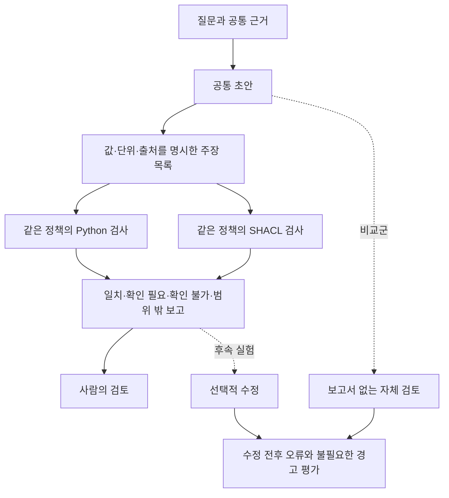

# 최종 답변과 근거를 검토하는 SHACL 실험

## 연구 목적과 현재 위치

SHACL을 최종 제출 전이나 중요한 중간 검토 시점에 호출하는 확인 도구로 둔다. 에이전트가 작업하는 동안 모든 행동을 차단하지 않는다. 결과와 근거를 정리한 뒤 무엇이 맞지 않고 무엇은 확인하지 못했는지 보고하고 사람이나 에이전트가 수정 여부를 판단한다.

현재 단계는 오프라인 구현 진단이다. 추가 유료 호출 없이 같은 정책의 Python 검사와 실제 pySHACL 검사를 만들고 저장된 답변의 일부를 재생했다. 답변 개선 효과와 사람의 검토 시간은 아직 측정하지 않았다.



그림의 초안 생성은 기존 기록을 사용했다. 주장 목록은 사람이 명시적으로 정리했으며 자연어에서 자동으로 추출한 결과가 아니다. 선택적 수정과 보고서 없는 자체 검토는 후속 실험이다.

## 기존 질문 세트의 한계

현재 24문항은 네 가지 질문 틀을 여섯 기록에 적용한 구성이다. 설정 번호 직접 조회 6문항은 모든 비교군에 필요한 근거가 있었다. 결함 코드 이름 질문은 B에서 3문항, C/D에서 4문항에 필요한 근거가 있었다. 명목 전류 Idc 질문 6문항은 모든 비교군에서 필요한 코드북 근거가 누락됐다. 공정 검토 문서 버전 질문 6문항은 제공된 원자료 묶음에 해당 정보가 없었다.

이 수치는 미리 작성한 근거 기준에 따른 입력 점검 결과다. LLM 정답 수나 전체 원자료의 완전성을 뜻하지 않는다. 기존 SHACL 보고서는 사전 참조만 검사했으므로 질문 적용성이나 문서 버전의 적절성을 평가하지 않았다. 기존 결과와 입력은 그대로 보존한다.

## 검사 계약과 판정 범위

검사 입력은 하나의 값과 출처 필드가 연결된 주장 목록, 그리고 이미 선택된 근거다. 검사기는 원자료를 추가 검색하거나 평가 정답을 읽지 않는다. 답변도 자동으로 고치지 않는다.

| 검사 | 확인하는 내용 | 확인하지 못하는 내용 |
|---|---|---|
| 출처 연결 | 선언한 출처가 선택된 근거에 있는가 | 그 출처가 질문에 적절한가 |
| 필드 연결 | 선언한 필드가 선택된 출처에 있는가 | 자연어 주장을 올바른 필드로 옮겼는가 |
| 값 일치 | 주장 값과 기록 값이 정한 비교 규칙에 따라 같은가 | 원본 기록 자체가 사실인가 |
| 단위 일치 | 양쪽에 명시된 단위가 같은가 | 단위 환산이나 물리적 적합성 |

값 비교는 파싱된 JSON 스칼라의 타입과 직렬화 결과를 사용한다. 예를 들어 숫자 `450`, 문자열 `"450"`, 실수 `450.0`은 다른 값으로 취급한다. 원래 JSON의 공백이나 지수 표기까지 보존하는 검사는 아니다. 이 엄격한 규칙에서 발생한 경고를 곧바로 사실 오류로 해석하지 않는다.

`pass`는 해당 검사에서 일치했다는 뜻이다. `flag`는 연결된 값이나 단위가 다르다는 뜻이다. 출처·필드·값·단위가 없으면 `unknown`으로 남긴다. 계산이나 추론으로 만든 `derived` 주장은 현재 구현의 범위 밖이므로 `not_applicable`로 표시한다. 두 엔진은 같은 입력 점검과 적용 범위 판정을 공유한다. 출처·필드의 통과 수를 독립적인 의미 검증 성공 수로 세지 않는다.

## 저장된 답변과 합성 변형 진단

6모델 호출 점검에서 저장한 Fable 답변 한 건을 사용했다. 답변은 PP6 작업표 2행의 문서 버전을 알 수 없다고 답하면서 해당 행의 기록값을 함께 제시했다. 사람이 그 기록값을 7개의 원자적 주장으로 나누고 나머지 파생 주장 2개를 별도로 남겼다. 이 정리는 공개된 매핑 파일에서 확인할 수 있으며 전문가가 검증한 자동 추출 결과는 아니다.

이 원형 1건과 명시적인 합성 변형 11건을 두 엔진으로 실행했다. 전체 24회 중 20회는 검사를 마쳤고 4회는 의도적으로 넣은 잘못된 입력 형식 때문에 거부됐다. 실행 오류는 없었다. 같은 입력에 대한 Python과 pySHACL의 검사 항목별 결과 및 입력 거부 결과가 일치했다. 이는 소프트웨어 동작 확인이며 24개의 독립적인 실제 질문 평가가 아니다.

| 진단 사례 | 관측 결과 | 해석 |
|---|---|---|
| 저장된 답변을 수동으로 정리한 값 | 25개 항목 일치, 3개 확인 불가, 8개 범위 밖 | 답변 전체의 정확도 판정이 아님 |
| 기록값 또는 단위 변경 | 바꾼 항목에 경고 | 명시된 비교 규칙 동작 확인 |
| 선택된 출처 삭제 | 확인 불가 | 원본에 정보가 없다고 단정하지 않음 |
| 잘못된 행의 값과 일치하는 주장 | 값 비교 통과 | 질문에 맞는 행인지 별도 검토 필요 |
| 출처와 주장 값을 함께 잘못 변경 | 값 비교 통과 | 원본 사실의 진위를 검사하지 못함 |
| 복합 객체 값 또는 중복 주장 ID | 입력 형식 거부 | 실패를 전체 실행 수에 포함 |

원형의 36개 항목은 9개 주장에 4개 검사를 적용한 수다. 코드처럼 단위가 명시되지 않은 3개 항목은 확인 불가이고 파생 주장 2개의 8개 항목은 범위 밖이다. 일치 항목 수가 답변 정확도 점수는 아니다. 원래 Fable 답변은 생성 전에 기존 D 보고서를 받았기 때문에 이번 재생으로 사후 검토의 인과 효과를 추정할 수도 없다.

## 다음 비교의 조건

같은 초안과 같은 근거에 대해 검토 없음, 같은 정책의 Python 보고서, SHACL 보고서를 비교한다. 답변을 수정하는 실험에서는 보고서 없이 같은 근거를 다시 보는 자체 검토도 둔다. 이렇게 해야 두 번째 생성 기회를 준 효과와 검증 정보를 준 효과를 구분할 수 있다.

Python과 SHACL이 동일한 정규화 보고서를 만들면 후속 LLM 입력도 같아질 수 있다. 이때 두 엔진의 답변 개선 효과를 서로 다른 처리 효과로 주장하지 않는다. 동일한 후속 호출을 공유했다면 파생 결과로 표시하고 독립 측정으로 세지 않는다. 엔진의 표현 방식과 실행 비용은 별도 축으로 남긴다.

새 질문을 만들기 전에 실제 자료에서 필요한 필드와 연결 관계를 확인한다. 근거가 충분한 경우, 검색에서 빠진 경우, 제공된 원자료에 없는 경우를 분리한다. 충돌이나 버전 적용 문제는 실제 사례와 판단 기준이 있을 때 포함한다. 임의로 만든 문제는 합성 진단으로 구분한다.

주장 구조화 과정의 누락과 잘못된 연결, 검사 범위 밖 주장, 불필요한 경고, 검토 지점의 정확성, 수정으로 고친 오류와 새로 만든 오류를 각각 센다. 답변 전체를 제대로 구조화하지 못한 경우도 분모에서 제외하지 않는다. 사람의 검토 시간이 줄었는지는 실제 검토 실험 전에는 주장하지 않는다.

## 산출물과 재현

- 검사기: `scripts/post_answer_review.py`
- 단위 검사: `tests/test_post_answer_review.py`의 11개 테스트 메서드
- 재생 실행기: `scripts/run_post_answer_demo.py`
- 계약과 수동 매핑: `research/post-answer-review-1/`
- 입력·결과·RDF·SHACL·해시: `research/post-answer-review-1/demo-001/`

```bash
uv run --locked python -m unittest tests.test_post_answer_review -v
uv run --locked python -m scripts.run_post_answer_demo --output _workspace/post-answer-demo-reproduction
```

재생 출력 디렉터리는 새 경로여야 한다. 기존 실패와 결과를 덮어쓰지 않는다. 이번 실행은 RDFLib 7.6.0, pySHACL 0.40.1을 사용했다. 소스 코드와 입력 해시는 실행 manifest에 기록했다.

PENELOPE의 *Submerged Arc Welding Open Repository* 자료는 Tapia Suárez 외 저자의 [Zenodo 기록 15083865](https://zenodo.org/records/15083865), CC BY 4.0 자료다. 원본 저자 목록·라이선스·파일 해시는 재생 입력에 보존했다. 기존 자료에서 일부를 추출하고 주장을 수동으로 정리했으며 합성 변형은 별도로 표시했다. 추가 유료 호출, 배포, AWS 리소스 생성은 하지 않았다.

## 코드북 연결의 사후 검토

값 하나의 일치 여부만으로는 코드북을 거친 답변을 충분히 점검할 수 없다. 그래서 선언된 코드북 조회 경로를 확인하는 검사를 별도로 추가했다. 작업표의 참조 ID, 코드 값, 코드북의 결과 값, 파일 경로와 해시, 열 제목, 해당하는 경우 단위를 각각 비교한다. 결함 이름과 명목 Idc 조회라는 두 가지 정책은 사람이 자료 구조를 보고 정했다. 자연어 질문에서 정책을 자동으로 알아낸 것은 아니다.

PP6 작업표 2행과 PP7 작업표 10행에서 각 두 연결을 골랐다. 네 연결마다 일치, 코드북 누락, 주장 값 변경, 출처와 주장 값의 동시 변경, 잘못된 헤더 형식의 다섯 조건을 만들었다. 총 20개는 원자료를 바탕으로 작성한 소프트웨어 진단용 입력이며 LLM 답변이 아니다.

두 엔진의 총 40회 실행 중 32회는 검사를 마쳤고 8회는 의도한 입력 형식 실패였다. 실행 오류는 없었다. 60개 검사로 항목별 결과와 예상 동작을 확인했고 모두 통과했다. 별도로 13개 단위 테스트 메서드도 통과했다. 코드북을 빼면 값과 연결을 확인할 수 없다고 남겼고 값을 바꾸면 해당 항목에 경고했다. 출처와 주장을 함께 바꾸면 일치 판정이 유지됐다.

두 엔진은 비교할 항목을 만드는 코드를 공유한다. 따라서 결과 일치는 서로 독립적인 의미 해석의 검증이 아니다. 파일 해시와 경로 역시 제공된 문자열의 일치를 확인한 것이며 원본 파일의 진위 인증은 아니다. 모델이 질문에 맞지 않는 행이나 조회 정책을 선언해도 그 선언 안에서 일치할 수 있다. 전체 답변에 대한 통과·실패 판정이나 강제 차단은 만들지 않았다.

## 후속 질문과 수정 입력

같은 두 작업표 행에 시작 위치 직접 조회, 결함 이름 조회, 명목 Idc 조회를 적용해 기본 질문 6개를 준비했다. 각 질문에 필요한 근거가 있는 경우와 관련 근거를 뺀 경우를 두었다. 입력 묶음은 12개다. 모델 실행 전의 후보이며 새로 보존한 평가 집합이나 검색 성능 실험이 아니다. 사용한 자료는 이미 개발에 활용한 자료다.

질문·선택 근거와 설계용 분류·필요 셀 목록은 별도 파일에 저장했다. 입력 묶음 ID에도 조건명이 들어 있으므로 향후 모델 메시지에는 ID를 넣지 않아야 한다. 최초 후보 파일의 ‘관계 검사 미구현’ 표시는 당시 상태로 보존했다. 이후 추가한 코드북 검사 결과는 별도 디렉터리에 남겼다.

초안 형식에는 주장별 값·단위·출처 필드를 요구하고 수정 형식에는 유지·변경·삭제·추가 이유를 담는 `revision_log`를 요구한다. 형식을 맞추는 것만으로 자연어 주장을 빠짐없이 올바르게 옮겼다고 보지는 않는다. 같은 질문에 대한 기존 여섯 모델 답변에서도 주장 목록이 비어 있거나 여러 값을 한 문장에 묶은 경우가 있었다. 이 구조화 단계의 한계는 검사기의 일치 여부와 따로 평가해야 한다.

- 코드북 검사와 결과: `scripts/postreview_lookup.py`, `research/post-answer-review-1/lookup-demo-001/`
- 후보 질문과 별도 설계 기록: `research/post-answer-review-1/question-candidates-001/`
- 초안·수정 형식과 비교 설계: `research/post-answer-review-1/`의 `draft-*`, `revision-*` 파일
- [값·단위 검토 화면](../experiments/seminar/post-answer-review.html): 저장된 진단을 선택해 볼 수 있는 HTML이며 새 모델 호출을 하지 않는다. 코드북 진단은 아직 이 화면에 포함하지 않았다.

수정 메시지 준비 코드 `scripts/postreview_messages.py`는 검사 엔진 이름과 원시 RDF를 모델 입력에서 제외한다. 보고서가 있는 조건과 없는 자체 검토 조건은 같은 초안·질문·선택 근거·출력 형식을 받는다. 작성한 5개 테스트 메서드가 통과했고 시험한 입력에서 두 엔진의 정규화 보고서와 후속 메시지가 같았다. 모든 입력에 대한 동등성이나 실제 제공자 연동을 검증한 것은 아니다. 모델 호출, 모델별 토큰 예산과 답변 수정 효과는 아직 실행·측정하지 않았다.

## 기존 72회 답변의 인용 위치 재생

기존 mini 모델 비교 기록 72회를 별도로 재생했다. 새 여섯 모델 비교가 아니며 추가 호출도 없다. 각 답변에 선택 근거와 메시지 해시를 연결했다. 선택 근거는 답변이 실제로 받았던 것을 사용했고 명시적인 JSON 경로나 셀 주소만 해석했다. 여러 위치를 섞은 표현이나 모호한 인용은 고쳐 해석하지 않았다.

원래 실패한 1회는 재실행하지 않고 전체 72회에 남겼다. 나머지 71개 답변에는 주장 항목 97개가 있었고 이 중 24개 답변은 주장 목록이 비어 있었다. 한 주장에 인용이 여러 개면 별도로 대조하므로 주장·인용 쌍은 100개였다. 86개의 위치를 해석했으며 값 비교 결과는 일치 76개, 확인 불가 9개, 경고 10개, 범위 밖 5개였다. 두 엔진의 항목별 결과는 같았고 새 입력 실패나 실행 오류는 없었다. 단위 테스트 6개 메서드도 통과했다.

이 수치는 답변 정확도가 아니다. 예를 들어 “값은 A2에 있다”는 위치 설명에서 주장 값이 `"A2"`이고 해당 셀의 내용이 숫자 `1`이면 단순 값 비교는 경고를 낸다. 실제로 경고 목록에는 이런 위치 설명이 포함됐다. 반대로 결함 이름 `"Porosity"`를 제시하면서 숫자 코드가 있는 A2를 인용한 경우도 있었다. 둘은 같은 종류의 오류가 아니므로 주장 의도를 다시 살펴야 한다.

검사 대상이 된 값만 맞는다고 질문에 맞는 답변이 되는 것도 아니다. 원자료와 일치하는 다른 행의 값을 말하거나 질문과 무관한 설정 번호를 답해도 이 진단은 잡지 못할 수 있다. 비어 있는 주장 목록과 자연어 본문의 누락 역시 통과로 간주하지 않는다. 이 재생에서는 명시적인 인용 위치를 확인할 수 있는 범위와 그 한계를 살폈으며 답변 수정 효과는 측정하지 않는다.

입력·항목별 결과·원래 실패 상태·해시는 `research/post-answer-review-1/pointer-replay-001/`에 보존했다. 실행기는 `scripts/postreview_pointer_replay.py`이며 기존 정답 판정 파일은 읽지 않는다. 검토 후 주석을 추가하더라도 원래 결과와 분리하고 검사 결과를 정답에 맞춰 고치지 않는다.


[기존 답변의 인용 위치 검토 화면](../experiments/seminar/post-answer-replay.html)에서 항목별 결과를 확인할 수 있다.

[사후 검토 보고서의 비교 설계와 관련 연구](2026-11-04-post-answer-feedback-design.md)에서 혼합 입력 v2, 자체 검토와 검사기 실패의 분리, 질문의 단위 구분, 후속 평가 기준을 설명한다.
