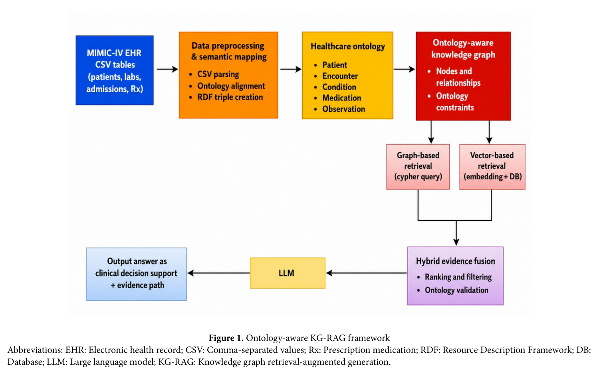
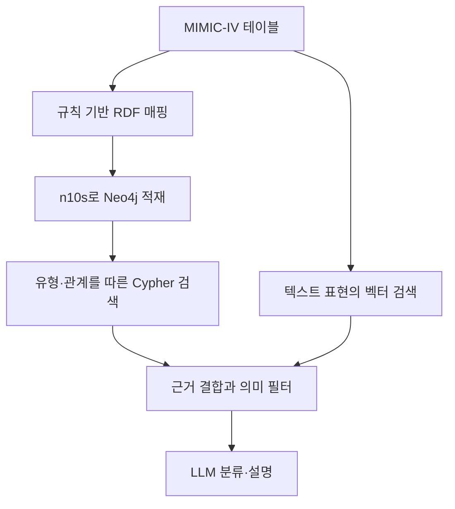
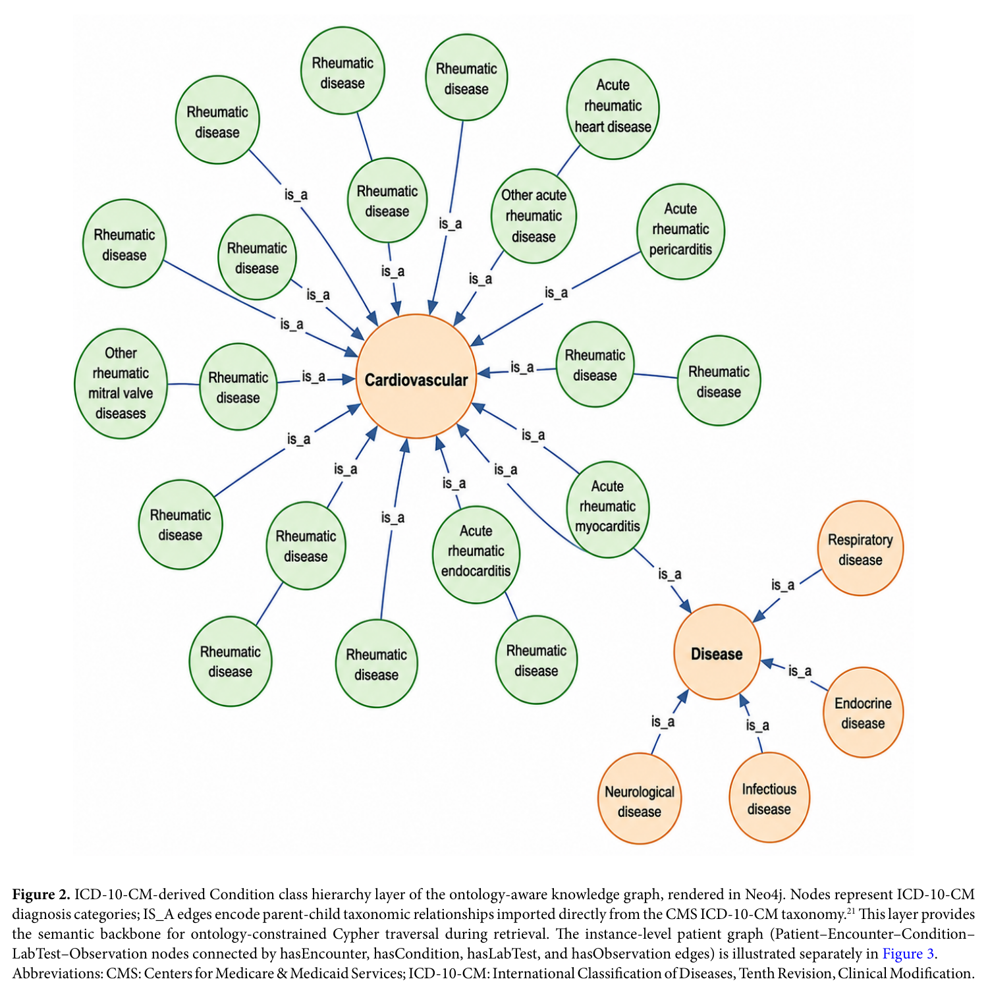
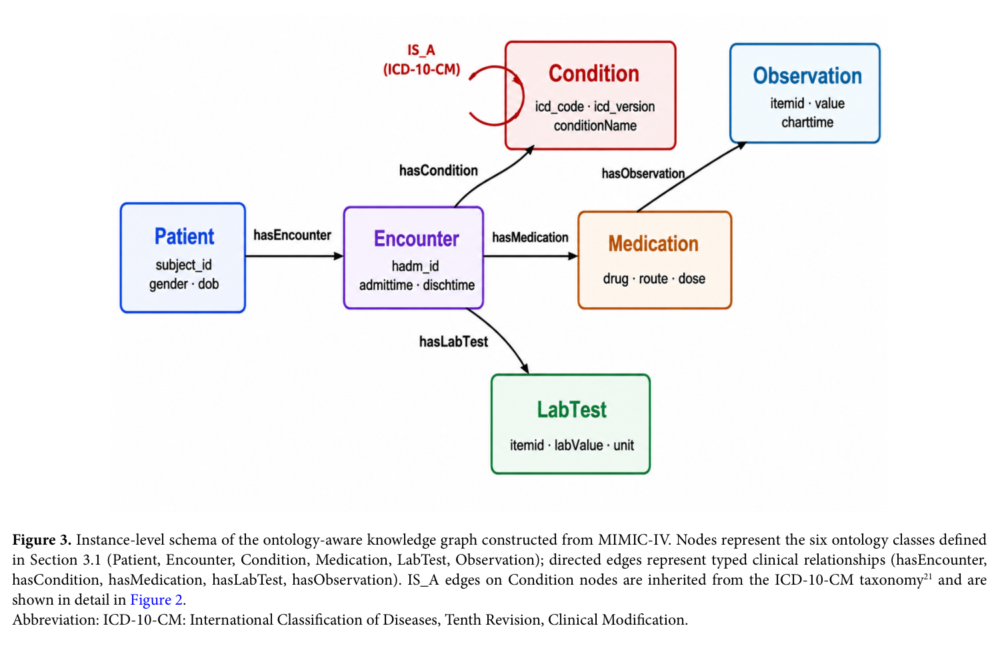
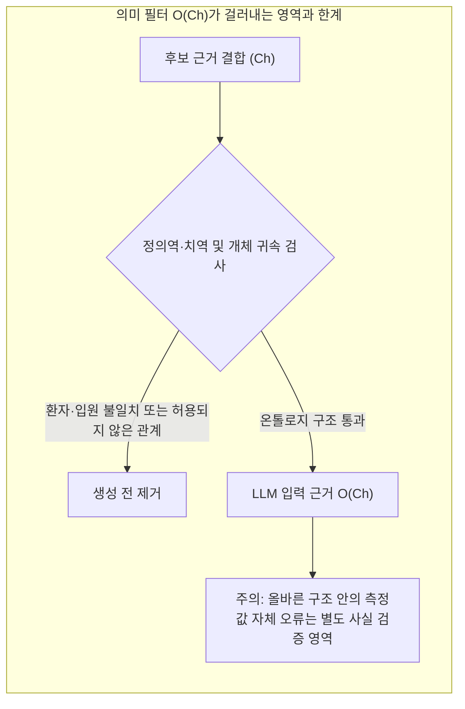
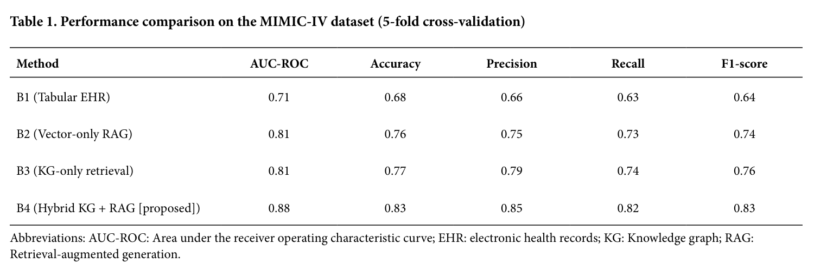
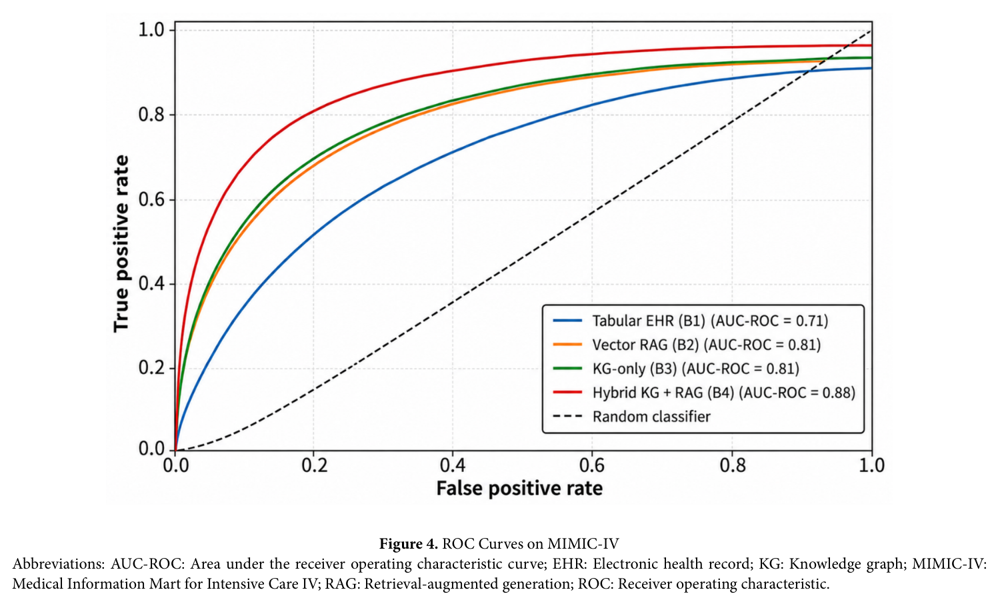
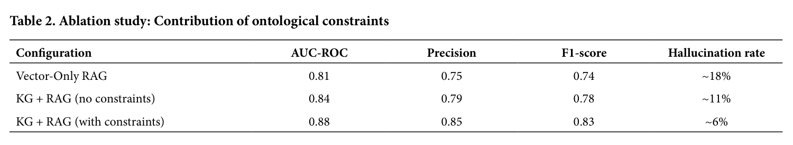
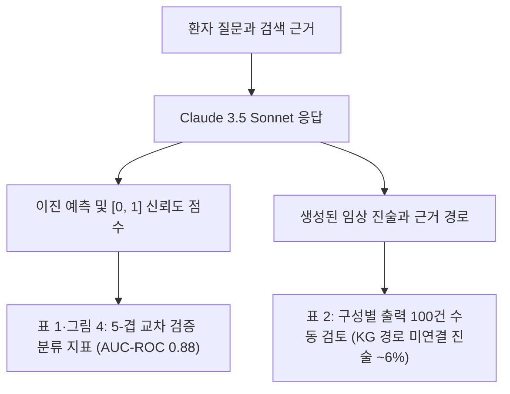
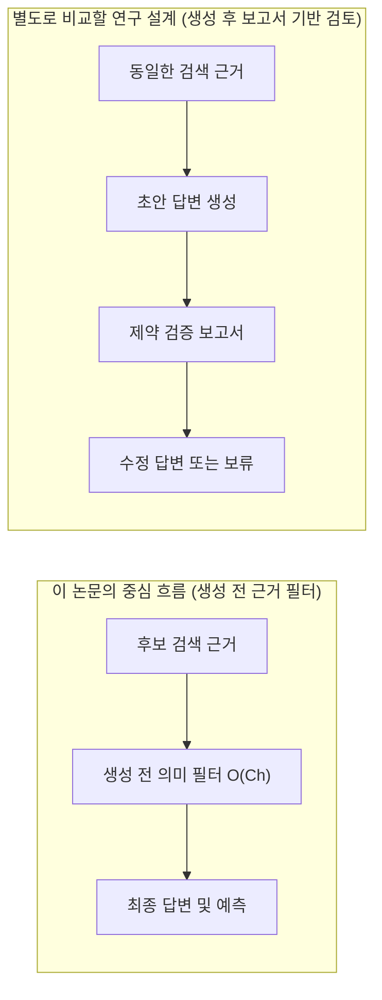

# 의료 온톨로지 RAG 리뷰: Neo4j와 n10s를 이용한 검색·분류 실험

환자 기록은 입원·검사·처방·진단 테이블에 나뉘어 있다. 값이 같아 보여도 다른 환자나 다른 입원에 속할 수 있다. 이 논문은 이런 연결을 명시한 온톨로지와 그래프 검색을 벡터 검색에 결합한다. 평가 결과를 읽을 때에는 자연어 답변을 잘 설명하는 능력과 질환을 분류하는 능력을 구분해야 한다.

이 글은 2026년 11월 6일에 확장한 리뷰다. 논문의 장 순서대로 문제의식·온톨로지 설계·Neo4j 적재·하이브리드 검색·패혈증 분류 실험·절제 연구·한계를 차례로 읽는다. 원문의 그림 4점과 표 2점은 출판사 PDF에서 캡처로 가져왔고 설명을 위해 새로 만든 도식은 Mermaid로 구분했다. 본문에 인용한 성능 수치는 모두 저자들의 보고값이며 이 리뷰에서 별도로 실험을 재실행하지는 않았다.

## 논문 정보와 검토 범위

| 항목 | 내용 |
|---|---|
| 제목 | Ontology-aware knowledge graph retrieval-augmented generation for clinical decision support |
| 저자 | Deepak Panneerselvam, Sasikala E |
| 소속 | SRM Institute of Science and Technology, Department of Data Science and Business Systems |
| 발표 | *Artificial Intelligence in Health*, 2026년 9월 10일 온라인 공개 |
| 읽은 판본 | 출판사 최종 공개 PDF, 13쪽 |
| 원문 | [출판사 페이지](https://www.accscience.com/journal/AIH/articles/online_first/9207) · [원문 PDF](https://article.accscience.com/journal/AIH/online_first/aih026210049/article_aih0262100491_e08b32.pdf) · [DOI](https://doi.org/10.36922/AIH026210049) |

이 글은 시스템 구조와 보고된 실험을 검토한 리뷰다. 임상적 유효성이나 환자 치료에 대한 권고를 제공하지 않는다. 원문과 원문 수록 그림·표는 저자들의 오픈 액세스 논문에서 가져왔으며 [CC BY 4.0](https://creativecommons.org/licenses/by/4.0/) 라이선스로 배포된다. 이미지별 원본 페이지·잘라낸 좌표·파일 해시는 [그림 출처 기록](../assets/images/clinical-ontology-rag/provenance.json)에 남겼다.

## 원문 구성과 읽기 지도

| 원문 | PDF 쪽 | 핵심 질문 |
|---|---|---|
| 1 Introduction | 1–2 | 전자의무기록에서 벡터 검색과 단순 그래프가 겪는 한계 |
| 2 Related work (2.1–2.3) | 2–3 | 임상 지식 그래프·의료 온톨로지·의료 RAG 선행 연구의 공백 |
| 3 Methodology (3.1–3.7) | 3–7 | 6개 클래스 온톨로지, CSV→RDF 변환, n10s 적재, 하이브리드 검색과 필터 |
| 4 Experimental setup and results (4.1–4.9) | 7–10 | MIMIC-IV 패혈증 분류 조건, 네 비교군 성능, 온톨로지 제약 절제 실험 |
| 5 Results analysis and discussion | 9 | 정형 경로와 벡터 유사도의 상호보완 해석 |
| 6 Limitations and future work | 9–10 | 온톨로지 품질 의존성, 단일 데이터셋, API 재현성, 비교군 공백 |
| 7 Conclusion, Appendix | 11, 13 | 결론 요약과 프롬프트 양식 |

## 1장: 분절된 전자의무기록과 임상 근거 검색

### 1.1 테이블과 텍스트로 나뉜 환자 기록

병원의 전자의무기록(EHR)에는 환자 인적 사항, 입원 이력, 진단 코드, 처방 약물, 검사 수치, 임상 기록지가 함께 들어 있다. 대규모 공개 데이터셋인 MIMIC-IV는 이런 임상 데이터를 연구에 활용할 기회를 열어 주었지만 여러 테이블에 흩어진 관계형 기록과 비정형 서술을 한꺼번에 다루기는 여전히 까다롭다.

거대 언어 모델(LLM)은 의료 질의응답에서도 유창한 문장을 만들어 낸다. 그러나 외부 근거 없이 답하면 환각이 생기고 어떤 기록을 바탕으로 판단했는지 설명하기 어렵다. 이를 보완하려고 도입한 검색 증강 생성(RAG)도 대개는 텍스트 임베딩의 벡터 유사도 검색에 의존한다. 벡터 유사도는 표현이 비슷한 문장을 잘 찾아내지만 환자와 입원, 검사, 처방 사이에 걸려 있는 깊은 의미 관계나 임상 제약을 그대로 보존하지는 못한다.

반대로 환자와 진료 이벤트를 노드와 간선으로 표현한 지식 그래프(KG)는 경로 탐색과 설명에 유리하다. 다만 기존 임상 지식 그래프 연구 상당수는 관계형 테이블을 휴리스틱이나 가벼운 스키마로 옮기는 데 그쳤다. 형식화된 온톨로지 제약이 없으면 임상적으로 성립할 수 없는 연결이 그래프나 검색 결과에 섞여 들어갈 여지가 남는다.

### 1.2 저자들이 내세운 기여

저자들은 이 간극을 메우기 위해 MIMIC-IV 기반 의료 온톨로지를 설계하고 Neo4j의 Neosemantics(n10s) 플러그인으로 온톨로지 인지 지식 그래프를 구축했다고 밝힌다. 여기에 온톨로지 제약을 적용한 Cypher 그래프 검색과 트랜스포머 기반 벡터 검색을 결합한 하이브리드 RAG 파이프라인을 올렸다.

논문이 내세운 기여는 크게 네 가지다. 환자·입원·검사·약물 기록을 포괄하는 의료 온톨로지와 n10s 기반 Neo4j 그래프를 구축했고, 구조화된 Cypher 조회와 비정형 텍스트 벡터 검색을 하이브리드 검색 구조로 묶었다. 또한 온톨로지 제약 유무만 따로 떼어 내어 검색 정밀도와 환각 감소 효과를 확인하는 절제 실험을 수행했으며, MIMIC-IV 임상 예측 과제에서 AUC-ROC와 정확도, 정밀도, 재현율, F1을 기존 방식과 비교했다. [원문 §1](https://article.accscience.com/journal/AIH/online_first/aih026210049/article_aih0262100491_e08b32.pdf#page=1)

## 2장: 선행 연구와 온톨로지 부재의 문제

### 2.1 임상 지식 그래프와 의료 온톨로지

2.1절과 2.2절은 임상 지식 그래프와 의료 온톨로지 연구를 나란히 짚는다. MIMIC-III나 MIMIC-IV를 그래프로 변환해 질환 예측이나 환자 유사도 분석에 활용한 연구는 이미 여럿 나왔다. 그래프 표현은 평면 테이블보다 환자·진단·약물·검사의 연결을 직관적으로 보여 준다. 그러나 테이블을 단순 규칙으로만 옮기면 의미 일관성과 유효성 제약을 강제하기 어렵다.

한편 의료 정보학에서는 SNOMED CT, ICD, LOINC, UMLS 같은 표준 온톨로지로 임상 개념을 정의하고 데이터를 통합해 왔다. 문제는 이런 온톨로지 시스템이 정적인 규칙 추론기나 소규모 데이터셋에 머무는 경우가 많았다는 점이다. 저자들은 형식 온톨로지의 의미 구조와 현대적인 그래프 DB, 그리고 LLM 기반 검색·생성 파이프라인을 하나로 묶는 확장 가능한 구조가 필요하다고 본다.

### 2.2 벡터 검색 기반 의료 RAG의 한계

2.3절은 의료 RAG 연구를 검토한다. 임상 질문 응답이나 의무기록 요약에 쓰이는 기존 RAG는 대부분 비정형 문서 청크의 임베딩 유사도에 기댄다. 표면 문장이 비슷해도 정작 질문이 요구하는 환자·입원·검사 사이의 정확한 관계 조건을 놓치면 불완전하거나 맥락에 맞지 않는 근거를 가져오게 된다.

최근 그래프를 결합한 GraphRAG 연구가 등장하기 시작했지만 형식 온톨로지 제약을 명시적으로 결합한 사례는 드물다. 저자들은 이 지점을 자신들의 출발점으로 삼는다. [원문 §2.1–2.3](https://article.accscience.com/journal/AIH/online_first/aih026210049/article_aih0262100491_e08b32.pdf#page=2)

## 3장: 온톨로지 구축, n10s 적재, 하이브리드 검색

### 3.1 전체 파이프라인과 입력·출력

3장은 제안하는 파이프라인을 온톨로지 설계, MIMIC-IV 데이터의 의미 매핑, Neo4j 지식 그래프 구축, 하이브리드 검색과 응답 생성의 네 단계로 나누어 설명한다. 전체 흐름은 원문 그림 1에 요약되어 있다.



그림 1. 온톨로지 인지 KG-RAG 프레임워크. Panneerselvam & Sasikala, PDF 3쪽. [원문](https://article.accscience.com/journal/AIH/online_first/aih026210049/article_aih0262100491_e08b32.pdf#page=3) · [크게 보기](../assets/images/clinical-ontology-rag/figure-01-framework.png) · [CC BY 4.0](https://creativecommons.org/licenses/by/4.0/). PDF에서 그림과 캡션 영역을 216 DPI로 잘라 이미지로 변환했으며 내용과 표기는 수정하지 않았다.

그림 1을 따라가면 먼저 MIMIC-IV의 CSV 테이블을 전처리·정규화해 RDF 트리플로 바꾼다. 이를 의료 온톨로지에 맞춰 Neo4j 지식 그래프로 적재한 뒤 Cypher 기반 그래프 검색과 임베딩 기반 벡터 검색을 나란히 수행한다. 두 경로에서 찾은 근거는 하이브리드 근거 융합 모듈에서 순위화와 온톨로지 검증을 거쳐 LLM으로 들어가고 최종적으로 임상 의사결정 지원 답변과 근거 경로가 출력된다.



위 도식은 기존 리뷰에서 논문의 처리 순서를 한눈에 보려고 그린 것이다. 원문 그림 1의 노란색 상자(`Healthcare ontology`)에는 `Patient`, `Encounter`, `Condition`, `Medication`, `Observation` 다섯 항목만 적혀 있으나 이어지는 3.1절 본문과 그림 3에서는 `LabTest`를 포함한 여섯 클래스를 정식 온톨로지 클래스로 정의한다. 또한 RDF 입력을 n10s로 적재했다는 설명만으로 OWL 추론기 전체나 별도의 SHACL 엔진 실행이 검증되었다고 읽어서는 안 된다. 본문이 실제로 설명하는 핵심 메커니즘은 유형·관계 제약을 따른 검색과 생성 전 의미 필터다.

### 3.2 여섯 클래스와 ICD-10-CM 계층

3.1절이 정의하는 핵심 클래스 여섯 가지와 각 클래스의 역할은 다음과 같다.

| 온톨로지 클래스 | 표현 대상 | 주요 객체·데이터 속성 |
|---|---|---|
| `Patient` | 환자 식별 및 인적 사항 | `PatientID`, `gender`, `birthday`, `hasEncounter` |
| `Encounter` | 개별 입원·진료 접점 | `admitTime`, `dischargeTime`, `belongsToPatient` |
| `Condition` | 진단 코드 및 질환 분류 | `conditionName`, ICD-10-CM `IS_A` 상위 개념 연결 |
| `Medication` | 입원 중 약물 처방 | `medicationName`, 투여 경로·용량, `hasMedication` |
| `LabTest` | 정량 검체 검사 항목과 수치 | `labValue`, 검사 단위, `hasLabTest` |
| `Observation` | 차트 관측 기록과 측정 시각 | 관측 항목·수치·기록 시각, `hasObservation` |

각 객체 속성에는 정의역(domain)과 치역(range) 제약을 명시해 의미상 맞지 않는 트리플이 그래프 구축이나 조회 과정에 끼어들지 못하게 한다. 진단 정보를 담는 `Condition` 클래스에는 미국 메디케어·메디케이드 서비스 센터(CMS)의 ICD-10-CM 분류 체계에서 가져온 `IS_A` 상하위 관계를 연결했다. 본문은 상위 개념으로 패혈증을 조회하면 `A40–A41` 아래의 하위 코드들이 함께 포괄되는 구조를 예로 든다.



그림 2. Neo4j에 렌더링된 ICD-10-CM 기반 Condition 클래스 계층. Panneerselvam & Sasikala, PDF 5쪽. [원문](https://article.accscience.com/journal/AIH/online_first/aih026210049/article_aih0262100491_e08b32.pdf#page=5) · [크게 보기](../assets/images/clinical-ontology-rag/figure-02-icd10-hierarchy.png) · [CC BY 4.0](https://creativecommons.org/licenses/by/4.0/). PDF에서 그림과 캡션 영역을 잘라 변환했으며 원본 표기를 그대로 두었다.

원문 그림 2를 실제로 살펴보면 본문 예시와 그림의 구체적인 노드 라벨 사이에 차이가 있다. 본문은 패혈증(`A40–A41`)을 예로 설명하지만 그림 2는 `Disease` 아래에 `Cardiovascular`, `Respiratory disease`, `Endocrine disease`, `Infectious disease`, `Neurological disease`를 두고 `Cardiovascular` 주위에 류마티스 심장 질환 하위 항목들과 함께 동일한 `Rheumatic disease` 라벨이 붙은 초록색 노드 열한 개를 배치한 예시 화면이다. 그런 점에서 그림 2는 실제 실험 대상인 패혈증 하위 코드 전체를 정밀하게 덤프한 도면이라기보다 ICD-10-CM의 `is_a` 상하위 계층이 Neo4j 안에서 어떤 모양으로 연결되는지를 보여 주는 개념도라고 읽는 편이 정확하다.

### 3.3 MIMIC-IV 테이블 매핑과 Neo4j 적재

3.2절과 3.3절은 원천 CSV 테이블을 RDF 트리플로 바꾸고 Neo4j에 적재하는 과정을 다룬다. 테이블과 온톨로지 클래스의 대응 관계는 아래와 같다.

| MIMIC-IV 원천 테이블 | 대응 온톨로지 클래스 | 식별자 및 연결 기준 |
|---|---|---|
| `patients.csv` | `Patient` | `subject_id` 기반 고유 자원 URI 생성 |
| `admissions.csv` | `Encounter` | `hadm_id` 기반 입원 단위 식별 및 환자 연결 |
| `diagnoses_icd.csv` | `Condition` | 입원별 ICD 진단 코드 연결 및 ICD-10-CM 계층 매핑 |
| `prescriptions.csv` | `Medication` | 입원 중 처방된 약물·경로·용량 연결 |
| `labevents.csv` | `LabTest` | 정량 검사 항목·수치·단위 연결 |
| `chartevents.csv` | `Observation` | 입원 및 중환자실 차트 관측값·기록 시각 연결 |

규칙 기반 변환으로 생성한 RDF 트리플은 Turtle 구문으로 저장한 뒤 Neosemantics(n10s) 플러그인을 통해 Neo4j에 적재한다. 이때 자원 식별자가 중복되지 않도록 Neo4j 고유성 제약(uniqueness constraint)을 건다. 논문은 온톨로지 제약을 반영한 조회 예시로 다음 Cypher 질의를 제시한다.

```cypher
MATCH (p:Patient)-[:hasEncounter]->(e:Encounter)
-[:hasObservation]->(o)
WHERE o.labValue IS NOT NULL
RETURN p.patientID, e.encounterID,
o.labValue, o.labUnit
LIMIT 50
```

이 예시 질의를 읽을 때는 두 가지를 눈여겨볼 필요가 있다. 우선 특정 환자나 입원을 지정하는 `WHERE p.patientID = ...` 조건 없이 `LIMIT 50`으로 끝나므로 실제 RAG 실행 코드라기보다 경로 패턴을 보여 주는 예시 스니펫에 가깝다. 아울러 `Observation` 노드에서 `labValue`와 `labUnit`을 읽고 있는데 그림 3의 인스턴스 스키마에서는 속성 배치가 조금 다르게 그려져 있다.



그림 3. MIMIC-IV로 구축한 온톨로지 인지 지식 그래프의 인스턴스 수준 스키마. Panneerselvam & Sasikala, PDF 6쪽. [원문](https://article.accscience.com/journal/AIH/online_first/aih026210049/article_aih0262100491_e08b32.pdf#page=6) · [크게 보기](../assets/images/clinical-ontology-rag/figure-03-instance-schema.png) · [CC BY 4.0](https://creativecommons.org/licenses/by/4.0/). PDF에서 그림과 캡션 영역을 잘라 변환했으며 원본 표기를 그대로 유지했다.

그림 3에서는 `Patient`(`subject_id · gender · dob`)가 `hasEncounter`로 `Encounter`(`hadm_id · admittime · dischtime`)에 연결되고, `Encounter`에서 `Condition`, `Medication`, `LabTest`로 간선이 뻗어 나간다. 반면에 `hasObservation` 화살표는 그림상 `Medication` 상자 위쪽에서 `Observation`(`itemid · value · charttime`)으로 이어진 것처럼 그려져 있다. 그러나 3.2절의 Cypher 질의와 3.3절 그림 2 캡션, 3.4절 본문은 모두 `Patient–hasEncounter–Encounter–hasObservation–Observation`처럼 입원(`Encounter`)에서 관측(`Observation`)으로 이어지는 경로를 기준으로 설명한다. 독해할 때는 본문과 질의가 정의한 논리 경로를 기준으로 삼는 것이 맞다.

이 단계에서 등장하는 구성 요소들이 실제로 담당하는 역할과 그 역할만으로는 자동 보장되지 않는 범위를 구분하면 아래와 같다.

| 구성 요소 | 논문에서 설명한 역할 | 그 역할만으로 확인되지 않는 것 |
|---|---|---|
| RDF·온톨로지 스키마 | 6개 클래스와 객체·데이터 속성의 정의역·치역 선언 | 원천 측정값 자체의 임상적 진위 여부 |
| Neosemantics (n10s) | Turtle 형식 RDF 트리플을 Neo4j 속성 그래프로 적재 | 완전한 OWL 추론기 실행이나 표준 SHACL 검증 리포트 생성 |
| Neo4j 고유성 제약 | 자원 URI 및 개체 식별자의 중복 적재 방지 | 환자·입원 간 시점 정합성이나 모든 임상 규칙 충족 |
| Cypher 경로 조회 | 지정한 타입과 간선을 따라 후보 임상 서브그래프 추출 | 생성 전 의미 필터(`O(C_h)`)의 세부 검증 규칙 전체 |

[원문 §3.1–3.3](https://article.accscience.com/journal/AIH/online_first/aih026210049/article_aih0262100491_e08b32.pdf#page=4)

### 3.4 그래프·벡터 결합과 생성 전 의미 필터

3.4절부터 3.7절까지는 검색과 검증, 그리고 LLM 호출 구성을 수식과 함께 설명한다. 검색은 두 갈래로 동시에 돌아간다. 그래프 경로는 정해진 타입 간선을 따라 Neo4j에서 관련 서브그래프를 꺼내고 벡터 경로는 임상 기록지와 검사 설명 등을 임베딩해 둔 벡터 DB에서 코사인 유사도로 관련 구절을 찾는다. 두 경로의 결과는 가중치 $\alpha$로 합쳐 하이브리드 문맥 $C_h$를 만든다.

$$C_h = \alpha \cdot \text{GraphRAG}(KG, q) + (1 - \alpha) \cdot \text{VectorRAG}(E, q)$$

3.5절은 이렇게 모은 문맥 $C_h$에 의미 필터 $O(\cdot)$를 씌운다. 정의역·치역 유효성과 논리적 일관성을 만족하는 요소만 남기는 과정이다.

$$O(C_h) = \{c \in C_h \mid \text{valid}_O(c)\}$$

$$p(y \mid x) = \text{LLM}(C_h, O(C_h))$$

논문이 말하는 생성 전 검증은 바로 이 $O(C_h)$ 단계다. 예를 들어 환자 A의 검사값을 환자 B의 입원 기록에 잘못 연결했다면 숫자 형식이 멀쩡해도 근거로 쓰면 안 된다. 관계의 정의역과 치역, 환자·입원 귀속을 확인하는 검사는 이런 구조적 뒤섞임을 걸러낼 수 있다. 반면에 올바른 환자와 입원에 연결되어 있지만 측정 자체가 잘못 기록된 수치는 스키마나 관계 제약만으로 찾아낼 수 없다.



3.7절과 부록(Appendix)에 공개된 구현 사양을 모으면 다음과 같다.

| 구성 항목 | 논문이 명시한 세부 사양 |
|---|---|
| 추론 모델 | Anthropic Claude 3.5 Sonnet (`claude-3-5-sonnet-20241022`), 파인튜닝 없이 추론만 수행 |
| 디코딩 설정 | `temperature = 0` (샘플링 없는 결정론적 디코딩) |
| 임베딩 모델 | BioBERT (`dmis-lab/biobert-base-cased-v1.2`), 768차원 벡터 |
| 벡터 저장소 | FAISS (코사인 유사도 검색) |
| 그래프 저장소 | Neo4j + Neosemantics (n10s) 플러그인 |
| 하이브리드 가중치 | $\alpha = 0.6$ (§4.4에서 별도 검증 데이터로 고정했다고 설명) |
| 부록 프롬프트 | 시스템·사용자 프롬프트 4줄 요약본 수록 (입력 `{query}`, `{Ch}`에 대해 이진 예측, $[0, 1]$ 신뢰도 점수, 근거 경로 요청) |

3.7절 본문은 부록에 전체 프롬프트 템플릿(complete prompt template)을 실었다고 적고 있으나 실제 PDF 13쪽 부록에는 말줄임표(`...`)가 포함된 네 줄짜리 요약 프롬프트만 실려 있다. 이 때문에 프롬프트의 세부 직렬화 형식이나 구체적인 제약 규칙 문구까지는 원문만으로 완전히 복원하기 어렵다. [원문 §3.4–3.7, Appendix](https://article.accscience.com/journal/AIH/online_first/aih026210049/article_aih0262100491_e08b32.pdf#page=5)

## 4장: 패혈증 분류 실험과 절제 연구

### 4.1 코호트 구성과 패혈증 이진 분류 과제

4.1절은 세 가지 연구 질문(RQ1: 온톨로지 인지 KG가 표형 EHR 기준선을 넘는가, RQ2: 하이브리드 검색이 단일 검색보다 나은가, RQ3: 온톨로지 제약이 검색 정확도와 환각에 독립적으로 기여하는가)을 세운다.

4.2절과 4.3절은 실험 데이터와 예측 과제를 구체적으로 밝힌다. 데이터는 MIMIC-IV v2.2의 병원 입원 수준 부분집합이다. 일반 병동과 중환자실 관측을 아우르기 위해 `chartevents.csv` 전체는 포함하되 중환자실 체류 메타데이터 연결 테이블인 `icustays.csv`는 제외했다고 설명한다.

예측 과제는 자유로운 문답이 아니라 **Sepsis-3 기준에 따른 패혈증 발병 이진 분류** 하나다. `diagnoses_icd.csv`(`icd_version = 10`)에서 연쇄상구균 패혈증, 기타 패혈증, 패혈성 쇼크를 동반하지 않거나 동반한 중증 패혈증에 해당하는 ICD-10-CM 코드 집합 `{A40.x, A41.x, R65.20, R65.21}` 중 하나라도 있으면 양성(`label = 1`)으로 분류했다. 최종 추출된 코호트는 **고유 환자(`subject_id`) 223,291명, 상호작용(interactions) 545,497건**이며 패혈증 양성 비율은 **2.5%**다.

4.4절은 평가 프로토콜을 설명한다. 한 환자가 여러 번 입원할 수 있으므로 환자 단위 데이터 누수를 막기 위해 `subject_id` 기준 5-겹 교차 검증(`GroupKFold`)을 수행했다. 흥미로운 부분은 LLM에서 AUC-ROC와 이진 분류 지표를 얻는 방식이다. 저자들은 Claude 3.5 Sonnet에 구조화된 프롬프트를 주어 이진 판정과 함께 $[0, 1]$ 구간의 보정된 신뢰도 점수(calibrated confidence value)를 출력하게 했다. 이 연속 점수로 전체 임계값에 대한 AUC-ROC를 구하고 검증 폴드에서 정한 단일 임계값을 적용해 정확도, 정밀도, 재현율, F1을 계산했다. 원문 7쪽 하단에는 이 연속 점수를 가리키며 다시 `Ch`라는 기호를 쓰는데 앞선 식 (1)의 결합 문맥 $C_h$와 기호가 겹치므로 문맥을 구분해 읽어야 한다.

4장에 보고된 두 종류의 정량 평가는 입력과 분모가 서로 다르므로 아래 표처럼 나누어 읽어야 한다.

| 평가 구분 | 평가 단위와 입력 | 산출 지표 및 보고 위치 |
|---|---|---|
| 주요 분류 평가 | 입원 단위 검색 근거 → 이진 판정 및 $[0, 1]$ 신뢰도 점수 | 5-겹 교차 검증 AUC-ROC, Accuracy, Precision, Recall, F1 (표 1, 그림 4) |
| 출력 표본 검토 | 구성별 무작위 추출 응답 100건 내의 생성 진술(statements) | KG 내부의 확인된 근거 경로에 연결되지 않는 진술의 비율 (표 2) |

[원문 §4.1–4.4](https://article.accscience.com/journal/AIH/online_first/aih026210049/article_aih0262100491_e08b32.pdf#page=7)

### 4.2 네 비교군의 분류 성능

4.5절부터 4.7절까지는 네 가지 비교 조건을 정의하고 5-겹 교차 검증 평균 성능을 비교한다.

| 비교군 | 논문이 설명한 입력·처리 방식 | 비교 시 유의할 차이점 |
|---|---|---|
| **B1 (Tabular EHR)** | 정형 CSV 특징(검사 수치·진단·인적 사항)에 로지스틱 회귀 적용 | 데이터 표현뿐 아니라 예측 모델(로지스틱 회귀 vs Claude 3.5 Sonnet)도 다름 |
| **B2 (Vector-only RAG)** | 임상 기록지·요약문을 BioBERT 768차원 벡터 및 FAISS로 검색 후 LLM 전달 | 그래프 경로 구조를 사용하지 않음 |
| **B3 (KG-only retrieval)** | 온톨로지 인지 Neo4j 그래프에서 Cypher 질의로만 임상 서브그래프 추출 | 비정형 텍스트 임베딩 유사도 검색이 없음 |
| **B4 (Hybrid KG + RAG)** | 그래프 서브그래프와 벡터 검색 구절 결합($\alpha = 0.6$) 후 의미 필터 $O(C_h)$ 적용 | 이중 경로 검색 결합과 생성 전 제약 검사가 함께 작동함 |



표 1. MIMIC-IV 데이터셋 5-겹 교차 검증 성능 비교. Panneerselvam & Sasikala, PDF 9쪽. [원문](https://article.accscience.com/journal/AIH/online_first/aih026210049/article_aih0262100491_e08b32.pdf#page=9) · [크게 보기](../assets/images/clinical-ontology-rag/table-01-performance.png) · [CC BY 4.0](https://creativecommons.org/licenses/by/4.0/).

| 방법 | 보고된 AUC-ROC | 보고된 Accuracy | 보고된 Precision | 보고된 Recall | 보고된 F1-score |
|---|---:|---:|---:|---:|---:|
| B1 (Tabular EHR) | 0.71 | 0.68 | 0.66 | 0.63 | 0.64 |
| B2 (Vector-only RAG) | 0.81 | 0.76 | 0.75 | 0.73 | 0.74 |
| B3 (KG-only retrieval) | 0.81 | 0.77 | 0.79 | 0.74 | 0.76 |
| B4 (Hybrid KG + RAG [proposed]) | 0.88 | 0.83 | 0.85 | 0.82 | 0.83 |

저자들의 보고에 따르면 제안 방식인 B4가 AUC-ROC 0.88, F1 0.83으로 모든 지표에서 가장 높다. 표형 기준선 B1(AUC-ROC 0.71)보다 0.17 높고 단일 경로인 B2(0.81) 및 B3(0.81)보다 각각 0.07 높다. 벡터 검색만 쓴 B2와 그래프 검색만 쓴 B3가 나란히 AUC-ROC 0.81을 기록한 데서 저자들은 비정형 텍스트 유사도와 정형 그래프 경로가 각기 비슷한 수준의 독립 신호를 제공하며 두 신호를 합쳤을 때 상호보완 효과가 나타난다고 해석한다.



그림 4. MIMIC-IV에서의 ROC 곡선 비교. Panneerselvam & Sasikala, PDF 10쪽. [원문](https://article.accscience.com/journal/AIH/online_first/aih026210049/article_aih0262100491_e08b32.pdf#page=10) · [크게 보기](../assets/images/clinical-ontology-rag/figure-04-roc-curves.png) · [CC BY 4.0](https://creativecommons.org/licenses/by/4.0/).

원문 그림 4를 볼 때는 그래프 오른쪽 끝부분(`False positive rate` 0.85~1.0 구간)을 주의 깊게 봐야 한다. 수학적인 정의상 모든 이진 분류기의 ROC 곡선은 임계값을 끝까지 낮추면 반드시 오른쪽 위 끝점인 `(1.0, 1.0)`에 도달해야 한다. 그런데 그림 4의 네 실선은 오른쪽 끝에서 `True positive rate` 0.91~0.96 부근에 머물러 수평에 가깝게 끝나고 무작위 분류기를 나타내는 점선 대각선이 오른쪽 끝에서 오히려 실선들을 뚫고 위로 올라간다. 이는 그림 4가 실제 검증 폴드의 임계값별 민감도·특이도 점들을 그대로 이은 경험적 계단 곡선이 아니라 네 방법의 상대적 순위와 AUC 수치를 보여 주기 위해 매끄럽게 그린 개략도일 가능성을 시사한다.

### 4.3 온톨로지 제약 절제 실험과 환각률 정의

4.8절은 연구 질문 RQ3에 답하기 위해 온톨로지 제약의 유무를 분리한 절제 실험(Table 2)을 제시한다. 비교 대상은 벡터 단일 검색(`Vector-Only RAG`), 온톨로지 제약을 강제하지 않는 스키마 경량 그래프 결합(`KG + RAG (no constraints)`), 그리고 의미 필터 $O(C_h)$까지 모두 적용한 제안 시스템(`KG + RAG (with constraints)`) 세 가지다.



표 2. 온톨로지 제약의 기여도를 확인한 절제 실험. Panneerselvam & Sasikala, PDF 10쪽. [원문](https://article.accscience.com/journal/AIH/online_first/aih026210049/article_aih0262100491_e08b32.pdf#page=10) · [크게 보기](../assets/images/clinical-ontology-rag/table-02-ablation.png) · [CC BY 4.0](https://creativecommons.org/licenses/by/4.0/).

| 구성 | 보고된 AUC-ROC | 보고된 Precision | 보고된 F1-score | 보고된 Hallucination rate |
|---|---:|---:|---:|---:|
| Vector-Only RAG | 0.81 | 0.75 | 0.74 | ~18% |
| KG + RAG (no constraints) | 0.84 | 0.79 | 0.78 | ~11% |
| KG + RAG (with constraints) | 0.88 | 0.85 | 0.83 | ~6% |

벡터 단일 구성에 제약 없는 KG를 더하면 AUC-ROC가 0.81에서 0.84로 오르고 온톨로지 제약까지 적용하면 0.88로 한 번 더 오른다. 여기서 함께 보고된 환각률(`Hallucination rate`)의 정의를 정확히 짚어야 한다. 저자들은 각 구성에서 무작위로 뽑은 출력 100건을 수동으로 검토해 **생성된 임상 진술 가운데 지식 그래프 내부의 확인된 근거 경로(confirmed evidence path)에 연결할 수 없는 진술의 비율**을 환각률로 계산했다.

이 지표를 읽을 때는 세 가지 경계를 함께 봐야 한다. 우선 표본으로 뽑은 응답은 100건이지만 분모는 개별 진술(statement) 단위이므로 `~6%`를 '100개 응답 중 정확히 6개가 오답'이라는 뜻으로 읽으면 안 된다. 또한 외부 의학 지식에 비추어 참·거짓을 가린 비율이 아니라 그래프 근거 경로에 정박되어 있는지를 본 지표여서, 그래프 자체에 잘못 들어간 사실이 경로로 연결되면 환각으로 잡히지 않고 반대로 실제로 참인 사실이어도 그래프에 없으면 미연결 진술로 분류된다. 아울러 그래프를 아예 쓰지 않는 `Vector-Only RAG` 조건에 대해서도 동일한 'KG 근거 경로 연결 여부' 기준을 어떻게 적용해 `~18%`를 산출했는지 채점 기준이 공개되어 있지 않다는 점도 감안해야 한다. [원문 §4.7–4.8](https://article.accscience.com/journal/AIH/online_first/aih026210049/article_aih0262100491_e08b32.pdf#page=8)

## 5장: 저자들의 결과 해석과 설명 가능성 논의

4.9절과 5장에서 저자들은 왜 이런 차이가 나는지 설명한다. 평면 테이블에서 속성만 뽑아 쓴 로지스틱 회귀(B1, 0.71)와 비교할 때 환자와 입원, 검사, 처방의 관계를 명시적으로 표현한 그래프 구조가 예측 신호를 더 잘 살려 낸다. 또한 벡터 검색은 비정형 기록지에 담긴 잠재적 표현 유사성을 포착하고 지식 그래프는 텍스트만으로는 복원하기 어려운 구조적 경로를 제공한다. 여기에 의미 필터 $O(C_h)$가 온톨로지 조건에 어긋나는 자료가 LLM 문맥에 들어가는 일을 막아 추론 사슬을 깨끗하게 유지한다.

나아가 저자들은 임상 현장에서 블랙박스 AI가 겪는 불신을 줄이려면 판단 근거를 역추적할 수 있어야 한다고 강조한다. 이 프레임워크에서는 답변마다 그 답변을 뒷받침한 Cypher 질의 경로와 개체·관계가 함께 남기 때문에 의료진이 어떤 입원 기록과 검사 수치가 판단에 쓰였는지 직접 대조할 수 있다는 논리다. [원문 §4.9–5](https://article.accscience.com/journal/AIH/online_first/aih026210049/article_aih0262100491_e08b32.pdf#page=8)

## 6장: 저자가 밝힌 한계와 재현 전 점검 사항

### 6.1 논문이 명시한 일곱 가지 한계

6장에서 저자들은 일곱 가지 한계를 스스로 밝힌다.

| 번호 | 저자가 명시한 한계 | 원문 설명 요지 |
|---|---|---|
| 1 | 온톨로지 완전성 의존 | 온톨로지에 빈틈이 있거나 원천 데이터에 잡음이 있으면 지식 그래프와 검색에도 오류가 전파됨 |
| 2 | 비정형 자연어 처리의 깊이 | 정형·반정형 요소 중심이며 시간 추론, 부정어 처리, 상호참조 해결(co-reference resolution)은 아직 제한적임 |
| 3 | 계산 비용과 실시간성 | 대규모 그래프 생성, 온톨로지 검증, 하이브리드 검색 비용 때문에 자원 제약 환경의 실시간 적용에 한계가 있음 |
| 4 | 단일 데이터셋 평가 | MIMIC-IV 하나에서만 평가했으므로 타 의료기관 EHR로의 일반화와 증분 그래프 갱신 검증이 필요함 |
| 5 | 단일 이진 예측 과제 | 패혈증 이진 분류만 다루었으며 다중 라벨 분류, 인과 추론, 실제 의료진 참여 전향 연구는 후속 과제임 |
| 6 | 호스팅 API 모델의 재현성 | 고정 가중치 오픈 모델이 아니라 Anthropic API(`claude-3-5-sonnet-20241022`)를 호출하므로 시점별 완전 재현성에 제약이 있음 |
| 7 | LLM-only 기준선 부재 | 검색 근거 $C_h$ 없이 LLM 단독으로 답하는 비교군이 없어 검색 구조의 이득과 모델 내부 사전 지식의 기여를 완전히 분리하지 못함 |

### 6.2 리뷰 관점에서 확인해야 할 설계 조건

저자들이 적은 일곱 가지 한계 외에도 이 논문의 수치를 해석하거나 후속 실험의 기준선으로 삼기 전에 반드시 짚고 넘어가야 할 방법론적 질문이 세 가지 있다.

가장 먼저 확인할 부분은 **양성 비율 2.5%와 표 1의 분류 지표 사이의 수리적 관계**다. 4.3절은 전체 545,497건 가운데 패혈증 양성 비율(유병률 $p$)이 2.5%라고 명시한다. 그런데 이진 분류에서 양성 비율이 $p = 0.025$인 모집단 전체에 대해 재현율($\text{Recall} = 0.82$)과 정밀도($\text{Precision} = 0.85$)가 표 1의 B4처럼 동시에 나왔다면 전체 표본 대비 참양성($\text{TP}$) 비율은 $0.025 \times 0.82 = 0.0205$가 되고 거짓양성($\text{FP}$) 비율은 $0.0205 \times (1 - 0.85) / 0.85 \approx 0.0036$이 된다. 이때 거짓음성($\text{FN}$) 비율은 $0.0045$이므로 전체 정확도($\text{Accuracy} = 1 - \text{FP} - \text{FN}$)는 약 $0.992$(99.2%)가 되어야 한다. 표 1에 적힌 정확도 `0.83`은 유병률 2.5%인 원시 혼동행렬에서는 나올 수 없고 양성·음성을 비슷하게 맞춘 표본이나 클래스별 매크로 평균에서나 성립하는 수치다. 또한 4.4절은 5-겹 교차 검증의 평균과 함께 표준편차를 제시한다고 적었으나 정작 표 1과 표 2에는 평균값만 실려 있다. 평가 분모와 재표본화, 평균 산출 방식을 확인하지 않고 표 1의 숫자를 그대로 인용해서는 안 된다.

다음으로 **라벨 정의와 입력 특징 사이의 시점 분리**도 살펴봐야 한다. 4.3절을 보면 정답 라벨은 `diagnoses_icd.csv`의 패혈증 진단 코드(`A40.x, A41.x, R65.20, R65.21`) 유무로 매긴다. 그런데 같은 절에서 모델이 사용하는 특징에 진단·치료 문맥(context of diagnoses and treatments)이 포함된다고 설명한다. 만약 예측 대상인 해당 입원의 패혈증 진단 노드나 패혈증 확진 직후의 처방 기록이 검색 서브그래프에 그대로 남아 있었다면 이는 발병 예측이라기보다 기록 내 정답 단서 찾기에 가까워진다. 환자 단위 분할(`GroupKFold`)은 서로 다른 폴드 사이에 동일 환자가 겹치는 일만 막아 줄 뿐 한 입원 기록 안에서 어느 시점까지의 정보만 검색에 허용했는지는 자동으로 보장하지 않는다.

마지막으로 **54만 건 코호트와 API 추론 규모의 관계**가 남는다. 전체 상호작용 545,497건에 대해 5-겹 교차 검증을 수행하면 모든 상호작용이 한 번씩 테스트 폴드에 들어가므로 B2, B3, B4 각각에서 수십만 번의 Claude 3.5 Sonnet API 호출이 필요하다는 계산이 나온다. 실제로 545,497건 전수에 대해 API를 호출했는지 아니면 평가용 부분 표본을 다시 추출했는지가 본문에 구체적으로 적혀 있지 않다.

이 논문을 실제로 재현하거나 후속 연구의 비교 기준으로 삼으려면 공개 본문만으로는 확인되지 않는 다음 항목들을 먼저 점검해야 한다.

| 점검 영역 | 재현 전에 확인해야 할 세부 항목 |
|---|---|
| 데이터와 라벨 | 필터링 단계별 제외 건수, 패혈증 진단 코드와 예측 허용 시점(cut-off)의 관계 |
| 검색 구성 | 텍스트 청킹 크기·겹침, BioBERT 풀링 방식, 경로별 `top-k`, 점수 정규화 및 공통 문맥 예산 |
| 의미 검증 | `valid_O`의 구체적인 규칙 목록, 실제 실행 엔진(Cypher 조건절 vs 별도 검증기), 필터 전후 제거 비율 |
| 분류 평가 | 폴드별 혼동행렬과 평가 분모, 재표본화 여부, 임계값 선정 기준, 폴드 간 표준편차 |
| 출력 표본 검토 | 진술(statement) 단위 분할 기준, `Vector-Only RAG`에 대한 KG 경로 채점 방식, 평가자 간 합의도 |
| API 실행 | 545,497건 전수 호출 여부 또는 평가 표본 규모, 실패·재시도 처리 방식 |

[원문 §4.3–4.4, §6](https://article.accscience.com/journal/AIH/online_first/aih026210049/article_aih0262100491_e08b32.pdf#page=7)

## 7장: 결론과 데이터·검증 연구에 주는 시사점

13쪽 부록의 프롬프트는 검색 근거와 질문을 받아 이진 예측, $[0, 1]$ 구간의 신뢰도 점수, 근거 경로 세 가지를 함께 출력하도록 요청한다. 결국 한 번의 모델 응답에서 나온 결과가 두 갈래의 서로 다른 평가로 나뉘어 채점되는 셈이다.



위 도식처럼 표 1의 분류 지표와 표 2의 환각률은 같은 시스템에서 나왔더라도 측정 대상과 분모가 다르다. 또한 이 논문이 다루는 온톨로지 검사는 생성 전에 부적합한 후보 근거를 덜어 내는 필터($O(C_h)$)에 초점을 맞추고 있어서, 초안 답변을 먼저 생성한 뒤 검증 보고서를 붙여 수정·보류를 유도하는 사후 검토 설계와는 개입 위치가 다르다.



원문 그림 1–3이 온톨로지와 그래프 구조를 보여 준다면 표 1–2와 그림 4는 패혈증 분류 실험과 출력 표본 검토에서 보고된 수치를 보여 준다. 논문의 주장과 직접 제시된 근거, 그리고 확대 해석을 경계해야 할 지점을 정리하면 다음과 같다.

| 주장 | 논문이 제공한 근거 | 확대하면 안 되는 결론 |
|---|---|---|
| 온톨로지 기반 그래프와 벡터 검색의 결합이 단일 검색보다 패혈증 분류 성능을 높임 | MIMIC-IV 코호트에서 B2(0.81)·B3(0.81) 대비 B4(0.88)의 AUC-ROC 보고 (표 1, 그림 4) | 자유 형식 임상 질의응답 전반의 의학적 정답률이 88%로 입증됨 |
| 생성 전 온톨로지 제약 필터가 근거 이탈 진술을 줄임 | 구성별 출력 100건 수동 검토에서 KG 경로 미연결 진술 비율이 ~18% → ~11% → ~6%로 감소 (표 2) | 그래프 경로에 연결된 진술이면 실제 측정값이나 임상 판단까지 모두 사실로 보증됨 |
| RDF 매핑과 n10s 적재로 Cypher 기반 근거 추적이 가능함 | 6개 클래스 스키마(그림 2–3)와 Cypher 조회 경로 보존 구조 | n10s 적재만으로 완전한 OWL 추론이나 표준 SHACL 검증 보고서 루프가 자동 구현됨 |

이 논문은 정형 테이블을 RDF와 n10s를 거쳐 Neo4j에 적재하고 Cypher 경로 검색과 벡터 유사도 검색을 결합한 뒤 생성 전 의미 필터를 두는 파이프라인을 일관된 의료 사례로 제시했다는 데 의의가 있다. 다만 보고된 개선 수치는 스키마 정합성, 그래프·벡터 이중 검색, 생성 전 필터가 함께 작동한 결과이므로 어느 한 도구의 단독 효과로 떼어 내어 읽을 수는 없다. 우리 저장소의 연구와 연결해 볼 때에도 그래프 조회로 관련 개체 범위를 좁히는 단계와 제약 조건으로 부적합한 근거를 걸러내는 단계, 그리고 최종 답변이 선택된 근거에 실제로 지지되는지 검증하는 단계를 분리해서 설계하고 채점해야 한다는 점을 다시 확인할 수 있다. [원문 §7](https://article.accscience.com/journal/AIH/online_first/aih026210049/article_aih0262100491_e08b32.pdf#page=11)
