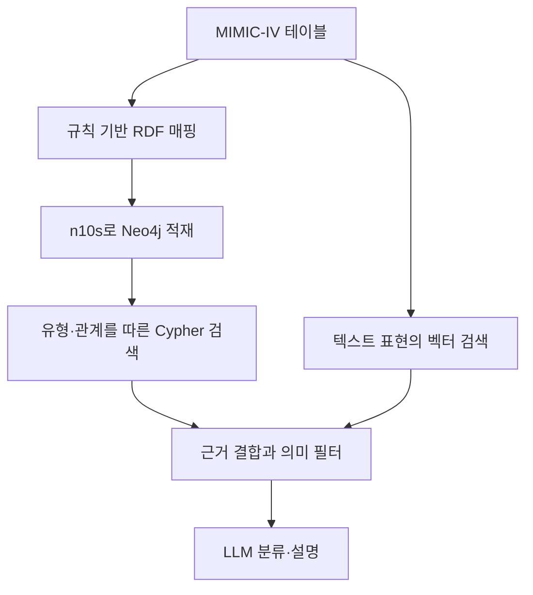

# 의료 온톨로지 RAG 리뷰 — Neo4j와 n10s를 이용한 검색·분류 실험

환자 기록은 입원·검사·처방·진단 테이블에 나뉘어 있다. 값이 같아 보여도 다른 환자나 다른 입원에 속할 수 있다. 이 논문은 이런 연결을 명시한 온톨로지와 그래프 검색을 벡터 검색에 결합한다. 평가 결과를 읽을 때에는 자연어 답변을 잘 설명하는 능력과 질환을 분류하는 능력을 구분해야 한다.

## 논문 정보

| 항목 | 내용 |
|---|---|
| 제목 | Ontology-aware knowledge graph retrieval-augmented generation for clinical decision support |
| 저자 | Deepak Panneerselvam, Sasikala E |
| 소속 | SRM Institute of Science and Technology |
| 발표 | Artificial Intelligence in Health, 2026년 9월 10일 온라인 공개 |
| 읽은 자료 | 출판사 최종 공개 PDF, 13쪽 |
| 원문 | [출판사 페이지](https://www.accscience.com/journal/AIH/articles/online_first/9207) · [DOI](https://doi.org/10.36922/AIH026210049) |

이 글은 시스템 구조와 보고된 실험을 검토한 리뷰다. 임상적 유효성이나 환자 치료에 대한 권고를 제공하지 않는다.

## CSV에서 RDF를 거쳐 Neo4j까지

논문은 Patient, Encounter, Condition, Medication, LabTest, Observation의 여섯 클래스를 사용한다. MIMIC-IV 테이블의 키를 이용해 자원을 식별하고 RDF 트리플을 만든 뒤 Turtle로 저장해 n10s로 Neo4j에 불러온다. 질의는 Cypher로 수행한다. ICD-10-CM 계층의 IS_A 관계는 진단 분류의 상하위 탐색에 사용한다. [원문 §3.1–3.3](https://article.accscience.com/journal/AIH/online_first/aih026210049/article_aih0262100491_e08b32.pdf#page=4)

그림은 논문의 처리 순서를 다시 그린 것이다. RDF 입력을 n10s로 적재했다는 사실만으로 전체 OWL 추론이나 SHACL 실행이 검증되었다고 해석하지 않는다. 본문이 설명하는 주요 경로는 유형·관계 제약을 적용한 검색과 생성 전 필터다.

## 검색과 생성의 구성

벡터 경로는 BioBERT로 만든 768차원 표현을 FAISS에 저장한다. 그래프 검색 결과와 벡터 검색 결과를 결합하고 온톨로지 조건을 검사한 뒤 Claude 3.5 Sonnet에 전달한다. 논문은 모델 식별자 `claude-3-5-sonnet-20241022`와 생성 전 검증 위치를 명시한다. [원문 §3.4–3.7](https://article.accscience.com/journal/AIH/online_first/aih026210049/article_aih0262100491_e08b32.pdf#page=5)

예를 들어 환자 A의 검사값을 환자 B의 입원 기록에 연결했다면 값의 숫자 형식이 맞아도 근거로 적절하지 않다. 관계와 대상 범위를 확인하는 검사는 이런 문제를 다룰 수 있다. 반면 올바른 환자에게 연결된 잘못된 측정값은 관계 구조만으로 찾아낼 수 없다. 이 예시는 구조 검사와 사실 확인의 차이를 설명하기 위한 것이다.

## 실제 평가 대상과 결과

실험은 패혈증 관련 진단 코드로 정한 양성·음성 분류를 중심으로 한다. 환자 단위 GroupKFold로 다섯 겹 교차 검증을 수행했다고 설명한다. 따라서 논문에서 제시한 AUC-ROC는 자유로운 의료 QA 답변의 정답률이 아니다. [원문 §4.2–4.4](https://article.accscience.com/journal/AIH/online_first/aih026210049/article_aih0262100491_e08b32.pdf#page=7)

| 구성 | 보고된 AUC-ROC | 보고된 F1 |
|---|---:|---:|
| 표형 EHR·로지스틱 회귀 | 0.71 | 0.64 |
| 벡터 검색 RAG | 0.81 | 0.74 |
| 그래프 검색 | 0.81 | 0.76 |
| 그래프·벡터 혼합, 제약 적용 | 0.88 | 0.83 |

출처는 원문 Table 1이다. 별도 제거 실험의 Table 2에서는 제약 없는 혼합 구성이 0.84, 제약 적용 구성이 0.88의 AUC-ROC를 보였다. 저자는 구성별 100개 출력을 수동 검토한 근거 경로 연결성도 보고한다. 그 지표에서 사용한 “hallucination”은 확인된 KG 근거 경로에 연결할 수 없는 임상 진술의 비율이다. 외부 임상 사실의 진위를 전부 판정한 비율과는 다르다. [원문 §4.8, Tables 1–2](https://article.accscience.com/journal/AIH/online_first/aih026210049/article_aih0262100491_e08b32.pdf#page=8)

## 결과를 받아들이기 전에 확인할 부분

저자는 온톨로지의 품질 의존성, 단일 데이터셋, API 모델의 재현성, LLM-only 비교군 부재를 한계로 적는다. 실제 의료진의 사용성과 전향적 임상 평가는 후속 과제다. [원문 §6](https://article.accscience.com/journal/AIH/online_first/aih026210049/article_aih0262100491_e08b32.pdf#page=9)

리뷰 관점에서는 추가 확인이 필요하다. §4.3의 양성 비율 2.5%와 Table 1의 accuracy·precision·recall을 같은 이진 혼동행렬에서 나온 값으로 해석하기 어렵다. 평균 방식, 재표본화, 평가 분모를 확인하지 않고 이 표를 재현 가능한 성능 기준으로 사용해서는 안 된다. §4.4는 표준편차 보고를 설명하지만 Table 1에는 평균 수치만 제시한다.

또 진단 코드로 라벨을 만들고 진단·처방 문맥을 특징으로 사용하므로 예측 시점 이후의 정보가 입력에서 어떻게 제외되는지 확인해야 한다. 환자별 분할은 동일 환자의 분할 간 중복을 줄이지만 시간 누수를 자동으로 해결하지 않는다. 이는 누수가 발생했다고 단정하는 주장이 아니라 재현 전에 확인할 설계 조건이다.

## 시스템 사례로서의 가치

RDF 매핑, n10s 적재, Cypher 조회, 벡터 검색을 한 파이프라인에 배치한 사례라는 점에서 읽을 가치가 있다. 그러나 보고된 개선을 n10s 하나의 효과나 일반적인 OWL 추론의 효과로 돌릴 수는 없다. 구조·표현·검색·필터가 함께 작동한다. 공개된 설명만으로 임상 적용의 안전성이나 일반적 답변 개선까지 검증되었다고 결론 내리기는 어렵다.
