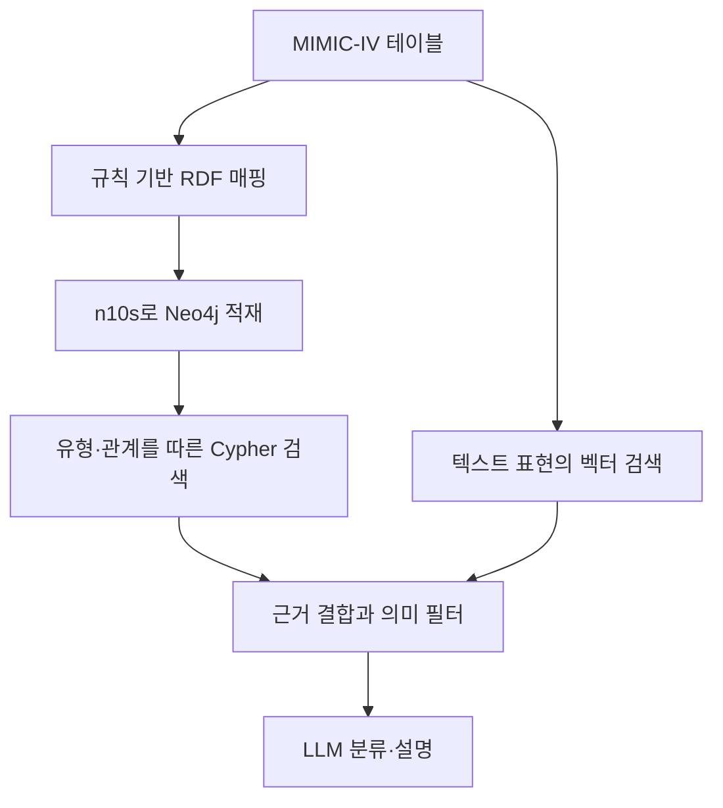
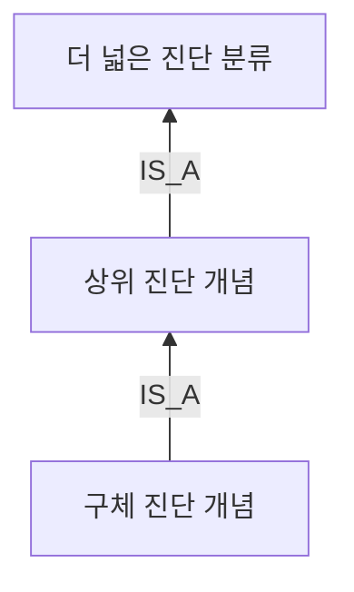
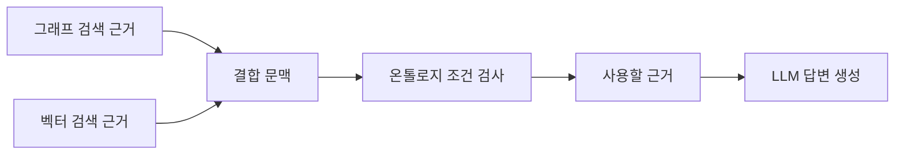
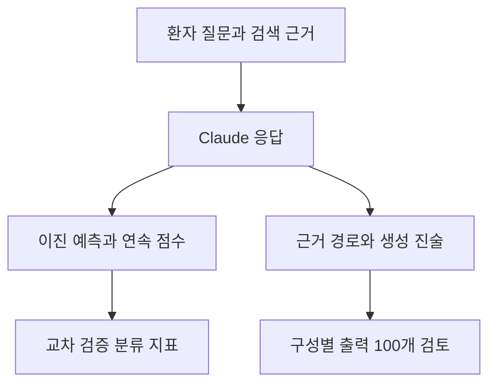
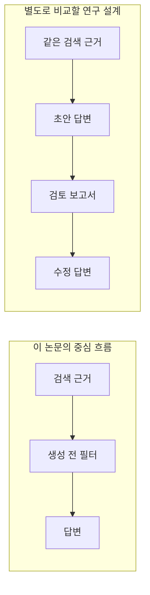

# 의료 온톨로지 RAG 리뷰 — Neo4j와 n10s를 이용한 검색·분류 실험

환자의 검사값을 찾으려면 숫자뿐 아니라 그 검사가 어느 환자의 어느 입원에 속하는지 알아야 한다. 이 논문은 이런 연결을 온톨로지와 Neo4j 그래프로 표현하고 그래프 검색을 벡터 검색과 결합한다. 검색한 근거를 생성 전에 검사한다는 점도 특징이다.

구조만 보면 의료 질의응답 시스템이지만 주요 정량 평가는 패혈증 관련 진단 코드를 이용한 이진 분류다. AUC-ROC 0.88과 ‘환각률 약 6%’는 서로 다른 평가에서 나온 수치다. 무엇을 입력하고 어떤 기준으로 채점했는지 구분하면서 원문 1~7장과 부록을 읽어보자.

## 논문 정보와 읽기 지도

| 항목 | 내용 |
|---|---|
| 제목 | Ontology-aware knowledge graph retrieval-augmented generation for clinical decision support |
| 저자 | Deepak Panneerselvam, Sasikala E |
| 소속 | SRM Institute of Science and Technology, School of Computing |
| 게재 | Artificial Intelligence in Health, 2026년 9월 10일 온라인 공개 |
| 검토 판본 | 출판사 공개 PDF 13쪽, 본문 1~11쪽·참고문헌 11~12쪽·부록 13쪽 |
| 원문 | [출판사 페이지](https://www.accscience.com/journal/AIH/articles/online_first/9207) · [DOI](https://doi.org/10.36922/AIH026210049) |
| 원본 그림·표 라이선스 | 저자 저작권, CC BY 4.0 |

2026년 11월 6일 확장한 리뷰다. 원본 그림 4개와 표 2개를 해당 설명 바로 옆에 배치했다. Mermaid 도식과 독해용 표는 리뷰에서 새로 정리한 자료다. 원문 성능을 재실험하지 않았으며 수치는 저자들의 보고와 그 보고를 검토한 해석으로 구분한다. 이미지 파일과 PDF의 해시는 [출처 기록](../assets/images/clinical-ontology-rag/provenance.json)에 남겼다.

| 원문 위치 | PDF 쪽 | 읽을 핵심 |
|---|---|---|
| 1 Introduction | 1–2 | EHR의 관계 구조를 검색에 반영하려는 이유 |
| 2 Related work, 2.1–2.3 | 2–3 | 임상 KG·온톨로지·의료 RAG의 연결 |
| 3 Methodology, 3.1–3.7 | 3–7 | 매핑, n10s 적재, 두 검색 경로, 생성 전 필터 |
| 4 Experimental setup and results, 4.1–4.9 | 7–9 | 코호트·라벨·분할·비교군·평가 정의 |
| 표 1·표 2·그림 4 | 9–10 | 분류 성능과 별도의 출력 표본 검토 |
| 5 Results analysis and discussion | 9 | 저자들의 결과 해석 |
| 6 Limitations and future work | 9–10 | 일반화·재현성·평가의 한계 |
| 7 Conclusion, Appendix | 11, 13 | 결론의 범위와 실제 응답 형식 |

## 1장 — 환자 기록의 연결과 검색 근거

입원, 검사, 진단, 처방은 각각의 테이블에 저장된다. 검사명과 수치가 같아도 환자나 입원이 다르면 질문에 대한 근거가 달라진다. 저자들은 텍스트 유사도만으로 이런 관계를 충분히 다루기 어렵다는 문제의식에서 출발한다.

이 문제를 모든 벡터 RAG의 필연적인 실패로 일반화할 필요는 없다. 환자 식별자나 입원 정보를 메타데이터 필터로 이용하는 다른 설계도 가능하다. 이 논문은 관계와 유형을 그래프에 명시하고 그 구조에 따라 근거를 찾는 방법을 제안한다.

저자들이 제시한 기여는 의료 온톨로지 기반 KG 구축, 그래프·벡터 하이브리드 검색, 온톨로지 제약 제거 실험, 임상 예측 평가다. 서론에서는 사실성·설명 가능성·환각 감소를 넓게 주장한다. 뒤의 평가가 그 주장 각각을 얼마나 직접 측정하는지가 독해의 기준이 된다.

## 2장 — 세 연구 흐름의 결합

### 2.1 임상 지식 그래프

환자·진단·약물·검사 사이 연결을 그래프로 만들면 여러 테이블을 가로지르는 경로를 표현할 수 있다. 저자들은 기존 연구의 일부가 휴리스틱 또는 가벼운 스키마에 의존해 의미 제약을 충분히 다루지 못한다고 평가한다. 이는 저자들의 선행 연구 해석이며 모든 기존 임상 KG를 동일한 수준으로 검증한 실험은 아니다.

### 2.2 온톨로지 기반 의료 정보 통합

SNOMED CT, ICD, LOINC, UMLS 등은 의료 개념을 식별하고 관계를 공유하는 배경으로 등장한다. 이 이름들이 나열됐다고 해서 이 시스템이 모두 가져와 통합한 것은 아니다. 실제 방법 절은 여섯 핵심 클래스와 ICD-10-CM 기반 Condition 계층을 설명한다.

### 2.3 의료 RAG

벡터 검색은 표현이 다른 텍스트를 유사도로 찾고 그래프 검색은 지정한 개체와 관계를 따라 근거를 찾는다. 논문은 두 경로를 결합하고 온톨로지 제약을 적용하는 방식을 제안한다. 다만 ‘두 경로가 서로 보완한다’는 가설과 그 효과를 분리해 입증하는 비교 설계는 별개다. 4장의 비교군과 제거 실험에서 이 차이가 중요해진다.

## 3장 — RDF 적재, 하이브리드 검색, 생성 전 검증

원문은 네 가지 큰 단계, 즉 온톨로지 설계·의미 매핑·KG 구축·검색 및 생성을 설명하고 이를 3.1~3.7절에서 구체화한다.


그림 1. 온톨로지 기반 KG-RAG의 전체 구성. Deepak Panneerselvam·Sasikala E, PDF 3쪽. [원문](https://article.accscience.com/journal/AIH/online_first/aih026210049/article_aih0262100491_e08b32.pdf#page=3) · [크게 보기](../assets/images/clinical-ontology-rag/figure-01-framework.png) · [CC BY 4.0](https://creativecommons.org/licenses/by/4.0/). 그림과 표는 원본 제목·캡션·주석을 포함해 PDF의 해당 영역을 잘랐다. 내용·축·범례·수치는 수정하지 않았다.

그림 1은 왼쪽 CSV 원천에서 시작해 전처리·의미 매핑, 온톨로지, KG를 거쳐 두 검색 경로로 갈라진다. 아래에서는 근거를 결합하고 검증한 뒤 LLM으로 보낸다. 검증의 위치가 답변 생성 전이라는 점을 먼저 확인하면 뒤의 제거 실험을 이해하기 쉽다.



기존 리뷰의 요약 도식이다. 원본 그림과 같은 큰 흐름을 유지하면서 RDF→n10s→Cypher 경로를 펼쳤다. 이 구조 자체가 완전한 OWL 추론이나 SHACL 검증을 실행했다는 뜻은 아니다.

### 3.1 여섯 클래스와 진단 계층

| 클래스 | 표현하려는 대상 |
|---|---|
| Patient | 환자 식별과 인구통계 정보 |
| Encounter | 개별 입원·진료 접점 |
| Condition | 진단 및 진단 코드의 분류 |
| Medication | 약물 관련 기록 |
| LabTest | 검사 항목과 관련 값 |
| Observation | 관찰 기록과 측정 시점 등 |

저자들은 객체 속성의 domain과 range를 정하고 `PatientID`, `admitTime`, `dischargeTime`, `labValue` 같은 데이터 속성을 둔다. 여기서 domain·range는 어떤 유형 사이의 관계인지 설명하는 제약이다. 숫자가 실제로 정확하게 측정됐는지까지 판정하는 기준은 아니다.


그림 2. 저자들이 ICD-10-CM 유래라고 설명한 Condition 계층. Deepak Panneerselvam·Sasikala E, PDF 5쪽. [원문](https://article.accscience.com/journal/AIH/online_first/aih026210049/article_aih0262100491_e08b32.pdf#page=5) · [크게 보기](../assets/images/clinical-ontology-rag/figure-02-icd10-hierarchy.png) · [CC BY 4.0](https://creativecommons.org/licenses/by/4.0/). 그림과 표는 원본 제목·캡션·주석을 포함해 PDF의 해당 영역을 잘랐다. 내용·축·범례·수치는 수정하지 않았다.

그림 2의 간선 `is_a`는 구체 개념에서 상위 개념으로 향한다. 실제 이미지에는 심혈관·류마티스 관련 이름 등이 보인다. 본문의 패혈증 코드 A40–A41 예시는 이 계층을 활용하는 방식을 설명하는 별도 예시이며 이 그림 자체가 패혈증 하위 코드 전체를 보여주는 것은 아니다.

상위 개념을 물으면 하위 진단까지 탐색하도록 질의를 구성할 수 있다. 하지만 계층을 저장하는 일, 그 계층을 순회하는 일, 논리 추론기로 새 사실을 도출하는 일은 구분해야 한다. 논문은 n10s의 특정 추론 프로시저나 외부 추론기 설정을 제시해 성능을 비교하지 않는다.



위는 계층 관계의 방향을 설명하는 도식이다. 실제 ICD 코드나 의학적 판단을 새로 추가한 예시는 아니다.

### 3.2 CSV를 RDF로 옮기는 규칙

본문은 `patients.csv`를 Patient, `admissions.csv`를 Encounter, `prescriptions.csv`를 Medication에 대응시킨다. `labevents.csv`와 `chartevents.csv`는 LabTest·Observation 관련 입력이다. `subject_id`, `hadm_id` 같은 키로 자원을 식별해 테이블 간 연결을 보존한다고 설명한다. 진단 코드는 뒤의 평가 라벨과 Condition 계층에도 쓰인다.

이것은 작성된 규칙을 이용하는 의미 매핑이다. 자연어를 주면 AI가 온톨로지와 관계를 자동 생성하고 정확성을 검증했다는 실험은 아니다. 환자와 입원을 구분할 키를 어떻게 URI와 속성으로 옮겼는지가 구현의 중요한 부분이다.

원문 3.2절은 다음 Cypher 예시를 제시한다.

```cypher
MATCH (p:Patient)-[:hasEncounter]->(e:Encounter)
-[:hasObservation]->(o)
WHERE o.labValue IS NOT NULL
RETURN p.patientID, e.encounterID,
o.labValue, o.labUnit
LIMIT 50
```

이 질의는 환자→입원→관찰 경로와 값의 존재를 확인한다. 코드만 보면 `o`에 Observation 레이블을 명시하지 않으며 시간 순서·단위 호환성·임상적 정상 범위를 모두 검사하는 것도 아니다. 이 예시는 논문에서 옮긴 것이며 이 리뷰에서 실행한 코드는 아니다.

### 3.3 n10s 적재와 Neo4j의 역할


그림 3. 환자·입원·진단·약물·검사·관찰의 인스턴스 스키마. Deepak Panneerselvam·Sasikala E, PDF 6쪽. [원문](https://article.accscience.com/journal/AIH/online_first/aih026210049/article_aih0262100491_e08b32.pdf#page=6) · [크게 보기](../assets/images/clinical-ontology-rag/figure-03-instance-schema.png) · [CC BY 4.0](https://creativecommons.org/licenses/by/4.0/). 그림과 표는 원본 제목·캡션·주석을 포함해 PDF의 해당 영역을 잘랐다. 내용·축·범례·수치는 수정하지 않았다.

Turtle로 만든 RDF를 n10s로 Neo4j에 가져오고 Neo4j의 유일성 제약으로 식별자 중복을 관리한다고 설명한다. 이후 검색은 Cypher로 수행한다. 따라서 이 사례에서 n10s는 RDF 기반 표현을 Neo4j에 연결하는 적재 구성 요소로 읽는 것이 정확하다.

원본 그림과 본문에는 주의할 차이도 있다. 그림 3의 `hasObservation` 화살표는 Medication에서 Observation으로 향하지만 위 Cypher 예시는 Encounter에서 관찰로 이동한다. 재구현할 때는 원본 스키마와 실제 질의를 대조해야 한다. 이 리뷰에서는 그림을 임의로 수정하거나 두 표현이 완전히 일치한다고 설명하지 않았다.

| 구성 요소 | 논문에서 설명한 역할 | 그 역할만으로 확인되지 않는 것 |
|---|---|---|
| RDF·온톨로지 | 개념·속성·관계 표현 | 원천 의료 사실의 정확성 |
| n10s | Turtle RDF의 Neo4j 적재 | 전체 OWL 추론의 실행과 완전성 |
| Neo4j 유일성 제약 | 식별자 중복 관리 | 모든 임상 제약의 충족 |
| Cypher | 유형과 관계를 따른 조회 | 별도 필터의 전체 구현 |
| O(C_h) | 검색 근거의 의미 제약 검사 | 구체 실행 엔진과 규칙 목록 |

### 3.4 그래프와 벡터의 두 검색 경로

그래프 경로는 질문과 관련된 서브그래프를 Cypher로 찾는다. 벡터 경로는 임상 노트·검사 설명·개체의 텍스트 표현을 대상으로 한다. BioBERT `dmis-lab/biobert-base-cased-v1.2`로 만든 768차원 벡터를 FAISS에 저장하고 코사인 유사도로 검색한다고 명시한다.

원문 식 (1)은 결합 문맥을 다음과 같이 표현한다.

`C_h = α · GraphRAG(KG, q) + (1 − α) · VectorRAG(E, q)`

4.4절은 별도 보류 데이터에서 정한 `α = 0.6`을 모든 fold에서 고정했다고 설명한다. 이 식은 두 검색 경로의 가중 결합을 나타내지만 텍스트와 서브그래프를 어떤 공통 점수로 바꾸는지까지 정의한 실행 명세는 아니다. 4.5절에는 결과를 이어 붙인다는 설명도 있다.

재현하려면 청크 크기·겹침, BioBERT 출력의 pooling 방식, 각 경로의 top-k, 점수 정규화, 중복 제거, 공통 문맥 예산이 필요하다. 공개 본문만으로 이 설정들을 확정할 수 없다. 모델 이름과 벡터 차원을 안다고 검색 구현이 모두 재현되는 것은 아니다.

### 3.5 근거 결합 뒤의 온톨로지 필터

식 (2)는 `p(y | x) = LLM(C_h, O(C_h))`, 식 (3)은 `O(C_h) = {c ∈ C_h | valid_O(c)}`로 표현된다. 직관적으로는 결합된 근거 가운데 선언된 온톨로지 조건을 만족하는 것을 골라내는 과정이다. 저자는 domain·range 유효성과 논리적 일관성을 예로 든다.

본문은 잘못되거나 개념적으로 부적절한 근거를 생성 전에 제거한다고 설명한다. 그러나 `valid_O`의 규칙 전체, 실행 코드, 사용한 검증 엔진은 구체적으로 제시하지 않는다. 이 필터를 ‘Python으로 구현했다’, ‘SHACL을 실행했다’, ‘n10s가 모든 오류를 자동 차단했다’고 채워 넣어서는 안 된다.



위 도식은 본문의 생성 전 필터 설명을 요약한다. 원문 식 (2)는 원래 문맥과 필터 결과를 모두 인자로 표기하고 있어 실제 프롬프트에 두 내용을 어떻게 넣었는지는 추가 확인이 필요하다.

예를 들어 환자 A의 검사 기록을 환자 B의 입원에 연결한 오류는 관계 일관성 검사로 다룰 수 있다. 반면 환자·입원 연결과 자료형이 모두 맞지만 측정값 자체가 틀렸다면 구조 검사만으로 알아낼 수 없다. 이는 검증 범위를 설명하는 예시이며 이 논문이 해당 오류들을 각각 주입해 검출률을 측정했다는 뜻은 아니다.

### 3.6 근거 경로를 남기는 응답

저자들은 답변에 관여한 환자·입원·관찰·관계의 경로를 보존하면 사람이 근거를 점검할 수 있다고 설명한다. 답변 옆에 조회 경로를 보여주는 것은 확인 가능성을 높이는 설계다. 다만 경로가 존재한다는 사실과 그 경로가 답변의 모든 주장을 뒷받침한다는 사실은 다르다. 임상의의 검토 시간이나 판단 개선을 측정한 사용자 실험은 제시되지 않는다.

### 3.7 생성 모델과 공개된 설정

Claude 3.5 Sonnet의 식별자는 `claude-3-5-sonnet-20241022`이며 Anthropic API로 추론만 수행하고 미세조정하지 않았다고 밝힌다. temperature는 0이다. 온톨로지 검사는 모델 훈련 전이 아니라 응답 생성 전에 위치한다.

저자들은 temperature 0을 결정적 생성이라고 설명하지만 호스팅 API의 장기적 재현성은 6장에서 별도로 한계로 인정한다. 이 논문은 여러 LLM의 비교가 아니며 모델을 바꾸었을 때 같은 효과가 유지되는지는 측정하지 않았다.

## 4장 — 실제 평가한 문제와 결과

### 4.1 연구 질문과 평가 축

세 연구 질문은 원시 EHR 대비 온톨로지 KG의 가치, 단일 검색 대비 하이브리드 검색의 가치, 온톨로지 제약의 추가 기여다. 이를 읽을 때 다음 두 평가를 분리해야 한다.

| 평가 | 입력·출력 | 실제로 보고한 것 |
|---|---|---|
| 주요 분류 평가 | 입원 단위 근거 → 이진 결정과 연속 점수 | AUC-ROC·accuracy·precision·recall·F1 |
| 출력 표본 검토 | 구성별 무작위 출력 100개 | KG 근거 경로로 연결되지 않는 진술의 비율 |

### 4.2 데이터 범위

MIMIC-IV v2.2를 사용한다. 저자는 병원 단위 분석이라고 설명하면서 ICU 입원 연결 테이블 `icustays.csv`를 제외했지만 ICU 관찰을 포함하는 `chartevents.csv`는 유지했다고 쓴다. 따라서 ‘중환자실 환자만으로 된 실험’이나 ‘ICU 자료를 완전히 제외한 실험’으로 단순화하면 모두 부정확하다.

4.3절에서 보고하는 최종 규모는 223,291명의 고유 환자와 545,497개의 encounter이며 양성 비율은 2.5%다. 원문은 이를 제시하지만 단계별 제외 건수와 평가 분모를 완전히 재구성할 자료는 충분하지 않다. 이 숫자를 소규모 10,000명 코호트로 바꾸어 설명해서는 안 된다.

### 4.3 패혈증 라벨과 예측 시점

양성은 `diagnoses_icd.csv`에서 `icd_version = 10`이고 `{A40.x, A41.x, R65.20, R65.21}`에 해당하는 코드가 하나 이상 있는 encounter로 정의한다. 원문은 Sepsis-3와 ‘onset’을 언급하지만 구체적으로 서술한 라벨 생성 절차는 진단 코드 기반이다.

이는 ‘30일 내 재입원’이나 ‘사망’ 예측이 아니다. 또한 발병 전 몇 시간까지의 자료로 예측하는지, 진단 이후의 기록을 어떻게 차단하는지가 충분히 명시되지 않아 이를 조기 발병 예측의 검증으로 곧바로 받아들이기 어렵다. 진단 코드로 라벨을 만들면서 진단 문맥도 특징에 포함하므로 시간 누수·목표 정보 포함 여부를 확인해야 한다. 누수가 발생했다고 단정하는 대신 재현 전에 필요한 확인 사항으로 남긴다.

### 4.4 환자 단위 분할과 연속 점수

저자들은 `subject_id`로 GroupKFold를 구성해 같은 환자의 여러 입원이 훈련과 시험에 나뉘지 않도록 했다고 설명한다. 다섯 fold의 평균을 보고하며 임계값은 검증 fold에서 정하고 α는 별도 보류 데이터에서 정해 고정했다고 쓴다.

환자 단위 분리는 동일 환자 중복 문제를 줄이지만 앞서 설명한 예측 시점 이후 정보의 유입까지 자동으로 막지는 않는다. 보류 데이터, fold별 검증 데이터, 검색 코퍼스의 경계를 어떻게 나눴는지도 재현 시 확인할 부분이다.

LLM에는 이진 결정과 [0,1]의 confidence를 출력하도록 요청하고 연속 점수로 AUC를 계산한다고 설명한다. confidence를 요청하는 것과 그 값의 통계적 보정을 검증하는 것은 다르다. 보정 곡선이나 Brier score 같은 결과는 제시하지 않는다. 또 4.4절은 점수에도 `C_h`라는 기호를 사용해 앞의 ‘검색 문맥’ 표기와 혼동된다. 여기서는 문맥과 예측 점수를 구분해 읽는다.

### 4.5 네 비교군

| 조건 | 논문이 설명한 입력·처리 | 비교에서 달라지는 요소 |
|---|---|---|
| B1 Tabular EHR | CSV 특징에 로지스틱 회귀 적용 | 표현뿐 아니라 예측 모델도 다름 |
| B2 Vector-only RAG | BioBERT·FAISS 텍스트 검색 후 Claude에 전달 | 그래프 구조를 쓰지 않음 |
| B3 KG-only retrieval | 온톨로지 KG에서 Cypher로 관련 근거 검색 | 임베딩 유사도 검색 없음 |
| B4 Hybrid KG + RAG | 두 검색 결과 결합 후 온톨로지 조건 검사 | 검색 결합과 제약 검사가 함께 들어감 |

B3의 조건은 검색 경로를 중심으로 설명되어 있으며 생성기와 점수화의 세부 연결은 더 명확한 명세가 필요하다. B1은 로지스틱 회귀이므로 B1과 B4의 차이를 온톨로지 하나의 효과로 해석할 수 없다. 검증 필터를 붙인 효과는 별도의 표 2가 더 직접적인 비교다.

### 4.6 지표의 의미

ROC는 판정 임계값을 바꿨을 때 거짓 양성률과 참 양성률이 어떻게 달라지는지 나타내고 AUC는 그 곡선 아래 면적이다. AUC 0.88을 ‘의료 질문의 88%에 정답을 냈다’로 읽으면 안 된다. accuracy·precision·recall·F1은 정한 임계값에서 계산한 분류 지표다.

양성이 2.5%인 상황에서는 음성으로만 예측해도 전체 정확도는 97.5%가 된다. 이런 불균형에서는 accuracy만으로 유용성을 판단할 수 없고 precision·recall, 평가 분모와 임계값을 함께 살펴야 한다.

### 4.7 표 1과 ROC 곡선


표 1. 5-fold 교차 검증의 성능 비교. Deepak Panneerselvam·Sasikala E, PDF 9쪽. [원문](https://article.accscience.com/journal/AIH/online_first/aih026210049/article_aih0262100491_e08b32.pdf#page=9) · [크게 보기](../assets/images/clinical-ontology-rag/table-01-performance.png) · [CC BY 4.0](https://creativecommons.org/licenses/by/4.0/). 그림과 표는 원본 제목·캡션·주석을 포함해 PDF의 해당 영역을 잘랐다. 내용·축·범례·수치는 수정하지 않았다.

아래는 원본 표 1의 수치를 읽기 쉽게 옮긴 것이다. 새 측정값이나 재계산된 평균이 아니다.

| 조건 | AUC-ROC | Accuracy | Precision | Recall | F1 |
|---|---:|---:|---:|---:|---:|
| B1 | 0.71 | 0.68 | 0.66 | 0.63 | 0.64 |
| B2 | 0.81 | 0.76 | 0.75 | 0.73 | 0.74 |
| B3 | 0.81 | 0.77 | 0.79 | 0.74 | 0.76 |
| B4 | 0.88 | 0.83 | 0.85 | 0.82 | 0.83 |


그림 4. 비교군별 ROC 곡선과 저자가 보고한 AUC. Deepak Panneerselvam·Sasikala E, PDF 10쪽. [원문](https://article.accscience.com/journal/AIH/online_first/aih026210049/article_aih0262100491_e08b32.pdf#page=10) · [크게 보기](../assets/images/clinical-ontology-rag/figure-04-roc-curves.png) · [CC BY 4.0](https://creativecommons.org/licenses/by/4.0/). 그림과 표는 원본 제목·캡션·주석을 포함해 PDF의 해당 영역을 잘랐다. 내용·축·범례·수치는 수정하지 않았다.

가로축은 거짓 양성률, 세로축은 참 양성률이다. 범례에서 파랑은 B1, 주황은 B2, 초록은 B3, 빨강은 B4다. 저자들은 B4의 AUC가 B2·B3보다 0.07 높다는 결과를 두 검색 경로의 상호보완성으로 해석한다.

B2와 B3의 AUC는 0.81로 같지만 같은 환자를 맞혔는지, 같은 오류를 냈는지는 알 수 없다. 오류의 중복과 상호보완성을 직접 보려면 사례별 예측 비교가 필요하다. 본문은 표준편차 보고를 언급하지만 표 1에는 fold별 변동이나 신뢰구간이 표시되지 않는다. 따라서 0.07 차이의 통계적 불확실성을 이 표만으로 계산할 수 없다.

수치의 정합성도 확인해야 한다. 양성률 2.5%, precision 0.85, recall 0.82를 하나의 동일한 평가 집합과 이진 혼동행렬에 적용하면 accuracy는 약 99.2%가 되어 표의 83%와 다르다. 이는 해당 전제를 놓고 계산한 점검값이며 논문 결과를 대체하는 수치가 아니다. fold별 평균 방식, 평가 시 재표본화 여부, 분모가 다르면 계산이 달라질 수 있다. 이런 정보를 확인하기 전에는 표를 재현된 성능 기준으로 사용하기 어렵다.

### 4.8 온톨로지 제약 제거 실험


표 2. 온톨로지 제약 유무에 따른 제거 실험. Deepak Panneerselvam·Sasikala E, PDF 10쪽. [원문](https://article.accscience.com/journal/AIH/online_first/aih026210049/article_aih0262100491_e08b32.pdf#page=10) · [크게 보기](../assets/images/clinical-ontology-rag/table-02-ablation.png) · [CC BY 4.0](https://creativecommons.org/licenses/by/4.0/). 그림과 표는 원본 제목·캡션·주석을 포함해 PDF의 해당 영역을 잘랐다. 내용·축·범례·수치는 수정하지 않았다.

| 구성 | AUC-ROC | Precision | F1 | 저자 정의 환각률 |
|---|---:|---:|---:|---:|
| Vector-only RAG | 0.81 | 0.75 | 0.74 | 약 18% |
| KG + RAG, 제약 없음 | 0.84 | 0.79 | 0.78 | 약 11% |
| KG + RAG, 제약 적용 | 0.88 | 0.85 | 0.83 | 약 6% |

표 2의 숫자를 그대로 옮겼다. 두 하이브리드 조건 사이에서 AUC는 0.04, 보고된 환각률은 약 5%포인트 차이가 난다. 이 비교는 그래프를 추가한 효과와 제약을 추가한 효과를 나누려는 시도다.

환각률의 정의를 특히 주의해서 읽어야 한다. 저자들은 구성별로 무작위 출력 100개를 수작업 검토했다고 설명한다. 생성 진술이 KG의 확인된 근거 경로에 연결되는지 살펴보고 연결되지 않는 진술의 비율을 계산했다고 한다. 선정한 출력은 100개지만 전체 진술의 수는 이와 구분해야 한다. 진술 수, 표본별 대응 관계, 평가자 수·합의 방식 등이 충분히 공개되지 않아 약 6%를 ‘100개 답변 중 정확히 6개가 오답’으로 바꾸면 안 된다.

또한 KG 경로에 연결되는지는 외부 의학적 진실과 다른 기준이다. KG 자체가 틀렸다면 근거 경로가 있는 잘못된 진술도 가능하다. 반대로 KG에 없는 사실은 실제로 참이어도 이 기준에서 근거 없는 진술로 분류될 수 있다. 벡터 검색만 쓰는 조건에도 KG 경로 기준을 적용하므로 그래프 밖 텍스트 근거가 어떻게 인정됐는지도 확인할 필요가 있다.

저자는 제약의 독립적 기여를 주장하지만 필터의 규칙·동일한 입력 예산·사례별 출력·평가 절차가 충분히 공개되지 않은 상태에서 일반적인 환각 억제 효과까지 단정하기는 어렵다.

### 4.9 설명 가능성과 근거 추적

이 절은 Cypher 경로를 통해 어떤 개체와 관계가 예측에 쓰였는지 사람이 확인할 수 있다고 설명한다. 표 1에는 분류 성능이, 표 2에는 경로 연결 평가가 보고되어 있다. 임상의가 더 빠르고 정확하게 검토하게 됐는지에 관한 사용자 효용은 측정하지 않았다. 근거 경로 제공은 설계상의 장점이며 실제 검토 효용은 별도 평가가 필요하다.

## 5장 — 저자들의 해석과 증거의 범위

저자들은 하이브리드 검색의 상호보완성, 제약의 추가 기여, 근거 경로의 설명 가능성, 구조의 확장성을 강조한다. 각 해석을 받치는 근거의 종류는 다르다.

| 해석 | 직접 제시된 근거 | 추가 확인 사항 |
|---|---|---|
| 하이브리드가 더 잘 분류함 | 표 1의 B4 성능 | 분모·불확실성·예산·시간 경계 |
| 제약이 근거 없는 진술을 줄임 | 표 2의 수작업 표본 검토 | 필터 코드와 평가 단위·합의 |
| 결과를 추적할 수 있음 | 조회 경로를 보존하는 설계 | 주장별 근거 적합성과 사람의 검토 효용 |
| 다른 환경으로 확장 가능함 | 모듈 구조에 대한 설명 | 타 기관·타 데이터의 실제 측정 |

이 논문은 Neo4j와 다른 DB를 비교하거나 n10s 사용 유무, OWL 추론기 종류, SHACL 적용 여부를 각각 바꾸어 실험하지 않았다. 결과를 어느 특정 제품이나 표준 하나의 우월성으로 돌리지 않는 것이 중요하다.

## 6장 — 한계와 재현 전에 확인할 내용

저자들이 인정하는 한계는 온톨로지·매핑 품질 의존성, 비정형 임상 텍스트 이해의 제한, 계산 비용, 단일 데이터셋, 이진 예측 중심 평가, 호스팅 API 재현성, LLM-only 비교군 부재다. 시간 추론·부정 표현·상호참조의 처리는 후속 과제로 남긴다.

따라서 필터가 시간 역전이나 모든 환자 혼동을 이미 완전히 차단한다고 설명하면 원문보다 강한 주장이 된다. 그래프 규모에 따른 질의 지연이나 검증 비용도 정량적으로 제시되지 않아 ‘효율적’이라는 표현을 실측 속도 우위로 읽기 어렵다.

재현을 위한 확인 목록은 다음과 같다.

| 영역 | 확인할 자료 |
|---|---|
| 데이터와 라벨 | 제외 단계별 건수, 진단 코드와 예측 시점의 관계 |
| 검색 | 청킹·pooling·top-k·코퍼스 분리·공통 문맥 예산 |
| 검증 | valid_O 규칙, 실제 엔진, 필터 전후 근거 |
| 분류 | fold별 혼동행렬, 평가 분모, 점수·임계값·변동 |
| 출력 검토 | 진술 단위 정의, 원문 출력, 평가자 지침·합의 |
| 실행 | API 호출 범위, 비용·실패 처리, 모델 버전 |

이 항목들은 공개 본문만으로 확인되지 않는다. 구현의 부재를 단정하지 않고 재현에 필요한 자료로 남긴다. 논문은 MIMIC-IV가 인증과 데이터 이용 동의를 충족한 연구자에게 제공된다고 밝히며 이 리뷰에는 환자 단위 원자료를 배포하지 않는다.

## 7장과 부록 — 응답 형식과 결론의 범위

결론은 온톨로지 KG와 벡터 검색을 결합한 임상 지원의 가능성을 강조한다. 수치가 직접 뒷받침하는 범위는 논문이 구성한 분류 비교와 제한된 출력 표본 평가다. 자유로운 치료 질의응답, 전향적 임상 효용, 실제 환자 안전성까지 검증한 것으로 확대하지 않는다.

13쪽 부록의 프롬프트는 검색 근거와 환자 질문을 주고 세 가지 출력을 요청한다. 이진 예측, [0,1]의 confidence, 근거 경로다. 이 형식 때문에 주 평가가 분류와 점수 중심이라는 점이 더 분명해진다.



위 도식은 분류 평가와 출력 검토를 분리해 그린 것이다. 같은 사례가 두 평가에서 어떻게 대응되는지는 공개 자료만으로 확정하지 않았다.

부록에는 confidence를 출력하라는 지시가 있지만 완전한 응답 JSON 스키마나 실패·재시도 정책은 제시하지 않는다. 시스템 프롬프트에는 생략 부호도 있어 부록만으로 실제 실행 프롬프트 전체가 고정됐다고 보기 어렵다.

## 연구 설계에 가져올 부분

이 사례에서 가져올 만한 것은 세 단계를 분리하는 관점이다. 먼저 환자·입원·검사 관계를 명시하고 두 검색 경로의 근거를 결합하며 생성 전에 근거의 적용 가능성을 확인한다. RDF 적재와 n10s는 그 구조를 구현하는 구성 요소다.

‘최종 답변 또는 사람의 중간 검토를 돕는 SHACL 보고서’와는 검증 위치가 다르다. 이 논문은 주로 생성 전 필터를 다룬다. 답변을 먼저 생성한 다음 보고서를 보여주어 수정하게 했을 때의 효과는 측정하지 않았다.



두 번째 흐름은 검증 위치를 비교하기 위한 설명도이며 이 논문의 결과나 어느 시스템의 우위를 나타내지 않는다. 필터로 근거를 제거할 때의 이익과 손실, 보고서로 검토를 유도할 때의 수정 효과와 불필요한 보류를 각각 측정해야 한다. 이 논문은 그 후속 질문을 구체화하는 구현 사례로 읽을 수 있다.

## 출처

- Panneerselvam D, Sasikala E. *Ontology-aware knowledge graph retrieval-augmented generation for clinical decision support*. Artificial Intelligence in Health, 온라인 공개 2026-09-10. [DOI: 10.36922/AIH026210049](https://doi.org/10.36922/AIH026210049).
- 구조·알고리즘은 원문 §3, 데이터·분류·출력 검토는 §4, 한계는 §5–6, 응답 형식은 PDF 13쪽 부록을 기준으로 설명했다. 원본 그림·표는 각 캡션의 PDF 페이지에서 확인할 수 있다.
- 원본 그림·표의 재사용은 [CC BY 4.0](https://creativecommons.org/licenses/by/4.0/)에 따른다. 새 도식은 원문을 설명하거나 검증 위치를 비교하기 위해 작성한 것이다.
