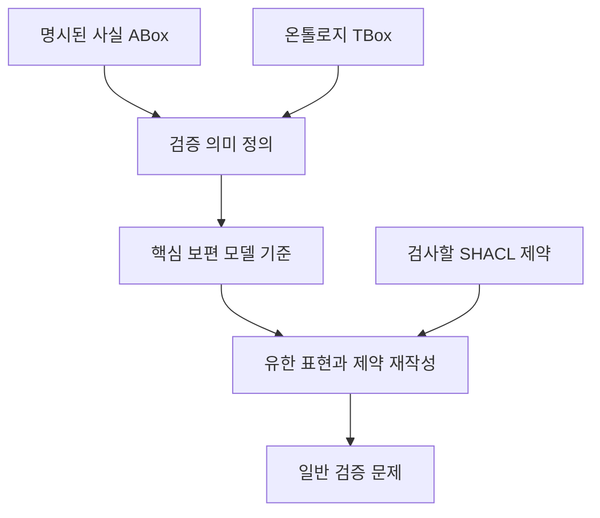

# OWL과 SHACL 의미론 리뷰: 추론한 그래프를 무엇으로 검증할 것인가

데이터에 애완동물이 새라고 적혀 있고 개라는 정보는 없다고 하자. “개가 아닌 애완동물이 있는가”라는 검사에 어떻게 답해야 할까. 저장된 사실만 보면 통과할 수 있다. 하지만 열린 세계에서는 그 동물이 개이기도 할 가능성을 배제하지 못한다. 이 차이는 OWL 추론과 SHACL 검증을 연결할 때 실제로 고려해야 할 문제다.

## 논문 정보와 연구 유형

| 항목 | 내용 |
|---|---|
| 제목 | SHACL validation in the presence of ontologies: Semantics and rewriting techniques |
| 저자 | Anouk Oudshoorn, Magdalena Ortiz, Mantas Šimkus |
| 소속 | TU Wien |
| 발표 | Artificial Intelligence 352, 104483, 2026년 1월 13일 온라인 공개 |
| 읽은 자료 | 저자 공개 최종 PDF, 26쪽 |
| 원문 | [DOI](https://doi.org/10.1016/j.artint.2026.104483) · [저자 공개 PDF](https://noukoudshoorn.github.io/files/SHACL_Validation.pdf) |

이 논문은 의미론·알고리즘·계산 복잡도를 다루는 이론 연구다. 그래프 DB나 LLM의 정확도·응답 시간을 비교한 논문이 아니다. 아래 설명은 핵심 정의와 결과를 풀어 쓴 것이며 모든 증명을 독립적으로 재검증했다는 뜻은 아니다.

## 열린 세계와 검증 대상 그래프

OWL에서는 기록되지 않은 사실을 곧바로 거짓으로 보지 않는다. SHACL은 입력 그래프에 실제로 어떤 값과 관계가 있는지 검사한다. 온톨로지가 추가 사실을 함의하면 검증 대상을 원래 그래프로 할지 추론을 반영한 구조로 할지부터 정해야 한다.

논문의 Example 3.1은 이 차이를 보여준다. 새라는 정보만으로 개가 아님을 논리적으로 확정할 수 없으므로 가능한 모든 OWL 모델에서 조건을 만족해야 한다고 요구하면 일반적인 그래프 검증의 직관과 어긋난다. 부정뿐 아니라 개수, 값의 동일성·분리 여부도 모델에 따라 달라질 수 있다. [원문 §3, Example 3.1](https://noukoudshoorn.github.io/files/SHACL_Validation.pdf#page=4)

예를 들어 “모든 사람은 부모가 존재한다”는 공리가 있다고 하자. 부모의 이름이 저장되어 있지 않아도 존재 자체는 추론할 수 있다. 이때 만들어지는 익명 대상을 실제 원천에서 확인한 사람과 동일하게 취급하면 안 된다. 추론된 존재와 기록된 증거는 서로 다른 역할을 한다. 이 문단은 의미론을 설명하기 위한 별도 예시다.

## 핵심 보편 모델을 택하는 이유

저자는 core universal model을 기준으로 검증 의미를 정한다. 보편 모델은 지식베이스의 여러 가능한 모델과 구조적으로 연결되는 대표 모델이다. core는 그 안의 불필요하게 중복된 구조를 줄인다는 개념이다. 아무 추론 결과 그래프나 택했을 때 부정·개수 검사 결과가 달라지는 문제를 피하려는 선택이다.

논문은 일관된 정규화 Horn-ALCHIQ 지식베이스에 대해 이 모델을 구성하는 방법과 유일성을 다룬다. 여기서 유일성은 노드 이름까지 같다는 뜻이 아니라 동형인 구조를 같은 것으로 본다는 의미다. [원문 §3–4, Theorems 4.4·4.6](https://noukoudshoorn.github.io/files/SHACL_Validation.pdf#page=8)

이 도식은 논리적 처리 관계를 설명한다. 무한할 수도 있는 모델을 실제로 전부 생성한 뒤 검사한다는 실행 절차를 뜻하지 않는다.

## 재작성으로 피하는 무한 확장

존재를 요구하는 공리가 반복되면 추론 구조는 끝없이 늘어날 수 있다. 저자는 전체 구조를 모두 저장하는 대신 유한한 표현을 사용하고 온톨로지를 반영한 제약으로 재작성해 일반 검증 문제로 줄인다. 양의 SHACL에서 시작해 부정과 재귀의 상호작용을 제한한 stratified SHACL로 논의를 확장한다. [원문 §5–7](https://noukoudshoorn.github.io/files/SHACL_Validation.pdf#page=11)

따라서 이 방법은 “아무 OWL과 아무 SHACL을 함께 넣으면 해결된다”는 일반 해법이 아니다. 논문은 재귀적 조각에서 개수 제약과 closed 연산자를 제외하고 equality·disjointness도 제한된 형태로 다룬다고 명시한다. 지원하는 언어 조각을 생략하면 정리의 적용 범위를 잘못 전달하게 된다. [원문 §2, §10](https://noukoudshoorn.github.io/files/SHACL_Validation.pdf#page=4)

## 복잡도 결과의 의미

| 결과 | 읽는 방법 |
|---|---|
| 논문이 다루는 검증 문제의 ExpTime-complete 결과 | 온톨로지·제약까지 입력으로 바뀌는 문제의 최악 경우 난도를 말함 |
| 데이터 복잡도 PTime-complete | 온톨로지·제약을 고정하고 사실 데이터가 커질 때의 난도를 구분함 |
| 일반 검증으로의 재작성 | 추론 의미를 반영한 문제 변환이 가능하다는 결과이며 특정 DB의 실행 속도 보장은 아님 |

복잡도는 몇 초가 걸리는지 알려 주는 성능표가 아니다. 이론적으로 처리할 수 있는 범위와 입력 구조에 따라 계산이 어려워지는 이유를 설명한다. [원문 초록·§8–10](https://noukoudshoorn.github.io/files/SHACL_Validation.pdf)

## 구현을 읽는 독자에게 남는 질문

추론기를 붙였다는 사실만으로 검증의 의미가 정해지지는 않는다. 어떤 공리를 지원하는지, 익명 개체를 어떻게 다루는지, 어떤 사실 집합에 부정과 개수 검사를 적용하는지 확인해야 한다. 이 논문의 기여는 그 선택을 명시적인 수학적 문제로 만든 데 있다.

실무 구현을 비교할 때도 지원하지 않는 공리를 오답으로 세는 것과 지원한다고 선언한 공리에서 틀린 결과를 내는 것은 구분해야 한다. 이 리뷰가 제시하는 구현상 해석이며 논문이 특정 제품의 적합성을 평가했다는 뜻은 아니다.
