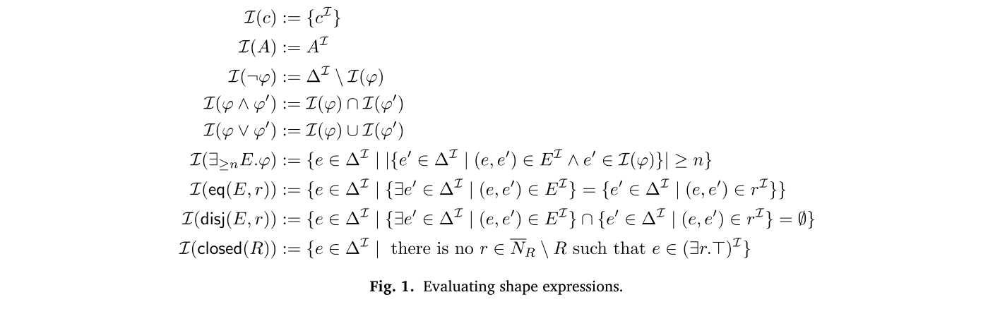
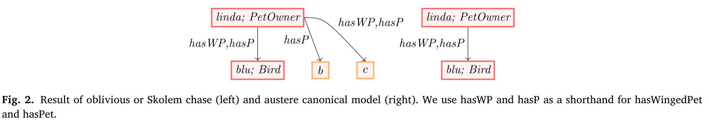
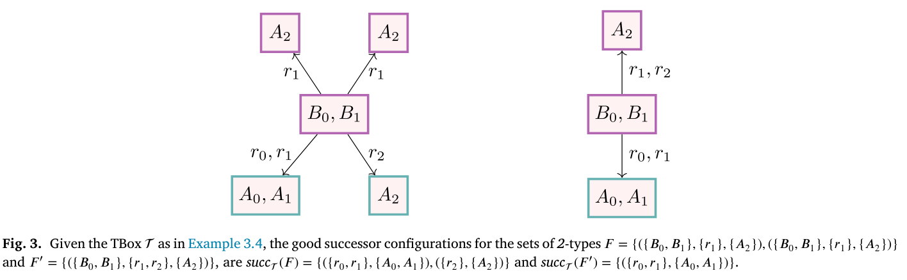
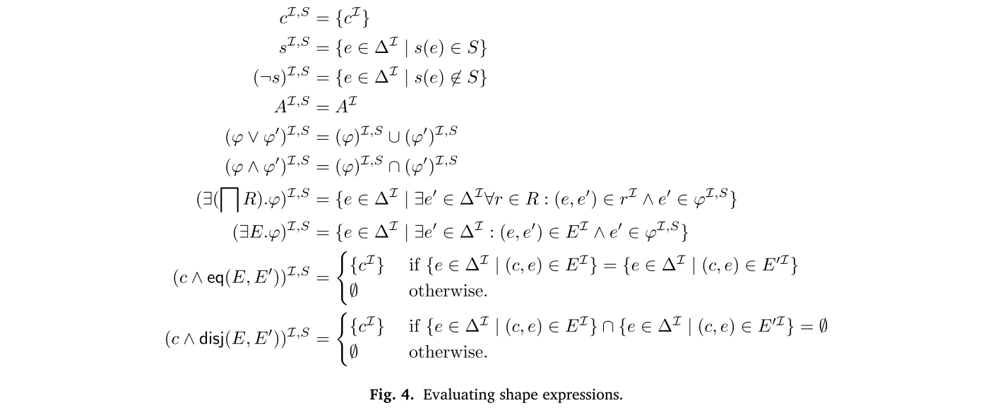
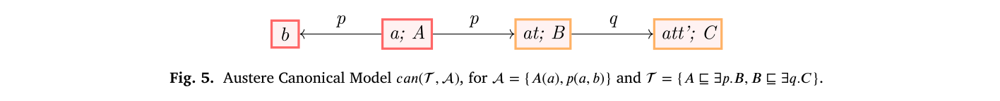
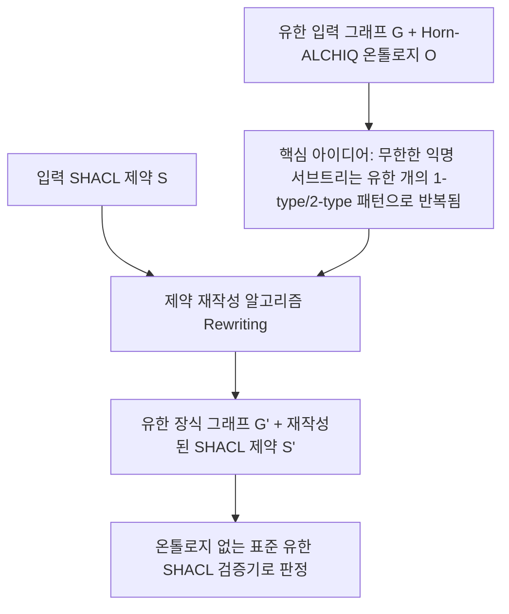

# OWL과 SHACL 의미론 리뷰: 추론한 그래프를 무엇으로 검증할 것인가

데이터에 애완동물이 새라고 적혀 있고 개라는 정보는 없다고 하자. “개가 아닌 애완동물이 있는가”라는 검사에 어떻게 답해야 할까. 저장된 사실만 보면 통과할 수 있다. 하지만 열린 세계에서는 그 동물이 개이기도 할 가능성을 배제하지 못한다. 이 차이는 OWL 추론과 SHACL 검증을 연결할 때 실제로 고려해야 할 문제다.

이 글은 2026년 11월 10일에 확장한 장별 심층 리뷰다. 논문의 1장부터 10장까지를 따라가며 열린 세계 가정(OWA)을 따르는 서술 논리(Description Logic) 온톨로지와 닫힌 세계 가정(CWA)을 따르는 SHACL 제약 검증이 충돌하는 지점, 저자들이 해법으로 제시한 **핵심 보편 모델(core universal model)** 및 **엄격한 정준 모델(austere canonical model)** 의미론, 그리고 무한한 추론 구조를 실제로 생성하지 않고 유한한 SHACL 검증 문제로 환원하는 **제약 재작성(constraint rewriting)** 알고리즘과 계산 복잡도(ExpTime-complete / PTime-complete)를 차례로 읽는다. 원문의 수식·도면 5점은 저자 공개 최종 PDF에서 캡처로 가져왔고 설명을 위해 새로 그린 도식은 Mermaid로 구분했다.

## 논문 정보와 검토 범위

| 항목 | 내용 |
|---|---|
| 제목 | SHACL validation in the presence of ontologies: Semantics and rewriting techniques |
| 저자 | Alexandra (Anouk) Oudshoorn, Magdalena Ortiz, Mantas Šimkus |
| 소속 | TU Wien, Faculty of Informatics |
| 발표 | *Artificial Intelligence*, Volume 352, 104483 (2026년 1월 온라인 공개, 26쪽) |
| 읽은 판본 | 출판사 오픈 액세스 최종 PDF, 26쪽 |
| 원문 | [ScienceDirect 페이지](https://www.sciencedirect.com/science/article/pii/S0004370226000019) · [DOI](https://doi.org/10.1016/j.artint.2026.104483) · [저자 공개 PDF](https://noukoudshoorn.github.io/files/SHACL_Validation.pdf) |

이 논문은 의미론·재작성 알고리즘·계산 복잡도를 증명한 순수 이론 연구다. 특정 상용 그래프 DB나 LLM 파이프라인의 실행 시간(초)을 벤치마크한 실험 논문이 아니다. 원문과 원문 수록 도면은 [CC BY 4.0](https://creativecommons.org/licenses/by/4.0/) 라이선스로 배포되며 이미지별 원본 페이지·좌표·SHA256 해시는 [그림 출처 기록](../assets/images/owl-shacl-semantics/provenance.json)에 남겼다.

## 원문 구성과 읽기 지도

| 원문 | PDF 쪽 | 핵심 내용 |
|---|---|---|
| 1 Introduction | 1–3 | 온톨로지 추론(OWA)과 SHACL 검증(CWA)을 결합할 때 생기는 근본적인 의미론적 딜레마 |
| 2 Preliminaries | 3–5 | 그래프(ABox), $\text{Horn-}\mathcal{ALCHIQ}$ 온톨로지, 비재귀 SHACL 문법과 평가 규칙(그림 1) |
| 3 Semantics of SHACL in the Presence of Ontologies | 5–10 | 모든 모델 검증의 한계(예제 3.1), Chase의 중복 생성 문제(예제 3.2, 그림 2), 엄격한 정준 모델과 Good Successor(정의 3.3, 그림 3) |
| 4 Equivalence with the Core of the Universal Model | 10–13 | 엄격한 정준 모델과 유한/무한 Core Universal Model의 동형성 증명(정리 4.4, 4.6, 4.10) |
| 5–7 Rewriting & Stratified Recursive SHACL | 13–21 | 재귀적·계층화(Stratified) SHACL 의미론(그림 4), 온톨로지를 반영한 유한 재작성 절차(정의 6.4, 예제 6.5, 그림 5) |
| 8–9 Complexity Analysis | 21–24 | 결합 복잡도 ExpTime-complete(정리 8.5, 8.10) 및 데이터 복잡도 PTime-complete(정리 9.1, 9.2) |
| 10 Conclusion | 24–25 | 지원 연산자 범위 요약 및 향후 연구 과제 |

## 1장–2장: 서술 논리 온톨로지와 SHACL 모양 표현의 형식 정의

### 1.1 왜 온톨로지 추론 결과에 곧바로 SHACL을 돌리면 문제가 생기는가

엔터프라이즈 지식 그래프에서는 흔히 OWL 온톨로지로 도메인 어휘와 상하위·존재 규칙을 선언하고, SHACL로 데이터 품질을 검증한다. 만약 온톨로지가 단순한 클래스/속성 계층(`rdfs:subClassOf`, `rdfs:subPropertyOf`)만 담고 있다면 추론된 트리플을 유한하게 실체화(materialize)한 뒤 표준 SHACL 엔진을 돌리면 그만이다.

하지만 OWL 온톨로지에 **존재 제약($A \sqsubseteq \exists r.B$, 예: "모든 사람은 생물학적 부모가 존재한다")**이나 **수 제약($A \sqsubseteq {\leqslant 1}\, r.B$)**이 들어가는 순간 두 가지 장벽이 나타난다.

1. **열린 세계(OWA)와 닫힌 세계(CWA)의 충돌**: OWL에서는 기록되지 않은 사실을 거짓으로 단정하지 않는 반면, SHACL의 부정(`sh:not`, $\neg \varphi$)이나 최소/최대 개수 제약(`${\geqslant_n} E.\varphi$)은 현재 그래프에 존재하는 이웃만 세어 참·거짓을 판정한다.
2. **익명 개체(anonymous individual)의 무한 사슬과 중복**: 존재 공리를 따라 익명 노드를 생성하는 표준 추론 절차(Oblivious Chase 등)는 끝없이 무한한 트리를 만들거나, 사실상 불필요한 중복 익명 노드를 만들어 SHACL의 개수 검사(`${\leqslant_n}$ 또는 ${\geqslant_n}$)를 왜곡한다.

### 1.2 $\text{Horn-}\mathcal{ALCHIQ}$ 온톨로지와 SHACL 모양 식의 평가 규칙

2장에서는 입력 그래프(ABox $G$), 정규화된 $\text{Horn-}\mathcal{ALCHIQ}$ 온톨로지 $\mathcal{O}$, 그리고 SHACL 모양 식(shape expression) $\varphi$를 정의한다. $\text{Horn-}\mathcal{ALCHIQ}$는 역속성($r^-$), 역할 포함($r \sqsubseteq s$), 한정 수 제약(${\leqslant 1}\, r.B$, ${\geqslant n}\, r.B$)을 지원하는 표현력 높은 Horn 서술 논리다.

SHACL 경로 표현 $E$와 모양 식 $\varphi$는 다음과 같은 문법으로 정의된다.

$$E ::= p \mid p^- \mid E \cup E \mid E \cdot E \mid E^*$$

$$\varphi, \psi ::= \top \mid B \mid c \mid \varphi \land \psi \mid \varphi \lor \psi \mid \neg \varphi \mid {\geqslant_n} E.\varphi \mid \text{eq}(E, p) \mid \text{disj}(E, p)$$

여기서 $B$는 개념(클래스) 이름, $c$는 상수(개체 IRI), ${\geqslant_n} E.\varphi$는 경로 $E$로 연결된 이웃 중 $\varphi$를 만족하는 노드가 $n$개 이상이라는 제약, $\text{eq}(E, p)$와 $\text{disj}(E, p)$는 경로 $E$와 속성 $p$의 이웃 집합이 같거나 서로소라는 제약이다. 주어진 해석(그래프) $I$ 위에서 각 모양 식이 만족되는 노드 집합 $\llbracket \varphi \rrbracket^I$의 정의는 원문 그림 1에 제시되어 있다.

그림 1. 해석 $I$ 위에서 복합 SHACL 모양 식 $\varphi$와 경로 표현 $E$의 평가 의미론 $\llbracket \varphi \rrbracket^I$. Oudshoorn, Ortiz, Šimkus, PDF 4쪽. [원문](https://noukoudshoorn.github.io/files/SHACL_Validation.pdf#page=4) · [크게 보기](../assets/images/owl-shacl-semantics/figure-01-shape-eval.png) · [CC BY 4.0](https://creativecommons.org/licenses/by/4.0/).

## 3장–4장: 왜 '모든 모델 검증'이나 '단순 Chase'가 아니라 'Core Universal Model'인가

### 3.1 예제 3.1 (Linda와 Blu): 모든 모델에서의 만족을 요구하면 생기는 역설

3장 도입부의 **예제 3.1**은 왜 고전적인 일차 논리 함의(certain answers over all models)를 SHACL 검증에 그대로 쓸 수 없는지 단적으로 보여 준다.

- **입력 그래프 $G$**: `hasPet(Linda, Blu)`, `Parrot(Blu)` (린다의 애완동물 블루는 앵무새다).
- **온톨로지 $\mathcal{O}$**: `Parrot` $\sqsubseteq$ `Bird` (앵무새는 새다). 단, 온톨로지에 `Bird`와 `Dog`가 서로소(`Bird` $\sqcap$ `Dog` $\sqsubseteq \bot$)라는 공리는 빠져 있다고 하자.
- **검증할 SHACL 제약**: 대상 노드 `Linda`가 모양 식 $\exists \text{hasPet}.(\text{Bird} \land \neg \text{Dog})$ ("개가 아닌 새를 애완동물로 기른다")를 만족하는가?

상식적인 데이터베이스 검증자라면 `Blu`가 온톨로지에 의해 `Bird`로 추론되고 `Dog(Blu)`라는 사실은 어디에도 없으므로 **검증 통과(True)**라고 답하길 원한다. 그러나 만약 "지식베이스 $(G, \mathcal{O})$의 **모든 가능한 모델 $I$**에서 제약이 성립해야 한다"고 정의하면, 어떤 모델 $I'$에서는 `Blu`가 새이면서 동시에 개(`Dog(Blu)`)일 수도 있으므로 검증이 **실패(False)**해 버린다. 즉 온톨로지 추론은 반영하되, 추론되지 않은 사실에 대해서는 최소한의 가정(CWA)을 유지할 **단 하나의 정준 모델(canonical model)**이 필요하다.

### 3.2 예제 3.2와 그림 2: 단순 Chase의 중복 익명 노드와 엄격한 정준 모델

그렇다면 데이터베이스 이론에서 널리 쓰는 표준 추론 절차인 **Oblivious Chase**를 정준 모델로 쓰면 어떨까? **예제 3.2**는 그 방식이 왜 개수 제약에서 실패하는지 보여 준다.

- **입력 그래프 $G$**: `hasPet(Linda, Blu)`, `Parrot(Blu)`, `hasFather(Linda, Bob)`, `ParrotOwner(Bob)`
- **온톨로지 $\mathcal{O}$**:
  1. $\text{ParrotOwner} \sqsubseteq \exists \text{hasPet}.\text{Parrot}$ (앵무새 주인은 앵무새 애완동물이 존재한다)
  2. $\exists \text{hasPet}.\text{Parrot} \sqsubseteq \text{ParrotOwner} \sqcap \exists \text{hasPet}.\text{Bird}$
  3. $\text{Parrot} \sqsubseteq \text{Bird}$

그림 2. 예제 3.2에 대한 Oblivious Chase의 일부(좌)와 저자들이 정의한 엄격한 정준 모델 $I_{\text{can}}(G, \mathcal{O})$(우). Oudshoorn, Ortiz, Šimkus, PDF 6쪽. [원문](https://noukoudshoorn.github.io/files/SHACL_Validation.pdf#page=6) · [크게 보기](../assets/images/owl-shacl-semantics/figure-02-chase-vs-canonical.png) · [CC BY 4.0](https://creativecommons.org/licenses/by/4.0/).

그림 2 왼쪽(Oblivious Chase)을 보면 `Linda`는 이미 `Parrot`이자 `Bird`인 `Blu`를 갖고 있는데도, 두 번째 공리($\exists \text{hasPet}.\text{Bird}$)를 기계적으로 적용하면서 `Bird`인 익명 노드 $x_1$을 새로 만들어 붙인다. 그 결과 `Linda`가 기르는 새가 2마리(`Blu`와 $x_1$)인 것처럼 부풀려져, "린다의 새는 최대 1마리인가($\neg ({\geqslant_2}\,\text{hasPet}.\text{Bird})$)?"라는 SHACL 검사가 부당하게 실패한다.

반면 그림 2 오른쪽의 **엄격한 정준 모델(Austere Canonical Model, $I_{\text{can}}(G, \mathcal{O})$)**은 이미 존재하는 이웃 `Blu`가 $\exists \text{hasPet}.\text{Bird}$ 요구사항을 충족하므로 불필요한 익명 노드 $x_1$을 만들지 않고, 꼭 필요한 경우(아직 애완동물이 명시되지 않은 `Bob`의 익명 앵무새 $y_1$)에만 최소한의 익명 노드를 도입한다.

### 3.3 정의 3.3과 정리 4.4–4.10: Good Successor와 Core Universal Model의 유일성

3.1절(정의 3.3, 그림 3)은 어떤 노드 $d$ 주변에 어떤 익명 이웃을 몇 개나 생성해야 중복도 없고 누락도 없는지를 결정하는 **Good Successor Configuration**을 수학적으로 정의한다.

그림 3. 두 노드 사이의 2-type($\tau$) 연결 조건을 나타낸 정의 3.3의 시각적 구조. Oudshoorn, Ortiz, Šimkus, PDF 9쪽. [원문](https://noukoudshoorn.github.io/files/SHACL_Validation.pdf#page=9) · [크게 보기](../assets/images/owl-shacl-semantics/figure-03-good-successor.png) · [CC BY 4.0](https://creativecommons.org/licenses/by/4.0/).

이어지는 4장에서는 이렇게 구성한 엄격한 정준 모델 $I_{\text{can}}(G, \mathcal{O})$이 그래프 이론과 데이터베이스의 **핵심 보편 모델(Core of the Universal Model)**과 동형(isomorphic)이며(정리 4.4, 4.6), 따라서 동형 사상 아래에서 **유일하게 결정된다(정리 4.10)**는 사실을 증명한다. 즉 추론 엔진의 내부 구현 순서에 휘둘리지 않는 수학적으로 유일하고 최소한의 추론 완료 그래프가 정의된 것이다.

## 5장–7장: 무한 모델을 만들지 않는 제약 재작성(Rewriting)과 계층화 재귀 SHACL

### 5.1 재귀적 SHACL과 계층화 부정(Stratified Negation)

5장에서는 모양 이름(shape atom) $s$가 자기 자신이나 다른 모양 이름을 참조하는 **재귀적 SHACL**로 논의를 확장한다. 이때 모양 이름들에 대한 배정(valuation) $\nu$를 포함한 평가 규칙은 원문 그림 4와 같다.

그림 4. 모양 원자(shape atom) 배정 $\nu$가 주어졌을 때 복합 SHACL 모양 식의 평가 규칙. Oudshoorn, Ortiz, Šimkus, PDF 14쪽. [원문](https://noukoudshoorn.github.io/files/SHACL_Validation.pdf#page=14) · [크게 보기](../assets/images/owl-shacl-semantics/figure-04-recursive-eval.png) · [CC BY 4.0](https://creativecommons.org/licenses/by/4.0/).

저자들은 재귀와 부정이 얽힐 때 의미가 모호해지는 문제를 피하기 위해, Datalog에서처럼 부정을 계층별로 나눈 **Stratified SHACL**을 채택한다. 다만 재귀적 조각(Section 5–7)에서는 유한 상태 오토마타 변환과 재작성을 보장하기 위해 일반 수 제약(${\geqslant_n}, n \ge 2$) 대신 존재 제약(${\geqslant_1} E.\varphi$, 즉 $\exists E.\varphi$)을 중심으로 다루고, $\text{eq}(E, p)$나 $\text{disj}(E, p)$는 최상위 계층 등에 제한적으로 허용한다.

### 5.2 무한한 익명 트리를 유한한 모양 제약으로 압축하는 재작성(Section 6–7)

온톨로지에 "모든 사람은 부모가 있고 그 부모도 사람이다($\text{Person} \sqsubseteq \exists \text{hasParent}.\text{Person}$)" 같은 공리가 있으면 정준 모델 $I_{\text{can}}(G, \mathcal{O})$는 무한한 크기를 갖는다. 컴퓨터 메모리에 무한 그래프를 실체화할 수는 없다.

6장과 7장의 핵심 아이디어는 **데이터($G$)를 무한히 불리는 대신, SHACL 제약($S$)과 입력 그래프를 온톨로지 타입 정보로 장식한 유한한 검증 문제로 재작성(rewriting)**하는 것이다(정의 6.4, 예제 6.5, 그림 5).

그림 5. 예제 6.5에서 유한 입력 노드($a, b$)로부터 뻗어나가는 무한한 엄격한 정준 모델의 일부. Oudshoorn, Ortiz, Šimkus, PDF 17쪽. [원문](https://noukoudshoorn.github.io/files/SHACL_Validation.pdf#page=17) · [크게 보기](../assets/images/owl-shacl-semantics/figure-05-austere-canonical.png) · [CC BY 4.0](https://creativecommons.org/licenses/by/4.0/).

그림 5에서 보듯 입력 그래프의 개체 $a, b$ 바깥으로 생성되는 익명 노드 사슬($x_1, x_2, \dots$)은 무한하지만, 각 익명 노드가 만족하는 온톨로지 개념 집합(1-type)과 인접 연결 형태(2-type)의 가짓수는 유한하다. 따라서 어떤 경로 표현 $E$가 익명 트리 영역으로 들어갔다가 나오는 조건이나 익명 트리 내부에서 머무는 조건을 **유한 오토마타 상태 전이**로 미리 계산해 SHACL 모양 식 자체에 합쳐 넣을 수 있다. 그 결과 무한 정준 모델 위에서의 검증 문제를 **온톨로지가 없는 유한 그래프 위의 일반 SHACL 검증 문제**로 정확히 환원한다(정리 6.12, 7.6).

## 8장–9장: 결합 복잡도(ExpTime)와 데이터 복잡도(PTime) 분리

8장과 9장은 제안한 의미론 아래에서 온톨로지 기반 SHACL 검증 문제의 계산 복잡도 상·하한을 증명한다.

| 복잡도 구분 | 고정/가변 입력 | 증명된 복잡도 등급 | 관련 정리 및 직관적 의미 |
|---|---|---|---|
| **결합 복잡도 (Combined Complexity)** | 그래프 $G$, 온톨로지 $\mathcal{O}$, SHACL 제약 $S$ 모두 입력으로 가변 | **ExpTime-complete** | 정리 8.5 (비재귀), 정리 8.10 (Stratified 재귀). $\text{Horn-}\mathcal{ALCHIQ}$의 개념 포섭 추론 자체가 이미 ExpTime-hard이므로 SHACL을 결합해도 최악 복잡도 등급이 더 올라가지 않음 |
| **데이터 복잡도 (Data Complexity)** | 온톨로지 $\mathcal{O}$와 SHACL 제약 $S$를 고정하고 입력 그래프 $G$의 크기만 증가 | **PTime-complete** | 정리 9.1, 정리 9.2. 실제 운영 환경처럼 스키마($\mathcal{O}, S$)가 고정되어 있을 때에는 그래프 데이터 크기에 대해 다항 시간(Polynomial Time) 안에 검증 가능 |

이 복잡도 표는 이론적 계산 가능성과 확장성의 근거를 제공한다. 특히 스키마가 고정된 상태에서 데이터 크기에 대해 **PTime-complete**라는 결과는, 존재 공리가 포함된 온톨로지 환경에서도 NP-hard나 결정 불가능(undecidable)으로 빠지지 않고 결정론적 다항 시간 안에 닫힌 세계 검증을 수행할 수 있음을 보장한다.

## 10장: 종합 판단과 우리 연구(`shacl-graphrag`)에의 시사점

이 논문은 "OWL 추론기와 SHACL 검증기를 어떻게 한 파이프라인에 놓을 것인가?"라는 실무적 질문에 가장 엄밀한 이론적 기준점을 제공한다.

1. **추론된 익명 존재(Existential Witness)와 명시적 데이터 증거의 구분**:
   - 논문의 예제 3.1·3.2가 잘 보여 주듯, 온톨로지의 존재 공리($\sqsubseteq \exists r.B$)로 추론된 익명 노드를 실제 원천 데이터에서 확인된 개체와 무분별하게 섞으면 개수 제약(`sh:minCount`, `sh:maxCount`)이나 부정 제약(`sh:not`)이 깨진다.
   - 우리 연구(`shacl-graphrag`)의 오프라인 OWL-RL 추론 및 SHACL 검증 실험에서도 **양의 규칙 폐포(positive rule closure)로 얻은 사실**과 **원천 데이터의 누락(missing evidence)**을 엄격히 분리하는 원칙을 세웠는데, 이 논문의 엄격한 정준 모델(Austere Canonical Model)이 바로 그러한 최소 추론 원칙의 형식적 일반화다.
2. **구현 시 확인해야 할 언어 조각(Fragment)의 경계**:
   - 이 논문의 재작성 정리가 성립하는 범위는 일관된 $\text{Horn-}\mathcal{ALCHIQ}$ 온톨로지와 Stratified SHACL(재귀 영역에서는 일반 카디널리티와 `sh:closed` 제외)이다. 만약 온톨로지에 비-Horn 선언($A \sqsubseteq B \sqcup C$)이 들어가면 단일 정준 모델이 존재하지 않아 Core Universal Model 의미론을 그대로 쓸 수 없다. 따라서 실제 시스템에 적용할 때에는 사용하는 온톨로지가 Horn 조각에 속하는지부터 점검해야 한다.
