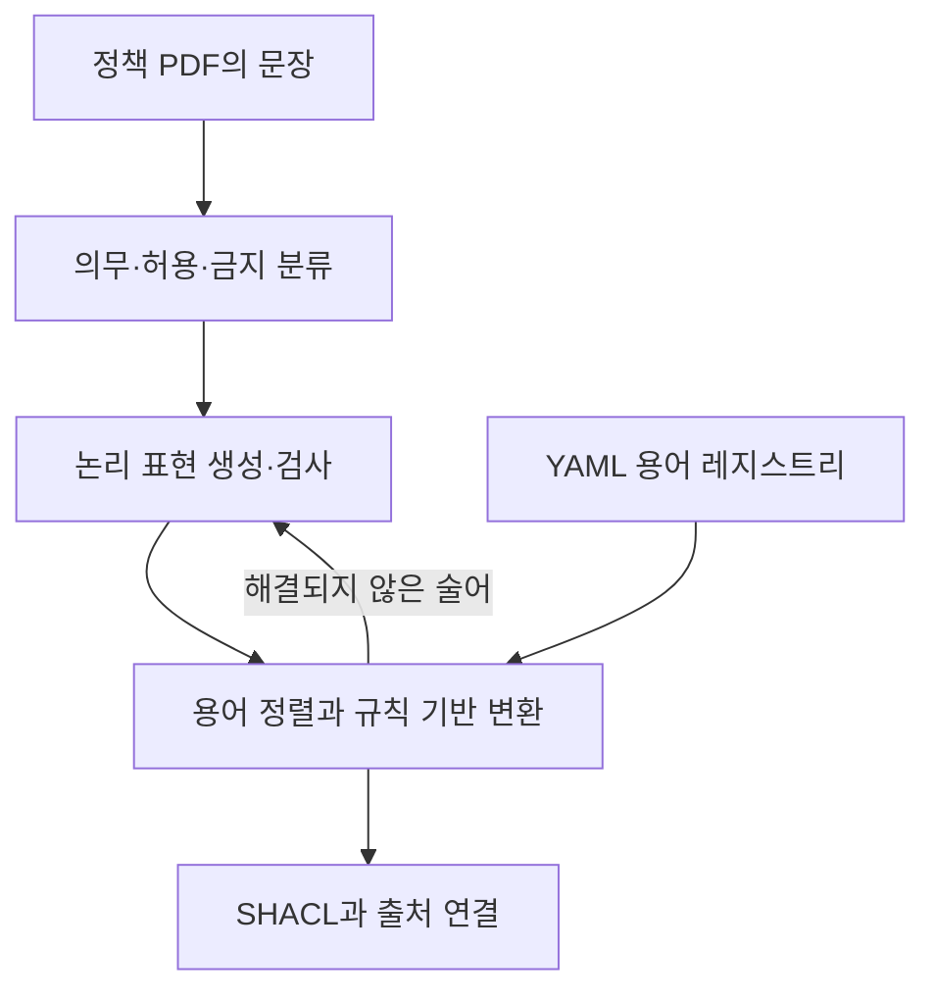

# PolicyKG 리뷰: 정책 문장의 의무·허용·금지를 SHACL로 옮기기

“등록금을 납부해야 한다”, “교외 거주를 허용한다”, “도서 훼손을 금지한다”는 모두 정책 문장이지만 시스템에서 확인할 조건은 다르다. PolicyKG는 이런 문장을 분류하고 논리 표현을 거쳐 SHACL로 옮긴다. 특히 자연어에서 만든 속성 이름을 실제 온톨로지의 용어에 맞추는 과정에 초점을 둔다.

## 논문 정보와 증거 수준

| 항목 | 내용 |
|---|---|
| 제목 | PolicyKG: An Agentic LLM Pipeline for Translating Institutional Policies into SHACL Knowledge Graphs |
| 저자 | Ponkrit Kaewsawee, Chaklam Silpasuwanchai, Chutiporn Anutariya |
| 소속 | Asian Institute of Technology |
| 읽은 판본 | arXiv v1, 2026년 8월 10일, 23쪽 |
| 발표 상태 | arXiv에 IJCKG 2026 심사 중으로 표기된 프리프린트 |
| 원문 | [논문](https://arxiv.org/abs/2608.09028v1) |

아래 수치는 저자의 보고이며 재현 실행을 하지 않았다. 심사 완료 논문의 확정 결과로 소개하지 않는다.

## 네 단계와 용어 레지스트리

파이프라인은 문서 추출, 의무·허용·금지 분류, 일차 논리와 의무 논리 표현, SHACL 변환으로 나뉜다. LangGraph가 단계와 실패 시 수정을 관리한다. 주 실험의 LLM은 로컬 Ollama로 실행한 Mistral 7B Instruct다. [원문 §4–5](https://arxiv.org/pdf/2608.09028v1#page=7)

Corpus Adapter는 클래스·속성·동의어를 담은 YAML 레지스트리, 선택 범위를 제한하는 prompt, 생성한 이름을 정규화하는 후처리로 구성된다. FOL에서 SHACL 구조를 내보내는 과정은 규칙 기반이며 용어 선택과 해결되지 않은 술어의 수정에 LLM이 관여한다. [원문 §4.4–4.5, Figures 2–3](https://arxiv.org/pdf/2608.09028v1#page=8)

예를 들어 모델이 `payFee`라고 쓴다고 실제 시스템에도 그 속성이 존재하는 것은 아니다. `tuitionPayment`가 공식 용어라면 둘의 대응을 정해야 한다. 비슷한 철자의 이름을 맞추는 것과 두 속성의 의미가 같음을 확인하는 것도 구별할 필요가 있다. 이 예시는 용어 정렬 문제를 설명하기 위해 구성했다.

## SHACL로 옮길 때의 의미 손실

논문은 의무를 필수 속성과 Violation 수준으로, 금지를 maxCount 0과 Violation 수준으로 표현하는 패턴을 제시한다. 허용은 Info 수준의 shape로 나타낸다. 예외 관계는 `deontic:overrides` 메타데이터로 남기지만 완전한 예외 추론은 후속 과제로 둔다. [원문 §4.4](https://arxiv.org/pdf/2608.09028v1#page=8)

이것은 선언한 정책 표현 방식이다. SHACL의 severity만 바꾼다고 허용의 모든 법적·논리적 의미가 구현되는 것은 아니다. 기한·예외·우선순위를 포함한 문장에서는 변환 결과가 실제 조건을 보존하는지 별도 검사가 필요하다. 구조가 같은 shape를 안정적으로 생성하는 능력과 정책을 올바르게 해석하는 능력은 다르다.

## 서로 다른 분모의 평가

기관 정책 문서 다섯 개, 81쪽에서 1,663문장을 추출하고 443개 규칙을 얻는다. 논문은 전체 규칙과 일부 평가 집합을 구분한다. [원문 §5.1·§6.3](https://arxiv.org/pdf/2608.09028v1#page=9)

| 평가 항목 | 범위 | 보고 결과 |
|---|---|---|
| SHACL 구문 유효성 | 전체 443규칙 | 401/443, 90.5% |
| FOL 경유 변환의 구조 정확성 | FOL 경로 351개 | 351/351 |
| 의무 유형과 severity 일치 | FOL 경로 351개 | 330/351, 94.0% |
| 양성·음성 테스트 개체에 대한 행동 평가 | 69개 shape 부분집합 | F1 0.866 |

구조 정확성 100%는 규칙 기반 출력 템플릿의 성질과 연결된다. 이를 전체 정책의 의미 정확도 100%로 읽을 수 없다. F1 0.866도 모든 443규칙을 행동 검사한 결과가 아니다. 기준 온톨로지·참조 shape가 같은 프로젝트에서 만들어졌으며 저자도 완전히 독립된 blind gold라고 주장하지 않는다.

## 도메인을 바꾸었을 때의 결과

수작업으로 선정한 GDPR 규칙 15개에서는 레지스트리 교체로 정확한 속성 정렬이 1/15에서 11/15로 증가한다. 반면 별도 임대차 문장 200개의 LexDeMod 평가에서는 분류 Macro F1이 0.370으로 낮아진다. “shall be entitled”처럼 허용을 나타내는 표현이 의무로 흡수되는 문제를 설명한다. [원문 §6.4·6.6](https://arxiv.org/pdf/2608.09028v1#page=15)

두 실험은 측정 대상이 다르다. GDPR 결과는 용어 정렬이고 LexDeMod 결과는 의무 유형 분류다. Stage 4의 레지스트리가 Stage 2의 잘못된 분류까지 자동으로 고쳤다는 결과로 합쳐서는 안 된다.

또 §6.3의 351개 산출물 정규화 전후 비교는 이미 만든 출력에 대한 정적 분석이다. 전체 파이프라인을 adapter 유무로 새로 실행한 비교와 구분해야 한다. 반복 실행에서 같은 해시가 나왔다는 결과도 같은 호스트·모델·버전 등 고정 조건에서 안정적이었다는 주장이다.

## 자동 생성 연구로서의 기여

정책 문장부터 논리 표현과 shape까지 연결을 남기고 용어 정렬을 별도 구성 요소로 다룬 점이 실용적이다. 동시에 원문은 분류·구문·구조·행동 평가의 성과가 서로 다를 수 있음을 보여준다. 자연어 정책을 실행 가능한 규칙으로 만들었다는 사실만으로 원래 정책의 뜻을 온전히 보존했다고 판단해서는 안 된다.

검토자의 관점에서 후속 재현의 우선순위는 참조 집합의 독립성, 전체 규칙에 대한 행동 평가 범위, 예외·기한의 표현 보존이다. 레지스트리를 작성·수정하는 사람의 작업량도 별도 측정이 필요하다. 이 글은 그러한 비용이 이미 검증되었다고 주장하지 않는다.
