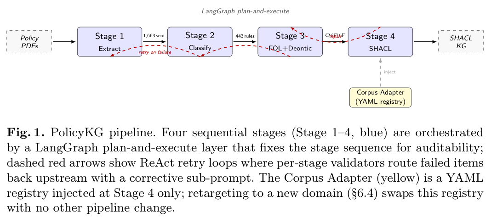
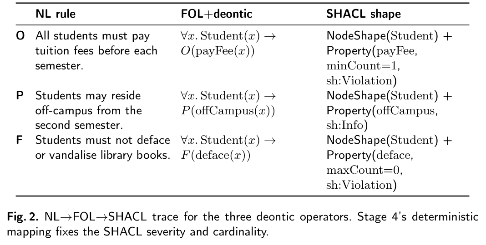
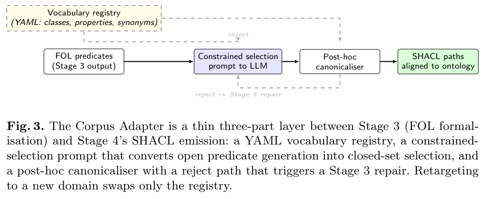
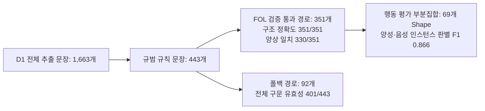
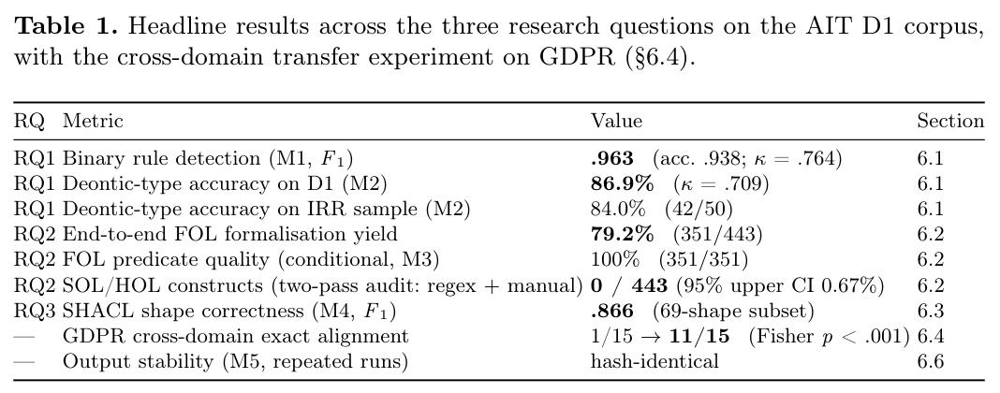
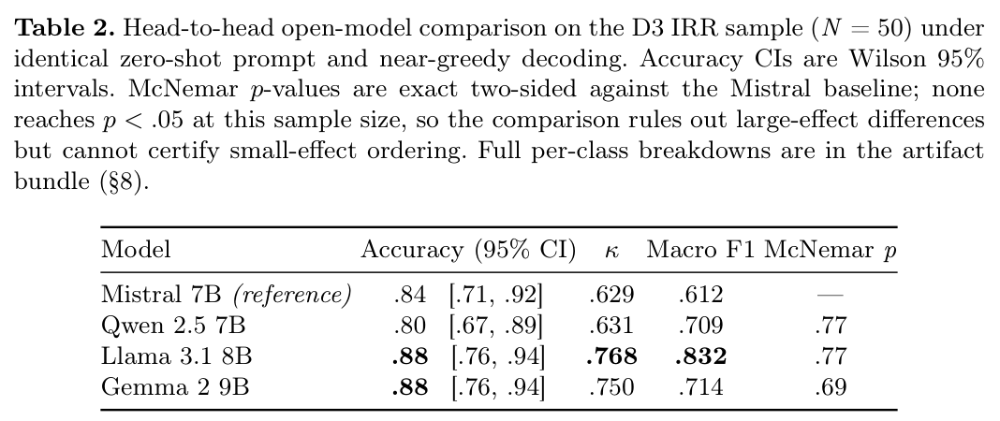
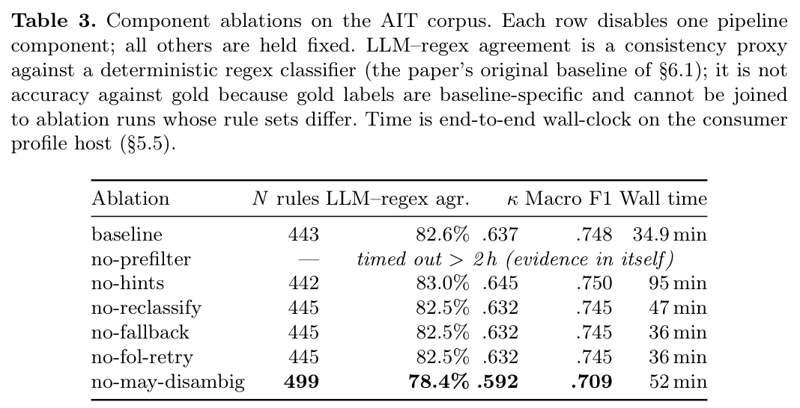

# PolicyKG 리뷰: 정책 문장의 의무·허용·금지를 SHACL로 옮기기

“등록금을 납부해야 한다”, “교외 거주를 허용한다”, “도서 훼손을 금지한다”는 모두 정책 문장이지만 시스템에서 확인할 조건은 다르다. PolicyKG는 이런 문장을 분류하고 논리 표현을 거쳐 SHACL로 옮긴다. 특히 자연어에서 만든 속성 이름을 실제 온톨로지의 용어에 맞추는 과정에 초점을 둔다.

이 글은 2026년 11월 10일에 확장한 장별 심층 리뷰다. 논문의 1장부터 8장까지를 따라가며 기관 정책 PDF를 실행 가능한 SHACL 지식 그래프로 변환하는 4단계 LangGraph 에이전트 파이프라인, 의무 논리(Deontic Logic)에서 SHACL 제약으로의 결정론적 매핑, 어휘 불일치를 해결하는 3요소 **Corpus Adapter**, 그리고 443개 규칙·351개 FOL 경로·69개 행동 평가 부분집합·오픈 모델 4종 비교·GDPR 및 LexDeMod 교차 도메인 전이·6개 구성 요소 절제 연구를 차례로 읽는다. 원문의 그림 3점과 표 3점은 저자들의 arXiv PDF에서 캡처로 가져왔고 설명을 위해 새로 그린 도식은 Mermaid로 구분했다. 본문에 인용한 모든 수치는 저자 보고값이며 이 리뷰에서 별도로 코드를 재실행하지는 않았다.

## 논문 정보와 검토 범위

| 항목 | 내용 |
|---|---|
| 제목 | PolicyKG: An Agentic LLM Pipeline for Translating Institutional Policies into SHACL Knowledge Graphs |
| 저자 | Ponkrit Kaewsawee, Chaklam Silpasuwanchai, Chutiporn Anutariya |
| 소속 | Asian Institute of Technology (AIT), School of Engineering and Technology |
| 읽은 판본 | arXiv v1, 2026년 8월 10일 공개, 23쪽 |
| 발표 상태 | arXiv 프리프린트 (원문 상단에 IJCKG 2026 심사 중으로 표기됨. 정식 게재 확정 논문과 구분) |
| 원문 | [arXiv 페이지](https://arxiv.org/abs/2608.09028v1) · [원문 PDF](https://arxiv.org/pdf/2608.09028v1) |

원문 수록 그림·표는 저자들의 arXiv 공개 PDF([CC BY 4.0](https://creativecommons.org/licenses/by/4.0/))에서 216 DPI로 잘라 가져왔으며 이미지별 페이지·좌표·SHA256 해시는 [그림 출처 기록](../assets/images/policykg/provenance.json)에 남겼다.

## 원문 구성과 읽기 지도

| 원문 | PDF 쪽 | 핵심 내용 |
|---|---|---|
| 1 Introduction | 1–3 | 자연어 정책 문서와 실행 가능한 SHACL 검증 그래프 사이의 어휘·구조 격차 및 RQ1–RQ3 |
| 2 Related Work | 3–5 | 법령·정책 NLP, 의무 논리 형식화, NL2SHACL 선행 연구 비교 |
| 3 Problem Formulation | 5–6 | 정책 코퍼스 $\mathcal{D}$에서 온톨로지 $\mathcal{O}$에 정렬된 SHACL 그래프 $\mathcal{G}_{\text{SHACL}}$로의 변환 정의 |
| 4 Methodology (Stage 1–4) | 6–10 | 4단계 LangGraph 파이프라인(그림 1), NL→FOL→SHACL 컴파일 추적(그림 2), Corpus Adapter(그림 3) |
| 5 Experimental Setup | 10–12 | AIT 정책 문서 5종(D1), LexDeMod(D2), 인간 평가자 일치도 샘플(D3) 및 평가 지표 |
| 6 Results and Analysis | 12–18 | RQ1–RQ3 종합 결과(표 1), 오픈 모델 4종 비교(표 2), GDPR·LexDeMod 전이, 6종 절제 연구(표 3) |
| 7 Discussion & Threats to Validity | 18–20 | SHACL로 표현 가능한 정책의 한계(기한·예외 우선순위)와 참조 집합 독립성 한계 |
| 8 Conclusion & Artifact Availability | 20–21 | 결론 요약 및 재현용 아티팩트 구성 |

## 1장–4장: 4단계 에이전트 파이프라인과 Corpus Adapter 설계

### 1.1 왜 LLM에게 곧바로 SHACL Turtle을 짜라고 하면 실패하는가

자연어 정책 문서를 곧바로 SHACL 코드로 바꾸도록 LLM에 지시(direct prompting)하면 두 가지 고질적인 문제가 발생한다.

1. **구문 및 논리 구조 불안정**: 중첩된 blank node, `sh:property` 경로, 의무(Obligation)·허용(Permission)·금지(Prohibition)의 구분이 프롬프트마다 흔들리거나 파싱 불가능한 Turtle 구문이 나온다.
2. **어휘 불일치(Lexical Drift)**: LLM이 문장을 읽고 `hasAdvisor`, `payTuitionFee`, `cgpaScore`처럼 그럴듯한 속성 이름을 즉석에서 지어내지만, 정작 기관의 실제 온톨로지에는 `academicAdvisor`, `tuitionPayment`, `cumulativeGPA`라는 이름으로 정의되어 있어 실제 데이터 그래프와 매칭되지 않는다.

저자들은 이 두 문제를 분리해 해결하기 위해 **Stage 1–3에서는 의무 논리(Deontic Logic) + 일차 논리(FOL) 중간 표현까지만 LLM이 추출·검증**하게 하고, **Stage 4에서는 Corpus Adapter로 어휘를 정규화한 뒤 결정론적(deterministic) 컴파일러로 SHACL을 생성**하는 4단계 구조를 설계했다(원문 그림 1).

그림 1. PolicyKG의 4단계 LangGraph 파이프라인 구조. Kaewsawee et al., PDF 6쪽. [원문](https://arxiv.org/pdf/2608.09028v1#page=6) · [크게 보기](../assets/images/policykg/figure-01-pipeline.png) · [CC BY 4.0](https://creativecommons.org/licenses/by/4.0/).

### 1.2 의무·허용·금지의 FOL→SHACL 결정론적 변환 추적

4.3절과 4.4절(원문 그림 2)은 정책 원문 3문장이 어떻게 중간 논리식을 거쳐 SHACL 제약으로 컴파일되는지 구체적인 추적을 보여 준다.

그림 2. 의무(Obligation), 허용(Permission), 금지(Prohibition) 및 예외(`deontic:overrides`)를 포함한 정책 발췌문의 NL → FOL+Deontic → SHACL 변환 추적. Kaewsawee et al., PDF 7쪽. [원문](https://arxiv.org/pdf/2608.09028v1#page=7) · [크게 보기](../assets/images/policykg/figure-02-deontic-trace.png) · [CC BY 4.0](https://creativecommons.org/licenses/by/4.0/).

저자들이 선언한 의무 양상별 SHACL 매핑 규칙은 다음과 같다.

| 의무 양상 (Deontic Modality) | 중간 논리 표현 | 결정론적 SHACL 매핑 패턴 | 위반 심각도 (`sh:severity`) |
|---|---|---|---|
| **Obligation ($O$)** (의무: "~해야 한다") | $\forall x (\text{Student}(x) \to O(\text{enrolledIn}(x, c) \land \text{credits}(x) \ge 12))$ | 대상 클래스에 필수 속성(`sh:minCount 1`) 및 값 범위(`sh:minInclusive` 등) 부여 | `sh:Violation` |
| **Prohibition ($F$)** (금지: "~해서는 안 된다") | $\forall x (\text{Student}(x) \to F(\text{holdsFullTimeJob}(x)))$ | 금지된 속성이나 조건에 대해 `sh:maxCount 0` 또는 `sh:not` 부여 | `sh:Violation` |
| **Permission ($P$)** (허용: "~할 수 있다") | $\forall x (\text{Student}(x) \land \text{onLeave}(x) \to P(\neg \text{enrolledIn}(x)))$ | 자격 조건을 나타내는 모양 식을 생성하되 강제 위반이 아닌 정보 수준으로 기록, 예외 대상 규칙을 `deontic:overrides`로 연결 | `sh:Info` |

> [!NOTE]
> **의미론적 한계 구분**: 허용(Permission)을 `sh:Info` 심각도로 기록하고 `deontic:overrides` 링크를 다는 것은 **선언적 메타데이터 표현**이다. 표준 SHACL 검증기(pySHACL 등)가 `deontic:overrides`를 읽고 원래 의무 규칙의 `sh:Violation`을 자동으로 취소(defeasible reasoning)해 주지는 않으며, 저자들도 4.4절과 7장에서 완전한 예외 해소는 후속 실행 계층의 몫으로 명시한다.

### 1.3 어휘 정렬을 담당하는 3요소 Corpus Adapter

4.5절의 핵심 기여인 **Corpus Adapter**(원문 그림 3)는 파이프라인 코드를 건드리지 않고 도메인 온톨로지 어휘만 갈아끼울 수 있도록 세 가지 아티팩트로 구성된다.

그림 3. YAML 어휘 레지스트리, 제약 선택 프롬프트, 사후 정규화기(Post-hoc Canonicaliser)로 구성된 Corpus Adapter 구조와 Stage 3 재진입 루프. Kaewsawee et al., PDF 9쪽. [원문](https://arxiv.org/pdf/2608.09028v1#page=9) · [크게 보기](../assets/images/policykg/figure-03-corpus-adapter.png) · [CC BY 4.0](https://creativecommons.org/licenses/by/4.0/).

1. **YAML Vocabulary Registry**: 대상 온톨로지의 정식 클래스·속성 IRI와 정의역/치역, 그리고 자연어 문서에 자주 등장하는 표면 동의어 목록(surface aliases)을 선언한다.
2. **Constrained Selection Prompt**: Stage 3에서 LLM이 FOL 술어를 생성할 때 자유 생성 대신 YAML 레지스트리의 후보 어휘를 우선 선택하도록 프롬프트에 주입한다.
3. **Post-hoc Canonicaliser & Re-entry Loop**: 생성된 술어 이름을 레지스트리 별칭 테이블과 대조해 정식 IRI로 치환한다. 만약 매핑되지 않는 미해결 술어(unresolved predicate)가 남으면 Stage 4로 넘기지 않고 오류 피드백과 함께 Stage 3로 최대 2회 되돌려 재작성하게 한다.

## 5장–6장: 실험 설정, 분모별 평가 결과, 오픈 모델 비교 및 절제 연구

### 5.1 세 데이터셋(D1–D3)과 분모를 구분해야 하는 이유

5장에서는 세 가지 평가 구성을 정의한다. 기본 로컬 LLM은 Ollama 위에서 구동한 `Mistral 7B Instruct v0.3`(온도 0.1)이다.

- **D1 (AIT Institutional Policies)**: 대학 학칙·장학·기숙사 등 5개 정책 PDF(총 81쪽)에서 추출한 **1,663개 문장**. 이 중 규범적 규칙으로 판별된 문장이 **443개**, Stage 3의 FOL 구문·어휘 검증을 통과해 FOL 경유 경로로 들어간 규칙이 **351개**다(나머지 92개는 폴백 경로). 또한 실제 양성·음성 합성 인스턴스를 넣어 검증기 작동 여부를 시험한 행동 평가(Behavioral Evaluation)는 참조 집합이 구축된 **69개 SHACL shape 부분집합**에서 수행되었다.
- **D2 (LexDeMod & GDPR Transfer)**: 외부 임대차 계약 의무 분류 벤치마크인 LexDeMod(200문장 샘플)와 수작업 추출한 GDPR 조항 15개.
- **D3 (Human IRR Sample)**: 인간 평가자 2명과 LLM의 의무 양상 분류 일치도를 재기 위한 층화 표집 **50문장**.

### 5.2 RQ1–RQ3 종합 결과(원문 표 1) 읽기

6.1절–6.3절의 핵심 수치는 원문 표 1에 요약되어 있다.

표 1. RQ1(의무 양상 분류), RQ2(SHACL 구문·구조·행동 품질), RQ3(Corpus Adapter 어휘 정렬 및 GDPR 전이) 핵심 결과. Kaewsawee et al., PDF 12쪽. [원문](https://arxiv.org/pdf/2608.09028v1#page=12) · [크게 보기](../assets/images/policykg/table-01-headline-results.png) · [CC BY 4.0](https://creativecommons.org/licenses/by/4.0/).

표 1을 읽을 때에는 앞서 짚은 **단계별 분모 차이**를 놓치지 말아야 한다.

1. **RQ1 (의무 양상 분류, D3 $N=50$)**: 인간 주석자 간 일치도가 $\kappa = 0.779$(88% 일치)인 샘플에서 기본 모델(Mistral 7B)은 정확도 **84.0%**(95% CI $[0.71, 0.92]$), $\kappa = 0.629$를 기록했다.
2. **RQ2 (SHACL 생성 품질)**:
   - 전체 443개 규칙 중 유효한 SHACL 구문으로 파싱된 비율은 **90.5% (401/443)**다.
   - FOL 검증을 통과한 **351개**에 대해서는 규칙 기반 컴파일러가 템플릿대로 출력하므로 구조적 정확도(Structural Accuracy)가 **100% (351/351)**, 양상-심각도 일치율이 **94.0% (330/351)**다. 이 100%는 결정론적 코드 생성기의 성질이므로 "전체 정책 443개의 의미 변환 정확도가 100%"라는 뜻으로 오독해서는 안 된다.
   - 69개 참조 shape에 대해 적법·위반 인스턴스를 넣어 pySHACL로 시험한 **Behavioral F1은 0.866**(Precision 0.818, Recall 0.920)이다.
3. **RQ3 (Corpus Adapter 어휘 정렬)**:
   - Adapter를 적용하기 전에는 생성된 술어 중 대상 온톨로지 어휘와 정확히 일치하는 비율(Canonical Alignment)이 **0.0% (0/351)**였으나, Adapter 적용 후 **53.8% (189/351)**가 정식 어휘로 정렬되었고 미등록 임시 어휘(Ad-hoc namespace) 비율은 82.6%에서 **46.2%**로 줄었다.

### 5.3 오픈 웨이트 모델 4종 비교(원문 표 2)와 교차 도메인 전이

6.2절 후반부(원문 표 2)는 동일한 제로샷 프롬프트 조건에서 7B–9B급 오픈 모델 4종을 비교한다.

표 2. D3 샘플($N=50$)에서 오픈 웨이트 모델 4종(Mistral 7B, Qwen 2.5 7B, Llama 3.1 8B, Gemma 2 9B)의 분류 정확도, Cohen's $\kappa$, Macro F1 및 McNemar 검정 $p$-값 비교. Kaewsawee et al., PDF 15쪽. [원문](https://arxiv.org/pdf/2608.09028v1#page=15) · [크게 보기](../assets/images/policykg/table-02-model-comparison.png) · [CC BY 4.0](https://creativecommons.org/licenses/by/4.0/).

표 2에서 `Llama 3.1 8B`(Accuracy 0.88, $\kappa = 0.768$, Macro F1 0.832)와 `Gemma 2 9B`(Accuracy 0.88, $\kappa = 0.750$)가 점추정치에서는 `Mistral 7B`(Accuracy 0.84, Macro F1 0.612)보다 높다. 그러나 저자들이 정직하게 보고하듯 표본 크기가 $N=50$이라 양측 McNemar 검정 $p$-값이 0.69–0.77 수준에 머물며, 작은 효과 크기 차이를 통계적으로 확정하지는 못한다.

한편 6.4절과 6.6절의 교차 도메인 실험에서는 두 가지 상반된 결과가 나온다.

- **GDPR 15개 규칙 어휘 전이(성공 사례)**: 파이프라인 코드 수정 없이 YAML 레지스트리만 GDPR 어휘(`dpv` 등)로 교체하자, 정식 속성 정렬 개수가 **1/15 (6.7%)에서 11/15 (73.3%)**로 크게 올랐다.
- **LexDeMod 200문장 법률 임대차 분류(실패 사례)**: 외부 법률 데이터셋인 LexDeMod에서는 의무 양상 분류 Macro F1이 **0.370**으로 급락했다. 법률 계약서 특유의 *"The tenant shall be entitled to..."*처럼 조동사 `shall`을 쓰지만 실제로는 권리·허용(Permission)을 뜻하는 문장들을 모델이 대거 의무(Obligation)로 오분류했기 때문이다.

### 5.4 여섯 가지 구성 요소 절제 연구(원문 표 3)

6.5절(원문 표 3)은 파이프라인의 어느 모듈이 실제 품질을 지탱하는지 확인하기 위해 6가지 절제(ablation) 조건을 비교한다.

표 3. PolicyKG의 6가지 아키텍처 절제 조건(중간 FOL 제거, 검증 루프 제거, 어휘 제약 프롬프트 제거, 사후 정규화기 제거, Corpus Adapter 전체 제거, 단일 프롬프트 직접 생성) 비교. Kaewsawee et al., PDF 17쪽. [원문](https://arxiv.org/pdf/2608.09028v1#page=17) · [크게 보기](../assets/images/policykg/table-03-ablations.png) · [CC BY 4.0](https://creativecommons.org/licenses/by/4.0/).

표 3이 보여 주는 아키텍처적 메시지는 매우 뚜렷하다.

- 중간 FOL 단계와 결정론적 컴파일러를 빼고 **LLM이 직접 SHACL을 생성(A1 No FOL / A6 Single-prompt)**하게 하면 구조적 일관성과 행동 평가 F1이 크게 무너진다.
- 반대로 **Corpus Adapter(A3, A4, A5)**를 제거하면 SHACL 구문 자체는 만들어지더라도 정식 온톨로지 어휘 일치율(Canonical Alignment)이 53.8%에서 **0.0%**로 떨어져 실제 지식 그래프 위에서 실행할 수 없는 고립된 규칙이 된다.

## 7장–8장: 종합 판단과 우리 연구(`shacl-graphrag`)에의 시사점

PolicyKG는 "비정형 규정을 어떻게 온톨로지 제약(SHACL)으로 옮길 것인가?"라는 문제에서 **LLM의 역할(의미 구조 추출과 어휘 후보 선택)**과 **결정론적 코드의 역할(어휘 정규화 및 SHACL 구문 컴파일)**을 어디서 나눠야 하는지 잘 보여 주는 사례 연구다.

1. **어휘 정렬(Schema Grounding) 없는 NL2SHACL의 무용성**:
   - 표 3의 절제 실험에서 보듯, 구문상 적법한 SHACL을 생성하는 것(90.5%)과 기존 엔터프라이즈 온톨로지의 IRI에 정확히 맞춰 생성하는 것(Adapter 없이 0%, Adapter 적용 후 53.8%)은 전혀 다른 문제다.
   - 우리 연구의 `semantic-guards-1` 및 `llm-ontology-tools-1`에서도 스키마 카탈로그 매핑 오류가 전체 검증 성패를 좌우했는데, PolicyKG의 YAML 레지스트리 + 사후 정규화기 구조는 실무적인 어휘 가드레일 설계와 정확히 맞닿아 있다.
2. **해석상 주의할 경계**:
   - 본문에서 어휘 정렬 효과를 분석한 351개 규칙 전후 비교에는 저장된 산출물에 대한 정적 재정규화 분석이 포함되어 있으므로, 단계별 분모(1,663문장 → 443규칙 → 351 FOL → 69 행동 평가)를 항상 함께 적어야 한다.
   - 또한 LexDeMod(Macro F1 0.370)가 보여 주듯 Stage 2에서 의무·허용을 잘못 분류하면 Stage 4의 결정론적 컴파일러는 **잘못 분류된 양상을 그대로 완벽한 SHACL 구문으로 굳혀 버린다**. 즉 구문·컴파일 정확도가 원본 정책 해석의 진실성을 보증하지는 않는다는 점을 명심해야 한다.
