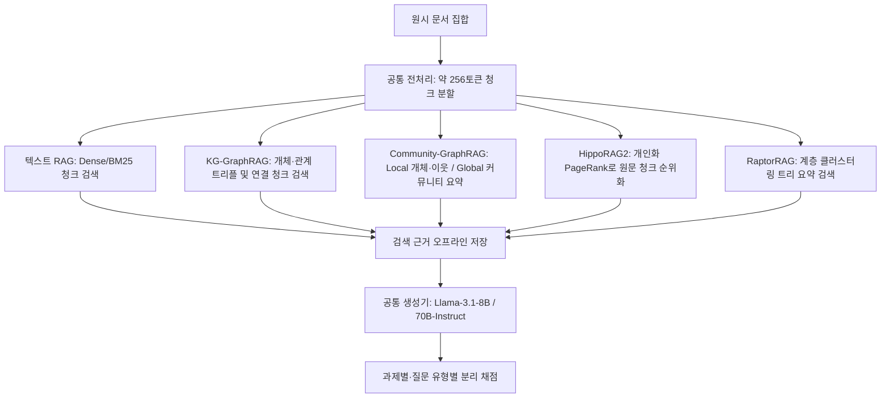
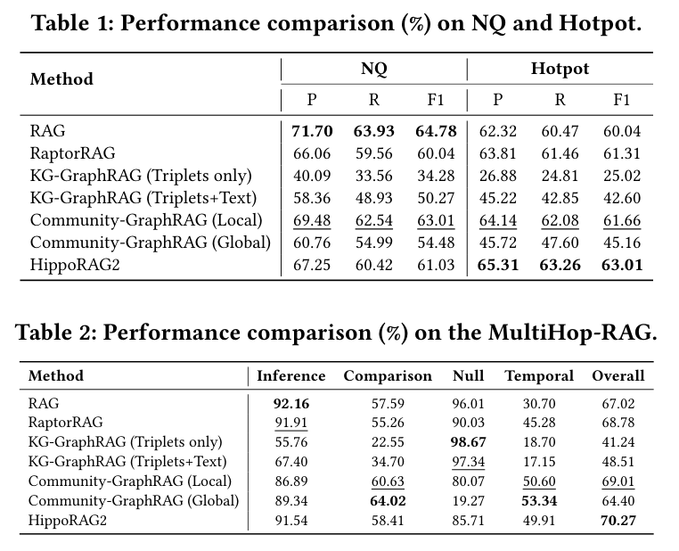
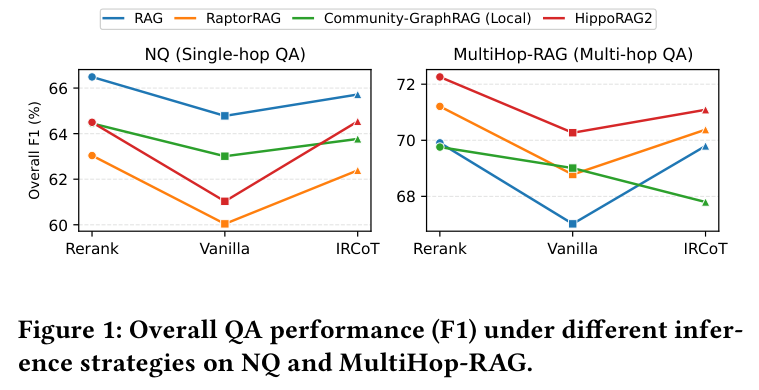
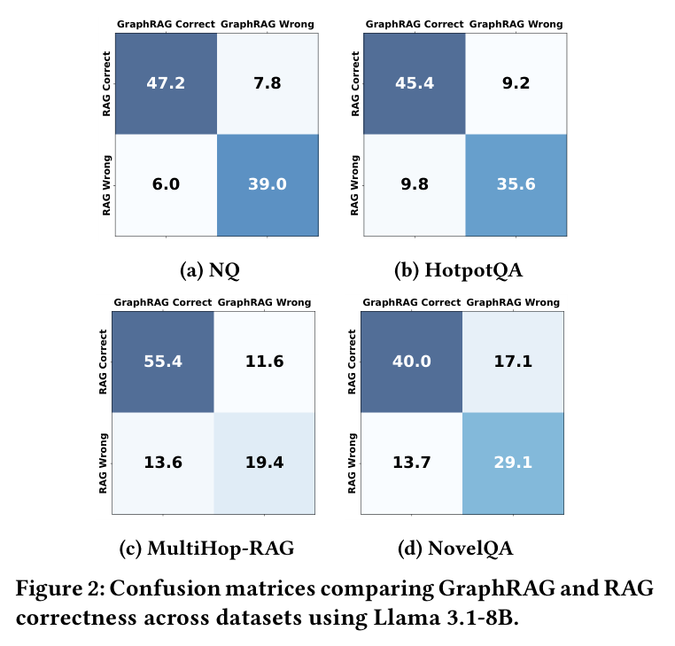
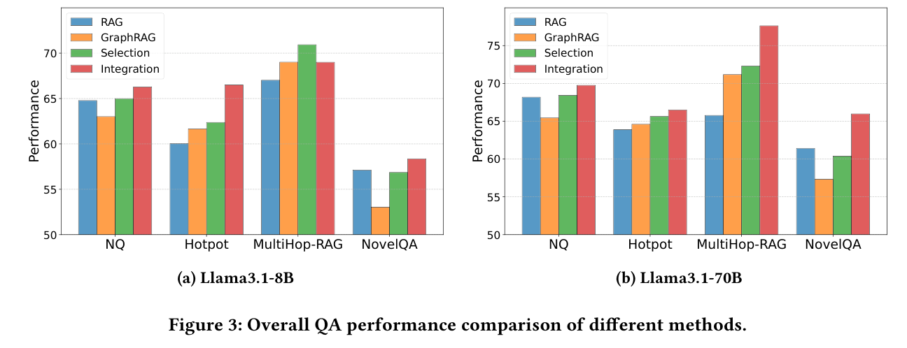
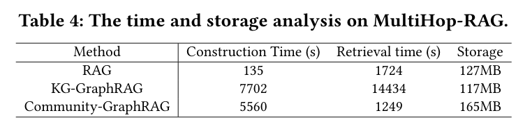

# RAG vs. GraphRAG 리뷰: 상세 질문·관계 질문·답 없는 질문의 차이

문서에서 사실을 바로 찾는 일과 여러 문서의 사건을 비교하는 일은 필요한 검색 방식이 다르다. 문서에 답이 없는 질문이라면 그 사실을 인정하는 능력도 필요하다. 이 논문은 RAG와 GraphRAG의 평균 성능을 비교하면서 평균에 가려진 질문별 차이를 따로 분석한다.

이 글은 2026년 11월 10일에 확장한 장별 심층 리뷰다. 논문의 1장부터 6장까지와 핵심 부록(부록 C, K, M)을 따라가며 단일 홉·다중 홉 질문 응답, 장문 소설 이해, 추상적 요약, RAG와 GraphRAG의 선택(Selection)·결합(Integration) 전략, 구축·검색 비용을 차례로 읽는다. 원문의 표 2점과 그림 3점은 저자들의 arXiv v3 PDF에서 캡처로 가져왔고 설명을 위해 새로 그린 도식은 Mermaid로 구분했다. 본문에 인용한 모든 수치는 v3 본문·부록의 저자 보고값이며 이 리뷰에서 별도로 코드를 재실행하지는 않았다.

## 논문 정보와 검토 범위

| 항목 | 내용 |
|---|---|
| 제목 | RAG vs. GraphRAG: A Systematic Evaluation and Key Insights |
| 저자 | Haoyu Han, Harry Shomer, Yu Wang, Yongjia Lei, Kai Guo, Zhigang Hua, Bo Long, Hui Liu, Jiliang Tang |
| 소속 | Michigan State University, Meta, Snap Inc., Amazon |
| 읽은 판본 | arXiv v3, 2026년 3월 4일 개정, 20쪽 (최초 공개 2025년 2월 17일) |
| 발표 상태 | 검토한 arXiv v3 판본을 기준으로 작성. PDF 상단 학회 머리글을 정식 게재 확정 정보로 단정하지 않음 |
| 원문·코드 | [arXiv 페이지](https://arxiv.org/abs/2502.11371v3) · [원문 PDF](https://arxiv.org/pdf/2502.11371v3) · [공개 저장소](https://github.com/haoyuhan1/RAGvsGraphRAG) |

이 글은 초기 판본(v1, v2)의 숫자를 v3 결과와 섞지 않는다. 원문 수록 그림·표는 저자들의 arXiv 공개 PDF([CC BY 4.0](https://creativecommons.org/licenses/by/4.0/))에서 216 DPI로 잘라 가져왔으며 이미지별 페이지·좌표·SHA256 해시는 [그림 출처 기록](../assets/images/rag-vs-graphrag/provenance.json)에 남겼다.

## 원문 구성과 읽기 지도

| 원문 | PDF 쪽 | 핵심 내용 |
|---|---|---|
| 1 Introduction | 1–2 | 텍스트 청크 기반 RAG와 그래프 구조 기반 GraphRAG의 공정 비교 필요성 |
| 2 Related Work | 2 | 기존 RAG 파이프라인과 최근 GraphRAG 변형(KG-GraphRAG, Community, HippoRAG2, RAPTOR) |
| 3 Experimental Settings | 2–3 | 공통 청크(256토큰), 임베딩(`text-embedding-ada-002`), 생성기(`Llama-3.1-8B/70B`), 7개 비교군 정의 |
| 4 Question Answering | 3–8 | NQ·HotpotQA·MultiHop-RAG·NovelQA 성능, 추론 전략(Vanilla/Rerank/IRCoT), 상호보완성, 선택·결합 실험, 구축·검색 비용 |
| 5 Summarization | 8–9 | Query-focused 요약(SQuALITY)과 Key-point 요약(KPR), LLM-as-a-Judge 위치 편향 분석 |
| 6 Conclusion & Future Work | 9 | 주요 발견 요약 및 하이브리드 검색 설계 시사점 |
| Appendices A–M | 13–20 | 그래프 커버리지 분석(부록 C), 70B 생성기 결과(부록 K), 검색 토큰 수 매칭 비교(부록 M) |

## 1장–3장: 공정한 비교를 위한 검색·생성 통제 설계

### 1.1 기존 비교의 공백과 다섯 가지 그래프 변형

검색 증강 생성(RAG)은 문서 청크를 임베딩 공간에 매핑해 질문과 의미적으로 가까운 조각을 가져온다. 반면 GraphRAG는 문서에서 개체와 관계, 혹은 계층적 커뮤니티 요약을 추출해 구조화된 연결을 따라 근거를 모은다. 문제는 각 GraphRAG 논문이 서로 다른 청크 크기, 임베딩 모델, 프롬프트, 백본 LLM을 사용해 자체 평가를 보고했다는 점이다. 결과 차이가 그래프 구조 덕분인지, 아니면 더 큰 생성 모델이나 다른 전처리 설정 때문인지 분리하기 어려웠다.

저자들은 이 혼선을 줄이기 위해 문서 분할, 임베딩 모델, 생성 스크립트, 채점 프롬프트를 통일한 상태에서 텍스트 RAG와 다섯 가지 GraphRAG 계열을 비교한다. [원문 §1–3](https://arxiv.org/pdf/2502.11371v3#page=2)

### 1.2 일곱 가지 비교군의 검색 단위 차이

3장에서 정의한 비교군들은 모두 그래프나 계층 트리를 활용하지만 최종적으로 생성기에 넘기는 **검색 단위(retrieval unit)**가 서로 다르다. 이 차이를 이해해야 뒤이은 4장의 성패 원인이 또렷하게 보인다.

| 비교군 | 그래프/인덱스 구조 | 생성기에 전달하는 최종 문맥 | 기본 검색 예산 ($k$) |
|---|---|---|---|
| **RAG** | 평면 텍스트 청크 벡터 인덱스 | 상위 $k$개 원문 청크 | $k=10$ 청크 |
| **KG-GraphRAG (Triple)** | LLM이 추출한 `(주어, 술어, 목적어)` 지식 그래프 | 질문 개체 주변 서브그래프의 **트리플 텍스트만** 전달 | 상위 트리플 집합 |
| **KG-GraphRAG (Text)** | 위와 동일한 지식 그래프 + 원문 청크 역색인 | 선택된 트리플과 **그 트리플이 추출된 원문 청크**를 함께 전달 | 트리플 + 원문 청크 |
| **Community-GraphRAG (Local)** | 개체·관계 설명 + 커뮤니티 계층 (Microsoft GraphRAG) | 질문과 매칭된 개체·관계 설명, 인접 커뮤니티 요약, 관련 원문 조각 | Local 문맥 예산 |
| **Community-GraphRAG (Global)** | 계층적 커뮤니티 요약 보고서 | 하위 커뮤니티 요약들을 Map-Reduce 방식으로 취합한 전역 요약 | Global Map-Reduce |
| **HippoRAG2** | 개체·구절(passage) 이분 그래프 + 개인화 PageRank(PPR) | 그래프 위에서 PPR 점수를 계산한 뒤 최종적으로는 **상위 $k$개 원문 청크**를 전달 | $k=10$ 청크 |
| **RaptorRAG** | 청크를 반복 클러스터링·요약해 만든 계층 트리 | 트리 전체 노드(원문 청크 + 중간 요약 노드) 중 상위 $k$개 검색 | $k=10$ 노드 |

공통 임베딩 모델은 `text-embedding-ada-002`이며, 그래프 구축(개체·관계 추출 및 커뮤니티 요약)과 최종 답변 생성에는 기본적으로 `Llama-3.1-8B-Instruct`를 사용한다(그래프 구축 모델이나 생성기를 `Llama-3.1-70B-Instruct` 및 `GPT-4o-mini`로 바꾼 실험은 4.7절과 부록 K에 수록). [원문 §3.2](https://arxiv.org/pdf/2502.11371v3#page=3)

## 4장: 질문 응답(QA)에서의 질문 유형별 격차와 상호보완성

### 4.1 단일 홉(NQ)과 다중 홉(HotpotQA, MultiHop-RAG) 결과 대조

4.1절과 4.2절은 단일 문서 안의 세부 사실을 묻는 Natural Questions(NQ)와 여러 문서에 걸친 추론을 요구하는 HotpotQA, MultiHop-RAG를 비교한다. 원문 표 1과 표 2에 전체 수치가 정리되어 있다.

표 1·표 2. NQ(단일 홉 QA)와 Multi-hop QA(HotpotQA, MultiHop-RAG)에서의 정확도(Acc) 및 F1 비교. Han et al., PDF 4쪽. [원문](https://arxiv.org/pdf/2502.11371v3#page=4) · [크게 보기](../assets/images/rag-vs-graphrag/table-01-02-nq-multihop.png) · [CC BY 4.0](https://creativecommons.org/licenses/by/4.0/).

표 1과 표 2에서 가장 먼저 눈에 띄는 현상은 세 가지다.

1. **단일 홉 세부 사실 질문(NQ)에서는 기본 텍스트 RAG가 가장 높다**: 표 1에서 RAG는 Accuracy 58.62%, F1 64.79%로 모든 GraphRAG 변형을 앞선다. 특히 트리플만 넘기는 `KG-GraphRAG (Triple)`은 F1이 40.91%로 급락한다. 원문 문장을 개체·관계 트리플로 압축하는 과정에서 질문이 요구하는 수식어나 부가 조건이 빠져나가기 때문이다. 실제로 저자들이 부록 C(표 8)에서 NQ 정답 개체가 구축된 지식 그래프에 존재하는지 조사한 결과, 정답이 그래프 노드에 아예 포함되지 않은 비율이 상당수 확인되었다. 원문 청크를 함께 붙이는 `KG-GraphRAG (Text)`(F1 55.34%)나 PPR로 원문 청크를 뽑는 `HippoRAG2`(F1 61.03%)가 그나마 손실을 줄인다.
2. **다중 홉 질문(HotpotQA, MultiHop-RAG)에서는 그래프 기반 경로가 강세를 보인다**: 표 2의 HotpotQA에서 `HippoRAG2`는 전체 F1 69.51%(비교 질문 76.00%, 교량 질문 67.85%)를 기록해 기본 RAG(전체 F1 62.66%)를 6.85%p 앞선다. 여러 문서 조각에 흩어진 교량 개체(bridge entity)를 찾을 때 개인화 PageRank가 단일 임베딩 유사도보다 유리하기 때문이다.
3. **평균 점수에 가려진 답 없는 질문(Null)과 시간 질문(Temporal)의 정반대 성향**: MultiHop-RAG에는 추론(Inference), 비교(Comparison), 시간(Temporal), 그리고 문서에 근거가 없어 답변을 거부해야 하는 **Null 질문**이 함께 들어 있다.
   - `Community-GraphRAG (Local)`과 `Global`은 시간 질문에서 각각 F1 55.66%(Acc 50.60%), F1 58.95%(Acc 53.34%)를 얻어 기본 RAG(F1 36.68%, Acc 30.70%)를 크게 앞선다.
   - 그러나 **Null 질문**에서는 기본 RAG가 Accuracy 96.01%로 정확히 답변을 보류한 반면, `Community-GraphRAG (Local)`은 80.07%, `Global`은 **19.27%**까지 떨어진다. 추상화된 커뮤니티 요약 보고서가 관련 주제를 넓게 서술하다 보니, 생성 모델이 직접적인 근거가 없는데도 그럴듯한 추측 답변을 만들어 내는 과잉 일반화(over-generalization)가 일어난 것이다.

> [!IMPORTANT]
> 이 결과는 GraphRAG 전체의 본질적 한계를 뜻하기보다, **원문 구절을 요약문이나 트리플로 대체했을 때 근거 부재 판별(abstention)이 얼마나 취약해지는지**를 보여 준다. 요약 계층을 쓰더라도 최종 판정 단계에서는 원문 구절의 명시적 증거 유무를 대조하는 절차가 필요하다.

### 4.2 추론 전략(Vanilla, Rerank, IRCoT)을 바꿨을 때의 변화

4.2절 후반부와 원문 그림 1은 기본 생성(Vanilla) 대신 검색 결과를 재순위화하는 **Rerank**(`bge-reranker-large`로 상위 5개 선별)와 다단계 사고 연쇄 검색인 **IRCoT**(Interleaved Retrieval with Chain-of-Thought)를 적용했을 때 순위가 어떻게 달라지는지 보여 준다.

그림 1. NQ(좌)와 MultiHop-RAG(우)에서 추론 전략(Rerank, Vanilla, IRCoT)에 따른 F1 변화. Han et al., PDF 4쪽. [원문](https://arxiv.org/pdf/2502.11371v3#page=4) · [크게 보기](../assets/images/rag-vs-graphrag/figure-01-inference-strategies.png) · [CC BY 4.0](https://creativecommons.org/licenses/by/4.0/).

그림 1을 보면 단일 홉인 NQ에서는 Rerank나 IRCoT를 붙여도 기본 RAG(파란 선)가 여전히 가장 위에 머문다. 반면 MultiHop-RAG에서는 기본 RAG에 IRCoT나 Rerank를 결합하면 F1이 67%대에서 약 70% 근처로 뛰어오르며 `Community-GraphRAG (Local)`과의 격차를 상당 부분 좁힌다. 다만 `HippoRAG2`(빨간 선) 역시 Rerank와 결합했을 때 72% 이상으로 함께 상승해 다중 홉 선두를 유지한다. 즉 다단계 검색 루프(IRCoT)는 평면 RAG의 다중 홉 약점을 보완해 주지만, 그래프 기반 초기 후보 확장(HippoRAG2)과 결합될 때에도 추가 이득을 준다.

### 4.3 장문 소설 이해(NovelQA)와 상호보완성 혼동 행렬

4.3절(표 3)은 평균 길이 수만 토큰에 이르는 소설 텍스트를 다루는 NovelQA 결과를 분석한다. 여기서는 `Community-GraphRAG (Local)`이 전체 정확도 52.86%로 가장 높고, 기본 RAG(46.81%)와 `HippoRAG2`(47.25%)가 그 뒤를 잇는다. 세부 내용을 묻는 단일 홉(Single-hop)과 세부 묘사(Detail)에서는 RAG와 Local이 팽팽하지만, 소설 여러 대목에 걸친 다중 홉(Multi-hop)에서는 Local이 52.17%로 RAG(40.58%)를 크게 앞선다.

더 흥미로운 대목은 4.4절의 **질문별 정오답 교차 분석(원문 그림 2)**이다.

그림 2. 네 벤치마크(NQ, HotpotQA, MultiHop-RAG, NovelQA)에서 RAG와 두 GraphRAG(Community Local, HippoRAG2)가 함께 맞히거나 한쪽만 맞힌 질문 비율(%). Han et al., PDF 6쪽. [원문](https://arxiv.org/pdf/2502.11371v3#page=6) · [크게 보기](../assets/images/rag-vs-graphrag/figure-02-confusion-matrices.png) · [CC BY 4.0](https://creativecommons.org/licenses/by/4.0/).

그림 2를 보면 평균 점수가 비슷해 보이는 벤치마크에서도 한쪽만 맞히는 비율이 10%에서 20% 가까이 존재한다. 예를 들어 NQ에서 RAG만 맞히고 `Community-GraphRAG (Local)`이 틀린 질문이 **15.8%**인 동시에, 반대로 Local만 맞히고 RAG가 틀린 질문도 **13.5%**나 된다. NovelQA에서도 RAG만 맞힌 질문이 **12.5%**, Local만 맞힌 질문이 **18.5%**다. 두 방식이 찾아내는 근거의 성격이 다르기 때문에 상호보완할 여지가 크다는 뜻이다.

### 4.4 RAG와 GraphRAG의 결합: Selection과 Integration

4.5절은 이러한 상호보완성을 실제 파이프라인에서 활용하는 두 가지 단순 전략을 실험한다(원문 그림 3).

그림 3. RAG와 GraphRAG를 결합하는 두 가지 방법: 질문 분류기로 한 경로만 고르는 Selection과 두 검색 결과를 합치는 Integration(상단), 그리고 네 벤치마크에서의 F1 성능 비교(하단). Han et al., PDF 7쪽. [원문](https://arxiv.org/pdf/2502.11371v3#page=7) · [크게 보기](../assets/images/rag-vs-graphrag/figure-03-selection-integration.png) · [CC BY 4.0](https://creativecommons.org/licenses/by/4.0/).

- **Selection (질문 라우팅)**: LLM 분류기(혹은 학습된 경량 라우터)가 질문을 보고 세부 사실 탐색이면 RAG를, 다중 개체 연결·전역 맥락 질문이면 GraphRAG를 선택해 **한 경로만 실행**한다. 검색 실행 비용은 단일 모델과 거의 같으면서도 네 벤치마크 모두에서 단일 RAG나 단일 GraphRAG보다 높은 F1을 달성한다.
- **Integration (문맥 통합)**: RAG가 가져온 청크와 GraphRAG가 가져온 문맥을 합쳐서 생성기에 넣는다. 그림 3 하단 막대그래프에서 보듯 Integration(보라색·갈색 막대)이 가장 높은 점수를 내지만, 매 질문마다 두 검색 파이프라인을 모두 돌리고 입력 토큰도 두 배로 늘어나는 비용을 치른다.

> [!TIP]
> 부록 M(표 15)에서 저자들은 Integration이 잘 되는 이유가 단순히 입력 토큰 수가 두 배로 늘어나서인지 확인하기 위해, 단일 RAG의 $k$를 늘려 Integration과 토큰 수를 맞춘 비교를 추가로 제시한다. 토큰 수를 맞춰도 Integration이 단일 RAG($k=20$)보다 일관되게 높은 점수를 보여, 단순 문맥 길이 증가가 아니라 **청크 유사도와 그래프 경로라는 이질적 근거의 결합 효과**임을 뒷받침한다.

### 4.5 인덱싱·검색 시간과 저장 공간 비용, 그리고 백본 모델 영향

4.6절(표 4)은 HotpotQA 데이터셋에서 각 방법의 그래프 구축(Indexing) 시간, 검색(Retrieval) 시간, 디스크 저장 용량을 비교한다.

표 4. HotpotQA에서 방법별 인덱싱 시간, 검색 시간, 저장 공간 비교. Han et al., PDF 8쪽. [원문](https://arxiv.org/pdf/2502.11371v3#page=8) · [크게 보기](../assets/images/rag-vs-graphrag/table-04-time-storage.png) · [CC BY 4.0](https://creativecommons.org/licenses/by/4.0/).

표 4를 읽을 때에는 측정 단위를 정확히 봐야 한다.

- 기본 텍스트 **RAG**는 LLM 추출 없이 임베딩만 계산하므로 인덱싱에 **55초**, 저장 공간 **81MB**만 든다.
- 반면 모든 청크에 대해 LLM으로 개체·관계를 추출해야 하는 **KG-GraphRAG**, **Community-GraphRAG**, **HippoRAG2**는 인덱싱에만 **11,590초에서 13,562초(약 3.2시간–3.8시간)**가 걸린다.
- 특히 `Community-GraphRAG (Global)`은 질의 시점에도 다수의 커뮤니티 요약을 대상으로 Map-Reduce 생성을 수행하므로 전체 검색·중간 생성 시간이 **48,895초**로 폭증한다. (여기서 표 4의 Retrieval Time은 평가 질문 전체 배치를 처리한 누적 시간으로, 단일 질의 지연 시간과 혼동하면 안 된다.)
- 이어지는 4.7절(표 5)에서 그래프 구축 LLM을 `Llama-3.1-8B` 대신 `Llama-3.1-70B`나 `GPT-4o-mini`로 바꾸면 추출된 그래프 품질이 올라가면서 QA 성능도 소폭 상승하지만, 구축 시 LLM 호출 비용과의 교환 관계를 따져야 한다.

## 5장: 요약 과제(Summarization)와 LLM-as-a-Judge 위치 편향

5장은 질의 초점 요약인 **SQuALITY**와 핵심 요점 요약인 **KPR(Key-Point Recall)**을 평가한다(표 6, 표 7, 그림 4).

1. **핵심 요점 포함률(KPR, 표 7)**: 문서 전체의 핵심 논점을 빠짐없이 짚어내야 하는 KPR에서는 계층적 요약을 갖춘 `Community-GraphRAG (Global)`(57.24%)과 `RaptorRAG`(55.71%)가 기본 RAG(51.49%)보다 높은 점수를 기록한다. 문서 곳곳에 흩어진 하위 주제를 클러스터링·요약 노드로 미리 묶어 둔 구조가 전역 요약에 실제로 도움을 준다는 뜻이다.
2. **SQuALITY와 LLM 심판의 순서 편향(표 6, 그림 4)**: SQuALITY에서는 두 요약문을 놓고 `GPT-4o-mini` 심판에게 어느 쪽이 더 나은지 판정하게 했다. 그런데 저자들이 프롬프트에 넣는 두 요약문의 **제시 순서(A 먼저 vs. B 먼저)**를 뒤집어 보자 승패 결과가 크게 흔들렸다(원문 그림 4). 특히 길고 포괄적인 문장을 생성하는 Global 요약은 심판 모델의 위치 편향과 장문 선호 편향에 민감하게 반응했다. 저자들은 요약 평가에서 단일 순서의 LLM-as-a-Judge 승률만 보고 우열을 단정해서는 안 된다고 경고한다. [원문 §5.2](https://arxiv.org/pdf/2502.11371v3#page=9)

## 6장: 종합 판단과 우리 연구(`shacl-graphrag`)에의 시사점

이 논문이 남긴 가장 실용적인 교훈은 **"GraphRAG가 RAG보다 좋은가?"라는 질문을 "어떤 구조적 변환이 어떤 질문 유형에서 정보를 잃거나 얻는가?"로 바꾸어 놓았다**는 점이다.

| 질문·작업 특성 | 유리한 검색 표현 | 실패 위험과 주의점 |
|---|---|---|
| 단일 문서 내 세부 조건·수치 확인 (NQ류) | 원문 청크 직접 검색 (RAG) | 트리플이나 커뮤니티 요약으로만 압축하면 세부 수식어가 탈락함 |
| 여러 문서의 교량 개체 연결 (HotpotQA류) | 그래프 경로 + 원문 청크 보존 (HippoRAG2 등) | 트리플만 전달하고 원문 청크를 빼면 생성 정확도가 떨어짐 |
| 시간 순서 비교 및 전역 주제 요약 | Community-GraphRAG (Local/Global), RAPTOR | 구축 비용이 수백 배 높고, Global Map-Reduce는 질의 비용도 큼 |
| 근거 부재 시 답변 거부 (Null 질문) | 원문 청크 대조 (RAG: 96.01%) | 추상 요약문(Global: 19.27%)만 주면 LLM이 환각 답변을 생성함 |

다만 이 결과를 읽을 때에도 두 가지 경계를 분명히 지켜야 한다. 첫째, 이 논문에서 비교한 그래프는 모두 비정형 텍스트에서 LLM이 확률적으로 추출한 어휘 그래프나 커뮤니티 트리다. 정형 데이터베이스나 명시적 온톨로지·SHACL 제약이 걸린 엔터프라이즈 지식 그래프와는 오류 양상이 다르다. 둘째, 자연어 다중 홉 QA에서 F1이 높다는 결과는 검색 후보 확장(recall)이 잘 되었다는 뜻이지, 비즈니스 규칙이나 자격 조건을 형식적으로 검증(validation)했다는 뜻이 아니다. 우리 연구가 다루는 하이브리드 파이프라인 설계에서는 이 논문이 보여 준 **원문 청크 보존의 중요성**과 **요약 기반 응답의 미근거 답변(Null 실패) 위험**을 핵심 통제 변수로 삼을 수 있다.
