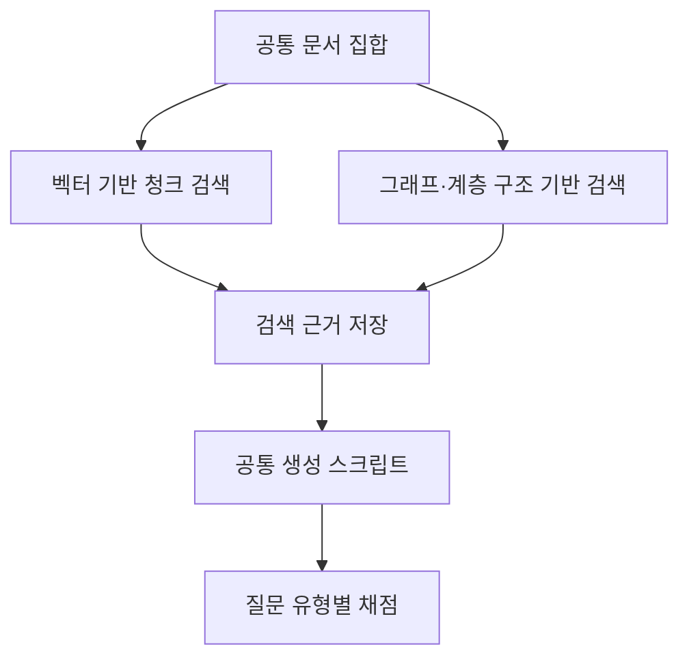

# RAG vs. GraphRAG 리뷰: 상세 질문·관계 질문·답 없는 질문의 차이

문서에서 사실을 바로 찾는 일과 여러 문서의 사건을 비교하는 일은 필요한 검색 방식이 다르다. 문서에 답이 없는 질문이라면 그 사실을 인정하는 능력도 필요하다. 이 논문은 RAG와 GraphRAG의 평균 성능을 비교하면서 평균에 가려진 질문별 차이를 따로 분석한다.

## 논문 정보와 판본

| 항목 | 내용 |
|---|---|
| 제목 | RAG vs. GraphRAG: A Systematic Evaluation and Key Insights |
| 저자 | Haoyu Han 외 공동저자 |
| 읽은 판본 | arXiv v3, 2026년 3월 4일 개정, 20쪽 |
| 최초 공개 | 2025년 2월 17일 |
| 발표 상태 | 검토한 arXiv 판본을 기준으로 작성. PDF의 임시 학회 서식을 정식 게재 정보로 사용하지 않음 |
| 원문·코드 | [논문](https://arxiv.org/abs/2502.11371v3) · [공개 저장소](https://github.com/haoyuhan1/RAGvsGraphRAG) |

이 글은 초기 판본의 결과를 개정판에 섞지 않는다. 아래 수치는 v3 본문 표 기준이며 코드를 재실행한 결과가 아니다.

## 공통 생성기로 비교하는 검색 방식

저자는 검색 결과를 먼저 저장한 다음 공통 생성 스크립트로 답을 만든다. 약 256토큰 청크, text-embedding-ada-002, 기본 top-k 10을 사용하며 가능한 범위에서 조건을 맞춘다. 생성기는 Llama-3.1-8B-Instruct와 70B-Instruct이고 본문 주요 표는 8B 결과다. [원문 §3](https://arxiv.org/pdf/2502.11371v3#page=3)

비교하는 그래프도 한 종류가 아니다. 트리플만 검색하는 방식, 트리플과 원문을 함께 검색하는 방식, 커뮤니티 요약을 이용하는 방식, 그래프로 원문 청크 검색을 돕는 HippoRAG2, 계층 요약 구조를 사용하는 RAPTOR를 구분한다.

도식은 비교 절차를 간추린 것이다. 검색 단위가 청크·트리플·요약으로 다르면 같은 top-k라도 전달하는 정보량은 같지 않다. 논문은 부록 M에서 고정 검색 토큰 예산도 별도로 다룬다.

## 평균 점수와 답 없는 질문

MultiHop-RAG에는 추론·비교·시간·Null 질문이 있다. Null은 자료가 답을 제공하지 않아 정보 부족으로 답해야 하는 유형이다. 다음은 v3 Table 2의 일부 결과이며 단위는 %다.

| 방법 | 전체 정확도 | Null 정확도 | 시간 질문 정확도 |
|---|---:|---:|---:|
| RAG | 67.02 | 96.01 | 30.70 |
| Community-GraphRAG Local | 69.01 | 80.07 | 50.60 |
| Community-GraphRAG Global | 64.40 | 19.27 | 53.34 |
| HippoRAG2 | 70.27 | 85.71 | 49.91 |

Local은 전체와 시간 질문에서 RAG보다 높은 점수를 얻지만 Null에서는 낮다. Global 역시 시간 질문의 이득과 답 없는 질문의 실패가 함께 나타난다. 전체 평균만 보면 이런 차이를 놓치기 쉽다. [원문 §4.1–4.2, Table 2](https://arxiv.org/pdf/2502.11371v3#page=4)

이 결과가 모든 GraphRAG의 답변 보류 능력을 규정하지는 않는다. 질문 분포와 검색·생성 설정을 고정한 실험에서 관찰한 차이다. 충분한 근거가 있는 질문을 불필요하게 보류하는 경우까지 함께 봐야 실제 응답 정책을 평가할 수 있다.

## 그래프를 만드는 동안 사라지는 정보

트리플 검색 방식의 약점은 생성 이전에 나타난다. 문서에 있던 세부 정보가 개체·관계 추출 단계에서 빠지면 이후 그래프 탐색으로는 되찾기 어렵다. 저자는 NQ와 HotPotQA에서 정답 개체의 그래프 포함 여부를 조사하고 그래프의 불완전한 포괄 범위를 원인 중 하나로 논의한다. [원문 §4.2, 부록 C](https://arxiv.org/pdf/2502.11371v3#page=4)

예를 들어 계약서의 “갱신일부터 30일 이내”라는 조건을 계약자와 계약 관계만으로 압축하면 시간 조건이 사라질 수 있다. 이 예시는 표현 손실을 설명하기 위한 것이다. 원문 청크를 함께 보존하면 해당 문장으로 돌아갈 수 있지만 검색·문맥 비용은 늘어난다.

## 선택과 결합의 비용

논문은 질문에 따라 RAG 또는 GraphRAG를 고르는 Selection과 두 검색 결과를 함께 쓰는 Integration을 검토한다. 두 방식이 맞힌 질문이 완전히 같지 않기 때문에 결합 여지가 생긴다. Integration은 매 질문마다 두 경로를 실행하는 비용이 발생한다. Selection은 분류기를 거쳐 선택한 검색 경로 하나만 실행한다. [원문 §4.4–4.6](https://arxiv.org/pdf/2502.11371v3#page=5)

구축·검색·저장 비용도 별도 표로 보고한다. 여기서 표에 적힌 Retrieval time을 확인 없이 개별 질문의 평균 지연으로 바꿔 소개하지 않는 것이 중요하다. 처리한 질문 수와 측정 단위를 함께 확인해야 다른 시스템과 비교할 수 있다.

## 리뷰의 판단

이 논문의 설계에서 유용한 부분은 검색 결과를 보존한 뒤 같은 생성 경로로 평가하고 질문 유형·검색 표현·추가 검색 전략을 나눠 보는 절차다. 그래프를 사용하는지보다 어떤 근거를 얼마나 보존했는지가 결과를 설명하는 데 중요하다.

다만 서로 다른 GraphRAG 구현은 한 가지 요소만 바꾼 실험이 아니다. 이 결과로 그래프라는 자료구조 자체의 효과나 RDF·Neo4j의 우열을 판정할 수 없다. 자연어 다단계 답변 능력과 형식 논리 추론기의 정확성도 별개다. 이 구분을 유지하면 논문은 특정 도구 추천보다 검색 파이프라인을 진단하는 자료로 읽힌다.
