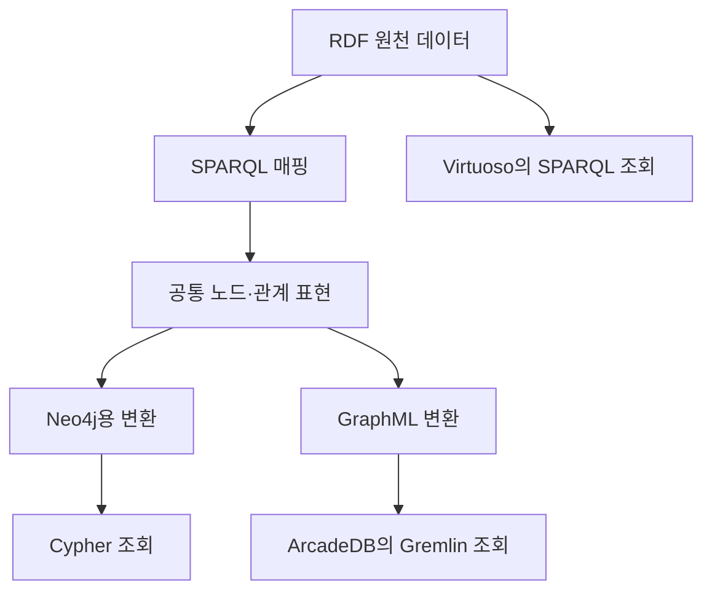

# rdf2pg 리뷰 — 같은 지식 그래프를 RDF와 속성 그래프로 조회하기

생물학 연구자가 유전자와 질병 사이의 연결을 찾는다고 하자. 데이터를 공개하고 다른 기관의 식별자와 연결하려면 RDF가 편리하다. 관계를 따라 탐색하는 응용 프로그램에서는 속성 그래프가 익숙할 수 있다. 하나를 고르면 다른 하나를 포기해야 할까. rdf2pg 논문은 같은 지식을 여러 그래프 시스템에서 조회할 수 있게 만드는 접근을 다룬다.

## 논문 정보와 검토 범위

| 항목 | 내용 |
|---|---|
| 제목 | Managing FAIR Knowledge Graphs as Polyglot Data End Points: A Benchmark based on the rdf2pg Framework and Plant Biology Data |
| 저자 | Marco Brandizi, Carlos Bobed, Luca Garulli, Arné de Klerk, Keywan Hassani-Pak |
| 소속 | Rothamsted Research, University of Zaragoza·I3A, Arcade Data Ltd |
| 읽은 판본 | 2025년 5월 23일 공개된 arXiv v1, 19쪽 |
| 발표 상태 | 이 글에서는 프리프린트로 취급. PDF의 저널 서식만으로 게재 확정을 판단하지 않음 |
| 원문 | [arXiv와 PDF](https://arxiv.org/abs/2505.17498v1) |

본문의 변환 구조와 비교 실험을 검토했다. 아래 결과는 저자가 보고한 측정이며 이 리뷰에서 DB를 설치하거나 벤치마크를 재실행하지는 않았다.

## RDF에서 노드와 관계를 고르는 방법

RDF는 주어·술어·목적어 트리플로 정보를 표현한다. 속성 그래프는 노드와 관계 각각에 속성을 붙인다. 따라서 파일 확장자만 바꿔서는 같은 의미가 유지되지 않는다. 특히 관계의 출처나 근거를 표현한 RDF 구조를 어떤 관계 속성으로 옮길지 결정해야 한다.

rdf2pg는 이 결정을 SPARQL 매핑으로 명시한다. 노드 식별자를 고르는 질의, 노드 속성을 가져오는 질의, 관계의 식별자·유형·양 끝을 고르는 질의, 관계 속성을 가져오는 질의가 기본 단위다. 입력은 Jena TDB에서 읽고 처리기는 이를 공통 LPG 표현으로 만든 뒤 Neo4j용 명령이나 GraphML로 변환한다. 매핑은 데이터셋과 도메인에 맞춰 작성한다. [원문 §2, 그림 1–3](https://arxiv.org/pdf/2505.17498v1#page=4)

그림은 원문의 구조를 간추려 다시 그린 것이다. RDF 직접 조회 경로와 LPG 변환 경로가 나뉜다. 변환된 데이터가 원천과 같은 업무 질문에 답하는지 확인하는 일이 비교의 전제다.

## 식물 생물학 데이터의 비교 조건

논문은 유전자 주석, 표현형, 생물학적 경로 등을 포함한 세 데이터셋을 사용한다. 규모는 약 200만·2,100만·9,700만 RDF 트리플이며 유사한 스키마를 공유한다. 질의는 다섯 범주의 25개로 구성하고 SPARQL·Cypher·Gremlin 표현을 맞췄다. [원문 §3.1·3.3](https://arxiv.org/pdf/2505.17498v1#page=10)

| 비교 대상 | 논문에서 사용한 판본 | 접근 경로 |
|---|---|---|
| Virtuoso Open Source | 7.2.10-r16 | RDF 직접 적재, SPARQL |
| Neo4j Community | 5.11.0 | rdf2neo 변환, Cypher |
| ArcadeDB | 23.4.1 | GraphML 적재, Gremlin |

이 표는 논문 당시의 실험 구성이다. 최신 제품의 지원 범위나 성능표로 읽어서는 안 된다. 적재 시간에도 서로 다른 경로가 반영된다. RDF를 바로 읽는 시간과 SPARQL로 읽고 변환하는 시간을 비교하면 변환 비용까지 함께 측정된다.

## 측정 결과의 해석

저자는 많은 질의에서 Neo4j가 빨랐고 경로 탐색에서 강점을 보였다고 보고한다. Virtuoso는 RDF·SPARQL 중심 접근의 유효한 선택으로 평가한다. ArcadeDB의 Gremlin 경로는 여러 경우 느렸으며 탐색 순서와 결과 제한 위치에 민감했다. [원문 §3.3, 그림 6–7](https://arxiv.org/pdf/2505.17498v1#page=10)

여기서 결과 제한이 중요하다. 논문은 다수 질의에서 처음 100개 결과를 가져오는 조건을 설명한다. 탐색 중간에 100개로 제한하는 것과 전체 탐색 후 100개를 반환하는 것은 실행량뿐 아니라 반환 집합에도 영향을 줄 수 있다고 지적한다. 따라서 빠른 응답이 항상 같은 전체 답을 계산한 결과인지는 별도로 확인해야 한다.

예를 들어 단백질 복합체의 구성원과 근거 문서를 찾는 질의에서, 근거 없는 경로를 먼저 잘라낸 결과와 마지막에 걸러낸 결과는 달라질 수 있다. 이 예시는 질의 의미를 맞추는 이유를 설명하기 위한 것이며 추가 실험 결과는 아니다.

## 비교의 강점과 남은 범위

이 연구의 강점은 RDF와 LPG를 추상적으로 논쟁하지 않고 실제 데이터·명시적 매핑·대응 질의로 비교했다는 데 있다. 매핑과 적재도 응용 시스템의 비용으로 드러난다.

다만 DB 엔진과 질의 언어가 함께 바뀌므로 성능 차이를 언어 하나의 효과로 분리할 수는 없다. 유사한 스키마의 식물 데이터에서 얻은 결과이며 임의의 RDF 전체에 대한 무손실 변환 증명으로 확대할 수도 없다. OWL 추론기나 SHACL 보고서의 효용, 사용자의 유지보수 시간도 이 실험의 성능 지표가 아니다.

서로 다른 시스템을 비교할 때 먼저 고정해야 할 것은 제품명이 아니라 반환할 개체·관계·속성의 의미다. 이 논문은 그 작업을 재현 가능한 매핑으로 남기는 방법을 제공한다. [원문 §4–5](https://arxiv.org/pdf/2505.17498v1#page=15)
