# rdf2pg 리뷰 — 같은 지식 그래프를 RDF와 속성 그래프로 조회하기

RDF로 통합한 지식을 Neo4j에서도 탐색하고 싶다면 무엇을 옮겨야 할까. 트리플을 노드와 간선으로 바꾸는 것만으로 충분할까. rdf2pg 논문은 이 문제를 **도메인별 SPARQL 매핑과 여러 그래프 DB의 대응 질의**로 다룬다. 관계의 근거를 어디에 담을지, 같은 질문을 다른 언어로 어떻게 표현할지까지 변환의 일부로 본다.

이 글은 2026년 11월 6일에 확장한 리뷰다. 논문의 장 순서대로 문제·구현·실험·이론·한계를 읽는다. 원문 그림은 캡처로, 설명을 위해 새로 만든 그림은 Mermaid로 구분했다. 아래 성능은 저자들의 측정이며 이 리뷰에서 벤치마크를 재실행한 결과가 아니다.

## 논문 정보와 검토 범위

| 항목 | 내용 |
|---|---|
| 제목 | Managing FAIR Knowledge Graphs as Polyglot Data End Points: A Benchmark based on the rdf2pg Framework and Plant Biology Data |
| 저자 | Marco Brandizi, Carlos Bobed, Luca Garulli, Arné de Klerk, Keywan Hassani-Pak |
| 소속 | Rothamsted Research, University of Zaragoza·I3A, Arcade Data Ltd |
| 읽은 판본 | 2025년 5월 23일 공개된 arXiv v1, 19쪽 |
| 발표 상태 | 이 글에서는 프리프린트로 취급. PDF의 저널 서식만으로 게재 확정을 판단하지 않음 |
| 원문 | [arXiv와 PDF](https://arxiv.org/abs/2505.17498v1) |

원문 그림의 출처는 위 저자들의 arXiv v1이다. 해당 판본은 CC BY-NC-SA 4.0으로 공개되어 있다. 이 리뷰의 해설과 새 도식에도 같은 라이선스를 적용한다. 이는 이 글에 대한 표시이며 저장소 전체의 라이선스를 변경하지 않는다. 원문 그림 1·3은 논문이 인용한 저자들의 프로젝트 위키 자료를 바탕으로 한다. 이미지별 페이지·잘라낸 좌표·파일 해시는 [그림 출처 기록](../assets/images/rdf2pg/provenance.json)에 남겼다.

## 원문 구성과 읽기 지도

| 원문 | PDF 쪽 | 핵심 질문 |
|---|---|---|
| 1 Introduction, 1.1 Motivational use cases | 1–3 | RDF와 LPG를 함께 쓰려는 이유 |
| 2 Technologies and methods | 3–5 | 변환에 쓰는 기술과 표현 방식 |
| 3.1 Test datasets | 5–6 | 어떤 데이터에서 비교했는가 |
| 3.2 Qualitative considerations | 6–10 | 매핑과 질의가 실제로 어떻게 달라지는가 |
| 3.3 Performance benchmark | 10–11, 그림은 12–14 | 적재·질의 비용의 차이 |
| 3.4 Theoretical considerations | 11–12 | 의미 보존과 정보 보존의 조건 |
| 4 Discussion, 4.1 Related work | 13, 15–16 | 적용 범위와 기존 변환 방식의 차이 |
| 5 Conclusions and future work | 16 | 입증한 범위와 후속 과제 |

아래 표들은 독해를 위해 새로 정리한 표다. 원문의 실험 결과는 주로 그림 6·7에 제시되어 있어 수치를 임의로 옮겨 적은 표 대신 원본 그래프를 함께 싣는다.

## 1장 — 공유할 지식과 조회할 구조

### 1.1 RDF와 LPG의 역할

RDF는 URI로 개체와 관계를 식별하고 서로 다른 기관의 데이터를 연결하기에 적합하다. LPG, 즉 속성 그래프는 노드뿐 아니라 관계 자체에도 속성을 붙일 수 있어 응용 프로그램의 경로 탐색을 간결하게 표현할 수 있다. 저자들은 이 둘 중 하나를 표준으로 강제하기보다 RDF로 통합한 지식을 여러 조회 지점으로 제공하려 한다. 제목의 *polyglot data end points*는 이 뜻이다.

FAIR는 데이터를 찾고 접근하고 상호운용하고 재사용할 수 있게 하자는 원칙이다. 그러나 RDF로 저장했다는 사실만으로 FAIR의 모든 요건을 충족하는 것은 아니다. 이 논문에서 관심을 두는 부분은 공유 가능한 식별자·어휘를 유지하면서 응용에 맞는 접근 방식을 제공하는 일이다.

### 1.2 두 가지 동기 사례

첫 사례는 식물 생물학 플랫폼 KnetMiner다. 연구자는 유전자에서 단백질, 생물학적 과정, 문헌으로 이어지는 연결을 따라 후보 유전자의 근거를 찾는다. 논문에서 말하는 semantic motif는 이런 의미 있는 경로 패턴이다. 이것을 OWL 추론기가 새로운 사실을 도출하는 과정과 혼동해서는 안 된다.

두 번째는 기업의 기술·역량 정보다. 직원이 어떤 기술을 어느 정도 갖추었는지 표현할 때 단순한 직원→기술 연결 외에 숙련도 같은 관계 정보가 필요하다. RDF에서 이 관계를 별도 자원으로 표현했다면 LPG에서는 관계 속성으로 보여주는 편이 응용에 알맞을 수 있다. 이 사례는 동기를 설명한다. 뒤의 식물 데이터 성능 실험과 동일한 정량 평가를 했다는 뜻은 아니다. [원문 §1–1.1](https://arxiv.org/pdf/2505.17498v1#page=1)

## 2장 — 트리플을 응용 그래프로 바꾸는 방법

2장은 기술적 배경을 설명하고 구체적인 구조는 3.2절의 그림 1–3에서 보여준다. 여기서는 배경과 구현을 연결해서 읽는다.

### 2.1 관계에 붙은 근거의 위치

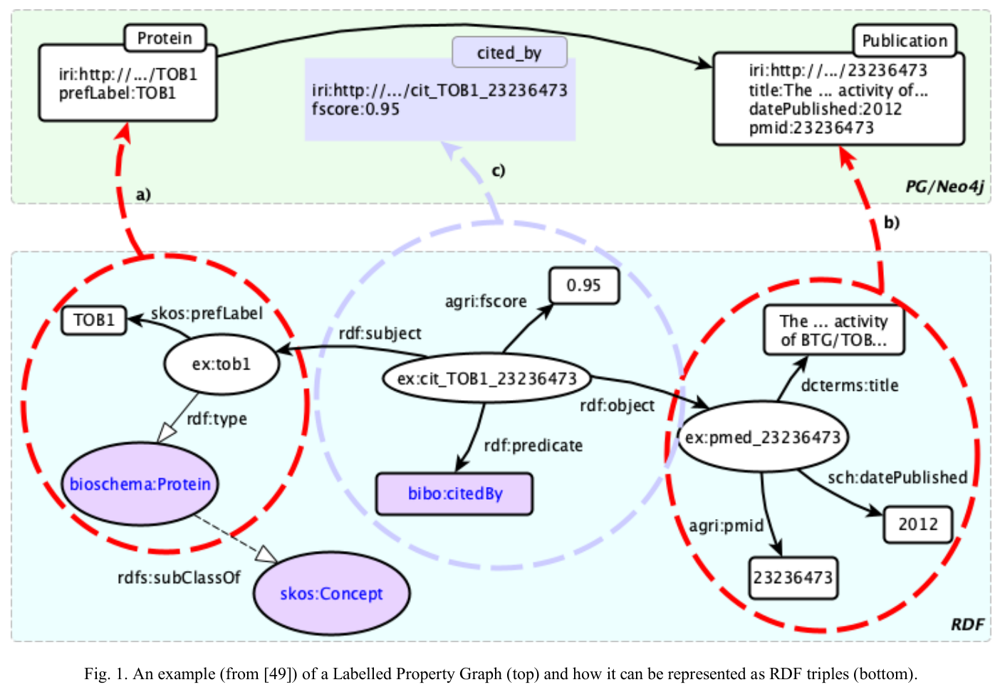

그림 1. RDF 표현과 LPG 표현, 관계를 별도 자원으로 표현한 reification 예시. Brandizi 외, PDF 6쪽. [원문](https://arxiv.org/pdf/2505.17498v1#page=6) · [크게 보기](../assets/images/rdf2pg/figure-01-rdf-lpg.png) · [CC BY-NC-SA 4.0](https://creativecommons.org/licenses/by-nc-sa/4.0/). PDF에서 그림 영역을 잘라 이미지로 변환했으며 그림의 내용·축·범례는 수정하지 않았다.

그림 1에서는 가운데 관계 표현을 살펴볼 필요가 있다. 단백질 TOB1과 문헌 23236473을 연결하면서 fscore 0.95라는 값을 붙인다. 이 값은 그림의 예시 속성이지 논문의 검색 정확도나 벤치마크 점수가 아니다.

RDF reification에서는 관계를 설명하는 자원을 만들고 주어·술어·목적어와 추가 속성을 연결한다. 이를 기계적으로 옮기면 LPG에도 중간 노드가 남는다. rdf2pg는 SPARQL로 이 구조를 읽어 단백질→문헌 관계 하나와 그 관계의 속성으로 묶을 수 있다. 저장 형식을 바꾸면서 응용에서 다룰 관계의 단위도 정한다.

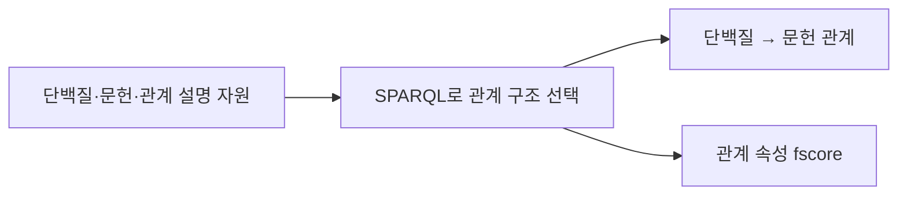

위 도식은 원문 그림 1의 변환 의도를 간추린 것이다. 어떤 자원을 하나의 관계로 묶을지는 매핑 작성자가 결정한다. 자연어에서 온톨로지를 자동으로 발견했다는 결과는 아니다.

### 2.2 SPARQL 매핑의 네 가지 역할

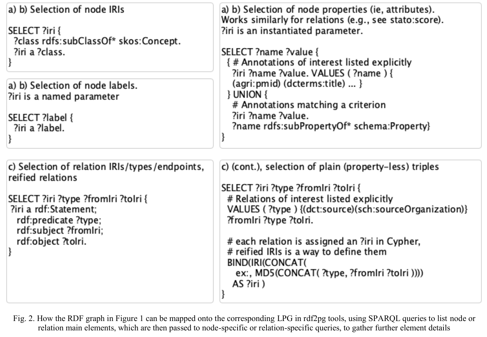

그림 2. 노드·관계와 각각의 속성을 추출하는 SPARQL 예시. Brandizi 외, PDF 7쪽. [원문](https://arxiv.org/pdf/2505.17498v1#page=7) · [크게 보기](../assets/images/rdf2pg/figure-02-sparql-mapping.png) · [CC BY-NC-SA 4.0](https://creativecommons.org/licenses/by-nc-sa/4.0/). PDF에서 그림 영역을 잘라 이미지로 변환했으며 그림의 내용·축·범례는 수정하지 않았다.

| 역할 | 매핑이 선택하는 정보 | 필요한 이유 |
|---|---|---|
| 노드 선택 | 노드로 만들 자원의 URI | 모든 RDF 자원이 응용 노드가 되는 것은 아님 |
| 노드 속성 | 레이블, 키와 값 | 표시 이름과 검색용 속성을 구성 |
| 관계 선택 | 관계 식별자·유형·시작점·끝점 | 여러 트리플을 하나의 관계로 묶을 수 있음 |
| 관계 속성 | 관계에 연결된 키와 값 | 근거·점수 등 관계 자체의 정보 보존 |

그림에는 레이블 질의 등이 별도 상자로 나뉘어 있어 상자 수와 위 역할 수가 같지는 않다. URI를 먼저 고른 뒤 속성을 가져오는 구조가 중요하다. 일반 트리플처럼 관계 자원의 URI가 없는 경우에는 예시처럼 해시를 이용해 관계 식별자를 만들 수도 있다.

이 방식은 유연하지만 매핑을 작성할 SPARQL 지식이 필요하다. 관계를 선택하는 질의에서 빠진 정보는 대상 그래프에 저절로 복원되지 않는다. 도메인별 매핑은 변환 도구의 입력이자 검토 대상이다.

### 2.3 처리기와 출력 핸들러

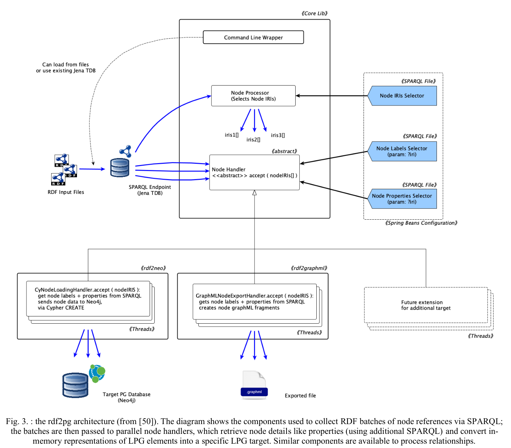

그림 3. rdf2pg의 노드 처리기와 출력 핸들러 구조. Brandizi 외, PDF 8쪽. [원문](https://arxiv.org/pdf/2505.17498v1#page=8) · [크게 보기](../assets/images/rdf2pg/figure-03-architecture.png) · [CC BY-NC-SA 4.0](https://creativecommons.org/licenses/by-nc-sa/4.0/). PDF에서 그림 영역을 잘라 이미지로 변환했으며 그림의 내용·축·범례는 수정하지 않았다.

그림 3에는 구현의 처리 흐름이 담겨 있다. 입력 RDF는 Jena TDB에 놓인다. 선택 질의로 얻은 URI를 묶어 처리하고 노드 처리기가 추가 질의로 레이블과 속성을 가져온다. 출력 핸들러는 이 공통 정보를 Neo4j용 명령이나 GraphML 요소로 바꾼다. 관계도 이에 대응하는 처리 경로를 갖는다.

데이터를 고르는 매핑과 대상 형식에 쓰는 코드를 분리했으므로 새로운 출력 대상을 추가할 때 노드·관계 핸들러를 구현하는 방식으로 확장할 수 있다. 다만 새 DB에 연결된다는 것과 그 DB에서 동일한 성능·질의 의미가 검증됐다는 것은 별개다. Jena TDB는 이 변환 경로의 입력 저장소이며 아래 세 DB 성능 비교에서 별도의 질의 엔진 조건은 아니다.

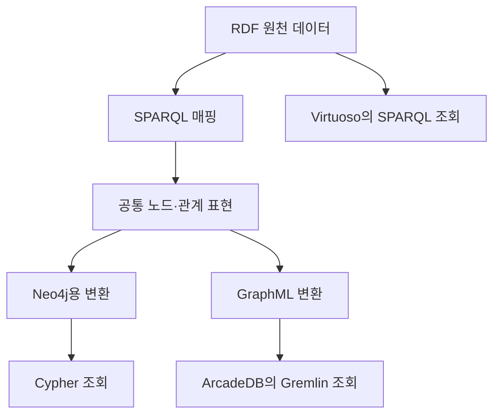

기존 리뷰의 위 도식도 남겼다. 원문 그림 3이 클래스와 처리 흐름을 보여준다면 이 도식은 RDF 직접 조회와 LPG 변환 조회가 어디서 갈라지는지를 보여준다.

## 3장 — 데이터, 질의, 성능과 보존 조건

### 3.1 세 식물 데이터셋

원문은 약 200만·2,100만·9,700만 RDF 트리플 규모의 세 데이터셋을 비교한다. 크기만 다르고 아무 관계도 없는 세 도메인이 아니라, 생물학 개체와 관계를 포함하는 유사한 스키마의 데이터다.

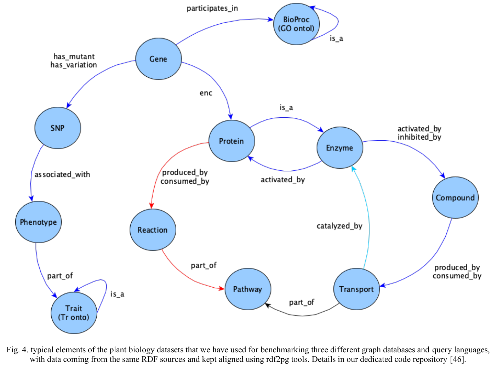

그림 4. 유전자·단백질·반응·경로·표현형을 잇는 생물학 스키마. Brandizi 외, PDF 9쪽. [원문](https://arxiv.org/pdf/2505.17498v1#page=9) · [크게 보기](../assets/images/rdf2pg/figure-04-biology-schema.png) · [CC BY-NC-SA 4.0](https://creativecommons.org/licenses/by-nc-sa/4.0/). PDF에서 그림 영역을 잘라 이미지로 변환했으며 그림의 내용·축·범례는 수정하지 않았다.

그림 4에서 Gene, Protein, Reaction, Pathway 등을 따라가 보면 질의가 단순 문서 검색과 다른 이유를 알 수 있다. 개별 속성 검색뿐 아니라 여러 종류의 관계를 연속해서 따라가는 질문을 만들 수 있다.

트리플 수는 입력 RDF의 규모다. 변환 후 노드·관계 수와 같은 단위가 아니다. 관계 설명 자원을 간선 속성으로 묶으면 물리적 개수가 달라져도 같은 응용 정보를 담을 수 있다. 따라서 두 DB에 같은 숫자의 레코드를 넣었다는 것보다 어떤 정보와 질문을 대응시켰는지를 확인해야 한다. 그림 6은 biopax·ara·poaceae, 그림 7 범례는 biopax·ara·cereals라는 표기를 사용한다. 원본 표기를 그대로 남겼다.

### 3.2 세 질의 언어의 표현 차이

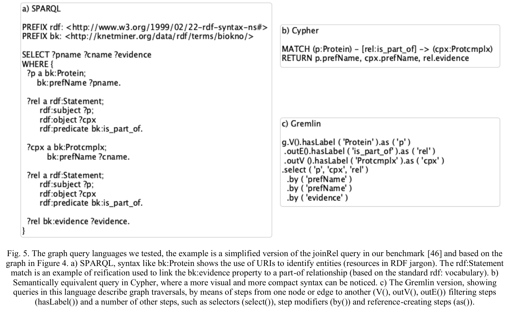

그림 5. 단백질과 복합체의 연결을 SPARQL·Cypher·Gremlin으로 표현한 예시. Brandizi 외, PDF 11쪽. [원문](https://arxiv.org/pdf/2505.17498v1#page=11) · [크게 보기](../assets/images/rdf2pg/figure-05-query-languages.png) · [CC BY-NC-SA 4.0](https://creativecommons.org/licenses/by-nc-sa/4.0/). PDF에서 그림 영역을 잘라 이미지로 변환했으며 그림의 내용·축·범례는 수정하지 않았다.

SPARQL 예시는 관계를 설명하는 RDF 자원까지 패턴에 포함한다. Cypher는 노드와 관계를 경로 모양으로 쓰고 관계 속성을 직접 조건에 넣는다. Gremlin은 출발점에서 연결을 따라 이동하고 걸러내는 단계를 이어 쓴다. 같은 질문이라도 데이터 표현과 언어가 함께 달라져 코드 모양과 실행 경로가 달라진다.

원문 코드는 캡처 그대로다. 이 글에서 실행 검증하거나 방향·구문을 교정한 코드가 아니므로 바로 붙여 넣을 예제로 제시하지 않는다. 독해할 때는 각 언어가 관계의 근거를 어디에서 읽는지에 주목하면 된다.

| 비교 지점 | 원문을 읽을 때 볼 부분 |
|---|---|
| 관계의 부가 정보 | 중간 RDF 자원을 탐색하는지, 관계 속성을 직접 읽는지 |
| 탐색 방향 | 후보 수가 적은 쪽에서 출발할 수 있는지 |
| 집계 | 경로 탐색과 그룹·평균 계산을 어떻게 결합하는지 |
| 선택적 경로 | 일부 연결이 없어도 앞부분의 결과를 남기는지 |

저자들은 효소와 단백질 사이 탐색 방향, 경로별 집계, 선택적 연결 등을 예로 든다. 이 절의 작성 편의성 평가는 구현 경험에 바탕을 둔 정성적 논의다. 사용자를 모집해 개발 시간을 비교한 실험으로 읽어서는 안 된다.

### 3.3 성능 비교의 실험 조건

| 항목 | 논문 조건 |
|---|---|
| RDF DB | Virtuoso Open Source 7.2.10-r16, SPARQL |
| LPG DB | Neo4j Community 5.11.0, Cypher |
| 다중 모델 DB | ArcadeDB 23.4.1, Gremlin |
| 변환 도구 | rdf2pg 5.0 |
| 계산 환경 | Xeon Gold 6152 2.10 GHz, 8코어 VM |
| 메모리 설정 | DB별 32 GB, 도구용 별도 32 GB |
| 질의 구성 | 개수 4·선택 6·합집합 6·집계 4·경로 5, 총 25개 |

메모리는 실행 환경 설정이지 실측 최대 사용량이 아니다. 제품 판본도 논문 당시 조건이며 오늘의 최신 버전 비교가 아니다.

#### 적재 시간과 변환 비용

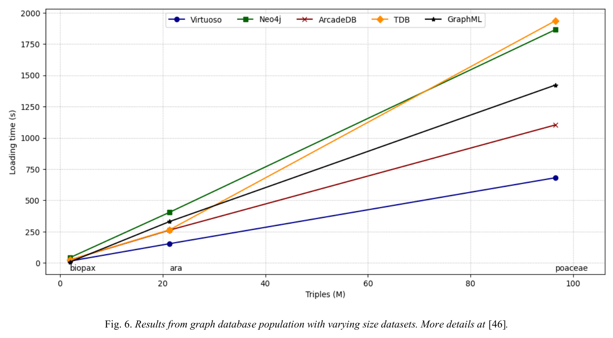

그림 6. 데이터 규모별 적재 및 중간 변환 단계의 시간. Brandizi 외, PDF 12쪽. [원문](https://arxiv.org/pdf/2505.17498v1#page=12) · [크게 보기](../assets/images/rdf2pg/figure-06-loading.png) · [CC BY-NC-SA 4.0](https://creativecommons.org/licenses/by-nc-sa/4.0/). PDF에서 그림 영역을 잘라 이미지로 변환했으며 그림의 내용·축·범례는 수정하지 않았다.

세로축은 초 단위 시간이다. Virtuoso·Neo4j·ArcadeDB 외에 TDB와 GraphML도 표시되므로 곡선 다섯 개를 질의 DB 다섯 종으로 세면 안 된다. 중간 저장·변환 단계도 함께 보여주는 그림이다.

Virtuoso는 RDF를 직접 읽고 LPG 경로에는 SPARQL로 읽어 구조를 바꾸는 비용이 들어간다. 저자들은 RDF 직접 적재가 더 빠르고 변환에 추가 비용이 든다고 설명한다. 이 그래프의 차이를 DB의 삽입 구현만의 효과로 분리할 수는 없다. 각 단계의 측정 구간을 확인하지 않고 곡선을 임의로 더해 전체 처리 시간을 만드는 것도 피해야 한다.

#### 질의 시간 그래프를 읽는 순서

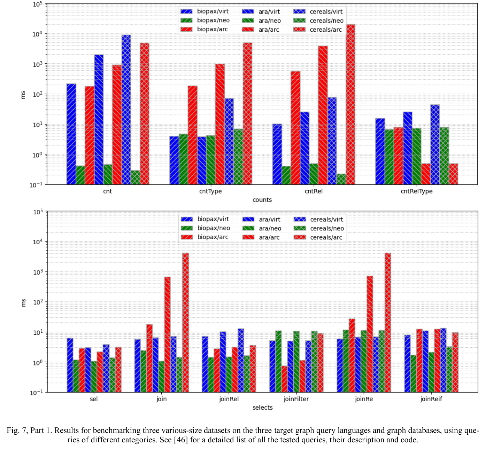

그림 7 앞부분. 개수 계산과 선택 질의의 응답 시간. Brandizi 외, PDF 13쪽. [원문](https://arxiv.org/pdf/2505.17498v1#page=13) · [크게 보기](../assets/images/rdf2pg/figure-07a-counts-selects.png) · [CC BY-NC-SA 4.0](https://creativecommons.org/licenses/by-nc-sa/4.0/). PDF에서 그림 영역을 잘라 이미지로 변환했으며 그림의 내용·축·범례는 수정하지 않았다.

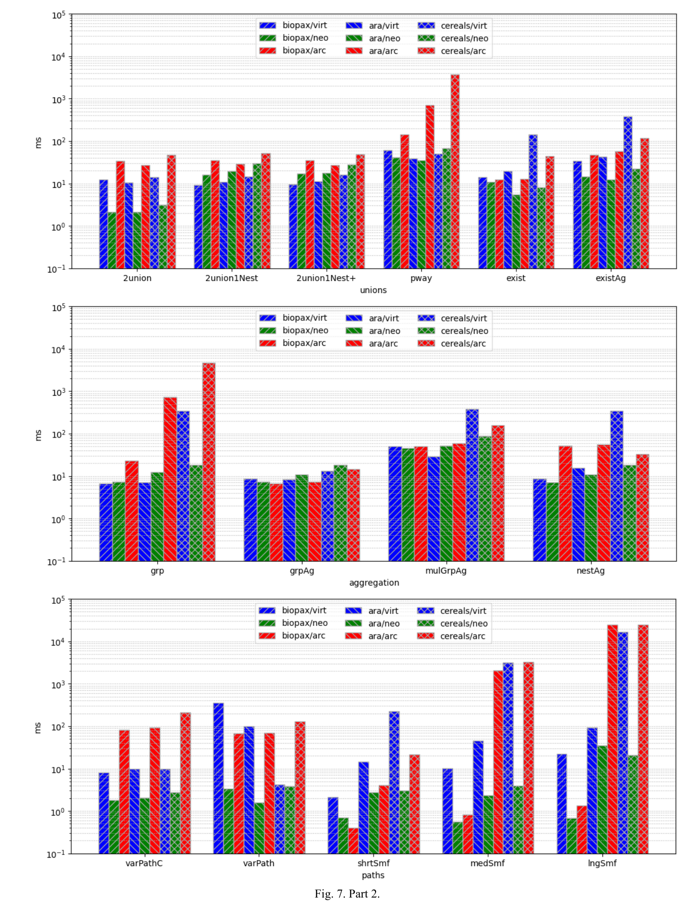

그림 7 뒷부분. 합집합·집계·경로 질의의 응답 시간. Brandizi 외, PDF 14쪽. [원문](https://arxiv.org/pdf/2505.17498v1#page=14) · [크게 보기](../assets/images/rdf2pg/figure-07b-unions-aggregation-paths.png) · [CC BY-NC-SA 4.0](https://creativecommons.org/licenses/by-nc-sa/4.0/). PDF에서 그림 영역을 잘라 이미지로 변환했으며 그림의 내용·축·범례는 수정하지 않았다.

그림 7의 세로축은 **밀리초 단위 로그 축**이다. 눈금 간격이 일정해도 시간 차이가 일정한 것은 아니다. 파란색은 Virtuoso, 초록색은 Neo4j, 빨간색은 ArcadeDB이며 무늬가 데이터셋을 구분한다. 같은 질의 안에서 DB와 데이터셋을 맞춰 읽어야 한다. 막대가 낮을수록 빠르다.

| 범주 | 그림에서 확인할 내용 | 해석의 경계 |
|---|---|---|
| 개수 계산 | cnt·cntRel에서 Neo4j의 낮은 응답 시간 | 저자의 내부 요약 정보 활용 설명은 구현을 직접 검증한 증명이 아님 |
| 선택 | 단순 선택과 join·관계 조건의 양상이 다름 | 단일 속성 검색 결과를 모든 조인으로 확대하지 않음 |
| 합집합 | 질의와 규모에 따라 격차가 달라짐 | 합집합이라는 이름만으로 실행 계획이 같지는 않음 |
| 집계 | grp·grpAg·mulGrpAg·nestAg의 결과가 서로 다름 | 그룹·중첩 계산을 한 종류로 뭉뚱그리지 않음 |
| 경로 | 중간·긴 semantic motif에서 Neo4j의 강점 | 이 데이터·매핑·질의 구현에 대한 관찰 |

저자들은 많은 질의에서 Neo4j가 빠르고 특히 경로 탐색에서 강점을 보였다고 보고한다. 하지만 그림 전체를 제품 순위 한 줄로 줄이면 질의별 차이가 사라진다. 이 글에서는 막대에서 정확한 숫자를 추정해 배수나 평균을 새로 계산하지 않았다.

#### 결과 제한 위치의 영향

논문은 처음 100개 결과를 가져오는 조건과 Gremlin에서 제한을 적용하는 위치의 문제를 논의한다. 아래는 그 의미를 설명하기 위한 도식이며 모든 25개 질의가 똑같이 실행됐다는 도식은 아니다.

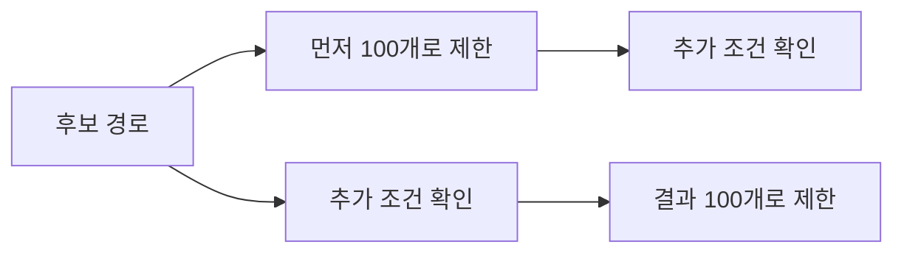

두 경로는 처리량뿐 아니라 반환 집합도 달라질 수 있다. 먼저 잘라낸 후보 안에 조건을 만족하는 것이 적으면 뒤에 있는 유효한 결과를 놓친다. 따라서 빠른 실행을 같은 답을 계산한 결과로 인정하려면 제한 위치·정렬·중복 처리까지 맞춰야 한다. 이는 이 리뷰의 비교 설계 해석이며 새 성능 측정은 아니다.

### 3.4 의미 보존과 정보 보존

이 절은 변환을 이해하는 데 중요하지만 성능 그래프에 가려지기 쉽다. **목적에 맞는 의미를 유지하는 것과 원본을 복원할 수 있는 것은 다르다.**

원문은 Car와 Van을 Vehicle로 매핑하는 예를 든다. 둘 다 차량이라는 응용 해석은 가능해도 대상 그래프에 원래 유형을 남기지 않았다면 어느 것이 Car였는지 되돌릴 수 없다.

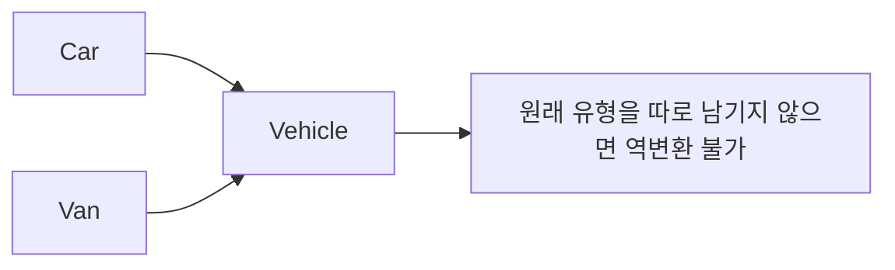

여기서 의미 보존은 SPARQL로 선택한 내용이 매핑에서 정한 대상 스키마에 맞는다는 논의다. 실제 세계에서 그 내용이 참이라는 보증이나 모든 원본 정보의 무손실 보존과는 구분해야 한다. 의도적으로 일부 정보만 노출하는 응용에서는 정보 축소가 목적일 수 있다.

저자들은 선택 조건과 식별자·유형 구분이 역변환 가능성에 영향을 준다고 논의한다. 이 논문을 모든 SPARQL 매핑에 자동 역변환을 제공한 결과로 읽어서는 안 된다. 이전 rdf2neo의 이론적 결과와 GraphML 출력에 대한 논의도 구분해야 한다.

복잡도 역시 두 부분으로 읽어야 한다. 선택한 노드·관계를 순서대로 출력하는 작업이 선형이라고 해도 그 전에 실행하는 SPARQL 질의 비용까지 선형이 되는 것은 아니다. 원문은 일반 SPARQL 질의의 최악 복잡도와 더 제한된 질의 부류를 구분한다. [원문 §3.4](https://arxiv.org/pdf/2505.17498v1#page=11)

## 4장 — 적용 범위와 관련 연구

### 4.1 한 원천에서 여러 응용 뷰 제공

논의의 중심은 RDF와 LPG 중 어느 쪽이 본질적으로 낫다는 결론이 아니다. 공유할 지식의 표현과 응용의 조회 구조를 분리하면 서로 다른 도구를 함께 쓸 수 있다. 반대로 매핑·변환·동기화가 추가되므로 데이터 갱신 시 무엇을 다시 만들어야 하는지도 설계해야 한다.

이 논문은 그런 운영 부담을 설명하지만 사람의 유지보수 노동을 시간 단위로 측정하지는 않는다. 실험 결과로 말할 수 있는 적재·질의 시간과, 앞으로 검증해야 할 관리 편의성은 나눠야 한다.

### 4.2 고정 매핑과 사용자 정의 매핑

관련 연구 절에서는 neosemantics 등을 포함한 기존 RDF–LPG 변환 접근과 비교한다. 비교를 읽을 때는 기본 매핑을 따르는지, 도메인 구조를 질의로 재구성하는지 살펴본다.

| 접근 | 얻는 것 | 확인할 것 |
|---|---|---|
| 정해진 변환 규칙 | 매번 매핑을 직접 쓰는 부담을 줄임 | 응용에 맞는 관계 구조가 나오는지 |
| rdf2pg의 SPARQL 매핑 | 복잡한 RDF 구조를 원하는 노드·관계로 재구성 | 누락 정보, 역변환 조건, 질의·변환 비용 |

기본적인 rdf:type→레이블 대응만으로는 그림 1의 관계 설명 자원이 원하는 간선 속성으로 합쳐지지 않을 수 있다. rdf2pg는 이 재구성을 표현할 수 있다는 장점이 있다. 그 대가로 매핑 작성과 검토가 필요하다. 이 비교는 원문이 다루는 변환 전략에 대한 것이며 최신 neosemantics 기능 전체나 추론 성능을 평가한 표가 아니다. [원문 §4–4.1](https://arxiv.org/pdf/2505.17498v1#page=15)

## 5장 — 결론과 후속 과제

저자들은 RDF 지식 그래프를 여러 그래프 시스템에서 조회할 수 있도록 만드는 rdf2pg 프레임워크와 식물 데이터 기반 비교를 제시한다. SPARQL로 응용에 필요한 정보를 고르고 공통 표현을 거쳐 대상 시스템으로 보내는 구조가 핵심 기여다. GQL·SQL 표준과 RDF-star 등으로 논의를 넓히지만 향후 방향을 현재 벤치마크에서 완료한 결과로 합쳐서는 안 된다.

이 논문은 Neptune을 실측한 연구도, OWL 추론기의 완전성을 비교한 연구도 아니다. SHACL 보고서가 LLM 답변을 개선하는지 역시 측정하지 않았다. 그러므로 이 논문을 바탕으로 후속 비교를 설계할 때는 **매핑과 질의의 대응 관계를 먼저 고정한다**는 방법을 가져오는 것이 적절하다. [원문 §5](https://arxiv.org/pdf/2505.17498v1#page=16)

## 논문의 주장과 근거 연결

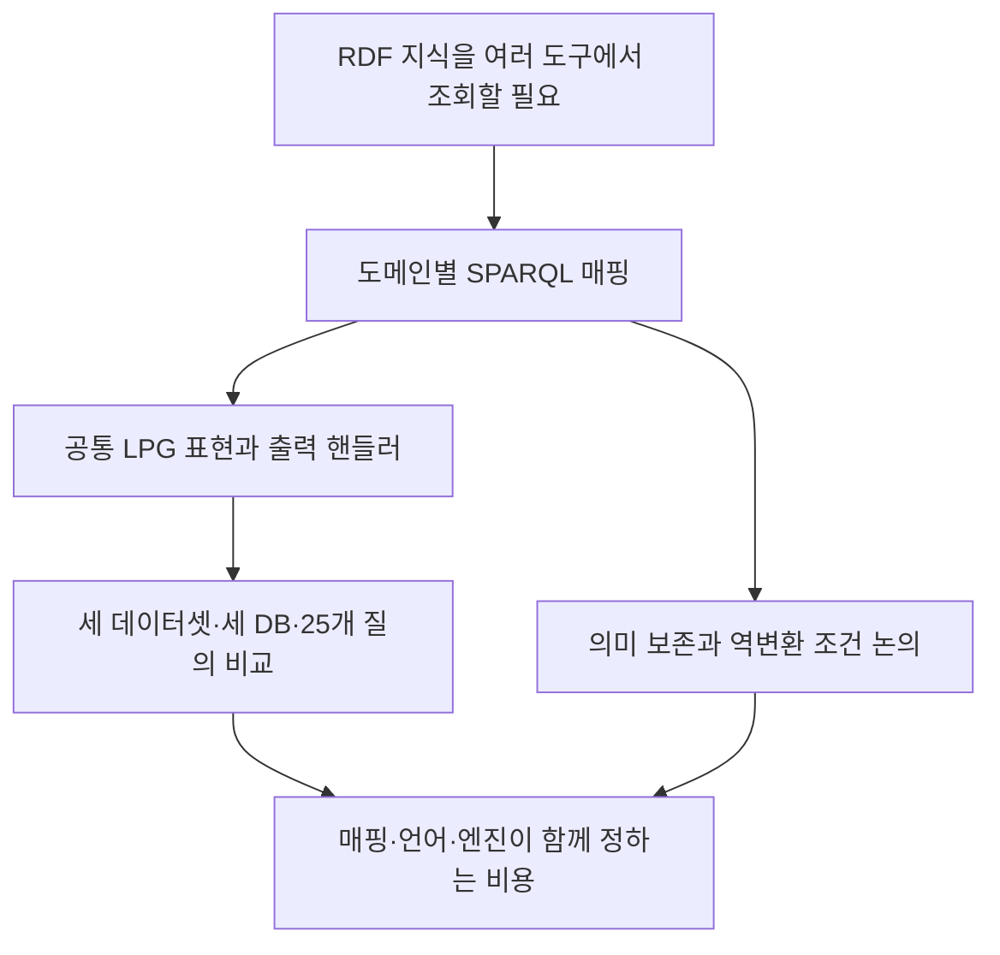

위는 리뷰에서 새로 만든 전체 논증도다. 원문 그림 1–3이 구현을, 그림 4–5가 데이터와 질의를, 그림 6–7이 측정을 보여준다고 연결해서 읽으면 된다.

| 주장 | 논문이 제공한 근거 | 확대하면 안 되는 결론 |
|---|---|---|
| RDF를 응용에 맞는 LPG로 표현할 수 있음 | 명시적 SPARQL 매핑과 처리기 구조 | 자연어만 주면 정확한 매핑을 자동 생성함 |
| 조회 비용이 접근 경로별로 달라짐 | 지정 판본·데이터·질의의 벤치마크 | 어느 엔진이나 언어가 항상 우월함 |
| 정보 보존에는 별도 조건이 필요함 | 매핑과 역변환에 대한 이론적 논의 | 임의의 변환이 무손실임 |
| 여러 도구를 함께 쓸 수 있음 | Neo4j·GraphML 경로와 비교 구현 | 운영·유지보수 비용 감소가 실측됨 |

DB 엔진, 질의 언어, 물리적 그래프 표현이 함께 바뀌므로 관측 차이를 한 요소의 효과로 분리할 수는 없다. 그럼에도 이 논문은 비교의 출발점을 구체적으로 보여준다. 같은 정보가 어디에 담기는지 먼저 설명하고 그 정보를 읽는 질의를 대응시킨 뒤 비용을 측정한다. 그 순서가 빠지면 빠른 결과가 더 적은 정보를 읽은 결과인지조차 구분하기 어렵다.
