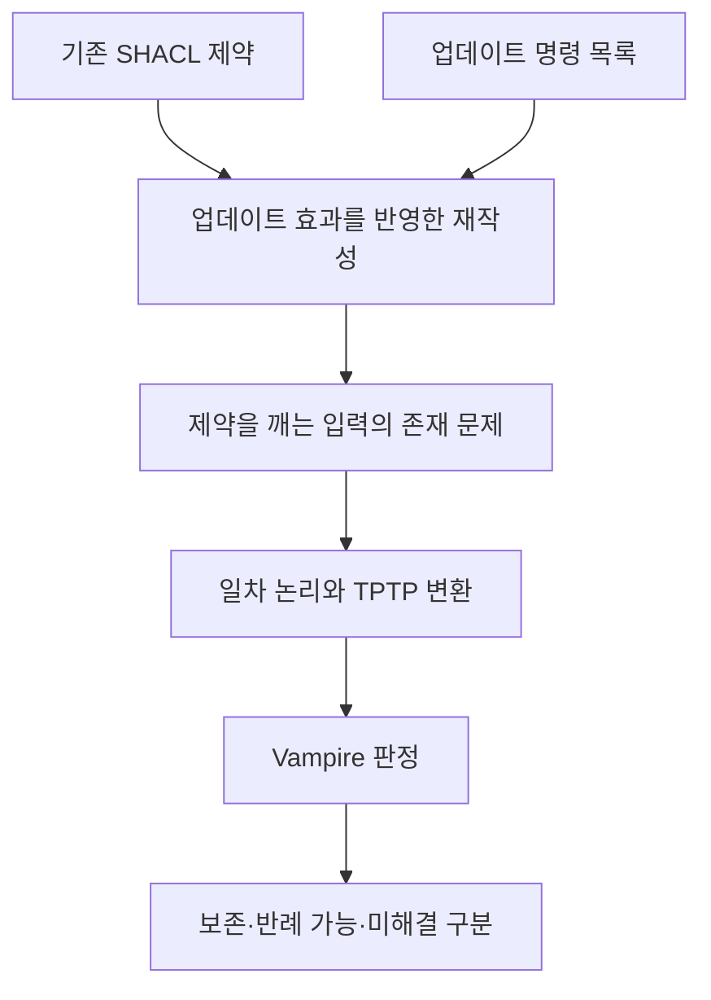

# SHACL 업데이트 검증 리뷰: 데이터를 바꾸기 전에 제약 보존을 판단하기

주소에는 도시와 번지가 있어야 한다는 규칙이 있다. 개인정보 최소화를 위해 번지를 모두 삭제하면 기존 규칙을 계속 만족할까. 업데이트 후 데이터를 검사하는 방법도 있지만 업데이트 명령 자체가 규칙을 깨뜨릴 수 있는지 먼저 분석할 수도 있다. 이 논문은 두 번째 질문을 다룬다.

## 논문 정보

| 항목 | 내용 |
|---|---|
| 제목 | SHACL Validation under Graph Updates (Extended Paper) |
| 저자 | Shqiponja Ahmetaj, George Konstantinidis, Magdalena Ortiz, Paolo Pareti, Mantas Simkus |
| 소속 | TU Wien, University of Southampton |
| 읽은 판본 | 2025년 7월 31일 arXiv v1, 확장판 25쪽 |
| 발표 상태 | ISWC 2025 채택 표기 |
| 원문·코드 | [논문](https://arxiv.org/abs/2508.00137v1) · [SHACL2FOL](https://github.com/paolo7/SHACL2FOL) |

이 리뷰는 정적 검증의 정의, 변환 방법과 초기 실험을 설명한다. 실제 DB의 트랜잭션 처리량이나 증분 검증기의 성능을 비교한 글은 아니다.

## 한 그래프와 모든 가능한 그래프

일반적인 검증은 특정 RDF 그래프가 shape를 만족하는지 검사한다. 이 논문의 주요 문제는 더 넓다. 현재 제약을 만족하는 모든 그래프에 같은 업데이트를 적용했을 때, 결과가 여전히 제약을 만족하는지 묻는다.

주소의 번지를 삭제하는 예시에서는 지금 가진 몇 개의 레코드만 확인해서는 부족하다. 규칙을 만족하던 그래프 중 하나라도 업데이트 후 규칙을 어길 수 있다면, 그 업데이트는 모든 입력에 대해 안전하다고 말할 수 없다. [원문 §1·§3](https://arxiv.org/pdf/2508.00137v1#page=2)

여기서 안전은 선언한 SHACL 제약의 보존을 뜻한다. 법적 적합성이나 업무상 바람직함을 전부 보장한다는 뜻은 아니다. 번지를 지우는 정책이 타당해도 주소 shape를 함께 바꿔야 하는 상황은 얼마든지 가능하다.

## 업데이트를 제약 쪽으로 옮기는 regression

논문은 shape 표현으로 업데이트 대상과 조건을 지정하는 언어를 정의한다. 그런 다음 업데이트 후 검사할 조건을 업데이트 이전의 조건으로 변환한다. 이 regression은 실제 데이터에 명령을 수행하는 대신, 명령이 검사에 미치는 영향을 논리식에 반영한다. [원문 §3–4](https://arxiv.org/pdf/2508.00137v1)

도식은 방법을 설명하기 위해 다시 그린 것이다. 제약을 깨는 입력이 존재하지 않는다는 결론을 얻으면 보존을 보일 수 있다. 증명기가 답을 찾지 못한 경우에는 보존이나 위반 중 하나로 임의 분류하지 않는다.

## SHACL2FOL 확장 구현

프로토타입은 shape 그래프와 JSON 형태의 액션 목록을 입력으로 받는다. SHACL2FOL이 생성하는 일차 논리 표현에 업데이트 효과를 반영하고 TPTP 파일을 만든다. 실험에서는 Vampire 4.9를 사용한다. 구현된 액션 형태는 논문 전체의 추상 언어보다 제한되므로 언어 정의와 실행 가능한 프로토타입을 구분해야 한다. [원문 §6](https://arxiv.org/pdf/2508.00137v1#page=13)

이는 임의의 SPARQL Update 프로그램을 그대로 입력하면 항상 분석해 주는 범용 도구라는 뜻은 아니다. 지원하는 경로·제약·액션 조합과 증명기의 한계를 확인해야 한다.

## 초기 실험과 미해결 사례

| 실험 | 변화시킨 조건 | 저자가 보고한 관찰 |
|---|---|---|
| 첫 번째 | shape 10개 고정, 액션 1–200개 | 계산 시간이 액션 수에 따라 대체로 선형 증가 |
| 두 번째 | 액션 20개 고정, shape 10–70개 | shape 수 증가에 따라 지수적인 시간 증가 |
| 증명 미도달 | 첫 번째·두 번째 실험 | 각각 16%, 8%에서 증명을 찾지 못함 |

각 측정점은 무작위로 생성한 실행 열 번의 평균이다. property equality·disjointness, qualified cardinality, 여러 경로 표현 등 충족 가능성 판단이 어려운 제약을 조합한다. 실제 기업의 업데이트 로그를 수집한 벤치마크는 아니다. [원문 §6, Figures 1–2](https://arxiv.org/pdf/2508.00137v1#page=14)

또 shape 수는 스키마 복잡도에 가까운 변수다. 이 실험을 “RDF 트리플이 늘어도 선형으로 빠르다”는 결과로 바꾸어 읽으면 안 된다. 데이터 양을 늘려 서버 성능을 측정한 실험과 입력 축이 다르다.

## 이론 결과와 운영 적용 사이

이 연구는 제약 보존 문제를 충족 가능성 판단으로 연결하고 제약의 표현력에 따른 계산 복잡도를 분석한다. 업데이트를 실행하기 전에 논리적으로 검토할 수 있다는 점이 기여다. 하지만 일반적으로 어려운 조합이 존재하므로 프로토타입의 미해결 비율도 결과의 일부로 남는다.

운영 환경에서는 이 분석으로 판정하지 못한 명령을 실제 변경 후 검증으로 넘기는 등 별도 정책이 필요할 수 있다. 그것은 이 리뷰의 적용상 해석이다. 논문이 그러한 전체 운영 체계의 비용과 효과까지 실측한 것은 아니다.
