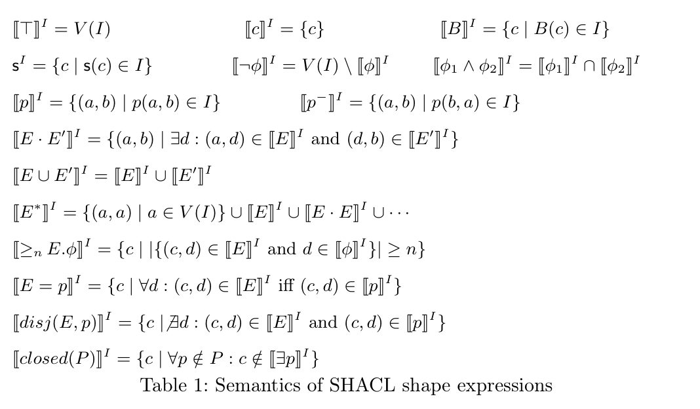
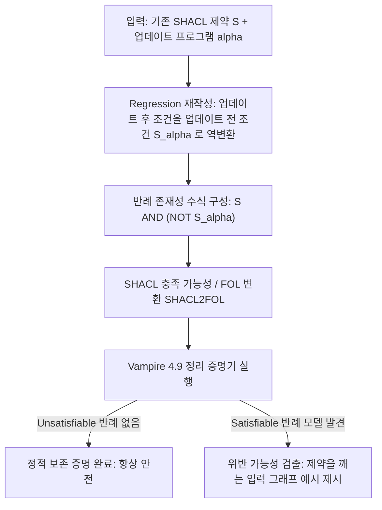
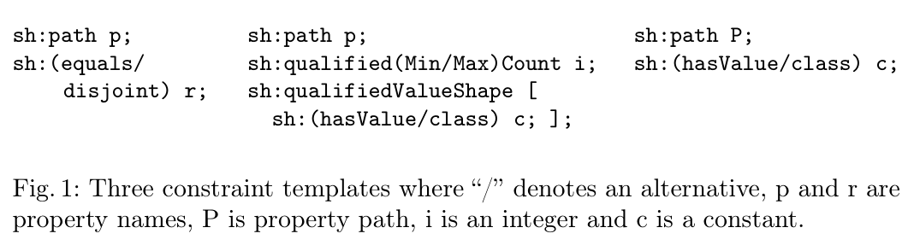
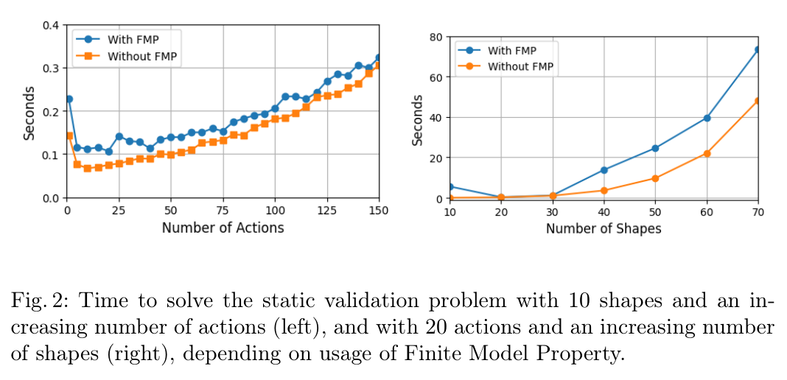

# SHACL 업데이트 검증 리뷰: 데이터를 바꾸기 전에 제약 보존을 판단하기

주소에는 도시와 번지가 있어야 한다는 규칙이 있다. 개인정보 최소화를 위해 번지를 모두 삭제하면 기존 규칙을 계속 만족할까. 업데이트 후 데이터를 검사하는 방법도 있지만 업데이트 명령 자체가 규칙을 깨뜨릴 수 있는지 먼저 분석할 수도 있다. 이 논문은 두 번째 질문을 다룬다.

이 글은 2026년 11월 10일에 확장한 장별 심층 리뷰다. 논문의 1장부터 7장까지를 따라가며 SHACL 모양 표현의 형식 의미론(표 1), 모양 식을 조건으로 삼아 트리플을 추가·삭제하는 업데이트 액션 언어 $\alpha = (\oplus, \ominus)$, 특정 데이터 그래프 없이도 "이 업데이트가 제약을 깨뜨릴 수 있는가?"를 판정하는 **정적 보존 검증(static validation under updates)**과 **회귀 재작성(regression)** 알고리즘, 언어 조각별 계산 복잡도(PSpace / ExpTime / NExpTime / Undecidable), 그리고 `SHACL2FOL`과 일차 논리 정리 증명기 **Vampire 4.9**를 이용한 실험 결과(그림 1, 그림 2)를 차례로 읽는다. 원문의 표 1점과 그림 2점은 저자들의 arXiv 확장판 PDF에서 캡처로 가져왔고 설명을 위해 새로 그린 도식은 Mermaid로 구분했다. 본문에 인용한 모든 수치는 저자 보고값이며 이 리뷰에서 별도로 증명기를 재실행하지는 않았다.

## 논문 정보와 검토 범위

| 항목 | 내용 |
|---|---|
| 제목 | SHACL Validation under Graph Updates (Extended Paper) |
| 저자 | Shqiponja Ahmetaj, George Konstantinidis, Magdalena Ortiz, Paolo Pareti, Mantas Šimkus |
| 소속 | TU Wien, University of Southampton, Umeå University |
| 읽은 판본 | arXiv v1, 2025년 7월 31일 공개, 25쪽 (ISWC 2025 채택 논문의 증명 포함 확장판) |
| 발표 | International Semantic Web Conference (ISWC) 2025 Research Track |
| 원문·코드 | [arXiv 페이지](https://arxiv.org/abs/2508.00137v1) · [원문 PDF](https://arxiv.org/pdf/2508.00137v1) · [SHACL2FOL 저장소](https://github.com/paolo7/SHACL2FOL) |

이 논문은 특정 RDF 데이터베이스에 트랜잭션을 실제로 실행한 뒤 변경된 노드만 빠르게 재검사하는 **런타임 증분 검증(incremental validation on a concrete graph)** 논문이 아니다. 대신 **데이터 그래프 $I$가 주어지지 않은 상태(data-independent)에서, 임의의 적법한 그래프에 업데이트 프로그램 $\alpha$를 적용했을 때 SHACL 제약이 항상 보존되는지를 실행 전에 논리적으로 판정하는 정적 분석(static verification)**을 다룬다. 원문 수록 그림·표는 저자들의 arXiv 공개 PDF([CC BY 4.0](https://creativecommons.org/licenses/by/4.0/))에서 216 DPI로 잘라 가져왔으며 이미지별 페이지·좌표·SHA256 해시는 [그림 출처 기록](../assets/images/shacl-updates/provenance.json)에 남겼다.

## 원문 구성과 읽기 지도

| 원문 | PDF 쪽 | 핵심 내용 |
|---|---|---|
| 1 Introduction | 1–3 | 데이터 독립적 정적 업데이트 검증의 동기와 환자·의사·약물 예제 도입 |
| 2 Preliminaries: SHACL | 3–5 | 그래프(해석 $I$), 비재귀·재귀 SHACL 모양 표현 문법과 의미론(표 1, 예제 1) |
| 3 Graph Updates | 5–7 | 모양 식 기반 조건부 삽입·삭제 액션 언어 $\alpha = (\oplus, \ominus)$와 순차 합성 의미론(예제 2–4) |
| 4 Static Validation under Updates | 7–9 | 정적 보존 문제 정의, 업데이트를 제약 식 안으로 밀어 넣는 Regression 변환(정리 1, 2, 예제 5–6) |
| 5 Complexity of Static Validation | 9–11 | 경로 표현($E^*$)·카디널리티·재귀 유무에 따른 복잡도 등급 분류(정리 3) |
| 6 Implementation and Experiments | 11–14 | `SHACL2FOL` + Vampire 4.9 구현, 3가지 제약 템플릿(그림 1), 액션 수·모양 수 증가 실험(그림 2) |
| 7 Conclusions & Appendix | 14–25 | 요약 및 정리 1–3의 전체 수학적 증명 수록 |

## 1장–2장: SHACL 모양 표현의 대수적 문법과 의미론

### 1.1 왜 업데이트 실행 전에 정적 검증이 필요한가

병원 지식 그래프에 다음과 같은 SHACL 제약(원문 예제 1)이 걸려 있다고 하자.

- 모든 환자(`Patient`)는 최소 1명의 담당 의사(`Physician`)와 연결되어야 한다($\text{Patient} \sqsubseteq {\geqslant_1}\text{treatedBy}.\text{Physician}$).
- 의사(`Physician`)와 제약사 직원(`PharmaEmployee`)은 서로소다($\text{Physician} \sqcap \text{PharmaEmployee} \sqsubseteq \bot$).

여기에 데이터베이스 관리자가 새로운 일괄 업데이트 스크립트 $\alpha$를 작성했다. 현재 개발용 샘플 DB에서 돌려 보았더니 아무런 위반이 나지 않았다고 해서 안심할 수 있을까? 그렇지 않다. 운영 환경의 어떤 적법한 그래프 상태에서는 그 스크립트가 마지막 담당 의사 연결을 지우거나 제약사 직원을 의사로 배정해 SHACL 제약을 깨뜨릴 수 있다. **모든 가능한 적법 그래프 $I$에 대해 업데이트 후 그래프 $I^\alpha$도 적법한지($I \models \mathcal{S} \implies I^\alpha \models \mathcal{S}$)**를 데이터 없이 미리 검사하는 것이 이 논문의 목표다.

### 1.2 SHACL 모양 표현의 형식 의미론(원문 표 1)

2장은 SHACL 모양 표현(shape expression) $\phi$와 경로 표현(path expression) $E$를 대수적 수식으로 정의한다. 해석(그래프) $I$ 위에서 모양 식 $\phi$를 만족하는 노드 집합 $\llbracket \phi \rrbracket^I$와 경로 $E$를 만족하는 노드 쌍 집합 $\llbracket E \rrbracket^I$의 정의는 원문 표 1에 정리되어 있다.

표 1. 그래프(해석) $I$ 위에서 SHACL 모양 식 및 경로 표현의 평가 의미론. Ahmetaj et al., PDF 4쪽. [원문](https://arxiv.org/pdf/2508.00137v1#page=4) · [크게 보기](../assets/images/shacl-updates/table-01-shape-semantics.png) · [CC BY 4.0](https://creativecommons.org/licenses/by/4.0/).

표 1에 포함된 연산자는 상수($c$), 클래스($B$), 모양 이름($\mathsf{s}$), 부정($\neg \phi$), 논리곱($\phi_1 \land \phi_2$), 역경로($p^-$), 경로 연결($E \cdot E'$), 경로 합집합($E \cup E'$), 클리니 스타($E^*$), 카디널리티 제약(${\geqslant_n} E.\phi$), 경로-속성 동치($E = p$), 경로-속성 서로소($\text{disj}(E, p)$), 닫힌 모양($\text{closed}(P)$)까지 표준 SHACL 핵심 제약을 폭넓게 포괄한다.

모양 그래프는 모양 정의 집합 $\mathcal{C}$(예: $\mathsf{s} \leftrightarrow \phi_{\mathsf{s}}$)와 타깃 제약 집합 $\mathcal{T}$(예: $\phi_1 \subseteq \phi_2$ 또는 $c \in \phi$)의 쌍 $(\mathcal{C}, \mathcal{T})$로 표현된다.

## 3장–4장: 조건부 그래프 업데이트 언어와 회귀(Regression) 변환

### 3.1 모양 식을 조건으로 쓰는 업데이트 액션 언어 $\alpha = (\oplus, \ominus)$

3장은 SPARQL Update의 `INSERT / DELETE WHERE` 패턴을 SHACL 모양 식과 결합해 추상화한 업데이트 언어를 정의한다. 단일 기본 액션(basic action)은 삽입 규칙 집합 $\oplus$와 삭제 규칙 집합 $\ominus$의 쌍 $(\oplus, \ominus)$로 이루어지며, 각 규칙은 다음 두 형태 중 하나다.

1. **클래스 멤버십 변경**: $B(x) \leftarrow \phi(x)$
   - 현재 그래프 $I$에서 모양 식 $\phi$를 만족하는 모든 노드 $c \in \llbracket \phi \rrbracket^I$에 대해 클래스 원자 $B(c)$를 추가($\oplus$)하거나 삭제($\ominus$)한다.
2. **속성 간선 변경**: $p(x, y) \leftarrow \phi(x) \land E(x, y) \land \psi(y)$
   - 시작 노드 $c$가 $\phi$를 만족하고 끝 노드 $d$가 $\psi$를 만족하며 둘 사이에 경로 $E$가 존재하면($(c, d) \in \llbracket E \rrbracket^I$), 속성 간선 $p(c, d)$를 추가($\oplus$)하거나 삭제($\ominus$)한다. (동일한 사실을 동시에 삽입·삭제하려 할 때는 삽입이 우선하거나 순차 적용으로 정의됨).

여러 기본 액션을 순서대로 실행하는 복합 업데이트 프로그램은 순차 합성 $\alpha = \alpha_1 ; \alpha_2 ; \dots ; \alpha_k$로 나타낸다(예제 2–4).

### 3.2 핵심 메커니즘: 업데이트를 제약 식 안으로 밀어 넣는 Regression (정리 1–2)

4장은 정적 보존 검증 문제를 어떻게 푸는지 설명한다.

- **정적 보존 검증 문제(Static Validation Problem)**: 주어진 모양 제약 $(\mathcal{C}, \mathcal{T})$와 업데이트 $\alpha$에 대해, $(\mathcal{C}, \mathcal{T})$를 만족하는 **모든** 그래프 $I$가 업데이트 후 그래프 $I^\alpha$에서도 $(\mathcal{C}, \mathcal{T})$를 만족하는가?
- 이를 뒤집어 말하면(여문제, co-problem), **업데이트 전에는 $(\mathcal{C}, \mathcal{T})$를 만족하지만($I \models (\mathcal{C}, \mathcal{T})$), 업데이트 후에는 $(\mathcal{C}, \mathcal{T})$를 위반하는($I^\alpha \not\models (\mathcal{C}, \mathcal{T})$) 반례 그래프 $I$가 존재하는가?**라는 **충족 가능성(Satisfiability)** 문제가 된다.

이때 가장 중요한 기술적 단계가 **회귀 재작성(Regression, 정리 1 및 정리 2)**이다. 업데이트 $\alpha = (\oplus, \ominus)$가 실행된 뒤의 그래프 $I^\alpha$에서 어떤 노드가 클래스 $B$에 속할 조건은, 업데이트 전 그래프 $I$에서 **(원래 $B$에 속하면서 $\ominus$ 조건에 걸리지 않았거나) 또는 ($\oplus$ 조건에 새로 걸렸거나)** 둘 중 하나다.

즉 제약 식 안에 등장하는 모든 클래스 원자 $B$와 속성 원자 $p$를 다음과 같이 업데이트 전 모양 식으로 치환(regression)할 수 있다.

$$B \;\mapsto\; \left( B \land \neg \bigvee_{B(x) \leftarrow \phi(x) \in \ominus} \phi \right) \;\lor\; \bigvee_{B(x) \leftarrow \psi(x) \in \oplus} \psi$$

$$p \;\mapsto\; \left( p \setminus \bigcup_{p(x,y) \leftarrow \dots \in \ominus} (\dots) \right) \;\cup\; \bigcup_{p(x,y) \leftarrow \dots \in \oplus} (\dots)$$

**정리 1**은 임의의 모양 제약 $(\mathcal{C}, \mathcal{T})$와 복합 업데이트 $\alpha = \alpha_1 ; \dots ; \alpha_k$에 대해, 뒤에서부터 한 단계씩 이 치환을 반복 적용해 얻은 재작성된 제약 $(\mathcal{C}^\alpha, \mathcal{T}^\alpha)$가 정확히 다음 등식을 만족함을 증명한다.

$$\forall I : \quad I^\alpha \models (\mathcal{C}, \mathcal{T}) \iff I \models (\mathcal{C}^\alpha, \mathcal{T}^\alpha)$$

따라서 정적 보존 검증은 **단일 시점의 원래 그래프 $I$ 위에서 "$I \models (\mathcal{C}, \mathcal{T})$이면서 동시에 $I \not\models (\mathcal{C}^\alpha, \mathcal{T}^\alpha)$일 수 있는가?"라는 표준 SHACL 충족 가능성(satisfiability) 문제로 다항 시간 안에 완벽히 환원**된다(정리 2).

## 5장: SHACL 언어 조각별 정적 검증의 계산 복잡도(정리 3)

정적 보존 검증이 SHACL 충족 가능성 문제와 다항 시간 동치(polynomial-time inter-reducible)라는 정리 2 덕분에, 5장(정리 3)에서는 사용된 SHACL 연산자 조합에 따른 정확한 계산 복잡도를 도출한다.

| SHACL 언어 조각 (포함 연산자) | 비재귀(Non-recursive) 정적 검증 복잡도 | 재귀(Recursive) 정적 검증 복잡도 |
|---|---|---|
| 기본 불리언 + 존재 제약 (${\geqslant_1} p.\phi$, 역경로 $p^-$) | **PSpace-complete** 또는 **ExpTime-complete** (조각에 따름) | **ExpTime-complete** |
| 일반 카디널리티 (${\geqslant_n} E.\phi$) + 경로 연산 ($E \cup E'$, $E \cdot E'$), 클리니 스타($E^*$) 제외 | **NExpTime-complete** (이진 표기 카디널리티 기준) | **결정 불가능 (Undecidable)** |
| 전체 SHACL (클리니 스타 $E^*$, 경로 동치 $E=p$, 서로소 $\text{disj}(E, p)$ 모두 포함) | **결정 불가능 (Undecidable)** | **결정 불가능 (Undecidable)** |

이 표가 주는 메시지는 명확하다. 재귀적 모양 정의나 추이적 경로($E^*$), 경로 간 동치($E=p$)가 카디널리티 제약과 자유롭게 결합되면 유한 모델 성질(Finite Model Property, FMP)이 깨지면서 이론적으로 결정 불가능한 영역이 나타난다. 하지만 비재귀적인 실무 제약 조각 상당수는 자동 정리 증명기로 충분히 다룰 수 있다.

## 6장: `SHACL2FOL` + Vampire 4.9 구현 및 확장성 실험

### 6.1 프로토타입 구현과 3가지 고난도 제약 템플릿(원문 그림 1)

6장에서 저자들은 기존 `SHACL2FOL` 도구를 확장해 SHACL 모양 그래프(Turtle)와 JSON 형식의 업데이트 액션 리스트를 입력받아 회귀 재작성을 수행한 뒤, 이를 일차 논리(FOL) TPTP 포맷으로 변환해 **Vampire 4.9** 정리 증명기에 넘기는 프로토타입을 구현했다.

실험을 단순한 장난감 제약으로 채우지 않기 위해, 저자들은 SHACL 충족 가능성 판정에서 가장 까다로운 연산자들(경로 동치/서로소, 한정 카디널리티, 복합 경로)을 조합한 **세 가지 제약 템플릿(원문 그림 1)**으로 합성 벤치마크를 생성했다.

그림 1. 합성 벤치마크 생성에 사용된 3가지 SHACL 제약 템플릿(`sh:equals/disjoint`, `sh:qualifiedMin/MaxCount`, 복합 경로 `sh:path P`). Ahmetaj et al., PDF 12쪽. [원문](https://arxiv.org/pdf/2508.00137v1#page=12) · [크게 보기](../assets/images/shacl-updates/figure-01-constraint-templates.png) · [CC BY 4.0](https://creativecommons.org/licenses/by/4.0/).

### 6.2 액션 수 증가 vs. 모양 수 증가에 따른 증명 시간(원문 그림 2)

저자들은 두 가지 실험 축에서 Vampire 4.9의 평균 해결 시간을 측정했다(각 점은 무작위 생성 인스턴스 10회 실행 평균, 타임아웃 5분). 또한 대상 그래프가 유한하다고 가정하는 **유한 모델 성질(With FMP)** 모드와 무한 모델까지 허용하는 일반 일차 논리(**Without FMP**) 모드를 나란히 비교했다(원문 그림 2).

그림 2. 모양 10개 고정 시 업데이트 액션 수(1–150개) 증가에 따른 해결 시간(좌)과 액션 20개 고정 시 모양 수(10–70개) 증가에 따른 해결 시간(우). Ahmetaj et al., PDF 13쪽. [원문](https://arxiv.org/pdf/2508.00137v1#page=13) · [크게 보기](../assets/images/shacl-updates/figure-02-solving-time.png) · [CC BY 4.0](https://creativecommons.org/licenses/by/4.0/).

그림 2에서 관찰되는 핵심 결과는 세 가지다.

1. **업데이트 액션 수(1–150개)에 대해서는 0.1–0.35초 내외로 거의 선형(linear)에 가깝게 확장된다(그림 2 좌측)**:
   - 모양 수가 10개로 고정되어 있으면 업데이트 액션이 150개까지 길어져도 회귀 재작성된 수식을 Vampire가 **0.4초 미만**에 매우 빠르게 풀어낸다.
2. **모양(Shape) 개수(10–70개)가 늘어나면 지수적(exponential)으로 시간이 증가한다(그림 2 우측)**:
   - 액션을 20개로 고정하고 상호작용하는 모양 수를 10개에서 70개로 늘리면 해결 시간이 수 초에서 **50–75초**로 가파르게 상승한다. 이는 5장의 복잡도 분석(스키마 크기에 대해 PSpace/ExpTime 이상)과 정확히 부합하는 실증 결과다.
3. **미해결(Timeout) 비율과 FMP 오버헤드**:
   - 첫 번째 실험(액션 변화)에서는 전체 인스턴스의 **16%**, 두 번째 실험(모양 변화)에서는 **8%**에서 Vampire가 5분 타임아웃 안에 증명을 마치지 못했다. 또한 유한 모델 제약을 명시적으로 인코딩하는 `With FMP`(파란 선)가 일반 FOL 증명인 `Without FMP`(주황 선)보다 추가 공리 부담 때문에 약간 더 느리게 작동했다.

## 7장: 종합 판단과 우리 연구(`shacl-graphrag`)에의 시사점

이 논문은 지식 그래프의 생명주기 관리에서 **"데이터를 고친 뒤 깨졌는지 검사하는 사후 검증(post-hoc validation)"**을 **"업데이트 규칙 자체가 기존 SHACL 계약을 위반할 가능성이 있는지 배포 전에 판정하는 정적 검증(pre-deployment static verification)"**으로 끌어올렸다.

1. **스키마 복잡도와 데이터 크기의 명확한 분리**:
   - 그림 2를 읽을 때 가장 주의할 점은 가로축이 RDF 트리플 수(데이터 크기)가 아니라 **업데이트 명령 수와 SHACL 모양 수(스키마 크기)**라는 사실이다. 정적 검증은 아예 데이터 그래프 없이 돌아가므로 데이터가 100만 건이든 10억 건이든 검증 시간은 동일하다.
2. **우리 연구(`shacl-graphrag`)와의 연결고리**:
   - `change-impact-1`이나 `bounded-refresh-1`처럼 엔터프라이즈 지식 그래프나 매핑 규칙이 갱신될 때, 어떤 업데이트 정책은 특정 조건에서 필수 속성(`sh:minCount`)이나 역할 배타성(`sh:disjoint`)을 깨뜨릴 잠재적 위험을 안고 있다.
   - 그림 2가 보여 주듯 전체 스키마가 아니라 **변경 대상과 맞물린 국소 모양 집합(10–30개 이내)**으로 범위를 좁히면 일차 논리 증명기로도 수 초 안에 정적 안전성을 점검할 수 있다. 다만 증명기가 타임아웃(8–16%)을 내는 결정 불가능/고복잡도 조합이 존재하므로, 실제 운영에서는 **정적 검증 통과 시 즉시 승인 → 미해결(Unknown) 시 대상 서브그래프 런타임 SHACL 검증으로 폴백**하는 2단계 게이트 구조가 합리적이다.
