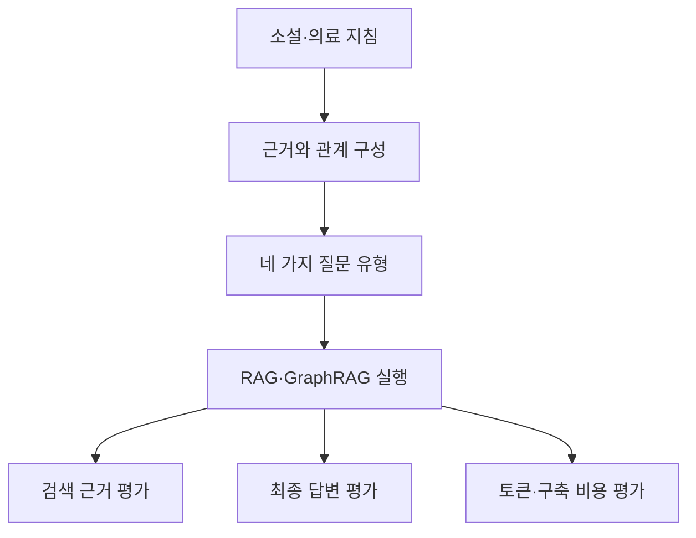

# GraphRAG-Bench 리뷰: 질문 난도와 검색·생성 비용을 나눠 보는 평가

그래프를 만들면 흩어진 정보를 연결하기 쉬워진다. 하지만 한 문장 안에 답이 있는 질문에도 관계 확장이 필요할까. 검색한 정보가 늘수록 답이 좋아지는지도 확실하지 않다. GraphRAG-Bench는 이런 차이를 질문 유형과 파이프라인 단계로 나눠 살펴본다.

## 논문 정보와 평가 대상

| 항목 | 내용 |
|---|---|
| 제목 | When to use Graphs in RAG: A Comprehensive Analysis for Graph Retrieval-Augmented Generation |
| 저자 | Zhishang Xiang, Chuanjie Wu, Qinggang Zhang, Shengyuan Chen, Zijin Hong, Xiao Huang, Jinsong Su |
| 읽은 판본 | arXiv v3, 2026년 2월 22일 개정, 34쪽 |
| 발표 | 최초 공개 2025년 6월 6일, ICLR 2026 |
| 원문·자원 | [논문](https://arxiv.org/abs/2506.05690v3) · [학회 기록](https://proceedings.iclr.cc/paper_files/paper/2026/hash/6c9e01d6cefbbf4cdd265032550e767f-Abstract-Conference.html) · [프로젝트](https://github.com/GraphRAG-Bench/GraphRAG-Benchmark) |

검토 대상은 그래프를 이용한 검색·생성 시스템이다. 여기서 복잡한 추론은 여러 문맥과 근거를 결합하는 작업을 포함한다. OWL 공리의 논리적 함의를 계산하는 추론기 벤치마크로 해석해서는 안 된다.

## 질문과 근거의 구성

저자는 소설과 의료 지침을 중심으로 자료를 구성한다. 소설은 관계가 서술 속에 흩어져 있고 의료 지침은 계층과 절차가 비교적 명시적이다. 자료에서 개체·관계와 근거를 추출하고 이를 바탕으로 사실 검색·복잡한 추론·맥락 요약·창의적 생성 질문을 만든다. [원문 §3.1–3.2, 부록 C](https://arxiv.org/pdf/2506.05690v3#page=5)

도식은 논문의 평가 흐름을 간추린 것이다. 질문이 어려워졌다는 판단과 검색 문맥이 늘었다는 관찰을 따로 기록한다. 단순히 경로 길이만 늘려 난도를 정의하지 않는다는 취지다.

## 서로 다른 평가 단위

| 평가 단위 | 지표의 역할 | 해석상 주의점 |
|---|---|---|
| 구축된 그래프 | 노드·간선 수, 평균 차수, 군집 계수 | 조밀하다고 관계가 사실이라는 뜻은 아님 |
| 검색 결과 | Evidence Recall, Context Relevance | 근거를 많이 찾는 것과 불필요한 문맥을 줄이는 것은 다름 |
| 생성 답변 | ACC, ROUGE-L, Faithfulness, Evidence Coverage | 정답과의 유사성·문맥 충실도·내용 포괄성은 서로 다른 지표 |
| 비용 | 프롬프트 토큰, 인덱스 구축 시간·토큰 | 토큰 수는 실제 청구 금액과 동일하지 않음 |

이 구분은 §3.3과 §4의 지표를 풀어 쓴 것이다. 논문의 ACC를 그대로 임상 정확도나 외부 세계의 진실성으로 바꿔 부를 수는 없다. [지표 정의와 부록 F](https://arxiv.org/pdf/2506.05690v3#page=6)

## 질문 유형에 따른 결과

다음은 Table 3의 소설 데이터, GPT-4o-mini 설정에서 일부 방법을 골라 옮긴 값이다. 전체 순위표가 아니라 유형별 차이를 읽기 위한 발췌다.

| 방법 | 사실 검색 ACC | 복잡한 추론 ACC | 맥락 요약 ACC |
|---|---:|---:|---:|
| RAG, rerank 적용 | 60.92 | 42.93 | 51.30 |
| MS-GraphRAG | 49.29 | 50.93 | 64.40 |
| HippoRAG2 | 60.14 | 53.38 | 64.10 |

RAG가 사실 검색에서 경쟁력을 유지하면서 일부 그래프 방식은 복잡한 질문과 요약에서 더 높은 점수를 얻는다. 그렇다고 모든 GraphRAG가 모든 복잡한 질문에서 앞서는 것은 아니다. 본문의 의료 결과와 다른 GraphRAG 행을 함께 보면 방법·자료·지표에 따라 순서가 바뀐다. [원문 Table 3, §4.1](https://arxiv.org/pdf/2506.05690v3#page=7)

## 비용 수치를 읽을 때의 주의점

논문은 구축 비용과 질의 시 토큰 사용을 함께 다룬다. 다만 v3의 §4.4에는 확인이 필요한 부분이 있다. Table 6–7의 MS-GraphRAG(global)·LightRAG 토큰 값과 바로 옆 설명의 자릿수가 일치하지 않는다. 따라서 그 부분을 근거로 특정 방법이 몇 배 비싸다고 단정하지 않는다. [원문 §4.4, Tables 6–7](https://arxiv.org/pdf/2506.05690v3#page=9)

부록 Table 15는 약 5만 6천 토큰의 소설 한 권으로 인덱스 구축을 측정한 별도 결과다. 이 조건에서 측정한 시간은 전체 데이터셋의 구축 시간이나 상시 운영 비용으로 일반화할 수 없다. [원문 부록, Table 15](https://arxiv.org/pdf/2506.05690v3#page=27)

## 기여와 검증의 경계

이 연구는 최종 답 하나의 점수로 끝내지 않고 그래프 구성·검색·생성·비용을 함께 관찰할 수 있게 했다. 검색 근거가 충분한데도 답이 나쁜 경우와 필요한 근거부터 놓친 경우를 구분하는 데 유용하다.

다만 그래프 구조에서 근거와 질문을 구성하는 절차는 평가 과제의 성격에도 영향을 준다. 실제 사용자의 질문 분포와 같다고 가정할 수 없다. 또 평균 차수와 성능의 상관만으로 그래프를 더 조밀하게 만들면 항상 좋아진다는 인과 결론을 내릴 수 없다. 구현·생성 모델·검색 설정이 함께 작용하기 때문이다.

이 리뷰에서는 논문의 결과표와 방법을 검토했으며 공개 코드를 실행하지 않았다. 논문의 실용적 가치는 그래프 도입 여부를 일괄 결정하기보다, 질문 유형과 근거 확보 과정을 분리해 평가하도록 만든 데 있다.
