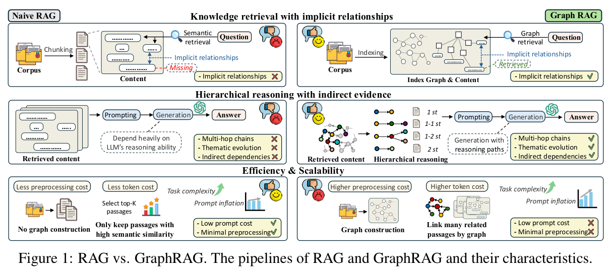
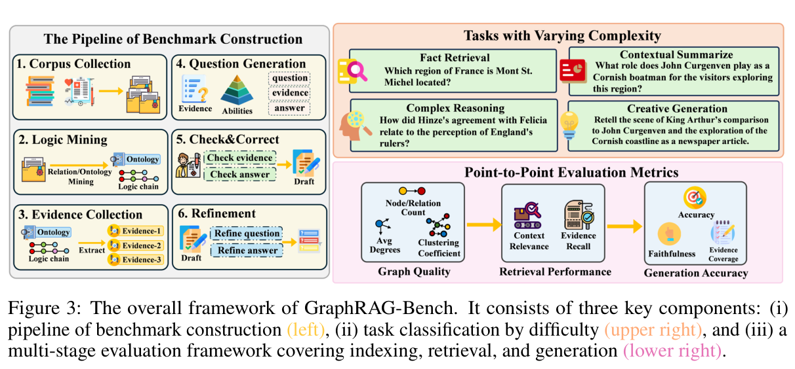
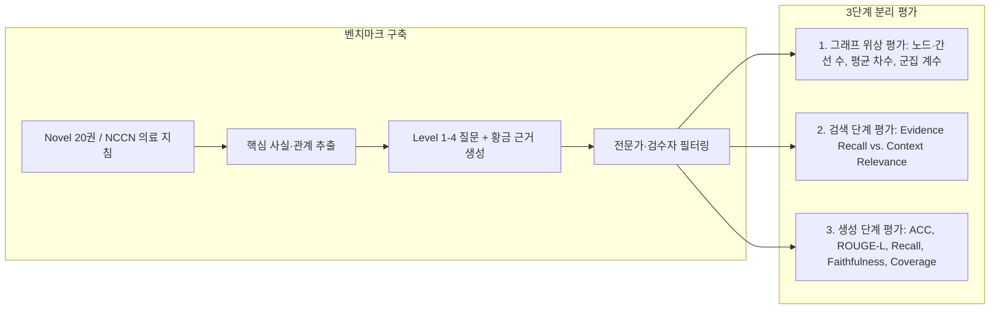
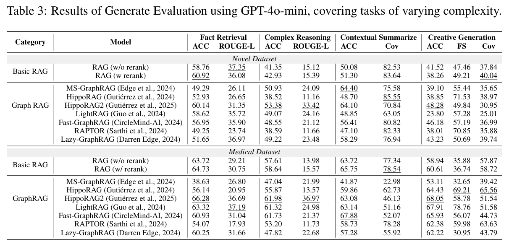
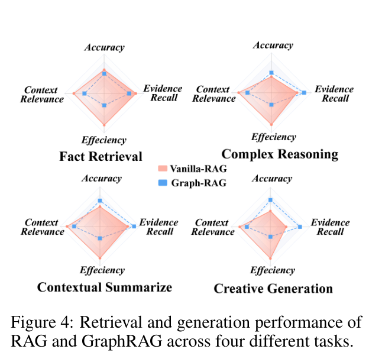
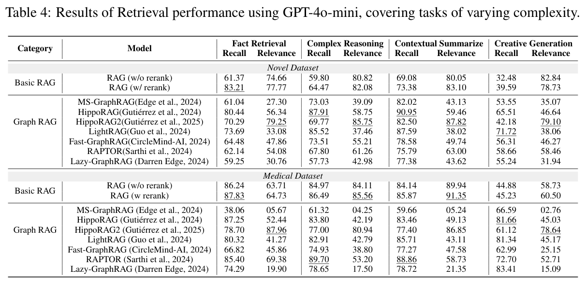
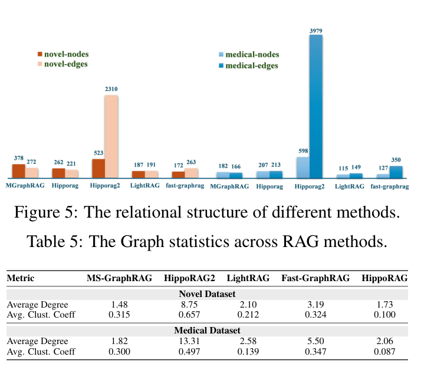
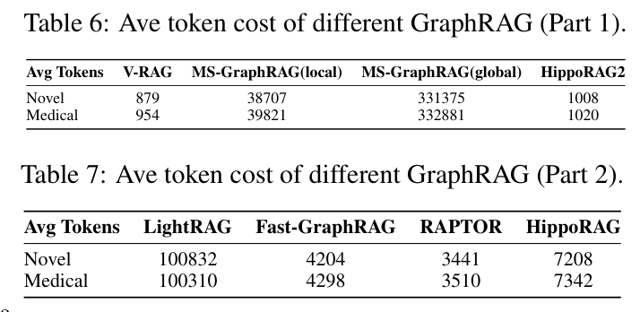

# GraphRAG-Bench 리뷰: 질문 난도와 검색·생성 비용을 나눠 보는 평가

그래프를 만들면 흩어진 정보를 연결하기 쉬워진다. 하지만 한 문장 안에 답이 있는 질문에도 관계 확장이 필요할까. 검색한 정보가 늘수록 답이 좋아지는지도 확실하지 않다. GraphRAG-Bench는 이런 차이를 질문 유형과 파이프라인 단계로 나눠 살펴본다.

이 글은 2026년 11월 10일에 확장한 장별 심층 리뷰다. 논문의 1장부터 5장까지와 주요 부록(부록 C, F, G)을 따라가며 Naive RAG와 GraphRAG의 파이프라인 차이, 4단계 질문 난도 체계(Level 1–4), 6단계 벤치마크 구축 절차, 소설(Novel) 및 의료 지침(Medical) 데이터셋에서의 생성·검색·그래프 위상·토큰 비용 평가 결과를 차례로 읽는다. 원문의 그림 4점과 표 3점은 저자들의 arXiv v3 PDF에서 캡처로 가져왔고 설명을 위해 새로 그린 도식은 Mermaid로 구분했다. 본문에 인용한 모든 수치는 v3 본문·부록의 저자 보고값이며 이 리뷰에서 별도로 코드를 재실행하지는 않았다.

## 논문 정보와 검토 범위

| 항목 | 내용 |
|---|---|
| 제목 | When to use Graphs in RAG: A Comprehensive Analysis for Graph Retrieval-Augmented Generation |
| 저자 | Zhishang Xiang, Chuanjie Wu, Qinggang Zhang, Shengyuan Chen, Zijin Hong, Xiao Huang, Jinsong Su |
| 소속 | Xiamen University, The Hong Kong Polytechnic University |
| 읽은 판본 | arXiv v3, 2026년 2월 22일 개정, 34쪽 (최초 공개 2025년 6월 6일) |
| 발표 | ICLR 2026 채택 논문 |
| 원문·자원 | [arXiv 페이지](https://arxiv.org/abs/2506.05690v3) · [원문 PDF](https://arxiv.org/pdf/2506.05690v3) · [ICLR 2026 기록](https://proceedings.iclr.cc/paper_files/paper/2026/hash/6c9e01d6cefbbf4cdd265032550e767f-Abstract-Conference.html) · [GitHub 프로젝트](https://github.com/GraphRAG-Bench/GraphRAG-Benchmark) |

검토 대상은 비정형 문서에서 그래프를 구축해 활용하는 검색·생성 시스템이다. 이 논문에서 말하는 복잡한 추론(Complex Reasoning)은 여러 문맥 조각과 단서를 결합하는 자연어 질의응답 과제를 가리키며, OWL 공리나 Datalog 규칙의 형식 논리 함의를 계산하는 추론기(reasoner) 벤치마크로 해석해서는 안 된다. 원문 수록 그림·표는 저자들의 arXiv 공개 PDF([CC BY 4.0](https://creativecommons.org/licenses/by/4.0/))에서 216 DPI로 잘라 가져왔으며 이미지별 페이지·좌표·SHA256 해시는 [그림 출처 기록](../assets/images/when-graphs-rag/provenance.json)에 남겼다.

## 원문 구성과 읽기 지도

| 원문 | PDF 쪽 | 핵심 내용 |
|---|---|---|
| 1 Introduction | 1–2 | 기존 RAG 벤치마크(단순 사실 중심)의 한계와 GraphRAG 전용 다단계 평가의 필요성 |
| 2 Preliminary & Taxonomy | 2–4 | GraphRAG 3단계 파이프라인(구축·검색·생성) 정의와 대표 모델 6종 분류 |
| 3 GraphRAG-Bench | 4–6 | 4단계 질문 난도(Level 1–4), 도메인 코퍼스(Novel·Medical), 6단계 벤치마크 구축 및 단계별 평가지표 |
| 4 Experiments | 6–10 | 생성 성능(표 3, 그림 4), 검색 성능(표 4), 그래프 구조 통계(그림 5, 표 5), 토큰 비용 분석(표 6–7) |
| 5 Conclusion | 10 | 언제 그래프를 쓰고 언제 평면 RAG로 충분한지에 대한 실무 가이드라인 요약 |
| Appendices A–H | 14–34 | 코퍼스 구축 상세(부록 C), 평가 지표 수식·프롬프트(부록 F), 단일 소설 인덱싱 시간 실측(부록 G, 표 15) |

## 1장–2장: Naive RAG와 GraphRAG의 파이프라인 구조 비교

### 1.1 왜 기존 QA 벤치마크로는 GraphRAG를 제대로 평가하기 어려운가

1장에서 저자들은 HotpotQA나 2WikiMultihopQA 같은 기존 다중 홉 QA 벤치마크가 짧은 위키백과 단락 몇 개를 잇는 지역적(local) 사실 확인에 치우쳐 있다고 지적한다. 반면 Microsoft GraphRAG, LightRAG, HippoRAG2, RAPTOR 같은 최신 GraphRAG 시스템은 책 한 권이나 전문 진료 지침 전체에 걸친 전역 요약, 다중 단서 종합, 가설 생성까지 겨냥해 설계되었다. 또한 기존 평가는 최종 생성 답변의 정확도 하나만 재는 경우가 많아, 성능이 떨어졌을 때 **그래프 구축 자체가 부실했는지, 검색 단계에서 잡음이 섞였는지, 아니면 생성기가 긴 문맥에 압도되었는지** 원인을 분리할 수 없었다.

그림 1. Naive RAG(상단)와 GraphRAG(하단)의 파이프라인 비교. Xiang et al., PDF 2쪽. [원문](https://arxiv.org/pdf/2506.05690v3#page=2) · [크게 보기](../assets/images/when-graphs-rag/figure-01-pipeline-comparison.png) · [CC BY 4.0](https://creativecommons.org/licenses/by/4.0/).

### 1.2 GraphRAG 3단계 형식화와 비교 대상 시스템

2장에서는 GraphRAG를 세 단계로 나누어 정리한다.

1. **그래프 구축(Graph Construction, $\mathcal{G} = f_{\text{const}}(\mathcal{D})$)**: 원시 코퍼스 $\mathcal{D}$에서 개체·관계 트리플, 구절 연결 그래프, 또는 계층적 요약 트리를 추출한다.
2. **그래프 기반 검색(Graph-based Retrieval, $\mathcal{R} = f_{\text{ret}}(q, \mathcal{G})$)**: 질의 $q$에서 시작해 이웃 확장, 개인화 PageRank(PPR), 커뮤니티 요약 선택 등으로 관련 서브그래프나 텍스트 조각을 모은다.
3. **응답 생성(Generation, $a = f_{\text{gen}}(q, \mathcal{R})$)**: 검색된 구조화·비구조화 근거를 프롬프트에 넣어 최종 답변을 생성한다.

논문이 실험에서 직접 비교하는 모델은 기본 벡터 검색인 **V-RAG**(및 `bge-reranker-large`를 붙인 **V-RAG w/ rerank**), **MS-GraphRAG (local / global)**, **LightRAG (hybrid)**, **Fast-GraphRAG**, **HippoRAG**, **HippoRAG2**, **RAPTOR**다. [원문 §2.2, §4](https://arxiv.org/pdf/2506.05690v3#page=3)

## 3장: GraphRAG-Bench의 4단계 질문 난도와 6단계 구축 프레임워크

### 3.1 네 가지 질문 난도(Level 1–4)와 두 도메인 코퍼스

3.1절은 질문이 요구하는 추론 범위와 근거 결합 복잡도에 따라 과제를 네 수준으로 나눈다.

| 난도 수준 | 과제 명칭 | 요구되는 검색·추론 특성 | 대표 질문 예시 |
|---|---|---|---|
| **Level 1** | **Fact Retrieval** (사실 검색) | 단일 구절이나 단일 개체 속성에서 바로 답을 찾을 수 있는 국소 사실 확인 | 특정 등장인물의 출신지나 특정 약물의 표준 용량 조회 |
| **Level 2** | **Complex Reasoning** (복잡한 추론) | 여러 문맥에 흩어진 2개 이상의 사건·개체 관계를 교량처럼 연결해 인과·비교를 추론 | 두 사건 사이의 선후·인과 관계나 복합 증상에 따른 감별 진단 경로 |
| **Level 3** | **Contextual Summarize** (맥락 요약) | 긴 장(chapter)이나 문서 전반에 걸친 다수의 사실 조각을 빠짐없이 모아 구조화 요약 | 소설 전체에서 주인공의 태도 변화 요약, 특정 질환의 전체 치료 프로토콜 정리 |
| **Level 4** | **Creative Generation** (창의적 생성) | 문서 안의 설정·근거를 충실히 지키면서 가설적 상황이나 역할극 형태의 새로운 서술 생성 | 작중 인물의 성격·사건에 기반한 가상 편지 작성, 임상 지침에 기반한 환자 상담 시나리오 작성 |

코퍼스는 서사 구조가 길고 암묵적 관계가 많은 **Novel(소설 20권, 약 200만 토큰, 2,065문항)**과 용어·계층·절차가 엄격하게 정의된 **Medical(NCCN 종양학 임상 진료 지침, 약 53만 토큰, 1,962문항)** 두 가지로 구성된다(원문 표 2).

### 3.2 6단계 벤치마크 구축과 파이프라인 단계별 평가 지표

3.2절과 3.3절(원문 그림 3)은 코퍼스에서 고품질 질문·근거 쌍을 만들고 세 단계로 채점하는 전체 절차를 보여 준다.

그림 3. GraphRAG-Bench의 6단계 구축 과정(1. 도메인 수집 → 2. 지침 추출 → 3. 정량 분석 → 4. 질문 생성 → 5. 근거 추출 → 6. 인간 검증)과 3단계 평가 체계(Graph Evaluation, Retrieval Evaluation, Generation Evaluation). Xiang et al., PDF 5쪽. [원문](https://arxiv.org/pdf/2506.05690v3#page=5) · [크게 보기](../assets/images/when-graphs-rag/figure-03-framework.png) · [CC BY 4.0](https://creativecommons.org/licenses/by/4.0/).

특히 3.3절이 정의한 **검색 단계와 생성 단계의 분리 지표**가 중요하다.

- **검색 단계(Retrieval Evaluation)**:
  - **Evidence Recall**: 질문에 답하는 데 필요한 황금 근거(gold evidence) 문장들이 검색된 문맥 안에 얼마나 포함되었는가.
  - **Context Relevance**: 검색된 전체 문맥 중에서 실제로 질문과 관련 있는 문장의 비율이 얼마인가(잡음이 많이 섞이면 Relevance가 하락).
- **생성 단계(Generation Evaluation)**:
  - Level 1–2에서는 정답 일치율(**ACC**)과 어휘 겹침(**ROUGE-L**), Level 3에서는 정답 핵심 정보 포괄률(**Recall**), Level 4에서는 근거 충실도(**Faithfulness**)와 사실 포괄률(**Coverage**)을 측정한다.

## 4장: 생성·검색·그래프 위상·토큰 비용의 실증 분석

### 4.1 생성 단계 평가: Level 1에서 흔들리는 GraphRAG와 Level 2–4의 이득

4.1절의 원문 표 3과 그림 4는 백본 생성기를 `GPT-4o-mini`로 통일했을 때 Novel 및 Medical 데이터셋에서의 생성 성능을 보여 준다.

표 3. Novel 및 Medical 데이터셋에서 Level 1–4 질문 유형별 생성 성능 비교(GPT-4o-mini 기준). Xiang et al., PDF 7쪽. [원문](https://arxiv.org/pdf/2506.05690v3#page=7) · [크게 보기](../assets/images/when-graphs-rag/table-03-generation-eval.png) · [CC BY 4.0](https://creativecommons.org/licenses/by/4.0/).

그림 4. Novel(상단)과 Medical(하단) 데이터셋에서 네 가지 질문 난도별 주요 모델 성능 레이더 차트. Xiang et al., PDF 7쪽. [원문](https://arxiv.org/pdf/2506.05690v3#page=7) · [크게 보기](../assets/images/when-graphs-rag/figure-04-radar-performance.png) · [CC BY 4.0](https://creativecommons.org/licenses/by/4.0/).

표 3과 그림 4를 함께 읽으면 질문 난도에 따라 선두 모델이 뚜렷하게 갈린다.

1. **Level 1 (단순 사실 검색)에서는 평면 벡터 검색(`V-RAG w/ rerank`)이 가장 강하거나 최상위권이다**:
   - Novel Level 1에서 `V-RAG w/ rerank`는 ACC **60.92%**로 `MS-GraphRAG (local)`(49.29%), `MS-GraphRAG (global)`(28.59%), `LightRAG`(43.09%), `Fast-GraphRAG`(52.46%)를 모두 앞선다. 오직 원문 구절을 그대로 보존해 순위를 매기는 `HippoRAG2`(60.14%)만이 대등한 수준을 유지한다.
   - 그래프 요약이나 서브그래프 확장이 오히려 단일 문장 사실 질문에서는 불필요한 주변 정보를 끌어들여 정확도를 떨어뜨린다는 뜻이다.
2. **Level 2 (복잡한 추론)와 Level 3 (맥락 요약)에서는 그래프 기반 모델이 역전한다**:
   - Novel Level 2에서 `HippoRAG2`는 ACC **53.38%**, `MS-GraphRAG (local)`은 **50.93%**를 기록해 `V-RAG w/ rerank`(42.93%)를 8–10%p 이상 앞선다. Medical Level 2에서도 `HippoRAG2`가 **66.72%**로 1위를 차지한다.
   - Level 3(맥락 요약)에서는 여러 구절을 폭넓게 모으는 `MS-GraphRAG (local)`(Novel 64.40%, Medical 78.69%)과 `HippoRAG2`(Novel 64.10%, Medical 74.16%), `RAPTOR`(Medical 75.56%)가 평면 RAG를 크게 앞선다.
3. **Level 4 (창의적 생성)에서의 흥미로운 분리**:
   - 사실 포괄률(Coverage)에서는 전역 요약을 참조하는 `MS-GraphRAG` 계열이 높지만, 주어진 문맥에만 엄격히 기반하는 충실도(Faithfulness)에서는 도메인에 따라 `RAPTOR`나 `Fast-GraphRAG`, `HippoRAG2`가 강세를 보인다.

### 4.2 검색 단계 평가: Evidence Recall과 Context Relevance의 반비례 딜레마

왜 어떤 GraphRAG는 Level 1에서 점수가 떨어지고 Level 3에서 점수가 오를까? 4.2절의 원문 표 4(검색 단계 직접 채점)가 그 메커니즘을 명확히 보여 준다.

표 4. Novel 및 Medical 데이터셋에서 검색된 문맥의 Evidence Recall(근거 재현율)과 Context Relevance(문맥 적합도) 비교. Xiang et al., PDF 8쪽. [원문](https://arxiv.org/pdf/2506.05690v3#page=8) · [크게 보기](../assets/images/when-graphs-rag/table-04-retrieval-eval.png) · [CC BY 4.0](https://creativecommons.org/licenses/by/4.0/).

표 4에서 확인되는 핵심 구조는 **재현율(Recall)과 정밀도/적합도(Relevance)의 날카로운 교환 관계(trade-off)**다.

- `MS-GraphRAG (local)`이나 `LightRAG`는 이웃 노드와 커뮤니티 설명을 대량으로 끌어오므로 **Evidence Recall**은 매우 높다(예: Medical Level 2에서 `MS-GraphRAG (local)`의 Recall은 80.54%, `HippoRAG2`는 82.06%).
- 그러나 그렇게 넓게 가져온 문맥 안에는 질문과 직접 관계없는 설명이 대량으로 섞여 들어가 **Context Relevance**가 급락한다(예: Novel Level 1에서 `V-RAG w/ rerank`의 Relevance가 34.43%인 반면 `MS-GraphRAG (local)`은 11.45%, `LightRAG`는 9.61%에 불과하다).
- 반면 **HippoRAG2**는 그래프 위에서 개인화 PageRank로 다중 홉 연결성을 계산하되 최종적으로는 정제된 원문 구절 상위 $k$개만 반환하기 때문에, 높은 Evidence Recall을 유지하면서도 Context Relevance 하락을 최소화한다. 이것이 HippoRAG2가 Level 1과 Level 2–3 모두에서 고른 성적을 낸 직접적인 이유다.

### 4.3 구축된 그래프의 위상(Topology) 통계와 토큰 비용

4.3절과 4.4절(원문 그림 5, 표 5, 표 6, 표 7)은 각 방법이 실제로 어떤 모양의 그래프를 만들며 질의당 얼마나 많은 프롬프트 토큰을 소모하는지 측정한다.

그림 5·표 5. 방법별 구축 그래프의 노드·간선 수(그림 5)와 평균 차수(Average Degree) 및 평균 군집 계수(Avg. Clust. Coeff, 표 5). Xiang et al., PDF 9쪽. [원문](https://arxiv.org/pdf/2506.05690v3#page=9) · [크게 보기](../assets/images/when-graphs-rag/figure-05-table-05-graph-stats.png) · [CC BY 4.0](https://creativecommons.org/licenses/by/4.0/).

그림 5와 표 5를 보면 같은 코퍼스를 입력해도 시스템마다 만들어 내는 그래프의 밀도가 완전히 다르다. `HippoRAG2`는 동의어·유사 개체 연결 간선까지 폭넓게 추가해 평균 차수(Novel 8.75, Medical 13.31)와 군집 계수(Novel 0.657, Medical 0.497)가 가장 조밀하다. 반면 LLM 프롬프트로 핵심 트리플만 보수적으로 뽑는 `MS-GraphRAG`나 `LightRAG`는 평균 차수가 1.48–2.58 수준의 성긴 그래프를 만든다. 다만 **그래프가 조밀하다고 해서 그 간선들이 모두 참인 도메인 사실이라는 뜻은 아니다**. 임베딩 유사도 간선이 많아지면 탐색 도달 범위는 넓어지지만 의미적 엄밀성은 낮아진다.

표 6·표 7. Novel 및 Medical 데이터셋에서 방법별 질의당 평균 토큰 소모량 비교. Xiang et al., PDF 9쪽. [원문](https://arxiv.org/pdf/2506.05690v3#page=9) · [크게 보기](../assets/images/when-graphs-rag/table-06-07-token-cost.png) · [CC BY 4.0](https://creativecommons.org/licenses/by/4.0/).

> [!WARNING]
> **원문 표 6–7과 본문 서술 사이의 자릿수 불일치 주의**:
> PDF 9쪽의 표 6과 표 7에는 질의당 평균 토큰 수가 `V-RAG` 879 / 954, `HippoRAG2` 1,008 / 1,020, `RAPTOR` 3,441 / 3,510, `Fast-GraphRAG` 4,204 / 4,298, `HippoRAG` 7,208 / 7,342로 적혀 있고, `MS-GraphRAG (local)`은 **38,707 / 39,821**, `LightRAG`는 **100,832 / 100,310**, `MS-GraphRAG (global)`은 **331,375 / 332,881**로 표기되어 있다. 그런데 바로 옆 4.4절 본문에서는 `MS-GraphRAG (global)`이 약 33k 토큰, `LightRAG`가 약 10k 토큰을 쓴다고 적어 표의 숫자와 자릿수(약 10배)가 어긋난다. 따라서 이 표를 인용할 때에는 본문 서술과의 표기 불일치를 함께 명시하고, 상대적 순서(`V-RAG` $\approx$ `HippoRAG2` $<$ `RAPTOR` $<$ `Fast-GraphRAG` $<$ `MS-GraphRAG local` $<$ `LightRAG` $<$ `MS-GraphRAG global`) 중심으로 해석하는 것이 안전하다.

또한 부록 G(표 15, PDF 27쪽)에서는 약 5.6만 토큰 분량의 단일 소설 1권을 인덱싱하는 데 걸리는 시간과 토큰을 별도로 보고한다. 이 표에서도 그래프 구축 단계의 대량 LLM 호출 비용이 평면 벡터 인덱싱보다 훨씬 크다는 점이 드러나지만, 단일 소설 1권 기준 측정치이므로 전체 코퍼스 상시 운영 비용으로 단순 비례 환산해서는 안 된다.

## 5장: 종합 판단과 우리 연구(`shacl-graphrag`)에의 시사점

GraphRAG-Bench가 제시하는 실무적 의사결정 기준은 명쾌하다.

1. **단일 사실 확인(Level 1)이 주류인 업무라면 평면 V-RAG + Reranker로 충분하며 비용 대비 정확도도 가장 높다.** 무리하게 커뮤니티 요약형 GraphRAG를 도입하면 문맥 잡음(낮은 Context Relevance) 때문에 오히려 정확도가 떨어지고 토큰 비용만 급증한다.
2. **다중 단서 추론(Level 2)과 전역 요약(Level 3)이 핵심이라면 그래프 구조가 분명한 이득을 주되, 그래프를 '최종 프롬프트 대체물'이 아니라 '원문 구절 탐색 인덱스'로 쓰는 방식(HippoRAG2류)이 토큰 효율과 정확도 양면에서 유리하다.**
3. **우리 연구(`shacl-graphrag`)와의 연결고리**:
   - 이 논문의 표 4가 보여 준 **Evidence Recall 과잉 확장 → Context Relevance 하락 → 생성 오류** 경로는 왜 그래프 검색 뒤에 **명시적 온톨로지·SHACL 제약 필터**가 필요한지를 설명하는 좋은 실증적 배경이 된다.
   - 그래프 탐색(PPR이나 이웃 확장)으로 후보 재현율(Recall)을 확보하더라도, 질문의 자격 조건이나 시간·상태 제약에 맞지 않는 후보를 생성기 진입 전에 걸러내지 않으면 Context Relevance가 무너진다. 즉 GraphRAG-Bench의 진단 지표는 향후 하이브리드 온톨로지 개입 실험에서 검색 단계 필터링 효과를 정량화할 때 그대로 참고할 수 있다.
