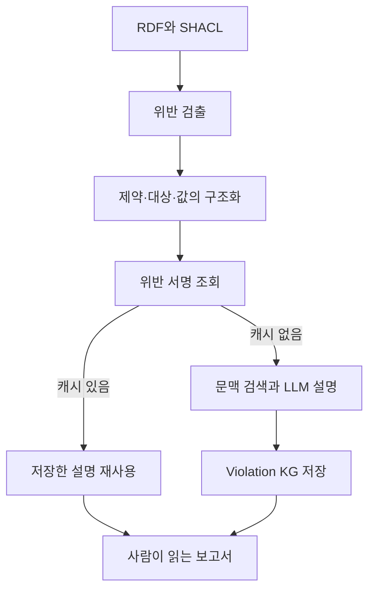

# xpSHACL 리뷰 — 검증 실패를 사람이 이해할 수 있는 설명으로 바꾸기

검증 보고서에 `sh:minCount`와 긴 URI만 나타나면 비전문가는 무엇을 확인해야 할지 알기 어렵다. 규칙 위반을 정확히 찾는 것과 그 이유를 이해하기 쉽게 전달하는 것은 별도의 문제다. xpSHACL은 SHACL 보고서에 문맥과 자연어 설명을 덧붙인다.

## 논문 정보

| 항목 | 내용 |
|---|---|
| 제목 | xpSHACL: Explainable SHACL Validation using Retrieval-Augmented Generation and Large Language Models |
| 저자 | Gustavo Correa Publio, José Emilio Labra Gayo |
| 읽은 판본 | arXiv v1, 2025년 7월 11일, 12쪽 |
| 발표 상태 | VLDB 2025 연계 제2회 LLM+Graph 워크숍 채택 표기. VLDB 본 학회 논문과 구분 |
| 원문 | [논문·공개 링크](https://arxiv.org/abs/2507.08432v1) |

본문의 구조·예시·실험 결과를 검토했다. 검증기나 LLM을 재실행하지 않았으며 아래의 시간과 건수는 저자의 보고다.

## 위반에서 설명까지의 처리 과정

확장 검증기는 위반한 shape, 대상 노드, 속성 경로와 값을 수집한다. Justification Tree Builder는 어떤 제약과 조건 때문에 위반이 발생했는지 구조화한다. RAG 단계는 관련 RDF, shape의 설명, 비슷한 위반 사례 등을 보충한다. 이 문맥을 LLM에 전달해 설명과 확인 제안을 생성한다. [원문 §4–6](https://arxiv.org/pdf/2507.08432v1#page=5)

이 그림은 구조를 간추린 것이며 정확한 함수 호출 순서를 보장하는 실행 추적은 아니다. Violation KG는 반복되는 위반의 설명을 다시 생성하지 않도록 저장하는 역할을 맡는다.

예를 들어 이름이 필수인 Person에 이름이 없으면, 설명은 어떤 개체의 어떤 필수값이 없는지 알려 줄 수 있다. 그러나 올바른 이름이 무엇인지는 보고서에 없을 수 있다. 누락을 설명하는 기능과 원천 사실을 찾아 자동으로 수리하는 기능은 구분해야 한다.

## 공개 온톨로지 평가의 전체 분모

저자는 LOV의 온톨로지를 데이터 그래프로 사용하고 라벨·설명·명명 규칙 등을 검사하는 공통 shape를 적용한다. 이 설정의 위반은 정한 품질 규칙과의 불일치이지, 해당 온톨로지의 사실이 거짓이라는 판정은 아니다. [원문 §7.2.1](https://arxiv.org/pdf/2507.08432v1#page=9)

| 처리 결과 | 보고 건수 |
|---|---:|
| 시도한 온톨로지 | 868 |
| 파싱 후 검증을 시작한 온톨로지 | 431 |
| 다운로드 오류 | 304 |
| 파싱 오류 | 131 |
| 비어 있어 건너뛴 그래프 | 2 |

성공한 자료만 보면 실제 수집 과정의 실패를 놓친다. 431개 중 위반이 있는 416개에서 145,910건의 위반을 보고했다. 설명 조회는 2,301회, 캐시 적중은 2,289회였고 생성이 필요한 고유 위반 서명은 12개였다. [원문 §7.2.1](https://arxiv.org/pdf/2507.08432v1#page=9)

높은 캐시 적중률은 이 데이터와 공통 shape 조합에서 위반 패턴이 반복됐다는 결과다. 모든 새로운 업무 규칙에서도 같은 적중률이 나온다고 예상할 근거는 아니다.

## 초기 비용과 반복 실행 비용

2MB 합성 RDF를 열 차례 처리한 별도 실험에서 pySHACL은 대략 4초, xpSHACL의 첫 실행은 약 65초, 캐시를 사용하는 후속 실행은 약 20초로 보고된다. 설명 생성 비용이 반복 실행에서 줄지만 기본 검증기 수준으로 내려가지는 않는다. [원문 §7.2.2, Figure 2](https://arxiv.org/pdf/2507.08432v1#page=10)

원문에는 캐시 실행의 잔여 오버헤드를 약 20초라고 부르는 문장도 있다. 이를 기본 검증 대비 정확한 차이로 다시 계산해 인용하기보다는, 그림과 본문이 제시한 총 실행 시간의 대략적인 수준으로 읽는 편이 적절하다.

## 설명 품질에서 아직 측정하지 않은 부분

저자는 생성 설명을 수동으로 살펴본 정성 관찰을 제시한다. 그러나 설명을 받은 사람이 더 빨리 문제를 해결했는지, 수정안을 더 정확하게 골랐는지, 설명을 잘못 믿지는 않았는지에 대한 정식 사용자 실험은 후속 과제로 남겨 둔다. [원문 §7.2.3·§7.3](https://arxiv.org/pdf/2507.08432v1#page=10)

캐시는 같은 설명을 반복 제공하므로 일관성을 높일 수 있다. 동시에 잘못된 설명을 재사용할 위험도 있다. 검토자의 관점에서는 shape·용어·문맥이 바뀌었을 때 캐시를 언제 무효화하는지, 같은 서명으로 묶인 사례에 동일한 설명이 적절한지 확인할 필요가 있다. 이는 추가 검토 항목이며 논문에서 해당 실패를 측정했다는 뜻은 아니다.

## 기여의 위치

xpSHACL은 검증을 인간의 이해와 확인 행동으로 연결하는 시스템 사례다. 측정된 기여는 처리 가능성, 설명 재사용, 실행 비용과 정성적인 설명 관찰에 있다. 사용자의 판단 개선이나 다른 LLM의 최종 답변 개선까지 이미 입증했다고 말하면 연구 범위를 넘는다.
