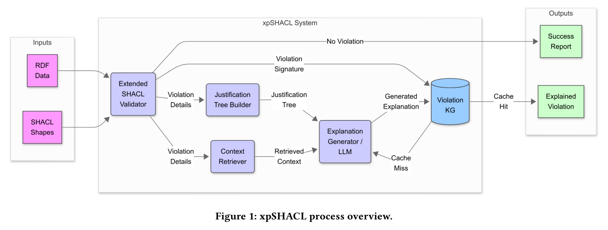
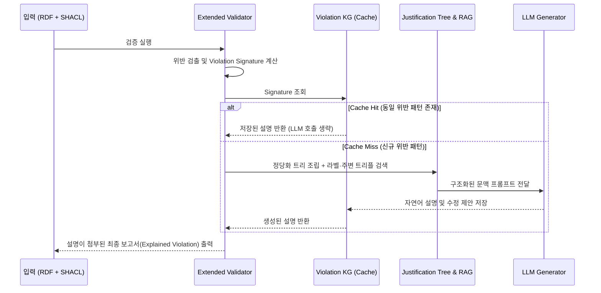
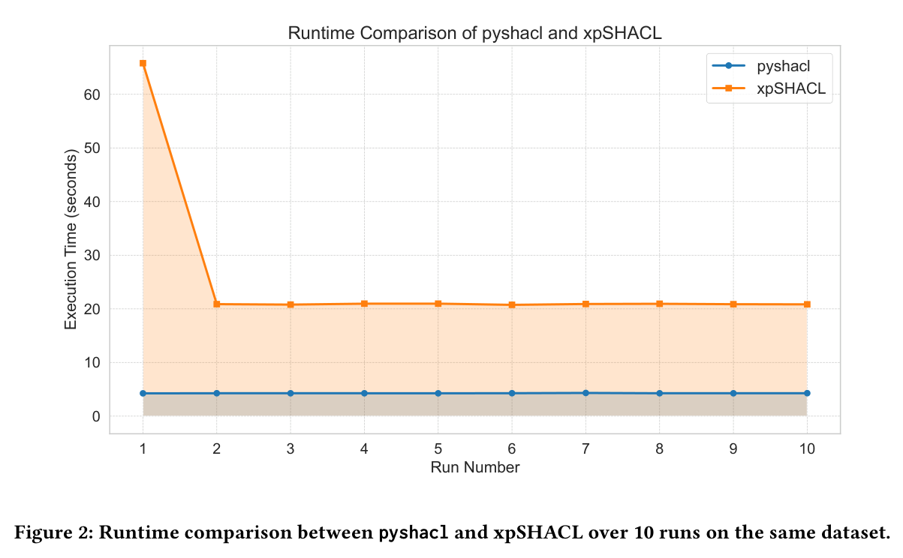

# xpSHACL 리뷰: 검증 실패를 사람이 이해할 수 있는 설명으로 바꾸기

검증 보고서에 `sh:minCount`와 긴 URI만 나타나면 비전문가는 무엇을 확인해야 할지 알기 어렵다. 규칙 위반을 정확히 찾는 것과 그 이유를 이해하기 쉽게 전달하는 것은 별도의 문제다. xpSHACL은 SHACL 보고서에 문맥과 자연어 설명을 덧붙인다.

이 글은 2026년 11월 10일에 확장한 장별 심층 리뷰다. 논문의 1장부터 8장까지를 따라가며 표준 W3C SHACL 검증 보고서의 비직관성 문제, **xpSHACL**의 5대 구성 요소(확장 검증기, 정당화 트리 빌더, 문맥 검색기, LLM 설명 생성기, Violation KG 캐시), Linked Open Vocabularies(LOV) 868개 온톨로지를 대상으로 한 대규모 실증 분모 분석(431개 검증 완료, 416개 위반 검출, 145,910건 위반, 2,289/2,301 캐시 적중), `pySHACL` 대비 10회 반복 실행 시간 비교(그림 2), 그리고 아직 측정되지 않은 사용자 연구의 경계를 차례로 읽는다. 원문의 그림 2점은 저자들의 arXiv PDF에서 캡처로 가져왔고 설명을 위해 새로 그린 도식은 Mermaid로 구분했다. 본문에 인용한 모든 수치는 저자 보고값이며 이 리뷰에서 별도로 코드를 재실행하지는 않았다.

## 논문 정보와 검토 범위

| 항목 | 내용 |
|---|---|
| 제목 | xpSHACL: Explainable SHACL Validation using Retrieval-Augmented Generation and Large Language Models |
| 저자 | Gustavo Correa Publio, José Emilio Labra Gayo |
| 소속 | Leipzig University, University of Oviedo (WESO Research Group) |
| 읽은 판본 | arXiv v1, 2025년 7월 11일 공개, 12쪽 |
| 발표 | VLDB 2025 연계 제2회 LLM+Graph 워크숍 (2nd Workshop on Generative AI and Knowledge Graphs, GenAIK / LLM+Graph @ VLDB 2025). VLDB 본 학회 정규 연구 트랙과 구분 |
| 원문 | [arXiv 페이지](https://arxiv.org/abs/2507.08432v1) · [원문 PDF](https://arxiv.org/pdf/2507.08432v1) |

원문 수록 그림 2점은 저자들의 arXiv 공개 PDF([CC BY 4.0](https://creativecommons.org/licenses/by/4.0/))에서 216 DPI로 잘라 가져왔으며 이미지별 페이지·좌표·SHA256 해시는 [그림 출처 기록](../assets/images/xpshacl/provenance.json)에 남겼다.

## 원문 구성과 읽기 지도

| 원문 | PDF 쪽 | 핵심 내용 |
|---|---|---|
| 1 Introduction | 1–2 | 표준 SHACL 검증 보고서(`sh:ValidationResult`)가 도메인 비전문가에게 읽기 어려운 이유 |
| 2 Background | 2 | RDF, SHACL 핵심 검증 메커니즘, RAG 및 지식 그래프 품질 관리 배경 |
| 3 Related Work | 2–3 | 기존 SHACL 시각화·디버깅 도구와 LLM 기반 설명 생성 연구의 공백 |
| 4 Architecture & Process Overview | 3–4 | xpSHACL 5단계 처리 파이프라인(그림 1)과 Violation Signature 캐싱 개념 |
| 5–6 System Components & Implementation | 4–5 | Justification Tree 구축, RAG 문맥 수집, 프롬프트 템플릿, Violation KG 스키마 |
| 7 Evaluation (7.1–7.3) | 5–8 | LOV 868개 온톨로지 코퍼스 전수 검증(7.2.1), `pyshacl` 대비 10회 반복 실행 시간(7.2.2, 그림 2), 정성적 설명 품질 및 타당도 위협(7.2.3–7.3) |
| 8 Conclusion & Future Work | 8–9 | 요약 및 인간 대상 사용성 평가(User Study) 후속 계획 |

## 1장–3장: 왜 정확한 SHACL 검증 보고서만으로는 부족한가

### 1.1 `sh:ValidationResult`의 기계 중심 구조

W3C SHACL 표준 검증기(`pySHACL`, TopBraid, Apache Jena SHACL 등)는 데이터 그래프가 모양 제약을 어기면 `sh:ValidationReport` 그래프를 출력한다. 각 위반 항목(`sh:ValidationResult`)에는 다음과 같은 트리플이 담겨 있다.

- `sh:focusNode`: 위반이 발생한 대상 노드 IRI (예: `ex:obs_9921`)
- `sh:resultPath`: 문제가 된 속성 경로 (예: `ex:hasMeasurementUnit`)
- `sh:sourceConstraintComponent`: 어긴 제약 컴포넌트 (예: `sh:MinCountConstraintComponent` 또는 `sh:OrConstraintComponent`)
- `sh:sourceShape`: 해당 제약을 선언한 모양 노드 (종종 익명 blank node `_:b14`)

온톨로지 엔지니어에게는 이 보고서가 명확하지만, 실제 데이터를 입력하거나 검수하는 임상 연구자, 금융 심사역, 제조 품질 담당자에게는 두 가지 장벽이 된다.

1. **중첩 논리 제약의 원인 추적 불가**: 만약 `sh:or`, `sh:not`, `sh:xone`, `sh:qualifiedValueShape`가 여러 겹으로 중첩된 모양에서 실패하면, 표준 보고서는 최상위 `sh:OrConstraintComponent`가 실패했다고만 알려 줄 뿐 구체적으로 어느 하위 분기 조건이 왜 깨졌는지 정당화 트리(justification tree)를 친절하게 풀어 주지 않는다.
2. **도메인 문맥(라벨·주석·예시)의 부재**: 긴 IRI나 코드 값만 찍혀 있을 뿐, 그 클래스와 속성이 업무상 무슨 뜻(`rdfs:label`, `rdfs:comment`)이며 어떻게 고쳐야 하는지 안내하지 않는다.

그렇다고 수만 건의 위반이 쏟아질 때마다 매번 거대 언어 모델(LLM)을 호출해 설명을 생성하면 시간과 API 비용이 감당할 수 없이 커진다. 저자들은 **정당화 트리(Justification Tree) + 문맥 검색(RAG) + 위반 서명 캐시(Violation KG)**를 결합해 이 문제를 푼다.

## 4장–6장: xpSHACL의 5대 구성 요소와 위반 서명 캐싱

### 4.1 전체 프로세스 아키텍처(원문 그림 1)

4장부터 6장까지는 xpSHACL의 다섯 가지 핵심 모듈과 데이터 흐름을 설명한다(원문 그림 1).

그림 1. xpSHACL 시스템의 입력(RDF 데이터, SHACL 모양), 5대 내부 구성 요소(Extended SHACL Validator, Justification Tree Builder, Context Retriever, Explanation Generator / LLM, Violation KG), 그리고 출력 보고서 생성 흐름. Publio & Labra Gayo, PDF 3쪽. [원문](https://arxiv.org/pdf/2507.08432v1#page=3) · [크게 보기](../assets/images/xpshacl/figure-01-process-overview.png) · [CC BY 4.0](https://creativecommons.org/licenses/by/4.0/).

각 모듈의 역할은 다음과 같다.

1. **Extended SHACL Validator**: `pySHACL`을 래핑해 표준 검증을 수행하고, 위반이 없으면 즉시 성공 보고서를 반환한다. 위반이 검출되면 각 위반의 세부 정보(`focusNode`, `resultPath`, `value`, `sourceShape`, `constraintComponent`)를 추출한다. 또한 개별 인스턴스 IRI를 제거하고 **(어긴 모양 ID + 속성 경로 + 제약 컴포넌트 유형)**만으로 구성된 정규화된 해시 키인 **위반 서명(Violation Signature)**을 계산한다.
2. **Violation KG (캐시 저장소 조회)**: 계산된 위반 서명을 먼저 **Violation KG**에 조회한다.
   - **Cache Hit (캐시 적중)**: 동일한 모양·경로·제약 패턴에 대해 이미 생성해 둔 설명 템플릿이 있으면 LLM을 부르지 않고 즉시 저장된 설명을 가져와 현재 노드의 값만 채워 넣는다.
   - **Cache Miss (캐시 미적중)**: 처음 보는 위반 패턴일 때에만 아래의 3, 4번 모듈을 실행한다.
3. **Justification Tree Builder**: 위반된 모양 정의를 재귀적으로 따라가며, 어떤 상위 모양과 하위 속성 제약(`sh:minCount`, `sh:datatype`, `sh:node` 등)의 조합 때문에 실패에 이르렀는지 계층적 정당화 트리로 조립한다.
4. **Context Retriever (RAG 단계)**: 데이터 그래프와 모양 그래프, 그리고 연결된 온톨로지에서 위반과 관련된 개체·속성의 `rdfs:label`, `rdfs:comment`, `skos:definition`, 주변 이웃 트리플을 검색해 문맥 패키지를 만든다.
5. **Explanation Generator / LLM**: 정당화 트리와 검색된 문맥을 프롬프트에 담아 LLM(실험에서는 로컬 Ollama 기반 `Llama 3` / `Mistral` 계열 또는 API 모델 활용 가능 구조)에 전달하고, **(a) 왜 위반이 발생했는지에 대한 평이한 자연어 설명**과 **(b) 데이터 또는 스키마를 어떻게 점검·수정해야 하는지에 대한 구체적 권고(actionable suggestion)**를 생성한다. 생성된 설명은 재사용을 위해 Violation KG에 영구 저장된다.

> [!IMPORTANT]
> **설명 생성과 데이터 자동 수리(Auto-repair)의 경계**:
> xpSHACL은 "어떤 노드의 어떤 필수 속성이 왜 빠졌는지"를 사람에게 설명하고 수정 방향을 제안할 뿐, 외부 원천 데이터에서 실제 정답 값을 찾아와 그래프를 자동으로 고쳐 쓰지 않는다. 누락된 사실의 설명(explainability)과 원천 증거 확보(ground-truth repair)는 별개의 단계다.

## 7장: LOV 868개 온톨로지 전수 실험과 반복 실행 성능 분석

### 7.1 LOV 코퍼스 평가의 전체 분모와 캐시 적중률(7.2.1절)

7.2.1절에서 저자들은 실제 공개 온톨로지 생태계에서 위반 패턴이 얼마나 반복되는지 확인하기 위해 **Linked Open Vocabularies (LOV)** 카탈로그에 등록된 온톨로지들을 데이터 그래프로 삼고, 온톨로지 메타데이터 품질(라벨·설명·명명 규칙 등)을 검사하는 공통 SHACL 모양 집합으로 전수 평가를 수행했다.

이 실험 결과를 인용할 때에는 성공한 온톨로지만 추려 말하지 않고 **시도한 전체 분모(868개)와 단계별 탈락 건수**를 정확히 보존해야 한다.

| 처리 단계 및 범주 | 온톨로지 / 위반 건수 | 비율 및 비고 |
|---|---:|---|
| **총 수집 시도 온톨로지 (Attempted)** | **868개** | LOV 등록 대상 전체 |
| ├─ 네트워크/다운로드 실패 (Download errors) | 304개 | 죽은 URI, 서버 응답 오류 등 |
| ├─ 구문 파싱 실패 (Parsing errors) | 131개 | 잘못된 RDF/XML·Turtle 구문 등 |
| └─ 빈 그래프 (Empty graphs) | 2개 | 파싱 후 트리플 0건 |
| **정상 파싱 및 SHACL 검증 수행 (Validated)** | **431개** | 전체 시도의 **49.65%** |
| ├─ 위반 0건 (Conforming) | 15개 | 검증 대상의 3.48% |
| └─ **1건 이상 위반 발생 (With violations)** | **416개** | 검증 대상의 **96.52%** |
| **검출된 총 SHACL 위반 건수 (Total violations)** | **145,910건** | 416개 온톨로지 합산 |
| **Violation KG 조회 횟수 (Total lookups)** | **2,301회** | 배치·그룹 단위 설명 요청 |
| ├─ **캐시 적중 (Cache Hits)** | **2,289회** | **적중률 99.48%** |
| └─ **캐시 미적중 / 신규 LLM 생성 (Unique signatures)** | **12회** | 고유 위반 서명 **12종**만 LLM 호출 |

이 표에서 두 가지 핵심 사실이 드러난다.

1. **실제 웹 온톨로지 수집의 현실적인 실패율**: 868개 중 절반가량(437개)이 다운로드나 구문 파싱 단계에서 탈락했다.
2. **대량 위반에서의 극단적인 패턴 반복성**: 431개 온톨로지에서 무려 **145,910건**의 위반이 쏟아졌지만, 공통 품질 SHACL 모양을 적용했기 때문에 고유한 위반 서명(Violation Signature)은 단 **12종**뿐이었다. 그 결과 2,301회의 설명 조회 중 **2,289회(99.48%)**를 캐시에서 즉시 처리하고 LLM 호출은 단 12회로 끝낼 수 있었다. 다만 이 99.5% 적중률은 **모든 대상에 동일한 공통 SHACL 모양 세트를 적용한 실험 조건**의 산물이므로, 모양 자체가 수백 개씩 계속 바뀌는 환경에 그대로 일반화해서는 안 된다.

### 7.2 `pySHACL` 대비 10회 반복 실행 시간 비교(7.2.2절, 원문 그림 2)

7.2.2절에서는 약 2MB 크기의 합성 RDF 데이터셋을 대상으로 순수 검증기인 `pyshacl`과 설명 생성이 결합된 `xpSHACL`을 동일한 데이터에 대해 10회 연속 실행하며 총 소요 시간을 비교했다(원문 그림 2).

그림 2. 동일 데이터셋에서 10회 반복 실행 시 `pyshacl`(파란 선)과 `xpSHACL`(주황 선)의 실행 시간(초) 비교. Publio & Labra Gayo, PDF 6쪽. [원문](https://arxiv.org/pdf/2507.08432v1#page=6) · [크게 보기](../assets/images/xpshacl/figure-02-runtime-comparison.png) · [CC BY 4.0](https://creativecommons.org/licenses/by/4.0/).

그림 2의 궤적을 보면 캐시 전후의 성능 특성이 한눈에 보인다.

- 기본 **`pyshacl`**(파란 선)은 설명 생성 없이 검증만 수행하므로 1회차부터 10회차까지 약 **4.3초**로 일정하다.
- **`xpSHACL`**(주황 선)은 캐시가 비어 있는 **1회차(Run 1)**에서 정당화 트리 조립, RAG 문맥 검색, LLM 호출을 모두 수행하느라 약 **65.5초**가 걸린다.
- 그러나 설명이 Violation KG에 저장된 뒤인 **2회차부터 10회차(Runs 2–10)**까지는 LLM 호출이 생략되면서 실행 시간이 약 **20.8초**로 일정하게 유지된다(1회차 대비 약 68% 단축).
- 물론 캐시가 100% 적중하더라도 정당화 트리 구성과 보고서 후처리 및 KG 조회 비용이 남아 있기 때문에 순수 `pyshacl`(~4.3초)보다는 약 16초가량의 추가 시간(총 ~20.8초)이 소요된다.

### 7.3 정성적 관찰과 타당도 위협(7.2.3–7.3절)

7.2.3절과 7.3절에서 저자들은 생성된 설명이 누락된 속성 이름과 기대 타입을 평이한 문장으로 잘 풀어낸다는 정성적 예시를 제시하면서도, 연구의 한계를 분명하게 인정한다.

1. **인간 대상 사용성 평가(Human User Study) 미실시**: 생성된 설명을 읽은 도메인 사용자가 실제로 표준 SHACL 보고서를 볼 때보다 오류 원인을 더 빨리 찾았는지, 혹은 잘못된 수정 제안을 그대로 믿는 과신(over-reliance)은 없었는지 정량적인 인간 실험은 아직 수행되지 않았다(8장 향후 과제로 명시).
2. **서명 추상화 수준과 문맥 특이성의 교환 관계**: 위반 서명(Signature)을 `(모양 + 경로 + 제약 컴포넌트)` 수준으로 거칠게 잡으면 캐시 적중률은 99%로 치솟지만, 개별 인스턴스의 특수한 이웃 값 때문에 발생한 미묘한 위반 차이를 설명에 반영하기 어렵다. 반대로 인스턴스 문맥까지 서명에 넣으면 설명은 정교해지지만 캐시 적중률이 떨어진다.

## 8장: 종합 판단과 우리 연구(`shacl-graphrag`)에의 시사점

xpSHACL은 SHACL 검증기를 단순한 '통과/차단(Pass/Fail) 판정기'에서 '설명 가능한 피드백 생성기'로 확장할 때 어떤 시스템 아키텍처가 필요한지 보여 주는 실용적인 워크숍 논문이다.

1. **우리 연구(`shacl-graphrag`)의 LLM 온톨로지 도구 실험과의 대비**:
   - 우리의 `llm-ontology-tools-1` 및 `yago-native-tools-1` 실험에서는 LLM 에이전트가 직접 SHACL 검증 도구를 호출하고 그 결과를 바탕으로 답변을 수정하거나 보류(abstention)했다. 이때 원시 `pySHACL` 보고서나 단순 요약만 주면 모델이 왜 클래스 위반이 났는지(예: 연결된 장소 노드의 타입 트리플 누락인지 실제 사실 오류인지) 오판하는 경우가 있었다.
   - xpSHACL의 **Justification Tree Builder + 주변 라벨/정의 Context Retriever** 구조는 사람뿐만 아니라 **검증 결과를 피드백으로 받아 쿼리를 수정해야 하는 LLM 에이전트에게도 훨씬 정확한 구조적 진단 문맥을 제공하는 전처리기**로 활용할 수 있다.
2. **캐시 무효화(Cache Invalidation) 설계의 중요성**:
   - Violation KG에 한 번 저장된 LLM 설명이 계속 재사용되므로, 만약 첫 번째 생성에서 LLM이 부정확한 설명을 만들었거나 이후 온톨로지/모양 정의가 개정되었다면 잘못된 설명이 반복 배포될 위험이 있다. 따라서 실무 도입 시에는 모양 그래프의 해시(fingerprint)를 위반 서명에 함께 묶어 스키마 변경 시 캐시가 자동 무효화되도록 설계해야 한다.
