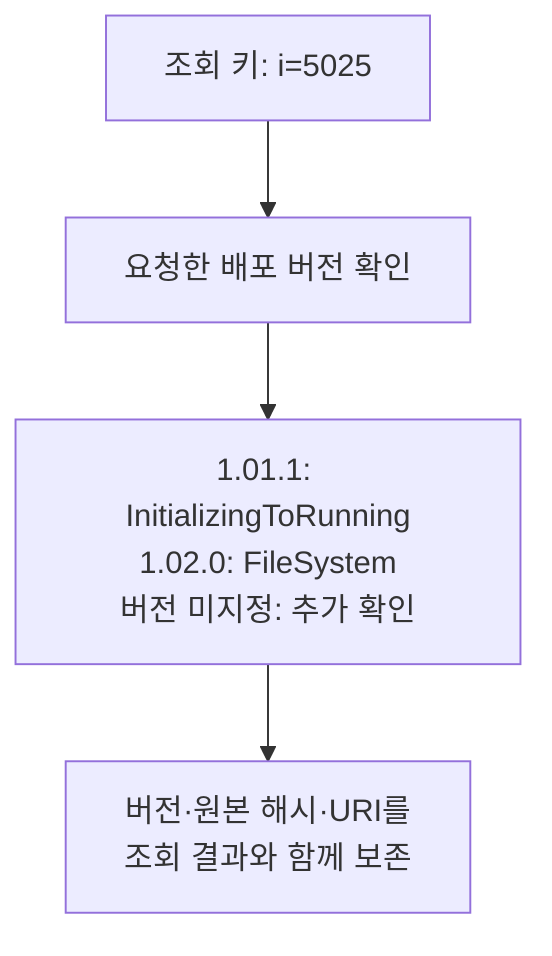

# 제조 정보모델의 버전과 식별자 해석

제조 사례의 변경 이력을 보완하기 위해 OPC Foundation이 공개한 MachineTool 정보모델 두 버전을 비교했다. 작업표나 실제 설비 이력이 아니라, 실제 배포된 스키마 파일의 변경이다. 기존 용접 자료의 값·출처 점검을 대체하지 않고 제조 분야에서 버전과 식별 범위를 다뤄야 하는 사례를 추가한다.

## 공개 스키마와 비교 범위

자료는 [OPC Foundation UA-Nodeset 저장소](https://github.com/OPCFoundation/UA-Nodeset)의 MachineTool 1.01.1과 1.02.0이다. 각각 2022-07-04와 2024-11-01 배포 태그를 고정했고 원본 XML과 MIT 1.00 라이선스 주석을 보존했다. 공식 [MachineTool 사양 안내](https://reference.opcfoundation.org/specs/OPC-40501-1)도 1.02.0의 발행일을 2024-11-01로 표시한다.

비교기는 숫자형 NodeId, 노드 종류, 네임스페이스를 포함한 BrowseName, 명시된 부모·DataType·참조만 읽는다. 값, 설명, 그 밖의 속성과 가져오지 않은 외부 모델의 정의는 비교 대상에서 제외했다. 따라서 아래 결과는 선택한 정의 필드의 차이이며 전체 의미 변경이나 장비 호환성 판정이 아니다.

| 항목 | 1.01.1 | 1.02.0 |
|---|---:|---:|
| 파일에 정의된 노드 | 552 | 589 |
| 참조의 출현 횟수 | 2,206 | 2,375 |
| 선언된 필수 외부 모델 | 4 | 6 |

네임스페이스 URI와 숫자 식별자로 구성한 조회 키 545개가 두 파일에 공통으로 있었다. 새 파일에만 있는 키는 44개, 이전 파일에만 있는 키는 7개였다. 공통 키 중 49개에서 선택한 필드가 달랐다. 이 49개 모두 참조가 달랐고 그중 BrowseName 15개·부모 14개·DataType 10개가 달랐다. 항목은 서로 겹치므로 합산하지 않는다. 원문을 살펴본 뒤 만든 탐색적 점검이며 새로운 평가용 표본이 아니다.

## 같은 식별자에 기록된 다른 정의

두 파일의 `ns=1;i=5025`는 같은 MachineTool 네임스페이스 URI를 가리킨다. 그러나 기록된 정의는 다르다.

| 항목 | 1.01.1 | 1.02.0 |
|---|---|---|
| NodeId | `ns=1;i=5025` | `ns=1;i=5025` |
| BrowseName 원문 | `1:InitializingToRunning` | `FileSystem` |
| ParentNodeId 원문 | `ns=1;i=101` | `ns=1;i=13` |

이 차이를 표준의 결함이라고 판정하지 않았다. “이 식별자가 어느 버전에서 무엇으로 기록돼 있는가”라는 조회에는 버전 문맥이 필요하다는 사례다. 동일한 조회 키가 보인다고 정의가 그대로 유지됐다고 가정할 수 없다. 반대로 이름이 바뀌었다는 관찰만으로 실제 설비가 바뀌었다고 말할 수도 없다.

## 다른 번호가 가리키는 같은 대상

반대 방향의 사례도 있다. `SignalColor`, `SignalModeLight`, `StacklightOperationMode` 별칭은 이전 파일에서 네임스페이스 번호 4를, 새 파일에서 번호 6을 사용한다. 두 번호는 각 파일에서 같은 `http://opcfoundation.org/UA/IA/` URI를 가리킨다. 숫자 식별자도 각각 3004·3005·3002로 유지된다.

따라서 원문 `ns=4;i=3004`와 `ns=6;i=3004`가 다르다는 이유만으로 대상이 달라졌다고 판단하면 안 된다. 먼저 각 파일의 NamespaceUris를 해석해야 한다. 새 파일의 번호 4는 Machinery/Jobs를 가리키므로 번호 자체를 파일 간 공통 식별자로 사용할 수도 없다.

이는 외부 IA 모델의 내용이 그대로라는 뜻은 아니다. 필수 모델의 버전도 별도로 기록돼 있으며 이번에는 그 모델 파일들을 가져오지 않았다. “참조 대상의 URI와 식별자가 같음”과 “참조 대상의 전체 정의가 같음”을 구분한다.

## 외부 모델의 버전 표기와 파일 고정

별도 후속 점검으로 IA 모델 세 파일의 메타데이터도 확인했다. 2022-06-15 파일과 2024-02-28 파일은 모두 `Version=1.01.2`를 표시하지만 발행일과 파일 해시가 다르다. 뒤의 파일에는 `ModelVersion=1.1.2`도 있다. 이 파일들은 앞선 MachineTool 정의 비교와 1,192개 조회 계산에 소급해서 포함하지 않았다.

[OPC UA Part 6, Annex F](https://reference.opcfoundation.org/specs/OPC-10000-6/annex-f)는 사람이 읽는 `Version` 문자열과 비교에 사용하는 `ModelVersion`·`PublicationDate`를 구분한다. `RequiredModels`의 최소 버전 요구는 더 나중 모델을 허용할 수 있으므로 정확히 같은 파일만 사용해야 한다는 조건과도 다르다. 이번 실험에서 파일 해시를 고정한 목적은 재현성이다. 그것을 표준의 호환성 규칙이라고 제시하지 않는다. 외부 모델의 의존성을 자동 해결하거나 현장 설치가 호환되는지 검사하지도 않았다.

기존 용접 작업표에서 찾지 못했던 문서 이력을 이 스키마 이력으로 대체할 수는 없다. 다만 제조 자료를 다루는 시스템이 이름·식별자·배포 버전을 함께 관리해야 하는 사례를 별도로 살펴볼 수 있다.

## 백엔드가 함께 지켜야 할 조건

이 자료에서는 최소한 다음 문맥이 조회 결과에 남아야 한다.

- 어떤 배포 버전과 원본 파일 해시에서 가져온 정의인지.
- NodeId의 네임스페이스 번호를 어떤 URI로 해석했는지.
- 참조의 종류와 정방향·역방향을 어떻게 보존했는지.
- 외부 모델을 실제로 읽었는지, 버전 요구만 기록했는지.

JSON·SQL·Neo4j·Neptune 모두 이 조건을 명시적으로 구현할 수 있다. 예를 들어 버전을 포함한 키나 조회 조건, RDF의 그래프 문맥을 사용할 수 있다. RDF를 선택했다고 배포 버전이 자동으로 구분되거나, Neo4j를 선택했다고 의미를 공유할 수 없는 것은 아니다. 정의 필드의 첫 비교는 오프라인 파서로 실행했다. 이후 선택된 타입 관계를 실제 Neo4j·n10s·Neptune에서 비교한 결과는 아래에 따로 제시한다. 모든 정의 필드나 전체 표준의 DB 간 동등성을 검증한 것은 아니다.

SHACL은 선언된 조건을 검사하는 데 사용할 수 있다. 예를 들어 전달된 레코드의 출처 버전이 요청된 버전과 맞는지 검사할 수 있다. 아래 최종 검토 진단에서는 버전·출처·실행 상태를 공통 메타데이터로 주고 Python과 SHACL의 알림을 비교했다. LLM 답변 개선 효과는 측정하지 않았다.

## 파일·노드·개별 질문의 재검토 범위

같은 두 스냅샷으로 재검토 범위도 점검했다. 두 파일에서 확인한 조회 키의 합집합은 596개다. 각 키마다 BrowseName과 직접 참조 목록을 묻는 두 질문을 만들었다. 총 1,192개 조회는 같은 자료에서 파생된 개발 항목이며 독립적인 현장 질문 표본이 아니다. 파일을 모두 읽은 뒤 만든 질문 목록이므로 미래의 사용자 질의를 예측한 결과로도 볼 수 없다.

정책은 다음처럼 명시했다.

1. **파일 전체**: 원본 파일 해시가 바뀌면 모든 질문을 재검토한다.
2. **해당 노드**: 질문이 가리키는 키의 종류·이름·부모·DataType·참조 중 하나가 바뀌거나 키가 추가·제거되면 재검토한다.
3. **개별 질문의 필드**: BrowseName 질문은 해당 키의 BrowseName을, 참조 질문은 해당 키의 직접 참조 목록을 비교한다. 키의 추가·제거도 해당 질문의 결과 변경으로 취급한다.

예를 들어 노드의 참조만 바뀌면 2번은 그 노드의 이름 질문도 표시한다. 3번은 이름 값이 그대로인 질문은 표시하지 않고 참조 질문만 표시한다. 여기서 질문을 좁힌다는 말은 질문 문자열을 더 짧게 만든다는 뜻이 아니라 **각 질문이 읽는 키와 필드를 명시한다는 뜻**이다.

| 재검토 정책 | 전체 조회 | 결과가 바뀐 조회 | 재검토 표시 | 변경을 놓친 조회 | 결과가 그대로인데 표시된 조회 |
|---|---:|---:|---:|---:|---:|
| 파일 전체 | 1,192 | 166 | 1,192 | 0 | 1,026 |
| 해당 노드의 선택 필드 | 1,192 | 166 | 200 | 0 | 34 |
| 개별 질문의 필드 | 1,192 | 166 | 166 | 0 | 0 |

마지막 정책이 정확히 일치한 것은 이 직접 조회의 필드 의존성을 사람이 정확히 지정했고 양쪽 스냅샷을 모두 제공했기 때문이다. 자동 자연어 해석이나 일반적인 변경 탐지 능력을 입증한 것이 아니다. 숨겨진 원문 누락, 잘못 지정한 의존 필드, 외부 모델 변경에는 이 결과를 그대로 적용할 수 없다. 표시된 질문을 자동 차단하거나 답변을 수정하지도 않았다. 재검토 대상 수가 줄었다고 사람의 검토 시간이 같은 비율로 줄었다고 말할 수는 없다.

이번 계산은 모든 정책에 두 스냅샷 전체를 제공했다. 실제 DB 조회 호출 수나 네트워크 사용량의 감소는 측정하지 않았다.

## 두 버전을 함께 보관한 조회

두 버전의 정의를 한 저장소에 함께 넣고 버전을 지정해 조회하는 오프라인 후속 점검도 했다. 조회 키에는 원본 XML 해시·네임스페이스 URI·숫자 NodeId를 함께 넣었다. 같은 숫자만 보고 다른 네임스페이스의 정의를 가져오거나 새 버전으로 과거 정의를 덮어쓰지 않기 위한 실험용 표현이다.

각 버전에서 i=5025의 이름·부모·명시된 참조·참조 대상의 파일 내 정의, SignalColor 별칭, IA 외부 모델 요구를 물었다. 2개 버전 × 6개 질문 × SQLite·RDFLib의 24개 슬롯이 모두 완료됐고 12개 질문 쌍의 반환 값이 일치했다. 별도 사후 검사기는 원본 XML을 직접 읽어 파일 해시 두 개와 24개 반환 값의 해당 필드를 대조했다. 모두 일치했지만 전체 XML 의미나 중간 변환 전체를 검증한 결과는 아니다.

참조에 등장하는 대상과 선택한 파일에 실제 정의된 대상을 구분했다. 외부 대상을 찾지 못한 경우에도 “선택한 파일에 정의 없음”으로 남겼다. 이를 전 세계에 없는 대상이나 잘못된 참조라고 판정하지 않았다. 이 실행에서 참조는 JSON 값으로 저장한 뒤 대상 키를 다시 조회했으므로 네이티브 그래프 탐색 성능을 비교한 실험도 아니다.

소프트웨어 점검에서는 없는 스냅샷과 정의가 없는 네임스페이스를 구분했고 두 입력 중 하나가 실패해도 계획한 24개 슬롯 중 12개의 실패를 보존했다. 두 네임스페이스에 같은 숫자의 노드가 모두 정의된 충돌 사례까지 시험한 것은 아니다. 사후 검사기에 잘못된 이름·출처 해시·없는 XML을 주는 통제도 별도로 확인했다. 이 24개 정의 필드 조회는 SQLite와 RDFLib 비교다. 별도의 실제 DB 비교는 아래의 타입 계층 조회에 한정되며, LLM 답변 평가는 실행하지 않았다.

## 공개 제조 모델의 부분 상속 비교

기존 제조 데이터에서 우리가 작성한 계층과 별개로 MachineTool의 두 배포본에 실제 기록된 ObjectType 계층을 비교했다. 각 파일에서 ObjectType 62개, 모델 객체 150개, 직접 상속 관계 62개와 타입 연결 150개를 읽었다. 외부 모델 정의는 아직 불러오지 않았다. 따라서 여기서 말하는 객체는 모델에 선언된 객체이며 공장에서 가동 중인 장비 150대를 뜻하지 않는다.

각 버전의 62개 타입에 대해 상위 타입과 해당 타입에 속하는 모델 객체를 물었다. 248개 질문에 직접 조회·Python 전이 규칙·OWL-RL 7.6.2를 적용했다. 744개 슬롯이 모두 완료됐다. Python과 OWL-RL은 248개 질문에서 같은 답 집합을 반환했다. 직접 조회와 달라진 질문은 상위 타입 44개, 객체 소속 6개였고 추가된 답의 출현 수는 각각 52개와 20개였다. 같은 계층을 반복해서 묻는 개발용 질문이므로 248개의 독립 평가 사례로 해석하지 않는다.

예를 들어 PartLoadPrognosisType의 직접 상위는 PrognosisType이다. 전이 규칙을 적용하면 그 위에 기록된 기본 네임스페이스 i=58도 반환한다. ProductionStateMachineType에 직접 연결된 모델 객체는 없지만 하위 타입까지 포함하면 각 버전에서 7개가 반환된다. 이 7개는 모두 이름이 State여도 서로 다른 식별자다. 이름만으로 합치면 결과의 의미가 달라진다.

별도 사후 검사기는 원본 XML을 직접 읽고 다른 탐색 코드로 답을 계산했다. 두 원본 해시와 계획·실행 항목을 확인했으며 744개 반환 값이 선택한 XML 관계의 계산값과 일치했다. 잘못된 답과 중복 행을 검출했고 원본 하나가 없거나 해시가 틀리면 372개를 채점 불가로 남겼다. 검사 결과로 실행 답을 고치지는 않았다. 이 대조는 선택한 상속·타입 연결에 한정되며 XML 전체나 OPC UA의 속성 상속·재정의 규칙을 검증한 것은 아니다.

이 결과는 같은 제한된 의미를 구현하면 Python과 OWL-RL이 같은 답을 낼 수 있음을 확인한다. RDF 우위나 LLM 답변 개선, 현장 설비의 호환성은 측정하지 않았다. 실제로 두 배포본의 선택한 상속 관계는 같지만 일부 객체의 타입 연결은 달랐다. 한 종류의 계층 질문이 안정적이라고 해서 전체 모델 변경이 무해한 것은 아니다.

산출물은 `research/manufacturing-model-change-1/subtype-offline-001/`에 보관했다. 공식 규정의 범위는 [HasSubtype 설명](https://reference.opcfoundation.org/specs/OPC-10000-3/7.10)과 [ObjectType·VariableType 상속 설명](https://reference.opcfoundation.org/specs/OPC-10000-3/6.3)을 함께 확인해야 한다.

## 실제 Neo4j·n10s·Neptune 비교

앞선 비교는 로컬 Python과 OWL-RL 실행이었다. 이번에는 같은 두 배포본의 선택된 타입 관계를 실제 Neo4j와 Neptune에 적재했다. 배포본마다 원문 관계 212개를 사용했고 외부 OWL-RL로 계산해 저장할 관계는 각각 288개와 289개였다. 외부 모델의 정의 전체는 가져오지 않았다.

| 비교군 | 구현한 의미 | 완료 | 구현 범위 밖 |
| --- | --- | ---: | ---: |
| Neo4j Cypher | 가변 길이 경로로 상위 타입과 모델 객체 소속 조회 | 248 | 0 |
| Neo4j n10s | `nodesInCategory`에 타입·상위 타입 관계 이름을 지정 | 124 | 124 |
| Neptune SPARQL | 원문 관계에 `+`, `*` 속성 경로를 적용 | 248 | 0 |
| 외부 OWL-RL + Neptune | 외부에서 도출한 관계를 저장한 뒤 직접 조회 | 248 | 0 |

계획한 992개 항목 중 868개를 실행했다. 실행된 반환 값은 같은 정책의 Python 결과와 모두 같았다. n10s의 124개 미지원 항목은 이번 어댑터에 상위 타입 조회를 구현하지 않았다는 뜻이다. 제품 자체가 그 조회를 할 수 없다는 결론은 아니다. Neo4j 5.26.32에서 n10s 프로시저의 존재를 확인했고 실제 호출했다.

여기서는 **선택된 타입 계층의 도달 가능성과 모델 객체의 타입 소속**을 맞췄다. Neo4j에는 `SUBTYPE`·`TYPEOF` 관계를, RDF에는 `rdfs:subClassOf`·`rdf:type` 관계를 적재했다. Neptune이 OWL 추론을 수행한 것은 아니다. 원문 관계를 경로로 조회하는 조건과 외부에서 계산한 관계를 직접 조회하는 조건을 분리했다. 전체 OPC UA 상속 규칙, 속성 재정의, 실제 설비 상태와 성능은 비교하지 않았다.

## 반환 값의 근거와 최종 검토

저장된 오프라인 결과 744개에서 양의 반환 값 759회에 각각 원문 관계로 이어지는 경로 하나를 연결했다. 빈 반환 값은 200개 결과에 있었다. 이는 모든 증명 경로나 최소 변경 영향 범위를 찾았다는 뜻이 아니다. 외부 정의가 빠진 경계도 별도로 남겼다. 선택된 자료에서 값의 근거를 확인하는 일과 전체 표준을 빠짐없이 확인하는 일은 구분해야 한다.

최종 검토는 답변을 차단하거나 고치지 않는 알림으로 구성했다. 사용한 출처의 해시, 요청한 버전의 해시, 근거 없는 반환 값의 수, 읽지 않은 정의의 수, 실행 상태, 전체 범위 확인 요청 여부를 Python과 SHACL에 동일하게 제공했다. 두 개의 기존 메타데이터 사례와 네 개의 조건 변경 사례에서 두 검사기의 알림 집합은 6/6 같았다. 버전 불일치, 근거 없는 값, 실행 실패, 전체 범위 미확인을 구분했다.

이 검사는 주어진 메타데이터를 해석하는 동작 확인이다. SHACL이 새로운 사실을 찾아냈거나 LLM의 답을 개선했다는 결과가 아니다. 특히 빈 답에 알림이 없더라도 대상이 실제로 없다는 보증은 아니다. 데모에서는 조회 결과, 오프라인 OWL-RL 결과의 근거 경로, 최종 검토 알림을 서로 구분해 보여준다.

## 기존 근거가 남아 있어도 답이 달라지는 경우

두 배포본을 비교하자 `ObligationType`의 정의와 기존 반환 값의 근거는 그대로인데 여기에 속하는 모델 객체 `i=5068`이 새로 등장했다. 선택한 파일 안의 소속 객체를 묻는 답은 1개에서 2개로 바뀌었다. 기존 답을 지지하는 관계가 아직 존재한다는 확인만으로는 새 객체의 추가를 감지할 수 없다.

이 사례를 보고 같은 두 배포본의 124개 타입 조회를 다시 점검했다. 사후에 구성한 개발 진단이며 새 평가 표본은 아니다. 전체 선택 그래프가 달라지면 모두 재검토하는 정책은 124개를 표시했다. 기존 양의 근거 경로가 사라졌는지만 보는 제한적인 대조군은 아무것도 표시하지 않아 바뀐 답 1개를 놓쳤다. 조회 중 읽은 인접 관계 묶음의 변경을 확인한 정책은 해당 1개만 표시했다.

소속 객체를 찾을 때는 방문한 타입별로 하위 타입 목록과 직접 소속 객체 목록을 읽었다. 빈 목록을 읽은 경우도 기록했다. 이후 두 스냅샷에서 이 목록이 바뀌었는지 확인하면, 기존 반환 값에 들어 있지 않던 새 객체도 변경 신호가 된다. 원래 답을 고치지는 않았고 재검토 대상만 표시했다.

이는 **양의 근거 추적과 변경 감지에 필요한 읽기 범위가 다르다**는 실제 배포본의 작은 사례다. 이 정책의 정확한 일치는 두 선택 스냅샷과 조회 규칙을 완전하게 제공한 조건에서 관찰됐다. 변경 피드가 빠졌을 때의 안전성, 최소 재검토 범위, 사람의 유지보수 시간, LLM 답변 개선이나 SHACL 고유의 이점은 검증하지 않았다. 여러 경로 중 하나만 사라져도 답은 같을 수 있으므로, 읽은 관계의 변경이 항상 답의 변경을 뜻하지도 않는다.

## 질문과 판단 한계

| 질문 | 현재 자료로 점검할 내용 | 남는 한계 |
|---|---|---|
| 각 배포 버전에서 i=5025는 무엇으로 기록됐는가 | 해당 버전의 이름·부모·참조 | 실제 설비 정체성과 무관 |
| 같은 식별자라면 정의도 같은가 | 두 원문 정의의 차이 | 표준의 결함이나 호환성 판단은 별도 |
| ns 번호가 달라지면 참조 대상도 달라지는가 | 각 파일의 URI 매핑과 숫자 식별자 | 외부 모델의 전체 정의는 미확인 |
| 새 버전은 어떤 외부 모델을 요구하는가 | RequiredModel의 URI·버전·발행일 | 설치된 현장 시스템 상태는 없음 |
| 이 변경을 적용해도 현장 장비가 정상 동작하는가 | 이 자료만으로 판단 불가 | 장비 구성·구현·시험 결과가 필요 |

이 사례는 “노드가 몇 개 이상이면 온톨로지가 유리한가”에 수치로 답하지 않는다. 하나의 조회 키라도 서로 다른 버전의 정의를 함께 다루면 문맥 관리가 필요할 수 있음을 보여준다. 그 관리를 JSON으로 할지 공유 스키마·그래프로 할지 결정하려면 시스템 수와 변경 빈도뿐 아니라 실제 유지보수 작업과 오류 비용을 별도로 측정해야 한다.

<!-- HUMANIZE-SUMMARY -->
경로: light / 장르: report / 강도: conservative
적용: C-11 연결어미 뒤 쉼표 정리, A-18 긴 관형구 문장 분리.
보존: 제목, 사실, 수치, 날짜, 고유명사, 링크, 코드, 주장과 유보 강도.
자체검증: 6/6 잠정 통과. 변경률과 등급은 공통 게이트에서 확정.
원문이 이미 간결하여 최소한으로 수정함.
