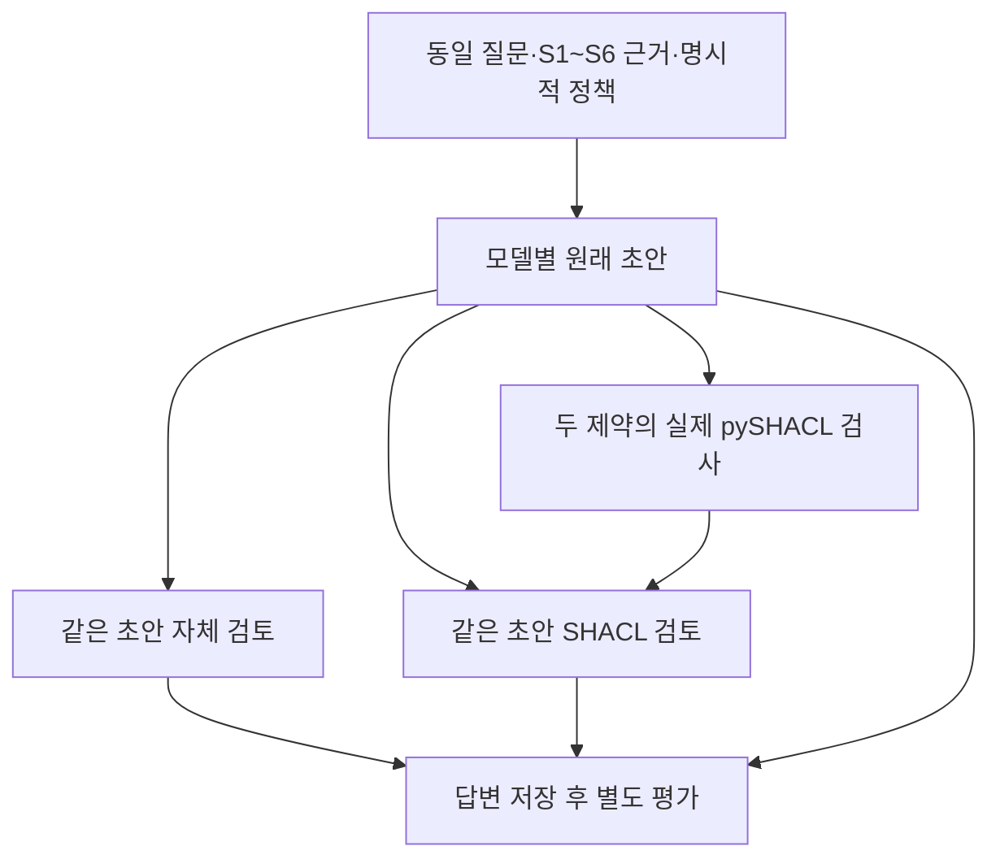

# 실제 측정 파일을 추가한 최종 답변 비교

PP6 제조 자료의 한 질문에 6개 모델을 적용했다. 초안 6건, 같은 초안을 자체 검토한 답변 6건, 같은 초안에 SHACL 자문 보고서를 붙여 검토한 답변 6건으로 총 18건이다. 모두 완료됐으며 사전에 고정한 네 필드의 판단은 세 조건 모두 6/6 일치했다. 초안부터 네 필드가 맞았으므로 이번 질문에서는 SHACL 보고서의 추가 개선 효과를 확인하지 못했다.

이 결과는 한 제조 질문의 개발 진단이다. 모델 순위, 일반적인 답변 정확도, SHACL의 무용성을 뜻하지 않는다. 질문과 출처는 이미 살펴본 자료이며 새 평가용 표본이 아니다.

## 질문과 공통 근거

질문은 “PP6 작업표 2행의 명목 Idc, 기록된 전류 채널의 존재, 해당 결함 구간에 대응한다고 검증된 평균 전류, 적용 검토 문서 버전을 각각 판단하고 사람이 확인할 연결 규약을 제시하라”였다.

| 구분 | 제공 근거 | 고정한 판단 기준 |
|---|---|---|
| 명목 전류 | 원본 작업표의 설정 코드 1과 코드북 C3 | 450 A |
| 기록 채널 | 원본 README와 HDF5 필드 검사 | 존재함 |
| 검증된 구간 평균 | 네 가지 인덱스 가정별 조건부 계산 | 연결 규약이 미검증이므로 미확인 |
| 적용 문서 버전 | 이번 조사 범위의 확인 상태 | 미확인 |

원본 HDF5에는 전류 채널이 있었다. 이전에 확보한 부분 자료에 없었다는 사실을 원본에도 없다는 뜻으로 해석하면 안 된다. 반대로 파일을 확보했다고 어노테이션의 표본 번호, 좌표계, 교정 상태까지 검증되는 것은 아니다. 조건부 평균 456.76~456.78 A는 검증된 결함 구간 평균과 구분했다. 자세한 원본 해시와 읽기 전용 검사는 [측정 자료의 경계](2026-11-07-welding-measurement-boundaries.md)에 남겼다.

## 비교 절차

B와 C는 각각 원래 초안을 검토했다. 자체 검토 결과를 다시 SHACL 검토에 넣지 않았다. 두 조건의 질문·근거·정책·원래 초안은 같고 C에만 보고서를 추가했다. 저장된 요청 18건의 위치·모델·응답 연결과 6쌍의 입력 동일성을 확인했다. 추가 원본 조회나 정답을 이용한 답변 수정은 없었다.

검사는 “연결 규약을 모르는 상태에서 검증된 구간 평균을 단정하는가”, “문서 적용성을 모르는 상태에서 버전을 단정하는가” 두 가지였다. 실제 pySHACL 실행과 같은 정책의 Python 결과를 대조했다. 여섯 초안 모두 위반 플래그가 없었다. 명목값의 정확성, 문장별 인용, 자유 서술의 함의, 교정, 외부 사실은 검사 대상이 아니다. 보고서는 강제 거부 규칙이 아닌 검토 자료로 제공했다.

## 관측 결과와 인용의 한계

| 조건 | 계획 / 완료 | 네 필드 일치 | 근거 없는 검증 평균·버전 단정 | 명목값 보류·채널 부정 |
|---|---:|---:|---:|---:|
| 초안 | 6 / 6 | 6 | 0 | 0 |
| 자체 검토 | 6 / 6 | 6 | 0 | 0 |
| SHACL 검토 | 6 / 6 | 6 | 0 | 0 |

이는 네 필드에 한정한 결과다. 전체 답변의 사실 정확도를 100%로 표현하지 않는다. 정책은 사람이 명시했고 S6에도 확인되지 않은 연결 조건을 적었다. 모델이 자연어에서 정책을 스스로 발견한 실험이 아니다.

코디네이터가 18개 원문을 제공 근거와 대조한 별도 검토에서는 모든 답변에 파일·테이블 대응, 인덱스, 좌표 변환, 교정, 문서 적용성에 관한 확인 항목이 있었다. 그러나 실제 사용자가 그 항목으로 검토를 더 잘 수행했는지는 측정하지 않았다. 이 검토는 비맹검이며 도메인 전문가의 판정이 아니다.

인용 식별자가 유효하다고 문장 전체가 그 출처 하나로 뒷받침되지는 않았다. 예를 들어 Luna의 세 답변은 S1 작업표의 표본 번호와 S6의 ‘연결 규약 미검증’을 한 문장에 묶어 S1만 인용했다. Luna의 초안과 자체 검토에는 README 설명과 파일 검사 결과를 묶은 인용도 있었다. Fable 자체 검토의 같은 워크북 해시 비교에는 S1과 S2가 함께 필요하다. 다른 곳에 관련 근거를 인용했더라도 개별 인용의 범위는 별도로 살펴야 한다. 이를 사전에 정의한 인용 점수로 사후 변환하지 않았다.

## 모델·실행 비용

기존 비교의 여섯 모델 식별자를 유지했다. Google Gemini 3.8 Flash와 Gemini 4 Argon, OpenAI GPT-6 Luna와 GPT-6 Astra, Anthropic Claude Sonnet 5.5와 Claude Fable 5.1이다. 이는 최신 시장 모델 목록에 관한 주장이 아니다.

실행 전 엔드포인트 확인에서 Argon의 기존 경로를 사용할 수 없어 `google-vertex/global` 경로로 명시적으로 바꾸고 고정했다. 다른 경로로 자동 재시도하지 않았다. 이 경로 차이는 이전 실험과의 비교 한계다.

출력 한도는 공통 2,048 토큰, reasoning 설정은 medium이었다. 입력은 보수적인 바이트 기반 상한으로 점검했으며 실제 모델별 토크나이저를 측정하지 않았다. 따라서 공통 최대 예산이지 실제 토큰 수의 완전한 일치가 아니다.

추가 18회 보고 비용은 $0.646692400이다. 기존 원장을 합친 누적은 180회 / 보고 비용 $3.368438350 / 실패 비용을 환급하지 않는 예약 원장 $4.146031030이다. 미해결 예약은 없다. 승인된 180회에 도달했으므로 남은 달러를 이유로 추가 호출하지 않는다. AWS 비용은 이 원장과 별개다.

## 이번 결과의 의미

현재 자료에서는 근거의 누락과 연결 규약 문제가 먼저 드러났다. 코드북 값을 검색 결과에 보존하고 실제 측정 파일을 확보하자 명목값·채널 존재와 미확인 구간 값을 구분하는 답변이 가능했다. 다만 이전 입력과 달라진 결과를 SHACL 보고서만의 효과로 돌릴 수 없다.

이번 보고서는 정답 인증보다 검사가 다루는 범위와 남은 확인 항목을 드러내는 자료로 읽어야 한다. 그 용도가 사람의 검토 시간이나 오류를 줄이는지는 아직 측정하지 않았다. 다음 확인 대상은 어노테이션과 측정 파일의 실제 연결 규약이며 새로 알아낸 내용을 이번에 고정한 모델 입력과 답변에 소급 적용하지 않는다.

[실제 답변 비교 데모](../experiments/seminar/measurement-review.html)에서 여섯 모델의 초안과 두 검토 답변을 원문 그대로 볼 수 있다. 저장 자료는 `research/manufacturing-measurement-1/answer-001/`에 있다. 데모는 저장 결과 재생이며 API를 호출하지 않는다.

<!-- HUMANIZE-SUMMARY -->
<!-- 보수적 light 윤문. C-11 연결어미 뒤 쉼표, J-1 본문 강조, D-8 형식적 강조 구문을 최소 수정했다. 사실·수치·고유명사·코드·제목·주장 강도와 범위는 보존했다. 자체검증 미통과 항목 0건. 변경률 확정은 오케스트레이터 검증에 따른다. -->
