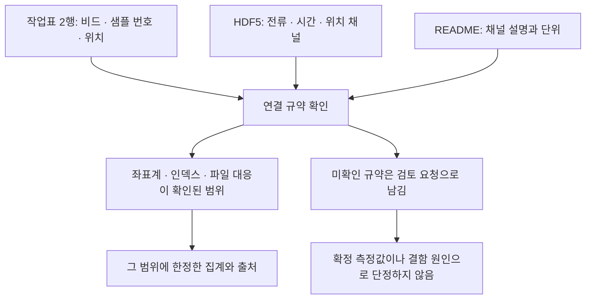

# 용접 측정 자료의 존재와 결함 구간 연결의 차이

기존 Q8에서는 작업표와 코드북으로 명목 전류 450 A를 확인했지만 실제 측정 전류를 확인하지 못했다. 원본 자료를 더 살펴보니 측정 채널은 공개 ZIP에 있었다. 따라서 한계는 “원본에 측정값이 없음”이 아니라 “기존 실험에 측정 파일을 가져오지 않았고 결함 행과 측정 구간의 연결도 검증하지 않음”이다. 기존 답변·백엔드 결과는 그대로 보존했다.

## 원본에서 추가로 확인한 범위

Tapia Suárez 등의 [Submerged Arc Welding Open Repository](https://doi.org/10.5281/zenodo.15083865), CC BY 4.0 자료에서 PP6의 README와 첫 번째 비드 파일 `PP6_01.hdf5`만 가져왔다. 전체 12.7GB ZIP을 내려받지 않았다. 정확한 바이트 범위를 지정한 HTTP 206 응답 6개를 받았고 압축 멤버의 CRC와 개별 파일의 SHA-256을 기록했다. ZIP 전체의 체크섬은 검증하지 않았다.

HDF5 파일은 6,147,189바이트다. `data0`에는 12,306개 행, `data1`에는 530,304개 행이 있다. README는 `current_a`를 DC 전극의 전류, 단위를 A로 설명한다. 이 채널과 코드북의 명목 설정값은 역할이 다르다. 측정 채널을 읽었다고 해서 교정 상태나 특정 결함 구간과의 대응까지 확인한 것은 아니다.

## 연결 전에 남는 해석 조건

| 확인 대상 | 원자료에서 관찰한 내용 | 남겨 둔 검토 사항 |
|---|---|---|
| 상태 인코딩 | README는 boolean으로 설명하며 저장값은 0과 255 | 255를 곧바로 잘못된 값으로 판정하지 않음 |
| 시간 간격 | README의 data0 주파수는 66.7 Hz, 파일의 행 수와 시작·끝 시각으로 계산한 값은 약 116.36행/초 | 일정 주파수나 손상 여부를 단정하지 않음 |
| 테이블 연결 인덱스 | `idx_data1` 값 3개가 data1 행 수 530,304와 같음 | 배열 원소 인덱스인지, 끝을 제외하는 경계인지 확인 필요 |
| 위치 좌표 | 작업표 2행은 106–116 mm, 측정 파일의 x 범위는 546.78–1,312.01 | 좌표 원점·변환 관계 미검증 |
| 측정 구간 | 작업표의 샘플 번호는 66,244–72,493 | 어느 테이블·파일을 가리키는지, 0/1 기준과 끝 포함 여부 미검증 |
| 문서 버전 | 새 측정 파일을 읽어도 적용 검토 문서 버전은 확인되지 않음 | 원본 릴리스와 업무상 적용 버전을 구분 |

이 표의 항목은 오류 목록이 아니다. 명시되지 않은 표현 규약을 좁은 제약으로 고정하면 유효한 표현을 오류로 표시할 수 있어 검토가 필요하다. 예를 들어 상태값을 무조건 0 또는 1로 제한하거나 연결 인덱스를 무조건 행 수보다 작게 제한하는 정책에는 별도 근거가 필요하다.

## 조건부 계산과 검증된 측정의 구분

작업표의 샘플 번호가 해당 파일의 `data1`을 가리킨다고 가정하고 인덱스 시작을 0 또는 1로 두는 경우와 끝을 포함하거나 제외하는 경우를 모두 계산했다. 네 경우는 모두 배열 범위 안에 있었고 평균은 약 456.76–456.78 A였다. 그러나 어느 가정도 선택하거나 승인하지 않았다.

수치가 비슷하다는 이유로 연결이 검증되는 것은 아니다. 네 경우가 가능한 모든 좌표 변환이나 시간 정렬을 포괄하지도 않는다. 따라서 이 평균을 “PP6 결함 구간의 실제 전류”라고 제시하지 않는다. 파일 내부의 조건부 산술 결과로만 보존한다. 결함 원인이나 운전 조치를 추론하지 않았다.

도식의 연결 규약 확인은 필요한 절차다. 이번 작업에서 모든 연결 규약을 확인했다는 뜻은 아니다.

## 기존 연구에 추가되는 의미

Q8의 기존 실험 조건은 작업표와 코드북이다. 이번 HDF5 추가는 새로운 원자료 접근이며 동일한 근거에 SHACL 보고서만 더하는 조건과 섞을 수 없다. 이후 비교에서도 원자료 추가 효과와 검토 보고서 효과를 분리해야 한다.

SHACL의 역할도 좁혀 설명할 수 있다. 도메인 담당자가 승인한 인코딩·단위·좌표·연결 규약이 있으면 그 규약을 검사하고 없으면 어떤 규약이 미확인인지 보고할 수 있다. 규약을 자동으로 사실처럼 만들어 내거나 검증 통과를 물리적 진실로 해석하는 역할은 아니다. 같은 규약의 Python 검사도 비교 대상으로 유지한다.

이번 진단은 선택한 파일 하나를 사전에 살펴본 뒤 수행한 개발 점검이다. 여섯 진단 항목이 실행됐고 실행 실패는 없었다. 별도 해시 불일치 대조에서는 여섯 실패 항목을 모두 남겼다. 이 개수는 정답률이나 독립 표본 수가 아니다. 코드의 내부 실패와 CLI 입력·출력 실패도 구분한다. 독립 검토자는 설계·코드를 검토했으며 생략된 원본 파일의 모든 값을 독립 검증한 것은 아니다.

추가 LLM 호출과 데이터베이스 호출은 모두 0회다. 실행 코드·조건부 계산·출처·실패 기록은 `research/manufacturing-measurement-1/diagnostic-001/`에 보존했다. 원본 HDF5는 로컬 소스 캐시에 남겼다.

## 위치와 표본 번호의 사후 일관성 점검

작업표의 위치를 명목 이동속도로 나눈 뒤 표본화율을 곱하면 표본 번호에 가까워지는지 확인했다. 이는 원자료에 기록된 설정을 읽어 비교한 계산이며 운전 조건의 권고가 아니다. PP6 비드 1의 네 행은 이미 살펴본 개발 자료이고 첫 행에서 관찰한 근사 관계를 보고 가설을 세웠다.

공칭 5,000 Hz, 기록 수를 시간 길이로 나눈 값, 기록 수에서 1을 뺀 뒤 시간 길이로 나눈 값에 각각 내림·가장 가까운 정수·올림과 0·1 오프셋을 조합했다. 18개 가정으로 네 행의 시작·종료점 8개를 비교해 144개를 계산했다. 서로 독립인 144개 실험이 아니다.

8개 지점을 모두 재현한 가정은 없었다. `(N-1)/duration`에 내림과 0 오프셋을 적용한 경우가 가장 가까웠지만 정확히 일치한 지점은 3/8이며 최대 차이는 표본 1개였다. 공칭 5,000 Hz와 0 오프셋은 0/8 일치, 최대 차이 39개였다. 가장 가까운 가정을 검증된 연결 규약으로 선택하지 않았다.

Decimal을 이용한 별도 산술 대조에서 144개 예측값과 18개 요약이 일치했다. 이 대조로 산술 구현을 확인했다. 원 저자의 변환 코드, 실제 위치 변화, 교정, 구간 끝점 포함 여부를 검증한 것은 아니다. 이 단계는 이전 HDF5 검사에서 저장한 시간 요약을 재사용했으며 HDF5를 독립적으로 다시 해석하지 않았다. 원본 워크북 해시는 확인했다. 자료를 읽지 못하는 통제에서는 계획한 144개 실패를 모두 남겼다.

이 후속 가설을 앞서 고정한 LLM 입력이나 답변에 소급 적용하지 않았다. 모든 가정과 결과는 `research/manufacturing-measurement-1/alignment-001/`에 보존했다.

<!-- HUMANIZE-SUMMARY -->
<!--
장르: report · 보수적 light 윤문
적용: C-11 연결어미 뒤 쉼표 6곳 제거, A-15 추상적 설명 구문 1곳 정리.
보존: 제목, 기술 용어, 수치, 출처, Markdown·Mermaid, 가정과 미검증 범위 및 주장 강도.
자체검증: 6항 점검, 미통과 항목 0건. 변경률 확정은 verify_change_rate.py에 위임.
-->
