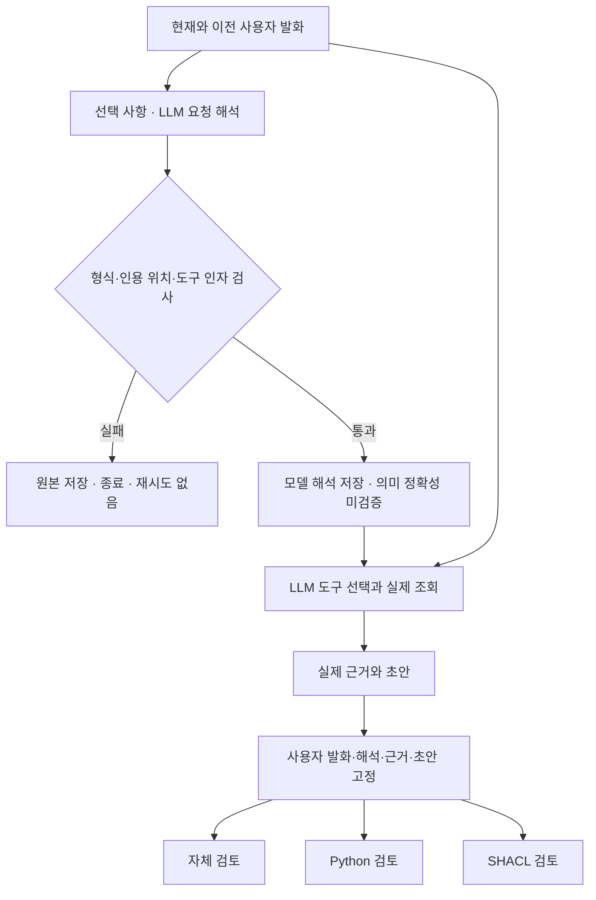

# 복합 제조 요청의 해석과 조회 계획

## 문제와 비교 범위

앞선 실제 실행에서는 LLM이 근거 네 개를 조회한 뒤부터 M01의 자격 충족, M03의 자격 만료, M02의 사용 불가를 올바르게 구분했다. 자체 검토와 보고서 검토 사이에서 추가 오류 수정은 관찰하지 못했다. 이 결과만으로 데이터 규모가 커질 때의 효과를 판단할 수는 없다.

이번에는 한 요청에 목표, 제약, 전해 들은 정보와 후속 변경이 섞인 경우를 다룬다. 예를 들어 “M02가 멈춰서 주문을 다른 설비로 돌리고 싶은데 M01은 바쁘다고 하고, M03은 자격을 갱신했다는 말이 있다”는 요청이다. 후보를 조회하는 것에 앞서 어느 조건을 유지하고 무엇을 미확인으로 남길지 정해야 한다. 이런 요청이 일반적인 사용자 패턴인지는 아직 조사하지 않았다.

## 구현한 해석 단계

화면의 **복합 요청 해석·조회 계획**을 켜면 조회 전에 LLM을 한 번 더 호출한다. 이 단계는 원래 사용자 질문들과 사용 가능한 도구 정의만 받으며 평가 항목이나 정답은 받지 않는다.

| 출력 항목 | 역할 | 검증의 한계 |
|---|---|---|
| 목표 | 사용자가 원하는 결과 | 누락·오해 가능 |
| 제약 | 유지·철회·불확실 조건 구분 | 상태 분류는 모델의 판단 |
| 사용자 보고 | 소문과 현황 진술을 출처 문장에 연결 | 인용이 맞아도 사실로 검증된 것은 아님 |
| 부족한 정보 | 답변에 필요한 미확인 자료 | 모델이 중요한 공백을 놓칠 수 있음 |
| 조회 단계 | 고정 도구, 인자, 선행 단계, 미지원 항목 | 자동 실행 명령이 아닌 참고 계획 |
| 확인 질문 | 판단에 필요한 추가 질문 | 필요성은 별도 평가 대상 |

목표·제약·사용자 보고에는 사용자 발화 번호와 원문 인용을 붙인다. 코드는 인용문이 해당 발화 안에 있는지, JSON 필드가 맞는지, 도구와 인자가 허용되는지, 선행 단계가 앞 단계만 가리키는지 확인한다. **문장을 올바르게 해석했는지와 빠짐없이 읽었는지는 확인하지 않는다.** 실제 인용을 붙여 “배정 변경 금지”를 반대로 해석한 결과도 형식 검사에는 통과할 수 있다. 이를 시험에 포함했다.

원본 해석 출력과 형식 실패를 저장한다. 형식이 틀리면 초안 생성 전에 종료하고 자동 재시도나 평가 정답을 이용한 수정을 하지 않는다. 형식이 맞는 잘못된 해석은 측정할 결과로 남긴다.

해석 단계의 계획을 코드가 자동 실행하지는 않는다. 기존 도구 사용 LLM이 원문, 참고 계획, 실제 조회 결과를 보고 호출 순서와 인자를 결정한다. 계획과 실제 호출은 각각 기록하므로 둘이 어긋난 경우를 사후에 확인할 수 있다. 자동 의미 정합성 채점기는 아직 없다.

## 사용자 보고와 조회 가능한 사실

현재 Neo4j 스냅샷에는 설비·주문·역량·자격 기록이 있다. 일정, 부하, 실제 납기, 갱신 문서 서비스는 없다. 따라서 “M01 일정이 꽉 찼다”는 말은 사용자 보고로 보존하고 DB에서 확인했다고 답하면 안 된다. “M03이 갱신됐다”는 말도 기존 만료 기록을 덮어쓰지 않는다.

이 공백을 SHACL이 채우지는 않는다. 현재 Python·SHACL 검토기는 선택된 후보의 자격 조건만 확인하며 납기·용량이나 사용자 요구 전체를 검증하지 않는다. 이번 구현은 계획의 관찰 가능성을 높이는 작업이다. 일정 최적화나 물리적 배정을 구현한 것은 아니다.

## 후속 대화의 조건 보존

이전에는 바로 앞 질문과 답변을 문맥으로 전달했다. 이제 완료된 실행의 연결을 따라 **원래 사용자 발화만** 최대 여섯 개, 합계 8,000자까지 전달한다. 한도를 넘으면 오래된 제약을 조용히 잘라내는 대신 새 요청으로 정리하도록 오류를 반환한다.

“앞에서는 O18을 하루 늦춰도 된다고 했지만 이제는 안 된다”는 변경도 두 발화를 함께 보존한다. 어느 조건이 철회됐는지는 모델이 해석하며 원문은 남는다. 이전 모델 답변을 재사용하지 않으므로 잘못된 답변을 사실로 굳히는 경로는 줄지만, 이전 답변의 표현을 가리키는 “그 두 후보” 같은 지시는 추가 확인이나 재조회가 필요할 수 있다.

세 갈래 비교 실행에서도 사용자 질문을 이어갈 수 있다. 어느 분기의 답변을 정답으로 선택하는 것은 아니다. 모든 최종 분기에 같은 사용자 발화와 해석을 전달하며 추가 조회나 다른 분기의 답변은 제공하지 않는다. 이는 [이전 구현 일지](2026-11-10-factory-query-tools-and-branches.md)의 비교 실행 후속 질문 제한을 변경한 것이다. 과거 실행 기록은 그대로 둔다.

## 질문 묶음

세 상황에 각각 간결한 명시형, 복합 구어형, 두 차례 후속 대화를 작성했다. 총 **아홉 표현, 열두 사용자 발화**이며 모두 작성한 개발 자료다.

| 상황 | 핵심 질문 | 놓치기 쉬운 점 |
|---|---|---|
| 가용성·갱신 소문·납기 | O17·O18 후보를 비교하되 M01 부하와 M03 갱신 여부를 구분해 달라 | 사용자 보고를 확인된 사실로 바꾸거나 O18 지연 허용을 누락 |
| 후속 제약 철회 | O18 지연 허용을 철회하고 M03을 제외한 선택지를 검토해 달라 | 과거 허용 조건 유지, 제외한 후보 재추천 |
| 갱신 진술과 제품 적용 범위 | 갱신일·적용 제품을 모르는 상황에서 O17·O18에 각각 적용 가능한지 설명해 달라 | 갱신 소문을 확정 사실로 취급, 서로 다른 제품에 같은 자격을 적용 |

간결한 명시형도 필요한 조건은 모두 포함하므로 하나의 원자적 질문은 아니다. 세 표현은 최종적으로 활성화된 요구를 맞추도록 작성했지만 후속 대화에는 과거 상태가 추가된다. 따라서 순수한 문장 길이만의 비교로 해석하지 않는다. 표현별 의미 동등성도 독립 검증이 필요하다.

`research/virtual-factory-llm-1/compound-requests/runtime.json`에는 질문과 스냅샷만 둔다. `evaluation-only.json`에는 별도 평가 기준과 미채점 상태를 둔다. 앱은 두 파일을 읽지 않으며 화면에서 질문을 입력하면 일반 실행 경로를 따른다.

## 평가와 실행 상태

계획 단계에서는 요구 보존, 잘못된 출처 분류, 철회 조건 처리, 미지원 조회 주장과 확인 질문의 필요성을 본다. 최종 답변에서는 핵심 판단, 인용의 뒷받침, 근거 없는 확신, 불필요한 보류, 구체적인 검토 지점을 따로 평가한다. 해석이 틀렸는데 검토기가 정상 실행된 결과도 실패로 남겨야 한다.

해석 단계 끄기·켜기를 비교할 수 있게 했지만 켜면 LLM 호출이 한 번 늘어난다. 기존 조회 상한인 다섯 도구 라운드·열두 도구 호출과 최종 출력 한도는 유지한다. 세 갈래 모드에서 최대 모델 호출은 끄면 아홉 번, 켜면 열 번이다. 이는 비용이 같은 비교가 아니므로 성능 차이가 생겨도 추가 계산과 해석 구조를 분리해 검토해야 한다. 시간·비용·실패를 함께 기록하고 기존 실행과 바뀐 프롬프트를 직접 동일 조건으로 비교하지 않는다.

이번 단계는 코드, 질문 묶음과 모의 소프트웨어 검증을 준비한다. 새 유료 실행 게이트는 열지 않았고 복합 질문의 실제 모델 결과는 아직 없다. 자연 발생 오류율, 일정 충족, SHACL의 추가 개선 효과를 주장하지 않는다.
